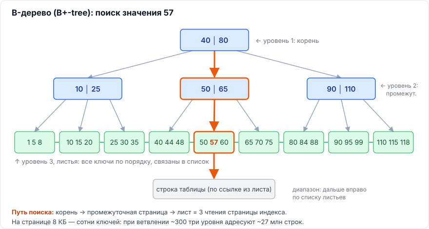

# Индексы в MS SQL Server и PostgreSQL применительно к 1С

Методичка для подготовки к аттестации **«Работа с индексами»**: индексы в SQL применительно к платформе 1С:Предприятие 8 на обеих СУБД — MS SQL Server и PostgreSQL.

Каждый вопрос разобран по одной схеме:

> **Коротко** — ответ на 30–60 секунд, его и стоит говорить на аттестации.

Затем — подробное объяснение со схемами, примерами SQL, разделом **«Применительно к 1С»** и блоком **«Запомнить»**.

Вопросы из примеров аттестации помечены **★**.



---

## Как пользоваться

1. **Первый проход** — читать главы по порядку: каждая следующая опирается на предыдущую.
2. **Повторение** — [шпаргалка](docs/07-shpargalka.md): все короткие ответы, сравнительная таблица MS SQL / PostgreSQL, числа и словарик.
3. **Практика** — [скрипты](sql/) для MS SQL и PostgreSQL: запустить на тестовой базе и посмотреть на свои индексы.

---

## Оглавление

### [Глава 1. Общая теория индексов](docs/01-teoriya.md)
- 1.1. Что такое индекс, задачи и цена
- 1.2. Устройство B-дерева, почему поиск логарифмический
- 1.3. Селективность и кардинальность
- 1.4. Почему индекс по малоселективному (булеву) полю может не использоваться
- 1.5. Порядок колонок в составном индексе, правило левого префикса
- 1.6. Покрывающий индекс и `INCLUDE`
- 1.7. Уникальный индекс и ограничение уникальности
- 1.8. Индексы, блокировки и взаимоблокировки

### [Глава 2. MS SQL Server](docs/02-mssql.md)
- Основа: кластерный индекс, некластерный индекс, куча
- 2.1. Ограничения на ключ индекса
- 2.2. ★ Fill factor и page split
- 2.3. Фрагментация, `REORGANIZE` и `REBUILD`, новый подход Microsoft к порогам
- 2.4. `sys.dm_db_index_usage_stats` и `sys.dm_db_missing_index_*`
- 2.5. Columnstore и rowstore
- 2.6. Фильтруемые индексы и сжатие данных

### [Глава 3. PostgreSQL](docs/03-postgresql.md)
- 3.1. Типы индексов: B-tree, Hash, GiST, SP-GiST, GIN, BRIN
- 3.2. Почему нет кластерного индекса и что делает `CLUSTER`
- 3.3. MVCC, HOT-обновления и раздувание
- 3.4. `fillfactor` для таблицы и индекса, отличия от MS SQL
- 3.5. `VACUUM` и autovacuum; `REINDEX` и `REINDEX CONCURRENTLY`
- 3.6. Фрагментация и раздувание — как отличить
- 3.7. Неиспользуемые индексы и тяжёлые запросы

### [Глава 4. Секционирование и индексы](docs/04-sekcionirovanie.md)
- 4.1. ★ Индексы и секционирование в MS SQL: выровненные индексы, `SWITCH`, partition elimination
- 4.2. Секционирование и операция Seek
- 4.3. Скользящее окно: `SPLIT`, `MERGE`, `SWITCH`
- 4.4. Глобальные и локальные индексы
- 4.5. Секционирование в PostgreSQL и уникальность
- Секционирование и 1С

### [Глава 5. Индексы в 1С:Предприятии](docs/05-1c.md)
- 5.1. Какие индексы создаёт платформа
- 5.2. ★ Рекомендации при создании индексов объектов метаданных
- 5.3. 1С на PostgreSQL: `mvarchar`/`mchar`, регистронезависимость, `online_analyze`
- 5.4. Различия MS SQL и PostgreSQL, важные для 1С

### [Глава 6. Обслуживание и диагностика](docs/06-obsluzhivanie-diagnostika.md)
- 6.1. Регламент обслуживания индексов и статистики
- 6.2. Как найти медленный запрос и связанный индекс
- 6.3. Кейс: тормозит отчёт по регистру

### [Шпаргалка](docs/07-shpargalka.md) · [Источники](docs/08-istochniki.md)

---

## Скрипты

| Файл | Что делает |
|---|---|
| [sql/mssql/01_index_usage.sql](sql/mssql/01_index_usage.sql) | Использование индексов, кандидаты на удаление |
| [sql/mssql/02_missing_indexes.sql](sql/mssql/02_missing_indexes.sql) | Недостающие индексы с оценкой выгоды |
| [sql/mssql/03_fragmentation.sql](sql/mssql/03_fragmentation.sql) | Фрагментация и плотность страниц |
| [sql/mssql/04_index_maintenance.sql](sql/mssql/04_index_maintenance.sql) | Выборочное обслуживание индексов и статистики |
| [sql/mssql/05_top_queries.sql](sql/mssql/05_top_queries.sql) | Тяжёлые запросы из кэша планов |
| [sql/mssql/06_partitioning_sliding_window.sql](sql/mssql/06_partitioning_sliding_window.sql) | Секционирование и скользящее окно |
| [sql/postgresql/01_unused_indexes.sql](sql/postgresql/01_unused_indexes.sql) | Неиспользуемые и дублирующиеся индексы |
| [sql/postgresql/02_bloat_pgstattuple.sql](sql/postgresql/02_bloat_pgstattuple.sql) | Раздувание и фрагментация (`pgstattuple`) |
| [sql/postgresql/03_top_queries.sql](sql/postgresql/03_top_queries.sql) | Тяжёлые запросы (`pg_stat_statements`), активные запросы |
| [sql/postgresql/04_vacuum_hot.sql](sql/postgresql/04_vacuum_hot.sql) | Мёртвые строки, autovacuum, доля HOT, долгие транзакции |
| [sql/postgresql/05_invalid_indexes_reindex.sql](sql/postgresql/05_invalid_indexes_reindex.sql) | Невалидные индексы, `REINDEX CONCURRENTLY` |
| [sql/postgresql/06_partitioning.sql](sql/postgresql/06_partitioning.sql) | Декларативное секционирование и уникальность |
| [sql/1c/logcfg.xml](sql/1c/logcfg.xml) | Технологический журнал: медленные запросы с планами |
| [sql/1c/storage_structure.bsl](sql/1c/storage_structure.bsl) | Физические имена таблиц и индексов → метаданные |

Скрипты только читают системные представления, кроме явно помеченных блоков обслуживания. Запускайте на тестовой базе.

---

## Структура репозитория

```
├── README.md
├── docs/            главы методички, шпаргалка, источники
├── images/          схемы (SVG)
└── sql/
    ├── mssql/       скрипты для MS SQL Server
    ├── postgresql/  скрипты для PostgreSQL
    └── 1c/          технологический журнал и код 1С
```

---

## О точности

Основа ответов подготовлена в NotebookLM по опорным материалам, затем проверена и дополнена. Места, где исходные ответы устарели или были неточны, помечены в тексте **«⚠️ Поправка»**:

- лимиты ключа индекса MS SQL — 1700 байт / 32 колонки для некластерных индексов с SQL Server 2016, а не 900 / 16;
- `pg_stat_statements`: с PostgreSQL 13 — `total_exec_time`, а не `total_time`;
- `REINDEX` без `CONCURRENTLY` блокирует и сам индекс, а не только запись в таблицу;
- значения `fillfactor` по умолчанию для индексов PostgreSQL;
- длина индексируемых строк в 1С считается от лимита ключа, а не по правилу «100–150 символов»;
- `DBCC DBREINDEX` + `sp_msforeachtable` — устаревший способ обслуживания.

Версии, на которые ориентирован текст: SQL Server 2016–2022, PostgreSQL 13–18, платформа 1С:Предприятие 8.3. Поведение конкретной базы проверяйте на ней самой: состав индексов — через `ПолучитьСтруктуруХраненияБазыДанных()`, планы — через технологический журнал или `EXPLAIN`.
