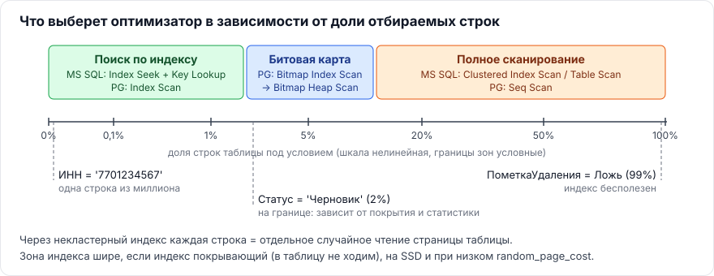
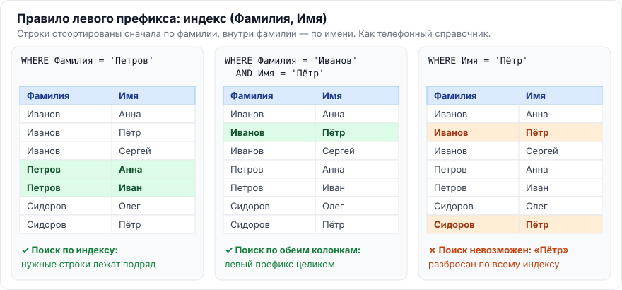
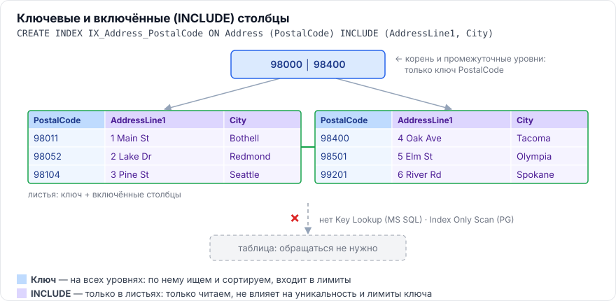

# Глава 1. Общая теория индексов

[← Оглавление](../README.md) · [Глава 2. MS SQL Server →](02-mssql.md)

Эта глава — фундамент. Всё, что дальше говорится про MS SQL, PostgreSQL и 1С, опирается на четыре идеи:

1. Индекс — это **отсортированная копия части данных** со ссылками на строки.
2. Почти всегда это **B-дерево**: поиск в нём занимает 3–4 чтения страницы даже на миллионах строк.
3. Оптимизатор выбирает индекс **по стоимости**, а стоимость считает **по статистике**.
4. Индекс ускоряет чтение, но **каждая запись платит** за его поддержку.

---

## 1.1. Что такое индекс, какие задачи он решает и чем за это приходится платить

> **Коротко.** Индекс — отдельная структура (обычно B-дерево), где значения ключевых колонок хранятся отсортированными вместе со ссылками на строки таблицы. Он ускоряет поиск, сортировку, соединения и проверку уникальности, а также сужает блокировки. Платим за это замедлением записи (каждый `INSERT/UPDATE/DELETE` правит все затронутые индексы), местом на диске и в памяти, временем обслуживания.

### Аналогия

Предметный указатель в конце книги. Чтобы найти слово «фрагментация», вы не листаете все 500 страниц (это **полное сканирование**), а открываете указатель: слова в нём отсортированы, рядом номера страниц (это **ссылки на строки**). Но если издатель добавит в книгу главу, указатель придётся переделать — это **цена записи**.

### Какие задачи решает индекс

| Задача | Как помогает индекс | Пример |
|---|---|---|
| Поиск по условию | Спуск по дереву к нужному значению вместо чтения всей таблицы | `WHERE ИНН = '7701234567'` |
| Поиск диапазона | Нашли начало диапазона — идём по листьям вправо | `WHERE Дата BETWEEN ...` |
| Сортировка и группировка | Данные в индексе уже упорядочены — шаг `Sort` не нужен | `ORDER BY Дата` |
| Соединения | Для каждой строки внешней таблицы быстро находим пару | `JOIN ... ON Ссылка = Владелец` |
| Уникальность | Проверка «есть ли уже такое значение» — один поиск в дереве | `PRIMARY KEY`, `UNIQUE` |
| Блокировки | Блокируются только найденные строки, а не вся просмотренная таблица | точечный `UPDATE` |

### Чем приходится платить

**1. Запись становится дороже.**
- Каждый `INSERT` и `DELETE` изменяет **все** индексы таблицы, каждый `UPDATE` — те, чьи колонки поменялись (в PostgreSQL часто все — см. [3.3](03-postgresql.md#33-как-mvcc-влияет-на-индексы-что-такое-hot-обновления-и-раздувание-bloat)).
- Вставка в заполненную страницу индекса вызывает **расщепление страницы** (page split) — лишний ввод-вывод и фрагментация.

**2. Место на диске и в памяти.**
- Каждый индекс хранится отдельно. Широкие индексы (много колонок, `INCLUDE`) в сумме легко превышают размер самой таблицы.
- Индексы читаются через буферный кэш: лишний индекс вытесняет из памяти полезные данные.
- Растут бэкапы, время восстановления и реструктуризации.

**3. Обслуживание.**
- Перестроение и реорганизация (`REBUILD`, `REORGANIZE`, `REINDEX`).
- Обновление статистики (`UPDATE STATISTICS`, `ANALYZE`).
- В PostgreSQL — очистка ссылок на мёртвые версии строк (`VACUUM`).

### Применительно к 1С

Галочка «Индексировать» у реквизита — это ещё один индекс на таблице. Если у документа 10 проиндексированных реквизитов, каждое его проведение пишет в 10+ индексов. Поэтому индексируют только то, по чему **реально** ищут и отбирают.

> **Запомнить:** индекс — компромисс «быстрое чтение ↔ медленная запись + место + обслуживание». Хороший индекс тот, что окупается.

---

## 1.2. Как устроено B-дерево. Почему поиск логарифмический

> **Коротко.** B-дерево (точнее, B+-дерево) — сбалансированное дерево из страниц по 8 КБ: корень → промежуточные уровни → листья. Промежуточные страницы хранят только «указатели-маршруты», листья — все ключи по порядку и связаны в двусвязный список. На странице помещаются сотни ключей, поэтому каждый уровень сужает поиск в сотни раз: глубина растёт как логарифм числа строк, и для десятков миллионов строк хватает 3–4 уровней.


### Уровни дерева

| Уровень | Что хранит | Зачем |
|---|---|---|
| **Корень** (root) | Граничные значения ключей + ссылки на страницы следующего уровня | Точка входа в любой поиск. В PostgreSQL номер корневой страницы хранится в метастранице индекса |
| **Промежуточные** (intermediate / internal) | То же: «ключ-граница → дочерняя страница». На строки таблицы **не ссылаются** | Маршрутизация: сравнили искомое значение с границами — поняли, в какую ветку спускаться |
| **Листья** (leaf) | **Все** ключи в отсортированном порядке + ссылка на строку | В некластерном индексе — ключ + адрес строки (RID / ключ кластерного индекса в MS SQL, TID/ctid в PG). В кластерном индексе MS SQL листья — **это и есть строки таблицы** |

Листовые страницы связаны в список «влево-вправо». Поэтому поиск диапазона работает так: спустились к началу диапазона один раз, дальше просто идём по цепочке листьев, не возвращаясь к корню. Так же индекс отдаёт данные в отсортированном виде для `ORDER BY` — в обе стороны.

### Почему поиск логарифмический

1. **Сбалансированность.** Все листья на одной глубине: путь к любой строке одинаковой длины.
2. **Большой коэффициент ветвления.** Узел — целая страница 8 КБ. При ключе ~20–30 байт в ней помещается ~300 ссылок, а не 2, как в двоичном дереве.
3. **Каждый уровень отбрасывает почти всё.** Спуск на уровень вниз сужает область поиска примерно в B раз (B — ветвление). Глубина: `h ≈ log_B(N)`.
4. **Внутри страницы — двоичный поиск**, ключи на странице отсортированы.

**Посчитаем** при ветвлении B ≈ 300:

| Уровней | Сколько строк можно адресовать |
|---|---|
| 1 (корень = лист) | ~300 |
| 2 | ~90 000 |
| 3 | ~27 000 000 |
| 4 | ~8 100 000 000 |

То есть найти одну строку среди 27 млн — это **3 чтения страниц индекса** (+1 чтение страницы таблицы). Корень и верхние уровни почти всегда лежат в кэше, так что реальных обращений к диску ещё меньше.

> **Запомнить:** B-дерево = сбалансированность + огромное ветвление → глубина 3–4 уровня. Листья связаны списком → диапазоны и сортировка «бесплатно».

---

## 1.3. Что такое селективность и кардинальность

> **Коротко.** **Селективность** — доля строк, которые проходят условие (от 0 до 1). Чем она меньше, тем «избирательнее» условие и тем выгоднее индекс. **Кардинальность** — количество строк: на выходе узла плана (сколько строк вернёт шаг) или число различных значений в колонке. Оптимизатор считает: кардинальность = входящие строки × селективность — и по этой оценке выбирает план. Устаревшая статистика → неверная оценка → плохой план.

### Селективность

**Селективность** — какая доля таблицы попадает под условие.

| Условие | Селективность | Что сделает оптимизатор |
|---|---|---|
| `WHERE ИНН = '7701234567'` | ~0,000001 (одна строка из миллиона) | Поиск по индексу (Index Seek) |
| `WHERE Статус = 'Черновик'` (2% строк) | 0,02 | Скорее индекс, зависит от того, нужно ли идти в таблицу |
| `WHERE ПометкаУдаления = Ложь` (99% строк) | 0,99 | Полное сканирование, индекс бесполезен |

> ⚠️ **Путаница в терминах.** «Высокая селективность» в разговорной речи = «условие отбирает **мало** строк» (числовое значение при этом **маленькое**). На аттестации лучше говорить однозначно: «условие отбирает малую долю строк».

### Кардинальность

Термин используют в двух смыслах:

1. **Кардинальность узла плана** — сколько строк придёт из этого шага. Её показывает план: `Estimated Number of Rows` в MS SQL, `rows=` в `EXPLAIN` PostgreSQL.
2. **Кардинальность колонки** — сколько в ней **различных** значений. У булевой колонки — 2, у ИНН — почти столько, сколько строк. В PostgreSQL это `n_distinct` в `pg_stats`.

### Как они связаны

```
Кардинальность узла = Число входящих строк × Селективность условия
```

Пример: в таблице 100 000 строк, `WHERE Статус = 'Активен'` по статистике отбирает 2% → оценка = 100 000 × 0,02 = **2 000 строк**.

### Откуда оптимизатор знает селективность — статистика

| | MS SQL Server | PostgreSQL |
|---|---|---|
| Что хранится | Гистограмма до 200 шагов + плотность (density) по колонкам/префиксам индекса | `pg_stats`: частые значения и их частоты (`most_common_vals/freqs`), гистограмма (`histogram_bounds`), `n_distinct`, `correlation` |
| Как обновляется | Автообновление при изменении ~20% строк (в новых версиях порог динамический) + `UPDATE STATISTICS` | `autovacuum` запускает `ANALYZE` по порогу + ручной `ANALYZE` |
| Точность | `WITH FULLSCAN` / `SAMPLE n PERCENT` | `default_statistics_target` (по умолчанию 100) или `ALTER TABLE ... ALTER COLUMN ... SET STATISTICS` |

Если статистика устарела, оптимизатор ошибается в оценке. Типичный результат: ожидал 10 строк, а пришло 500 000 → выбрал вложенные циклы (`Nested Loops`) с поиском по индексу на каждую строку, хотя нужно было соединение хешированием (`Hash Join`) со сканированием.

> **Запомнить:** селективность — доля, кардинальность — количество. Оптимизатор выбирает индекс по **оценке** кардинальности, а оценку берёт из **статистики**.

---

## 1.4. Почему индекс по малоселективному полю может не использоваться (на примере булева поля)

> **Коротко.** Если условие отбирает большую долю строк, путь через некластерный индекс дороже полного сканирования: на каждую найденную строку нужно отдельное «случайное» чтение страницы таблицы (Key Lookup / обращение к куче), а полное сканирование читает страницы подряд. Оптимизатор считает стоимость и выбирает сканирование. Исключения: сильный перекос значений (ищем редкое), фильтруемый/частичный индекс, покрывающий индекс, составной индекс, где такое поле — не первое.

### Почему индекс проигрывает — на цифрах

Таблица: 1 000 000 строк, на странице ~100 строк → **10 000 страниц**.
Запрос отбирает всего **5%** = 50 000 строк, и ему нужны колонки, которых нет в индексе.

| Способ | Что читаем | Сколько чтений |
|---|---|---|
| Через индекс | Листья индекса (немного) + **по одному случайному чтению страницы таблицы на каждую строку** | ~50 000 случайных чтений |
| Полное сканирование | Все страницы таблицы подряд | 10 000 последовательных чтений |

Даже при 5% строк индекс проигрывает в 5 раз. А булево поле отбирает 50–99%.



### Стратегии по мере роста доли строк

- **MS SQL Server:** `Index Seek` + `Key Lookup` (или `RID Lookup` для кучи) → при большой доле строк `Clustered Index Scan` / `Table Scan`. Точку перехода называют tipping point — обычно это **единицы процентов** строк, а не 30–50%, как часто думают.
- **PostgreSQL:**
  1. `Index Scan` — при очень малой доле строк;
  2. `Bitmap Index Scan` + `Bitmap Heap Scan` — при средней: сначала собирает из индекса битовую карту нужных страниц, затем читает страницы таблицы **в физическом порядке**, каждую один раз;
  3. `Seq Scan` — при большой доле.

  Стоимость в модели оптимизатора задают параметры `seq_page_cost` (1) и `random_page_cost` (4 по умолчанию; на SSD обычно ставят 1,1–1,5 — тогда индекс выбирается охотнее).

### Почему такой индекс ещё и вреден

Он не ускоряет чтение, но **замедляет каждую запись**, занимает диск и кэш.

### Когда индекс по малоселективному полю всё же полезен

1. **Перекос данных (data skew).** `Флаг = Истина` только у 0,1% строк — запрос именно по редкому значению очень селективен. Статистика (гистограмма / `most_common_vals`) это видит.
2. **Фильтруемый (MS SQL) / частичный (PG) индекс** — индексируем только редкие строки:
   ```sql
   -- MS SQL
   CREATE INDEX IX_Orders_Processing ON Orders(OrderDate) WHERE Status = 'Processing';
   -- PostgreSQL
   CREATE INDEX ix_orders_processing ON orders(order_date) WHERE status = 'Processing';
   ```
3. **Покрывающий индекс.** Все нужные колонки есть в индексе — обращения к таблице не нужны, остаётся читать только компактный индекс.
4. **Составной индекс.** Малоселективное поле — одна из колонок ключа (лучше не первая), а комбинация колонок даёт высокую избирательность.

### Применительно к 1С

- Не индексируйте `Булево`, перечисления с 2–3 значениями, `ПометкаУдаления`, `Проведен` — это прямо есть в методических рекомендациях 1С.
- Исключение: например, реквизит «Требует обработки», где `Истина` у единиц процентов документов, а регламентное задание ищет именно их.
- Фильтруемые индексы средствами конфигуратора создать нельзя — платформа их не поддерживает.

> **Запомнить:** индекс выгоден, когда условие отбирает **малую** долю строк. Для булева поля это почти никогда не так — кроме сильного перекоса.

---

## 1.5. Как порядок колонок в составном индексе влияет на его применимость. Правило левого префикса

> **Коротко.** Составной B-tree индекс `(A, B, C)` отсортирован сначала по A, внутри одинаковых A — по B, внутри — по C. Поэтому быстрый спуск по дереву возможен только по **левому префиксу**: `A`, `A+B`, `A+B+C`. Условие только по `B` или `C` индекс для поиска использовать не может (только полный просмотр индекса). Равенства ставят первыми, диапазон — последним: после колонки с диапазоном следующие колонки уже не сужают поиск. Порядок колонок также определяет, какой `ORDER BY` индекс отдаёт без сортировки.

### Аналогия — телефонный справочник

Справочник отсортирован по `(Фамилия, Имя)`.
- Найти всех «Ивановых» — легко.
- Найти «Иванов Пётр» — ещё легче.
- Найти всех «Петров» (только по имени) — придётся листать весь справочник.



### Какие условия работают с индексом `(A, B, C)`

| Условие | Как используется индекс |
|---|---|
| `A = 1` | Поиск (Seek) по A |
| `A = 1 AND B = 2` | Поиск по A и B |
| `A = 1 AND B = 2 AND C = 3` | Поиск по всем трём |
| `B = 2` или `C = 3` | **Поиск невозможен** — нет ведущей колонки. Только полный просмотр индекса или таблицы |
| `A = 1 AND C = 3` («дыра» на B) | Поиск по A, условие на C — фильтр внутри найденного диапазона |
| `A = 1 AND B > 10 AND C = 3` | Поиск по A и диапазону B. **C поиск уже не сужает** — проверяется как фильтр |

### Правило: равенства — первыми, диапазон — последним

Для запроса `WHERE Склад = @склад AND Период BETWEEN @н AND @к` правильный индекс — `(Склад, Период)`, а не `(Период, Склад)`:
- `(Склад, Период)`: все строки одного склада лежат рядом и уже отсортированы по периоду → один спуск и чтение подряд.
- `(Период, Склад)`: внутри диапазона периодов строки разных складов перемешаны → придётся просмотреть весь диапазон периодов и отфильтровать.

### Порядок колонок и сортировка

- Индекс `(A, B)` отдаёт `ORDER BY A, B` (и `ORDER BY A DESC, B DESC`) без шага `Sort`.
- `ORDER BY B, A` — уже нет (если только A не зафиксирован условием `A = константа`).
- Смешанное направление `ORDER BY A ASC, B DESC` требует индекса `(A ASC, B DESC)`.

### Особенности СУБД

- **Skip scan.** В PostgreSQL **18** появился skip scan для B-tree: при условии только на B индекс можно использовать, если у A мало различных значений (СУБД «перепрыгивает» по значениям A). В MS SQL Server такого нет. На старых версиях PG и в MS SQL правило левого префикса действует строго.
- **GIN и BRIN** (PostgreSQL): порядок колонок в составном индексе **не важен** — индекс одинаково работает с любым подмножеством колонок.

### Применительно к 1С

- Основные индексы регистров строятся по **порядку измерений в конфигураторе**. Отбор по измерению, которое стоит не первым, не использует основной индекс (подробнее в [5.2](05-1c.md#52--какие-рекомендации-можно-дать-при-создании-индексов-объектов-метаданных-в-1с)).
- Отбор в запросе лучше передавать в **параметры виртуальной таблицы**: тогда условие попадает внутрь подзапроса к таблице итогов, а не накладывается на уже собранный результат.

> **Запомнить:** индекс `(A,B,C)` = справочник по «Фамилия, Имя, Отчество». Ищется по левому префиксу; равенства слева, диапазон справа.

---

## 1.6. Что такое покрывающий индекс и зачем нужны включённые столбцы (INCLUDE)

> **Коротко.** Покрывающий индекс содержит **все** колонки, нужные запросу (в условиях, соединениях, сортировке и в `SELECT`), поэтому СУБД не обращается к таблице: в MS SQL исчезает `Key Lookup`, в PostgreSQL получается `Index Only Scan`. `INCLUDE` добавляет колонки **только в листья**: они не участвуют в поиске и сортировке, не входят в лимиты ключа и не влияют на уникальность, но делают индекс покрывающим без раздувания верхних уровней дерева.



### Как это выглядит

Запрос:
```sql
SELECT AddressLine1, City, PostalCode
FROM Person.Address
WHERE PostalCode BETWEEN '98000' AND '99999';
```

Индекс только по `PostalCode` → для каждой найденной строки `Key Lookup` за `AddressLine1` и `City`. Покрывающий индекс:

```sql
CREATE INDEX IX_Address_PostalCode
ON Person.Address (PostalCode)          -- ключ: по нему ищем
INCLUDE (AddressLine1, City);           -- только в листьях: просто отдаём
```

### Зачем `INCLUDE`, а не просто добавить колонки в ключ

1. **Уникальность не меняется.** `CREATE UNIQUE INDEX ... (Email) INCLUDE (Name)` проверяет уникальность только по `Email`. Если добавить `Name` в ключ — уникальной станет пара, это другое правило.
2. **Компактные верхние уровни.** Включённые колонки есть только в листьях → на промежуточных страницах больше ссылок → дерево ниже.
3. **Обход лимитов ключа.** В MS SQL включённые колонки не считаются в лимиты (900/1700 байт, 32 колонки) и могут иметь типы, недопустимые в ключе (`nvarchar(max)` и т.п.).
4. **Дешевле поддерживать порядок.** Включённые колонки не участвуют в сортировке.

### Чем платим

- Данные дублируются в индексе → больше диска и памяти.
- Любое изменение включённой колонки → изменение индекса.
- По включённым колонкам **нельзя искать**, только читать.

### Версии и особенности

| | MS SQL Server | PostgreSQL |
|---|---|---|
| `INCLUDE` | С SQL Server 2005 | С PostgreSQL 11 (B-tree), GiST — с 12, SP-GiST — с 14 |
| Название в плане | `Index Seek` / `Index Scan` без `Key Lookup` | `Index Only Scan` |
| Нюанс | Кластерный индекс покрывает всё всегда — в его листьях вся строка | `Index Only Scan` реально не ходит в таблицу, только если страница помечена «всё видимо» в **карте видимости** (visibility map). Карту обновляет `VACUUM`. Строка плана `Heap Fetches: N` — сколько раз всё-таки пришлось сходить в таблицу |

### Применительно к 1С

Платформа не создаёт индексы с `INCLUDE`. Эффект «покрытия» в 1С достигается иначе:
- кластерный индекс в MS SQL содержит все колонки строки;
- «Индексировать с доп. упорядочиванием» добавляет в ключ код/наименование/дату — индекс покрывает типичный динамический список с отбором по реквизиту.

В планах запросов 1С на MS SQL `Key Lookup` — частая находка. Это сигнал: индекс находит строки, но ему не хватает колонок.

> **Запомнить:** покрывающий = «всё нужное есть в индексе, в таблицу не ходим». `INCLUDE` = «положить в листья для чтения, но не для поиска».

---

## 1.7. Что такое уникальный индекс и чем он отличается от ограничения уникальности

> **Коротко.** Ограничение `UNIQUE` / `PRIMARY KEY` — **логическое правило** схемы («значения не повторяются»). Уникальный индекс — **физический механизм**, которым СУБД это правило проверяет: при создании ограничения индекс создаётся автоматически. Уникальный индекс можно создать и без ограничения — дубликаты тоже будут запрещены. Индекс при этом гибче: допускает `INCLUDE` и фильтр `WHERE` (уникальность только среди части строк).

### Сравнение

| | Ограничение UNIQUE / PRIMARY KEY | Уникальный индекс |
|---|---|---|
| Что это | Декларация бизнес-правила в схеме | Структура данных (B-дерево) |
| Создаётся | `ALTER TABLE ... ADD CONSTRAINT ... UNIQUE` | `CREATE UNIQUE INDEX ...` |
| Связь | Автоматически создаёт уникальный индекс | Может существовать без ограничения |
| Видно в метаданных как ограничение | Да | Нет, только как индекс |
| `INCLUDE` | MS SQL — нет; PostgreSQL — да (с версии 11) | Да |
| Фильтр `WHERE` | Нет | Да (фильтруемый / частичный уникальный индекс) |
| Удаление | Удаляется ограничение (индекс уходит вместе с ним) | `DROP INDEX` |

### Как обрабатываются NULL — частый вопрос

| | Поведение |
|---|---|
| **MS SQL Server** | NULL считаются **равными**: в колонке с уникальным индексом допускается только **один** NULL. Обходной путь: фильтруемый уникальный индекс `WHERE col IS NOT NULL` |
| **PostgreSQL** | NULL по умолчанию **различны**: допускается сколько угодно NULL. С PostgreSQL 15 можно указать `UNIQUE NULLS NOT DISTINCT` |

### На секционированной таблице

Уникальность — свойство всей таблицы, а проверяют её локальные индексы на каждой секции. Поэтому ключ секционирования обязан входить в уникальный ключ (подробнее — [глава 4](04-sekcionirovanie.md)).

### Применительно к 1С

- Платформа **не использует** ограничения `FOREIGN KEY` и почти не опирается на ограничения уникальности СУБД.
- Уникальность ссылки обеспечивает уникальный индекс по `Ссылка` (`_IDRRef`).
- «Контроль уникальности» кода справочника и номера документа выполняет **сама платформа**, а не СУБД. Индекс «по коду» в базе — это `Код + Ссылка`, сам по себе он дубли кода не запрещает.

> **Запомнить:** ограничение — «что должно быть», индекс — «чем это обеспечено». Индекс гибче (`INCLUDE`, `WHERE`).

---

## 1.8. Как индексы влияют на блокировки и взаимоблокировки

> **Коротко.** С подходящим индексом СУБД находит и блокирует **только нужные строки**. Без индекса она сканирует таблицу и блокирует (или проверяет) много лишнего: в MS SQL это ведёт к **эскалации** до блокировки всей таблицы, на уровне `SERIALIZABLE` — к широким **диапазонным блокировкам** (key-range в MS SQL, предикатные блокировки SSI в PostgreSQL). Индексы уменьшают время и область блокировок и этим снижают число взаимоблокировок. Но могут и провоцировать их: разный порядок обхода строк разными индексами, обновление проиндексированных колонок, повышение блокировки S→X.

### 1. Область блокировок

- **Нет индекса** → `Table Scan` / `Seq Scan`. Чтобы обновить одну строку, MS SQL читает и блокирует (`U`-блокировки) множество строк и страниц по пути. Параллельные транзакции ждут.
- **Есть индекс** → `Index Seek`. Блокируется ровно то, что попало под условие.

### 2. Диапазонные блокировки (защита от фантомов)

На уровне изоляции `SERIALIZABLE` нужно, чтобы другая транзакция не вставила строку, подпадающую под условие:
- **MS SQL Server — key-range locks.** Блокируются не только ключи, но и **промежутки между ключами** в индексе. Без подходящего индекса «промежутком» становится вся таблица.
- **PostgreSQL — предикатные блокировки SSI** (`SIReadLock`). При чтении через B-tree блокируются прочитанные строки и **листовые страницы индекса**. При `Seq Scan` — **вся таблица**, что ведёт к массовым ложным ошибкам сериализации (`could not serialize access`).

### 3. Эскалация блокировок

- **MS SQL Server:** когда один оператор набирает примерно **5 000 блокировок** на одном объекте (или кончается память под блокировки), СУБД заменяет их одной блокировкой таблицы (или секции, если `LOCK_ESCALATION = AUTO`). Запрос без индекса, обновляющий «немного» строк, но сканирующий всю таблицу, легко доходит до эскалации.
- **PostgreSQL:** блокировки строк хранятся прямо в версиях строк (в заголовке), поэтому **эскалации строковых блокировок нет**. Укрупняются только предикатные блокировки SSI (параметры `max_pred_locks_per_relation`, `max_pred_locks_per_page`).

### 4. Взаимоблокировки (deadlocks)

**Индексы помогают:** запросы короче → блокировки держатся меньше; области блокировок пересекаются реже.

**Индексы могут мешать:**
1. **Разный порядок обхода.** Транзакция 1 обновляет строки по индексу `ID ASC`, транзакция 2 — по индексу `Сумма DESC`. Они захватывают одни и те же строки в разном порядке → взаимоблокировка.
2. **Обновление проиндексированных колонок.** Блокируется ключ и в таблице, и в каждом затронутом индексе — ресурсов больше.
3. **Повышение режима S → X.** Две транзакции прочитали строку с удержанием `S`, затем обе хотят её изменить (`X`) — каждая ждёт другую.

### Применительно к 1С

- Классическая проблема 1С на MS SQL: запрос в транзакции проведения (например, контроль остатков) без подходящего индекса сканирует таблицу итогов регистра → эскалация → **блокировка всей таблицы** → у остальных «Конфликт блокировок при выполнении транзакции».
- В режиме **управляемых блокировок** основную работу берёт на себя менеджер блокировок 1С, а на MS SQL используется изоляция `READ COMMITTED SNAPSHOT`. Но блокировки изменяемых данных в СУБД никуда не деваются, и неудачный план по-прежнему может их расширить.
- Профилактика: правильный порядок измерений, отборы в параметрах виртуальных таблиц, одинаковый порядок захвата ресурсов в разных операциях (например, заранее устанавливаемая управляемая блокировка).

> **Запомнить:** хороший индекс = узкие и короткие блокировки. Без индекса → сканирование → много блокировок → эскалация (MS SQL) или блокировка всей таблицы в SSI (PG).

---

[← Оглавление](../README.md) · [Глава 2. MS SQL Server →](02-mssql.md)
