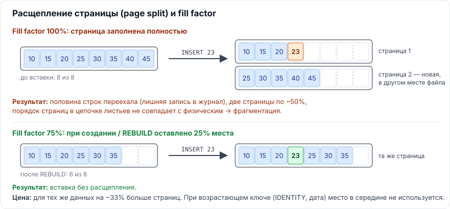
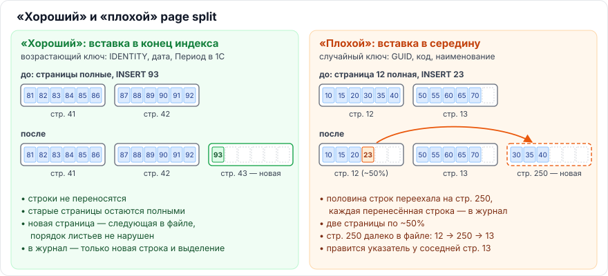
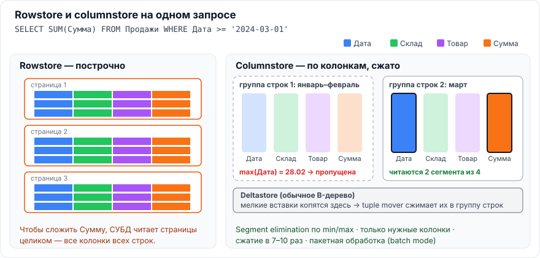

# Глава 2. MS SQL Server

[← Глава 1. Теория](01-teoriya.md) · [Оглавление](../README.md) · [Глава 3. PostgreSQL →](03-postgresql.md)

---

## Основа главы: кластерный индекс, некластерный индекс и куча

Вопроса об этом в списке нет, но без него непонятны fill factor, фрагментация и сравнение с PostgreSQL.


| | Кластерный индекс | Некластерный индекс | Куча (heap) |
|---|---|---|---|
| Что это | **Сама таблица**, организованная как B-дерево: в листьях лежат строки целиком, отсортированные по ключу | Отдельное B-дерево: в листьях ключ + ссылка на строку | Таблица без кластерного индекса: строки лежат на страницах без порядка |
| Сколько на таблицу | Один (данные можно упорядочить только одним способом) | До 999 | — |
| Ссылка на строку в некластерном индексе | **Ключ кластерного индекса** | — | **RID** (файл:страница:слот) |
| Операция «сходить за строкой» | `Key Lookup` | — | `RID Lookup` |

Следствие, которое спрашивают: **ключ кластерного индекса повторяется в каждом некластерном индексе**. Широкий кластерный ключ (например, `nvarchar(200)` вместо `int`) раздувает все индексы таблицы. Хороший кластерный ключ — узкий, уникальный, неизменяемый и, желательно, возрастающий.

**В 1С:** у справочников и документов кластерный индекс — по `Ссылка` (`_IDRRef`, `binary(16)`); у регистров — по периоду/регистратору или измерениям (см. [5.1](05-1c.md)).

---

## 2.1. Каковы ограничения на ключ индекса (байты, число колонок)

> **Коротко.** В MS SQL Server (с версии 2016): ключ **кластерного** индекса — до **900 байт**, **некластерного** — до **1700 байт**, ключевых колонок — до **32**. Включённые (`INCLUDE`) колонки в эти лимиты не входят, их может быть до 1023 и они могут иметь типы `(max)`. Типы `varchar(max)`, `nvarchar(max)`, `varbinary(max)`, `xml`, `text`, `image` в ключ не допускаются. В PostgreSQL: до **32 колонок** (вместе с `INCLUDE`), запись в B-tree — не больше ~1/3 страницы (**~2700 байт**).

> ⚠️ **Поправка к ответу NotebookLM.** «900 байт и 16 колонок» — лимиты SQL Server **до 2016**. С SQL Server 2016 для некластерных индексов — 1700 байт и 32 колонки.

### MS SQL Server

| Параметр | Значение |
|---|---|
| Размер ключа кластерного индекса | 900 байт |
| Размер ключа некластерного индекса | 1700 байт (до 2016 — 900) |
| Число ключевых колонок | 32 (до 2016 — 16) |
| Включённые колонки | Не входят в лимиты выше; всего колонок в индексе — до 1023 |
| Нельзя в ключе | `varchar(max)`, `nvarchar(max)`, `varbinary(max)`, `text`, `ntext`, `image`, `xml` (в `INCLUDE` — можно, кроме устаревших `text/ntext/image`) |

**Опасная тонкость.** Если колонки переменной длины **могут** в сумме превысить лимит (например, `nvarchar(600)` = до 1200 байт в кластерном ключе), индекс **создастся с предупреждением**. Ошибка возникнет позже — при вставке конкретной длинной строки. То есть проблема проявится не при разработке, а у пользователя.

### PostgreSQL

| Параметр | Значение |
|---|---|
| Число колонок в индексе | 32 (константа `INDEX_MAX_KEYS`, считаются и `INCLUDE`-колонки) |
| Размер записи B-tree | ≈ 1/3 страницы: около **2704 байт** при странице 8 КБ |
| TOAST для индексов | Длинное значение можно только **сжать**, вынести в отдельную TOAST-таблицу нельзя. Не сжалось — ошибка вставки |
| Другие типы | GIN не индексирует слишком длинные лексемы полнотекстового поиска (длиннее 2047 байт) |

### Применительно к 1С — как посчитать

- Строка 1С длиной N символов хранится в MS SQL как `nvarchar(N)` → **2·N байт**. В PostgreSQL (`mvarchar`, UTF-8) кириллица тоже ~2 байта на символ.
- Ссылка (`_IDRRef`) — 16 байт; к индексу по реквизиту платформа добавляет Ссылку.
- **Кластерный индекс регистра сведений** включает **все измерения**. Значит, сумма длин строковых измерений ограничена 900 байтами: два строковых измерения по 300 символов = 1200 байт → уже превышение.
- Строки **неограниченной** длины (`nvarchar(max)`) индексировать нельзя вообще — в конфигураторе для них свойство «Индексировать» недоступно.

Отсюда рекомендация: строковые измерения и индексируемые строковые реквизиты делать **такой длины, какая реально нужна**, и проверять сумму для кластерного индекса (подробнее — [5.2](05-1c.md)).

> **Запомнить:** 900 (кластерный) / 1700 (некластерный) / 32 колонки — MS SQL 2016+. ~2700 байт / 32 колонки — PostgreSQL. В 1С: символ = 2 байта, ссылка = 16 байт.

---

## 2.2. ★ Что такое fill factor и зачем может потребоваться его менять. Что такое page split

> **Коротко.** **Page split** — когда в полностью заполненную страницу индекса нужно вставить строку «в середину», СУБД выделяет новую страницу и переносит туда примерно половину строк. Это лишний ввод-вывод и журнал, две полупустые страницы и логическая фрагментация. **Fill factor** — процент заполнения листовых страниц **при создании или перестроении** индекса (по умолчанию 0 = 100%). Оставленное место позволяет вставлять строки без расщепления. Снижают его (до 90–70%) для индексов со вставками в случайные места (GUID, коды, наименования) и частыми расширяющими `UPDATE`. Платим: индекс больше, чтение медленнее, дерево может стать выше. При вставках в конец (identity, дата) снижать бессмысленно. Расщепление бывает **«хорошее»** (вставка в конец: строки не переносятся, просто добавляется страница) и **«плохое»** (вставка в середину). Лишние чтения появляются не во время split, а потом: от полупустых и разбросанных страниц страдают **сканирования диапазонов**, а **поиск отдельной строки (Seek)** почти не страдает — глубина дерева та же.



### Page split — подробно

Страницы индекса — 8 КБ, ключи на них отсортированы, листовые страницы связаны двусвязным списком (у каждой есть ссылки «предыдущая» и «следующая»). Если новая строка по ключу должна попасть на страницу, где нет места, происходит расщепление.

**Что происходит по шагам** (вставляем ключ 23 в полную страницу 12):

| Шаг | Что делает СУБД | Чтение | Запись |
|---|---|---|---|
| 1 | Спускается по дереву: корень → промежуточная → страница 12 | Обычное, было бы и без split | — |
| 2 | Выделяет новую страницу (например, 250): ищет свободное место в файле, отмечает его в служебных картах выделения | — | Служебные страницы + журнал |
| 3 | Переносит примерно половину строк со страницы 12 на страницу 250 | — | **Каждая перенесённая строка** — в журнал; меняются обе страницы |
| 4 | Перешивает цепочку листьев: у 12 «следующая = 250», у 250 «предыдущая = 12, следующая = 13», **у 13 «предыдущая = 250»** | **Страницу 13**, если её нет в кэше, — только ради одного указателя | Три страницы + журнал |
| 5 | Добавляет ключ-разделитель для страницы 250 в родительскую страницу | Родитель уже в памяти (через него спускались) | Родитель + журнал. Если родитель полон — **он тоже расщепляется** (каскад вверх, вплоть до корня: дерево становится на уровень выше) |
| 6 | Вставляет саму строку 23 | — | Страница + журнал |

### Почему split — дорогая операция

Обычная вставка меняет одну страницу и пишет в журнал одну строку. Расщепление делает намного больше работы:

1. **Объём журнала растёт в десятки раз.** Вместо одной записи о вставке в журнал попадают все перенесённые строки (в MS SQL — операция `LOP_DELETE_SPLIT` и вставки на новую страницу), выделение страницы и изменения соседей. Журнал пишется синхронно при фиксации транзакции, значит растёт время `COMMIT`. Больше журнала — больше бэкапов журнала и нагрузка на репликацию / Always On.
2. **Меняется не одна страница, а 3–4** (старая, новая, соседняя, родитель) плюс служебные карты выделения. Все они становятся «грязными» и позже будут записаны на диск при контрольной точке.
3. **Возможно лишнее чтение** соседней страницы — только чтобы поправить в ней указатель.
4. **Эксклюзивные блокировки страниц (латчи).** На время расщепления страницы недоступны другим сессиям: параллельные вставки и чтения ждут (`PAGELATCH_EX`). На нагруженной таблице это заметно.
5. **Каскад.** Полный родитель тоже расщепляется — работа повторяется уровнем выше.
6. **Долгосрочные последствия** (самое важное, см. ниже): полупустые страницы и нарушенный порядок листьев.

В PostgreSQL механизм тот же (расщепление B-tree с записью в WAL). Дополнительно действует `full_page_writes`: первое изменение каждой страницы после контрольной точки пишет в WAL **страницу целиком** — а split трогает сразу несколько страниц.

### «Хороший» и «плохой» split



| | «Хороший» split | «Плохой» split |
|---|---|---|
| Когда | Вставка в **самый конец** индекса: ключ возрастающий (`IDENTITY`, `SEQUENCE`, дата, Период регистра 1С) | Вставка **в середину**: случайный или «неудобный» ключ (GUID, код, наименование, хеш), удлиняющий `UPDATE` |
| Что происходит | Справа просто добавляется новая пустая страница. Строки **не переносятся** | Половина строк **переезжает** на новую страницу |
| Плотность страниц | Старые страницы остаются полными (~100%) | Две страницы по ~50% |
| Порядок листьев | Новая страница обычно следующая в файле — порядок не нарушен | Новая страница далеко в файле — **логическая фрагментация** |
| Журнал | Мало | Много |
| Вред | Практически нет | Запись дороже, индекс раздувается и фрагментируется |

Нюансы:
- Счётчик `SQLServer:Access Methods\Page Splits/sec` считает **оба** вида. Высокое значение само по себе не проблема, если это вставки в конец. Отличить «плохие» расщепления можно через Extended Events: событие `sqlserver.transaction_log` с операцией `LOP_DELETE_SPLIT`.
- В PostgreSQL расщепление **самой правой** страницы B-tree делается не пополам: левая страница остаётся заполненной до `fillfactor` (90%), чтобы вставки по возрастающему ключу не оставляли полупустых страниц.
- У «хорошего» split есть своя проблема — **горячая последняя страница**: все параллельные вставки бьются в одну страницу и ждут друг друга на латче (`PAGELATCH_EX`). В SQL Server 2019+ для таких индексов есть `OPTIMIZE_FOR_SEQUENTIAL_KEY = ON`.

### После split: Scan страдает, Seek — нет

Лишние чтения появляются **не во время** расщепления, а **потом**, когда индекс читают.

| Операция | Что делает | Как на неё влияют расщепления |
|---|---|---|
| **Index Seek** (поиск одного значения) | Спуск корень → лист: 3–4 страницы | Почти никак. Глубина дерева та же (лишний уровень появляется крайне редко), нужная строка находится за те же 3–4 чтения |
| **Scan** (весь индекс или диапазон) | Идёт по цепочке листьев | **Страдает дважды:** страниц больше (плотность ~50% → вдвое больше страниц на тот же диапазон, вдвое больше места в кэше) и порядок нарушен (упреждающее чтение рассчитано на подряд лежащие страницы — при «прыжках» по файлу вместо нескольких больших чтений получается много мелких) |

**На цифрах.** Диапазон из 10 000 строк, на странице помещается 100 строк:
- плотный индекс — **100 страниц**, лежат подряд, читаются крупными блоками;
- после множества «плохих» расщеплений — **~200 страниц** по 50%, разбросанных по файлу, и упреждающее чтение работает плохо.

> ⚠️ В плане запроса оператор `Index Seek` часто означает «найти начало диапазона и прочитать диапазон» (например, `WHERE Дата BETWEEN ...`). Спуск к началу от расщеплений не страдает, а вот **чтение диапазона после спуска страдает так же, как Scan**. Не страдает именно поиск отдельных строк.

Поэтому:
- фрагментацию имеет смысл лечить для индексов, по которым идут **большие сканирования диапазонов** (отчёты, выгрузки);
- для индексов, по которым в основном ищут отдельные строки (поиск по ссылке, коду), фрагментация почти не важна;
- **плотность страниц** важнее порядка: лишние страницы бьют и по SSD, и по памяти, а порядок важен в основном на HDD.

### Fill factor — подробно

- Задаётся в процентах 1–100; `0` и `100` означают одно и то же — заполнять полностью.
- Применяется **только при создании или перестроении** индекса. Дальше СУБД заполненность не поддерживает: страницы постепенно заполняются вставками.
- Действует на **листовые** страницы. `PAD_INDEX = ON` применяет тот же процент к промежуточным уровням.
- Значение по умолчанию для всего сервера — параметр `fill factor (%)` в `sp_configure`; менять его глобально Microsoft не рекомендует.

```sql
-- для одного индекса
ALTER INDEX IX_Orders_Customer ON dbo.Orders
REBUILD WITH (FILLFACTOR = 90, PAD_INDEX = ON);

-- текущие значения
SELECT OBJECT_NAME(object_id) AS table_name, name, fill_factor, is_padded
FROM sys.indexes
WHERE fill_factor NOT IN (0, 100);
```

### Когда снижать fill factor

| Ситуация | Почему помогает |
|---|---|
| Ключ — случайный GUID, хеш, код, наименование: вставки по всему дереву | Свободное место принимает новые строки без расщепления |
| `UPDATE`, которые **удлиняют** строки (переменная длина) | Строке есть куда «вырасти» на своей странице |
| Частые расщепления, видимые в мониторинге | Индекс дольше остаётся плотным и упорядоченным между обслуживаниями |

### Почему слишком низкий fill factor вредит

1. **Размер растёт.** `FILLFACTOR = 50` → индекс в **2 раза** больше на диске и в буферном кэше.
2. **Чтение медленнее.** Сканирование диапазона читает больше страниц ради тех же строк. А чтений в типичной нагрузке намного больше, чем записей.
3. **Дерево может стать выше.** Меньше ссылок на странице → иногда появляется лишний уровень.
4. **При возрастающем ключе — чистая потеря.** Новые строки всегда идут в конец, свободное место в середине никогда не заполнится.

### Как понять, что расщеплений много

- Счётчик производительности `SQLServer:Access Methods\Page Splits/sec` (учитывает и «хорошие» вставки в конец, поэтому смотреть на динамику).
- `sys.dm_db_index_operational_stats` → `leaf_allocation_count` по конкретному индексу.
- Быстрый рост `avg_fragmentation_in_percent` после перестроения ([2.3](#23-что-такое-фрагментация-и-как-её-измерить-чем-reorganize-отличается-от-rebuild-и-как-изменился-подход-microsoft-к-порогам)).

### Применительно к 1С

- Кластерные индексы **таблиц движений** регистров начинаются с `Период` → проводки текущей датой пишутся в конец. Снижать fill factor здесь бесполезно.
- Индексы по `Код`, `Наименование`, строковым реквизитам, **регистры сведений** с кластерным индексом по измерениям — вставки в середину. Здесь умеренный fill factor (90–80) может быть оправдан, если мониторинг показывает частые расщепления.
- Fill factor задаётся средствами СУБД (в плане обслуживания или скрипте перестроения) — в конфигураторе такой настройки нет.

> **Запомнить:** page split = вставка в полную страницу → две полупустые страницы + фрагментация. Дорог из-за журнала (переносятся строки), правки 3–4 страниц, латчей и возможного каскада. «Хороший» split — в конец, «плохой» — в середину. После split страдает Scan, Seek — почти нет. Fill factor = «оставить место при перестроении». Снижать **точечно** — только там, где вставки идут в середину и расщеплений реально много.

---

## 2.3. Что такое фрагментация и как её измерить. Чем REORGANIZE отличается от REBUILD и как изменился подход Microsoft к порогам

> **Коротко.** Фрагментация бывает **логическая** (порядок страниц в цепочке листьев не совпадает с физическим — мешает упреждающему чтению при сканировании диапазонов) и **низкая плотность страниц** (много пустого места — больше страниц читать и держать в памяти). Измеряется `sys.dm_db_index_physical_stats`: `avg_fragmentation_in_percent` и `avg_page_space_used_in_percent`. `REORGANIZE` — лёгкая онлайн-операция над листьями, её можно прервать без потери сделанного, статистику не обновляет. `REBUILD` — пересоздание индекса целиком (офлайн или онлайн в Enterprise), обновляет статистику индекса с полным сканированием. Microsoft больше **не рекомендует** обслуживать «по порогам 5/30%»: решать нужно по измеренному эффекту, а прирост после `REBUILD` часто объясняется просто обновлённой статистикой.

### Два вида фрагментации

| Вид | Что это | Чем вредит | Показатель |
|---|---|---|---|
| Логическая (внешняя) | Следующая по ключу страница лежит физически не следующей | Сканирование диапазона превращается в «прыжки» по файлу, хуже работает read-ahead. На SSD эффект небольшой | `avg_fragmentation_in_percent` |
| Низкая плотность (внутренняя) | Страницы заполнены, например, на 55% | Для тех же строк читается и кэшируется больше страниц — это бьёт и по SSD | `avg_page_space_used_in_percent` |

### Как измерить

```sql
SELECT OBJECT_NAME(ips.object_id)        AS table_name,
       i.name                            AS index_name,
       ips.index_type_desc,
       ips.page_count,
       ips.avg_fragmentation_in_percent,
       ips.avg_page_space_used_in_percent
FROM sys.dm_db_index_physical_stats(DB_ID(), NULL, NULL, NULL, 'SAMPLED') AS ips
JOIN sys.indexes AS i
  ON i.object_id = ips.object_id AND i.index_id = ips.index_id
WHERE ips.page_count > 1000          -- маленькие индексы не трогаем
ORDER BY ips.page_count DESC;
```

- Режим `LIMITED` — самый быстрый, но **не считает** плотность страниц (`avg_page_space_used_in_percent` = NULL). Для плотности нужен `SAMPLED` или `DETAILED`.
- Индексы меньше ~1000 страниц обычно не обслуживают: эффекта нет.
- Columnstore оценивается иначе: доля **удалённых строк** в группах строк (`sys.dm_db_column_store_row_group_physical_stats`).

Готовый скрипт — [sql/mssql/03_fragmentation.sql](../sql/mssql/03_fragmentation.sql).

### REORGANIZE и REBUILD

| | `ALTER INDEX ... REORGANIZE` | `ALTER INDEX ... REBUILD` |
|---|---|---|
| Что делает | Переставляет и уплотняет **листовые** страницы на месте | Строит индекс **заново** (все уровни), старый удаляет |
| Блокировки | Всегда онлайн, долгих блокировок нет | Офлайн — блокирует таблицу. `ONLINE = ON` — только Enterprise (и Azure SQL) |
| Прерывание | Можно остановить — сделанная работа сохраняется | `RESUMABLE = ON` (SQL Server 2017+, вместе с `ONLINE`) — можно приостановить и продолжить |
| Статистика | **Не обновляет** | Обновляет статистику **этого индекса** как с `FULLSCAN` (статистику по отдельным колонкам — нет) |
| Ресурсы | Мало CPU и памяти, но может писать много журнала | Много CPU/IO, место под **вторую копию** индекса, большой журнал (в модели FULL) |
| Fill factor | Уплотняет до текущего fill factor индекса | Можно задать новый `FILLFACTOR` |
| Columnstore | Сжимает дельта-группы, объединяет мелкие группы строк | Полная перестройка |

### Как изменился подход Microsoft

**Раньше** (и во многих регламентах 1С до сих пор):
- фрагментация < 5% (в некоторых методиках < 10–20%) — ничего;
- 5–30% — `REORGANIZE`;
- \> 30% — `REBUILD`.

**Сейчас** (статья Microsoft Learn «Оптимизация обслуживания индексов…»):
1. **Не опираться только на пороги.** Решение принимать по измеренному эффекту на конкретной нагрузке.
2. **Фрагментация важна только для больших сканирований диапазонов**, и сильнее всего — на медленных дисках. На SSD/NVMe и в облаке разница между последовательным и случайным чтением мала.
3. **Эффект от `REBUILD` часто даёт не дефрагментация, а обновление статистики** с полным сканированием (и сброс планов). Если вместо перестроения обновить статистику — часто получится тот же результат намного дешевле.
4. **Плотность страниц важнее порядка.** Низкая плотность увеличивает объём чтения и памяти при любом диске.
5. **Порядок действий:** измерить → обслужить → проверить, стало ли лучше. Если не стало — такое обслуживание не нужно.

### Применительно к 1С

Классический регламент 1С (ежедневная реиндексация по порогам) по-прежнему встречается и на аттестации может спрашиваться. Правильный современный ответ: **ежедневно — обновление статистики; дефрагментация — выборочно**, по крупным индексам с подтверждённым эффектом, в технологическое окно (см. [6.1](06-obsluzhivanie-diagnostika.md)).

> **Запомнить:** два вида фрагментации; `REORGANIZE` — лёгкий, онлайн, без статистики; `REBUILD` — тяжёлый, обновляет статистику. Современный подход: не «по порогам», а «по эффекту»; статистика важнее.

---

## 2.4. Что показывают `sys.dm_db_index_usage_stats` и `sys.dm_db_missing_index_*`. Ограничения рекомендаций по недостающим индексам

> **Коротко.** `sys.dm_db_index_usage_stats` — счётчики использования **существующих** индексов с момента запуска экземпляра: `user_seeks`, `user_scans`, `user_lookups` (чтения) и `user_updates` (затраты на поддержку). По ним ищут индексы, которые много обновляются и почти не читаются. `sys.dm_db_missing_index_*` — индексы, которых **не хватило** оптимизатору: колонки равенства, неравенства, включённые колонки и оценка выгоды. Ограничения: данные теряются при перезапуске, рекомендации не учитывают стоимость записи, не задают порядок колонок, не предлагают фильтруемых, уникальных, кластерных и columnstore индексов, дублируют друг друга, хранится не больше 600 групп. Применять вслепую нельзя.

### `sys.dm_db_index_usage_stats`

| Колонка | Что считает |
|---|---|
| `user_seeks` | Поиски по индексу (Index Seek) |
| `user_scans` | Просмотры (Index Scan — весь индекс или диапазон) |
| `user_lookups` | Обращения за строкой по закладке (Key Lookup) — бывают только у кластерного индекса/кучи |
| `user_updates` | Операции, изменившие индекс. Считаются **операторы**, а не строки |
| `last_user_seek/scan/lookup/update` | Когда было последнее обращение |
| `system_*` | То же для системных операций (обновление статистики и т.п.) |

**Важные свойства:**
- Хранится **в памяти**: обнуляется при перезапуске экземпляра, отключении или закрытии базы (`AUTO_CLOSE`), а для индекса — при его перестроении (в некоторых версиях).
- Строка появляется, только когда к индексу было хоть одно обращение. Индекса нет в DMV → им не пользовались ни разу с запуска.
- Решение «удалить индекс» принимают только по статистике за **полный бизнес-цикл** (месяц, закрытие квартала, годовые отчёты).

**Пример: кандидаты на удаление** — много обновлений, мало чтений ([скрипт целиком](../sql/mssql/01_index_usage.sql)):

```sql
SELECT OBJECT_NAME(i.object_id) AS table_name, i.name AS index_name,
       ISNULL(s.user_seeks + s.user_scans + s.user_lookups, 0) AS reads,
       ISNULL(s.user_updates, 0) AS writes
FROM sys.indexes AS i
LEFT JOIN sys.dm_db_index_usage_stats AS s
       ON s.object_id = i.object_id AND s.index_id = i.index_id
      AND s.database_id = DB_ID()
WHERE OBJECTPROPERTY(i.object_id, 'IsUserTable') = 1
  AND i.type_desc = 'NONCLUSTERED'
  AND i.is_primary_key = 0 AND i.is_unique_constraint = 0
ORDER BY writes DESC, reads ASC;
```

### `sys.dm_db_missing_index_*`

| Объект | Что содержит |
|---|---|
| `sys.dm_db_missing_index_details` | Таблица и колонки: `equality_columns` (условия `=`), `inequality_columns` (`>`, `<`, `<>`…), `included_columns` |
| `sys.dm_db_missing_index_group_stats` | Выгода: `user_seeks`, `user_scans`, `avg_total_user_cost` (средняя стоимость запросов), `avg_user_impact` (% снижения стоимости) |
| `sys.dm_db_missing_index_groups` | Связь «группа ↔ индекс» |
| `sys.dm_db_missing_index_columns(handle)` | Колонки конкретного предложения с их ролью |
| `sys.dm_db_missing_index_group_stats_query` | (SQL Server 2019+) — какие именно запросы просили этот индекс |

Оценка полезности, которую обычно используют для сортировки:

```
avg_total_user_cost × avg_user_impact × (user_seeks + user_scans)
```

Скрипт — [sql/mssql/02_missing_indexes.sql](../sql/mssql/02_missing_indexes.sql).

### Ограничения рекомендаций (главное для ответа)

1. **Не учитывается цена записи.** Оптимизатор думает только о `SELECT`. Замедление `INSERT/UPDATE/DELETE`, рост базы и обслуживания — не в расчёте.
2. **Нет порядка колонок.** Колонки перечислены в порядке их следования в таблице, а не по селективности. Порядок (равенства → неравенства) определяет человек.
3. **Только обычные некластерные rowstore-индексы.** Не предлагаются фильтруемые, уникальные, кластерные, columnstore, направление `DESC`.
4. **Сбрасывается при перезапуске** — как и usage stats.
5. **Не больше 600 групп** рекомендаций; пока старые не «разобраны», новые могут не появиться.
6. **Взгляд на отдельный запрос, а не на всю нагрузку.** Для похожих запросов приходят почти одинаковые предложения — создав все, получите пачку дублирующих индексов.
7. **Нужна консолидация.** Часто правильнее расширить существующий индекс (добавить колонку в `INCLUDE`), чем создавать новый.

### Применительно к 1С

- Missing index — хороший **индикатор**, где проблема, но **не** готовое решение: индекс, созданный в базе вручную, платформа не знает. Решение переносится в метаданные (признак «Индексировать», порядок измерений) или в текст запроса.
- По usage stats удобно видеть **неиспользуемые индексы от лишних галочек «Индексировать»** — снимать галочку нужно в конфигураторе.

> **Запомнить:** usage stats — «как используются те, что есть», missing index — «чего не хватило». Обе в памяти, обе обнуляются. Missing index не знает о записи, порядке колонок и других запросах.

---

## 2.5. Чем columnstore отличается от rowstore и для каких нагрузок он подходит

> **Коротко.** **Rowstore** хранит строки целиком на страницах (B-дерево или куча) — подходит для OLTP: точечные поиски, чтение строки целиком, частые мелкие изменения. **Columnstore** делит таблицу на группы строк (до ~1 млн) и внутри группы хранит **каждую колонку отдельно**, сжатой (сегменты). Запрос читает только нужные колонки, сжатие в разы, пакетная обработка (batch mode), пропуск групп по min/max (segment elimination). Мелкие вставки сначала идут в **deltastore** (обычное B-дерево). Подходит для аналитики: хранилища, отчёты по большим объёмам с агрегатами. Некластерный columnstore поверх OLTP-таблицы позволяет совмещать нагрузки (operational analytics).



### Ключевые понятия

| Термин | Что это |
|---|---|
| **Rowgroup** (группа строк) | До 1 048 576 строк, которые сжимаются вместе |
| **Column segment** (сегмент) | Значения одной колонки в одной группе строк, сжатые. У сегмента есть метаданные: min/max |
| **Deltastore** | Обычная B-tree-таблица для мелких вставок. Набралось достаточно строк — фоновый процесс **tuple mover** сжимает её в колоночный формат |
| **Delete bitmap / deleted rows** | Удаление в сжатой группе не переписывает её, а помечает строку удалённой. Поэтому «фрагментация» columnstore — это доля удалённых строк |
| **Batch mode** | Обработка пакетами (~900 строк за раз) — сильно меньше нагрузка на CPU |
| **Segment elimination** | По min/max сегмента СУБД пропускает группы строк, где нужных значений точно нет |

### Сравнение

| | Columnstore | Rowstore |
|---|---|---|
| Нагрузка | OLAP: хранилища, BI, аналитика | OLTP: учётные транзакционные системы |
| Запросы | Сканирование миллионов строк, агрегаты (`SUM`, `COUNT`, `AVG`) по нескольким колонкам | Поиск по ключу, чтение строки целиком, узкие диапазоны |
| Запись | Массовая загрузка (bulk insert) | Частые мелкие `INSERT/UPDATE/DELETE` |
| Сжатие | В 7–10 раз | Без сжатия или ROW/PAGE (в 1,5–3 раза) |

**Варианты:**
- **Кластерный columnstore** — вся таблица в колоночном виде (таблица фактов хранилища).
- **Некластерный columnstore** поверх обычной таблицы — OLTP работает по B-деревьям, аналитические отчёты по колоночному индексу, без отдельного ETL.

### Применительно к 1С

Платформа columnstore-индексы не создаёт, и добавлять их в таблицы базы 1С вручную — неподдерживаемое изменение структуры. Практическое место columnstore в мире 1С — **отдельное хранилище / BI-контур**, куда выгружаются данные из 1С.

> **Запомнить:** rowstore = строки целиком, для OLTP. Columnstore = колонки отдельно и сжаты, читаются только нужные — для аналитики. Deltastore принимает мелкие вставки.

---

## 2.6. Что такое фильтруемые индексы и сжатие данных и когда они полезны

> **Коротко.** **Фильтруемый индекс** (в PostgreSQL — частичный) содержит только строки, подходящие под `WHERE` в определении индекса. Он меньше, дешевле в обслуживании, получает точную статистику по своему подмножеству. Полезен, когда колонка в основном `NULL`, при перекосе значений (ищем редкий статус) и для «горячих» подмножеств. **Сжатие данных** ROW/PAGE уменьшает размер таблиц и индексов на диске и в памяти ценой CPU — полезно для больших таблиц, где узкое место — ввод-вывод и память.

### Фильтруемые индексы

```sql
-- MS SQL: индексируем только заполненные значения
CREATE INDEX IX_Client_Email ON dbo.Client(Email) WHERE Email IS NOT NULL;

-- уникальность только среди активных записей
CREATE UNIQUE INDEX UX_Client_Login ON dbo.Client(Login) WHERE IsActive = 1;

-- PostgreSQL: частичный индекс
CREATE INDEX ix_orders_pending ON orders(created_at) WHERE status = 'Pending';
```

**Когда полезны:**
1. Колонка почти вся `NULL`, а ищут заполненные значения.
2. Перекос: «В обработке» — 0,5% заказов, «Выполнен» — 99,5%. Индекс только по редкому статусу.
3. Горячее подмножество: незакрытые документы, записи текущего периода.

**Ограничения в MS SQL (их спрашивают):**
- В фильтре только простые сравнения, `IN`, `IS [NOT] NULL`, `AND`. Нет `OR`, функций, вычисляемых колонок.
- **Параметризованные запросы:** если условие пришло параметром (`WHERE Status = @p`), оптимизатор не знает, совпадёт ли значение с фильтром, и **может не использовать** индекс (помогает `OPTION (RECOMPILE)` или литерал в запросе).
- Требуются определённые `SET`-параметры сессии (как для индексированных представлений).

В PostgreSQL частичные индексы гибче: в условии допустимо любое immutable-выражение.

### Сжатие данных (MS SQL Server)

| Вид | Что делает |
|---|---|
| **ROW** | Хранит значения фиксированной длины в переменном формате: `int` со значением 5 занимает 1 байт, а не 4; убирает лишние байты и NULL |
| **PAGE** | ROW + сжатие **префиксов** (общее начало значений колонки на странице) + **словарь** повторяющихся значений на странице |
| **Columnstore** | Своё колоночное сжатие (словари, RLE, битовая упаковка) — в разы сильнее |

```sql
ALTER INDEX IX_Orders_Date ON dbo.Orders REBUILD WITH (DATA_COMPRESSION = PAGE);
-- оценить выгоду заранее:
EXEC sp_estimate_data_compression_savings 'dbo', 'Orders', NULL, NULL, 'PAGE';
```

- Доступно во всех редакциях с SQL Server 2016 SP1.
- **Плюсы:** меньше диск, больше данных помещается в буферный кэш, меньше ввода-вывода.
- **Минусы:** CPU на сжатие и распаковку; при частых изменениях PAGE-сжатие дороже.

**В PostgreSQL** встроенного ROW/PAGE-сжатия нет. Есть:
- **TOAST** — длинные значения (больше ~2 КБ) сжимаются (`pglz`, с PG 14 — `lz4`) и выносятся в отдельную таблицу;
- **дедупликация B-tree** (PG 13+) — одинаковые ключи в листе хранятся один раз со списком ссылок, что сильно уменьшает индексы по малоселективным колонкам.

### Применительно к 1С

- Фильтруемые индексы платформа не создаёт.
- Сжатие таблиц базы 1С на MS SQL включают средствами СУБД — это частая практика для больших баз. После реструктуризации, когда платформа пересоздаёт таблицу, проверьте, что сжатие сохранилось.

> **Запомнить:** фильтруемый индекс = индекс по части строк (NULL, редкие значения, горячие данные); в MS SQL осторожно с параметрами. Сжатие = меньше IO и памяти за счёт CPU.

---

[← Глава 1. Теория](01-teoriya.md) · [Оглавление](../README.md) · [Глава 3. PostgreSQL →](03-postgresql.md)
