# Глава 2. MS SQL Server

[← Глава 1. Теория](01-teoriya.md) · [Оглавление](../README.md) · [Глава 3. PostgreSQL →](03-postgresql.md)

---

## Основа главы: кластерный индекс, некластерный индекс и куча

Вопроса об этом в списке нет, но без него непонятны fill factor, фрагментация и сравнение с PostgreSQL.

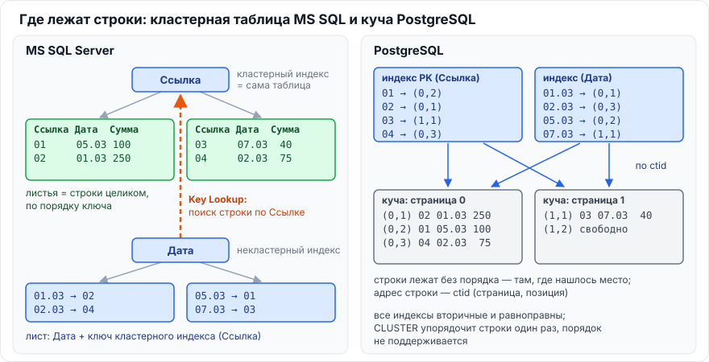

| | Кластерный индекс | Некластерный индекс | Куча (heap) |
|---|---|---|---|
| Что это | **Сама таблица**, организованная как B-дерево: в листьях лежат строки целиком, отсортированные по ключу | Отдельное B-дерево: в листьях ключ + ссылка на строку | Таблица без кластерного индекса: строки лежат на страницах без порядка |
| Сколько на таблицу | Один (данные можно упорядочить только одним способом) | До 999 | — |
| Ссылка на строку в некластерном индексе | **Ключ кластерного индекса** | — | **RID** (файл:страница:слот) |
| Операция «сходить за строкой» | `Key Lookup` | — | `RID Lookup` |

Следствие, которое спрашивают: **ключ кластерного индекса повторяется в каждом некластерном индексе**. Широкий кластерный ключ (например, `nvarchar(200)` вместо `int`) раздувает все индексы таблицы. Хороший кластерный ключ — узкий, уникальный, неизменяемый и, желательно, возрастающий.

**В 1С:** у справочников и документов кластерный индекс — по `Ссылка` (`_IDRRef`, `binary(16)`); у регистров — по периоду/регистратору или измерениям (см. [5.1](05-1c.md)).

---

## 2.1. Каковы ограничения на ключ индекса (байты, число колонок)

> **Коротко.** В MS SQL Server (с версии 2016): ключ **кластерного** индекса — до **900 байт**, **некластерного** — до **1700 байт**, ключевых колонок — до **32**. Включённые (`INCLUDE`) колонки в эти лимиты не входят, их может быть до 1023 и они могут иметь типы `(max)`. Типы `varchar(max)`, `nvarchar(max)`, `varbinary(max)`, `xml`, `text`, `image` в ключ не допускаются. В PostgreSQL: до **32 колонок** (вместе с `INCLUDE`), запись в B-tree — не больше ~1/3 страницы (**~2700 байт**).

> ⚠️ **Поправка к ответу NotebookLM.** «900 байт и 16 колонок» — лимиты SQL Server **до 2016**. С SQL Server 2016 для некластерных индексов — 1700 байт и 32 колонки.

### MS SQL Server

| Параметр | Значение |
|---|---|
| Размер ключа кластерного индекса | 900 байт |
| Размер ключа некластерного индекса | 1700 байт (до 2016 — 900) |
| Число ключевых колонок | 32 (до 2016 — 16) |
| Включённые колонки | Не входят в лимиты выше; всего колонок в индексе — до 1023 |
| Нельзя в ключе | `varchar(max)`, `nvarchar(max)`, `varbinary(max)`, `text`, `ntext`, `image`, `xml` (в `INCLUDE` — можно, кроме устаревших `text/ntext/image`) |

**Опасная тонкость.** Если колонки переменной длины **могут** в сумме превысить лимит (например, `nvarchar(600)` = до 1200 байт в кластерном ключе), индекс **создастся с предупреждением**. Ошибка возникнет позже — при вставке конкретной длинной строки. То есть проблема проявится не при разработке, а у пользователя.

### PostgreSQL

| Параметр | Значение |
|---|---|
| Число колонок в индексе | 32 (константа `INDEX_MAX_KEYS`, считаются и `INCLUDE`-колонки) |
| Размер записи B-tree | ≈ 1/3 страницы: около **2704 байт** при странице 8 КБ |
| TOAST для индексов | Длинное значение можно только **сжать**, вынести в отдельную TOAST-таблицу нельзя. Не сжалось — ошибка вставки |
| Другие типы | GIN не индексирует слишком длинные лексемы полнотекстового поиска (длиннее 2047 байт) |

### Применительно к 1С — как посчитать

- Строка 1С длиной N символов хранится в MS SQL как `nvarchar(N)` → **2·N байт**. В PostgreSQL (`mvarchar`, UTF-8) кириллица тоже ~2 байта на символ.
- Ссылка (`_IDRRef`) — 16 байт; к индексу по реквизиту платформа добавляет Ссылку.
- **Кластерный индекс регистра сведений** включает **все измерения**. Значит, сумма длин строковых измерений ограничена 900 байтами: два строковых измерения по 300 символов = 1200 байт → уже превышение.
- Строки **неограниченной** длины (`nvarchar(max)`) индексировать нельзя вообще — в конфигураторе для них свойство «Индексировать» недоступно.

Отсюда рекомендация: строковые измерения и индексируемые строковые реквизиты делать **такой длины, какая реально нужна**, и проверять сумму для кластерного индекса (подробнее — [5.2](05-1c.md)).

### Как это выглядит на практике — ошибка 1946

Реальная ошибка из 1С на MS SQL Server: сумма полей кластерного индекса регистра сведений превысила 900 байт.


Как читать сообщение:

| Фрагмент | Что значит |
|---|---|
| `_InfoRg59_2` | Индекс таблицы регистра сведений `_InfoRg59`. Какой это регистр и какие поля в индексе — через [`ПолучитьСтруктуруХраненияБазыДанных()`](05-1c.md#как-узнать-физические-имена-таблиц-и-индексов) или скрипт [sql/1c/storage_structure.bsl](../sql/1c/storage_structure.bsl) |
| `длина элемента индекса, равная 1238 байт` | Фактическая длина ключа у **конкретной записываемой строки** |
| `максимальную длину, равную 900 байт для кластеризованного индекса` | Лимит ключа кластерного индекса (у некластерного — 1700) |
| `native=1946` | Номер ошибки SQL Server: запись не помещается в индекс. Возникает **при записи данных**, а не при создании индекса |

Почему так происходит:

- При создании индекса (реструктуризации) SQL Server только **предупреждает**, что максимально возможная длина ключа больше 900 байт, и индекс создаётся. Пока значения короткие, всё работает.
- Ошибка возникает, когда записывается строка, у которой **реальная** сумма значений полей ключа больше 900 байт. Например, длинное значение в строковом измерении: 1238 байт ≈ 600 символов строк (2 байта на символ) плюс остальные поля.
- Поэтому ошибка «плавающая»: одни записи проходят, другие — нет. Обычно она проявляется при записи пользователем или обменом длинного значения.
- На PostgreSQL лимит записи B-tree больше (~2700 байт), поэтому та же конфигурация там может работать, а на MS SQL — падать.

Как исправить:

1. Уменьшить длину строковых измерений до реально нужной — так, чтобы сумма (символы × 2 + 16 байт на каждую ссылку + остальные поля) гарантированно укладывалась в 900 байт.
2. Длинные строки, по которым не нужен отбор и уникальность, перенести из измерений в **ресурсы или реквизиты** — они не входят в кластерный индекс.
3. Вместо длинного строкового измерения использовать **ссылку** (справочник) — это всего 16 байт в ключе.

> **Запомнить:** 900 (кластерный) / 1700 (некластерный) / 32 колонки — MS SQL 2016+. ~2700 байт / 32 колонки — PostgreSQL. В 1С: символ = 2 байта, ссылка = 16 байт. Превышение лимита — ошибка 1946 при записи длинного значения, а не при создании индекса.

---

## 2.2. ★ Что такое fill factor и зачем может потребоваться его менять. Что такое page split

> **Коротко.** **Page split** — когда в полностью заполненную страницу индекса нужно вставить строку «в середину», СУБД выделяет новую страницу и переносит туда примерно половину строк. Это лишний ввод-вывод и журнал, две полупустые страницы и логическая фрагментация. **Fill factor** — процент заполнения листовых страниц **при создании или перестроении** индекса (по умолчанию 0 = 100%). Оставленное место позволяет вставлять строки без расщепления. Снижают его (до 90–70%) для индексов со вставками в случайные места (GUID, коды, наименования) и частыми расширяющими `UPDATE`. Платим: индекс больше, чтение медленнее, дерево может стать выше. При вставках в конец (identity, дата) снижать бессмысленно. Расщепление бывает **«хорошее»** (вставка в конец: строки не переносятся, просто добавляется страница) и **«плохое»** (вставка в середину). Лишние чтения появляются не во время split, а потом: от полупустых и разбросанных страниц страдают **сканирования диапазонов**, а **поиск отдельной строки (Seek)** почти не страдает — глубина дерева та же.

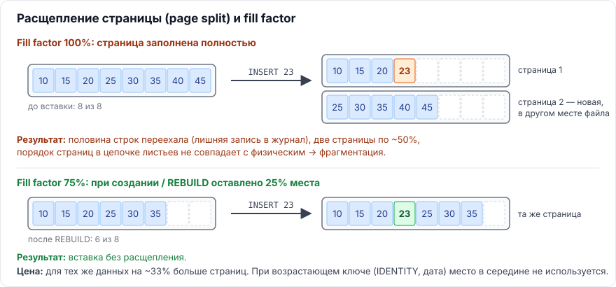

### Page split — подробно

Страницы индекса — 8 КБ, ключи на них отсортированы, листовые страницы связаны двусвязным списком (у каждой есть ссылки «предыдущая» и «следующая»). Если новая строка по ключу должна попасть на страницу, где нет места, происходит расщепление.

**Что происходит по шагам** (вставляем ключ 23 в полную страницу 12):

| Шаг | Что делает СУБД | Чтение | Запись |
|---|---|---|---|
| 1 | Спускается по дереву: корень → промежуточная → страница 12 | Обычное, было бы и без split | — |
| 2 | Выделяет новую страницу (например, 250): ищет свободное место в файле, отмечает его в служебных картах выделения | — | Служебные страницы + журнал |
| 3 | Переносит примерно половину строк со страницы 12 на страницу 250 | — | **Каждая перенесённая строка** — в журнал; меняются обе страницы |
| 4 | Перешивает цепочку листьев: у 12 «следующая = 250», у 250 «предыдущая = 12, следующая = 13», **у 13 «предыдущая = 250»** | **Страницу 13**, если её нет в кэше, — только ради одного указателя | Три страницы + журнал |
| 5 | Добавляет ключ-разделитель для страницы 250 в родительскую страницу | Родитель уже в памяти (через него спускались) | Родитель + журнал. Если родитель полон — **он тоже расщепляется** (каскад вверх, вплоть до корня: дерево становится на уровень выше) |
| 6 | Вставляет саму строку 23 | — | Страница + журнал |

Пошагово, с массивом слотов и номерами страниц в файле: [interactive/page-split.html](../interactive/page-split.html) (скачайте и откройте в браузере).

### Почему split — дорогая операция

Обычная вставка меняет одну страницу и пишет в журнал одну строку. Расщепление делает намного больше работы:

1. **Объём журнала растёт в десятки раз.** Вместо одной записи о вставке в журнал попадают все перенесённые строки (в MS SQL — операция `LOP_DELETE_SPLIT` и вставки на новую страницу), выделение страницы и изменения соседей. Журнал пишется синхронно при фиксации транзакции, значит растёт время `COMMIT`. Больше журнала — больше бэкапов журнала и нагрузка на репликацию / Always On.
2. **Меняется не одна страница, а 3–4** (старая, новая, соседняя, родитель) плюс служебные карты выделения. Все они становятся «грязными» и позже будут записаны на диск при контрольной точке.
3. **Возможно лишнее чтение** соседней страницы — только чтобы поправить в ней указатель.
4. **Эксклюзивные блокировки страниц (латчи).** На время расщепления страницы недоступны другим сессиям: параллельные вставки и чтения ждут (`PAGELATCH_EX`). На нагруженной таблице это заметно.
5. **Каскад.** Полный родитель тоже расщепляется — работа повторяется уровнем выше.
6. **Долгосрочные последствия** (самое важное, см. ниже): полупустые страницы и нарушенный порядок листьев.

В PostgreSQL механизм тот же (расщепление B-tree с записью в WAL). Дополнительно действует `full_page_writes`: первое изменение каждой страницы после контрольной точки пишет в WAL **страницу целиком** — а split трогает сразу несколько страниц.

### «Хороший» и «плохой» split

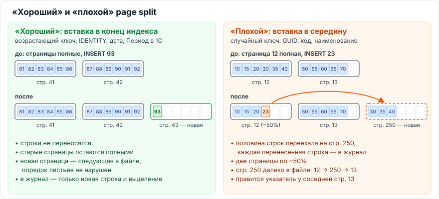

| | «Хороший» split | «Плохой» split |
|---|---|---|
| Когда | Вставка в **самый конец** индекса: ключ возрастающий (`IDENTITY`, `SEQUENCE`, дата, Период регистра 1С) | Вставка **в середину**: случайный или «неудобный» ключ (GUID, код, наименование, хеш), удлиняющий `UPDATE` |
| Что происходит | Справа просто добавляется новая пустая страница. Строки **не переносятся** | Половина строк **переезжает** на новую страницу |
| Плотность страниц | Старые страницы остаются полными (~100%) | Две страницы по ~50% |
| Порядок листьев | Новая страница обычно следующая в файле — порядок не нарушен | Новая страница далеко в файле — **логическая фрагментация** |
| Журнал | Мало | Много |
| Вред | Практически нет | Запись дороже, индекс раздувается и фрагментируется |

Нюансы:
- Счётчик `SQLServer:Access Methods\Page Splits/sec` считает **оба** вида. Высокое значение само по себе не проблема, если это вставки в конец. Отличить «плохие» расщепления можно через Extended Events: событие `sqlserver.transaction_log` с операцией `LOP_DELETE_SPLIT`.
- В PostgreSQL расщепление **самой правой** страницы B-tree делается не пополам: левая страница остаётся заполненной до `fillfactor` (90%), чтобы вставки по возрастающему ключу не оставляли полупустых страниц.
- У «хорошего» split есть своя проблема — **горячая последняя страница**: все параллельные вставки бьются в одну страницу и ждут друг друга на латче (`PAGELATCH_EX`). В SQL Server 2019+ для таких индексов есть `OPTIMIZE_FOR_SEQUENTIAL_KEY = ON`.

### После split: Scan страдает, Seek — нет

Лишние чтения появляются **не во время** расщепления, а **потом**, когда индекс читают.

| Операция | Что делает | Как на неё влияют расщепления |
|---|---|---|
| **Index Seek** (поиск одного значения) | Спуск корень → лист: 3–4 страницы | Почти никак. Глубина дерева та же (лишний уровень появляется крайне редко), нужная строка находится за те же 3–4 чтения |
| **Scan** (весь индекс или диапазон) | Идёт по цепочке листьев | **Страдает дважды:** страниц больше (плотность ~50% → вдвое больше страниц на тот же диапазон, вдвое больше места в кэше) и порядок нарушен (упреждающее чтение рассчитано на подряд лежащие страницы — при «прыжках» по файлу вместо нескольких больших чтений получается много мелких) |

**На цифрах.** Диапазон из 10 000 строк, на странице помещается 100 строк:
- плотный индекс — **100 страниц**, лежат подряд, читаются крупными блоками;
- после множества «плохих» расщеплений — **~200 страниц** по 50%, разбросанных по файлу, и упреждающее чтение работает плохо.

> ⚠️ В плане запроса оператор `Index Seek` часто означает «найти начало диапазона и прочитать диапазон» (например, `WHERE Дата BETWEEN ...`). Спуск к началу от расщеплений не страдает, а вот **чтение диапазона после спуска страдает так же, как Scan**. Не страдает именно поиск отдельных строк.

Поэтому:
- фрагментацию имеет смысл лечить для индексов, по которым идут **большие сканирования диапазонов** (отчёты, выгрузки);
- для индексов, по которым в основном ищут отдельные строки (поиск по ссылке, коду), фрагментация почти не важна;
- **плотность страниц** важнее порядка: лишние страницы бьют и по SSD, и по памяти, а порядок важен в основном на HDD.

### Fill factor — подробно

- Задаётся в процентах 1–100; `0` и `100` означают одно и то же — заполнять полностью.
- Применяется **только при создании или перестроении** индекса. Дальше СУБД заполненность не поддерживает: страницы постепенно заполняются вставками.
- Действует на **листовые** страницы. `PAD_INDEX = ON` применяет тот же процент к промежуточным уровням.
- Значение по умолчанию для всего сервера — параметр `fill factor (%)` в `sp_configure`; менять его глобально Microsoft не рекомендует.

```sql
-- для одного индекса
ALTER INDEX IX_Orders_Customer ON dbo.Orders
REBUILD WITH (FILLFACTOR = 90, PAD_INDEX = ON);

-- текущие значения
SELECT OBJECT_NAME(object_id) AS table_name, name, fill_factor, is_padded
FROM sys.indexes
WHERE fill_factor NOT IN (0, 100);
```

### Когда снижать fill factor

| Ситуация | Почему помогает |
|---|---|
| Ключ — случайный GUID, хеш, код, наименование: вставки по всему дереву | Свободное место принимает новые строки без расщепления |
| `UPDATE`, которые **удлиняют** строки (переменная длина) | Строке есть куда «вырасти» на своей странице |
| Частые расщепления, видимые в мониторинге | Индекс дольше остаётся плотным и упорядоченным между обслуживаниями |

### Почему слишком низкий fill factor вредит

1. **Размер растёт.** `FILLFACTOR = 50` → индекс в **2 раза** больше на диске и в буферном кэше.
2. **Чтение медленнее.** Сканирование диапазона читает больше страниц ради тех же строк. А чтений в типичной нагрузке намного больше, чем записей.
3. **Дерево может стать выше.** Меньше ссылок на странице → иногда появляется лишний уровень.
4. **При возрастающем ключе — чистая потеря.** Новые строки всегда идут в конец, свободное место в середине никогда не заполнится.

### Как понять, что расщеплений много

- Счётчик производительности `SQLServer:Access Methods\Page Splits/sec` (учитывает и «хорошие» вставки в конец, поэтому смотреть на динамику).
- `sys.dm_db_index_operational_stats` → `leaf_allocation_count` по конкретному индексу.
- Быстрый рост `avg_fragmentation_in_percent` после перестроения ([2.3](#23-что-такое-фрагментация-и-как-её-измерить-чем-reorganize-отличается-от-rebuild-и-как-изменился-подход-microsoft-к-порогам)).

### Применительно к 1С

- Кластерные индексы **таблиц движений** регистров начинаются с `Период` → проводки текущей датой пишутся в конец. Снижать fill factor здесь бесполезно.
- Индексы по `Наименование`, строковым реквизитам, `Код` (если код не возрастает — ручной ввод, префиксы), **регистры сведений** с кластерным индексом по измерениям — вставки в середину. Здесь умеренный fill factor (90–80) может быть оправдан, если мониторинг показывает частые расщепления.
- **Кластерный индекс объектных таблиц по Ссылке (`_IDRRef`)** — вставки, скорее всего, в конец (см. ниже).

#### Порядок вставки по Ссылке (`_IDRRef`)

> ⚠️ **Предположительно, требует проверки.** Официального описания алгоритма генерации ссылок от 1С нет. Вывод сделан по формату UUID ссылок (версия 1) и по известной перестановке групп GUID в `_IDRRef`. Перед тем как опираться на него, проверьте на своей базе способами ниже.

Ссылку нового объекта формирует платформа. Судя по строковому виду (`2cc04775-73e6-11e5-877b-1008b1715f68` — третья группа начинается с `1`), это UUID **версии 1**: первые три группы — метка времени, разрезанная на младшую, среднюю и старшую части, последние две — тактовая последовательность и «узел». В строке части времени идут в неудобном порядке, поэтому ссылки выглядят случайными.

В поле `_IDRRef` (`binary(16)`) хранятся те же 16 байт, что и в строке GUID, но **группы GUID стоят в другом порядке**. Байты внутри каждой группы не переворачиваются — меняется только порядок самих групп. Пример одной и той же ссылки:

```
1С (строка GUID):   8226efb1 - d96b - 11f1 - 91a2 - e399cf00eb19
                    группа 1   гр.2   гр.3   гр.4   группа 5

MS SQL (_IDRRef):   0x 91A2 E399CF00EB19 11F1 D96B 8226EFB1
                       гр.4  группа 5    гр.3 гр.2 группа 1
```

| Байты `_IDRRef` | Группа GUID | Что там (UUID v1) | Как меняется |
|---|---|---|---|
| 1–2 | 4-я | Тактовая последовательность | Постоянны для генератора |
| 3–8 | 5-я | Узел | Постоянны для генератора |
| 9–10 | 3-я | Старшая часть времени (+ версия `1`) | Растёт медленнее всего |
| 11–12 | 2-я | Средняя часть времени | Растёт |
| 13–16 | 1-я | Младшая часть времени | Меняется быстрее всего |

Итого в `_IDRRef` время записано от старшей части к младшей (байты 9–16), а неизменная часть генератора — в начале (байты 1–8).

**Перевод `_IDRRef` → GUID 1С** (через hex-строку, не зависит от кодировки базы):

```sql
DECLARE @r binary(16) = 0x91A2E399CF00EB1911F1D96B8226EFB1;
DECLARE @h char(32)   = CONVERT(char(32), @r, 2);   -- hex без '0x'

SELECT LOWER(
         SUBSTRING(@h,25,8) + '-' + SUBSTRING(@h,21,4) + '-' +
         SUBSTRING(@h,17,4) + '-' + SUBSTRING(@h, 1,4) + '-' +
         SUBSTRING(@h, 5,12));
-- 8226efb1-d96b-11f1-91a2-e399cf00eb19
```

**Перевод GUID 1С → `_IDRRef`** (например, чтобы найти строку по `Ссылка.УникальныйИдентификатор()`):

```sql
DECLARE @g char(36) = '8226efb1-d96b-11f1-91a2-e399cf00eb19';

SELECT CONVERT(binary(16),
         SUBSTRING(@g,20,4) + SUBSTRING(@g,25,12) +
         SUBSTRING(@g,15,4) + SUBSTRING(@g,10,4) + SUBSTRING(@g,1,8), 2);
-- 0x91A2E399CF00EB1911F1D96B8226EFB1
```

> **Про часто встречающуюся формулу с `REVERSE`.** В интернете приводят `REVERSE(SUBSTRING(_IDRRef, 9, 8)) + SUBSTRING(_IDRRef, 1, 8)`. В таком виде она **не выполняется**: `REVERSE` работает со строками и возвращает `varchar`, а `varchar + varbinary` даёт ошибку *Msg 402*. Рабочий вариант — с явными приведениями:
>
> ```sql
> SELECT CAST(CAST(REVERSE(SUBSTRING(_IDRRef, 9, 8)) AS binary(8))
>             + SUBSTRING(_IDRRef, 1, 8) AS uniqueidentifier)
> ```
>
> Здесь `REVERSE` — не «распаковка» перестановки, а трюк. Он переворачивает байты 9–16, а `uniqueidentifier` при выводе ещё раз переворачивает первые 4, 2 и 2 байта. Два переворота компенсируют друг друга, и получается строка GUID 1С. Без внешнего `CAST(... AS uniqueidentifier)` результат с GUID 1С не совпадёт. Кроме того, `REVERSE` гоняет байты через `varchar`. В базе с многобайтовой кодировкой (например, UTF-8 collation) это может их испортить. Поэтому надёжнее вариант через hex-строку выше.

MS SQL сравнивает `binary` побайтно слева направо (PostgreSQL `bytea` — так же). Значит, при одинаковом узле каждая следующая ссылка больше предыдущей, и новые элементы справочников и документы попадают **в конец** кластерного индекса `_IDRRef` — «хороший» split. Снижать fill factor для него обычно бессмысленно.

Оговорки:
- **Несколько «хвостов».** Если ссылки создают разные процессы или серверы с разными узлами или тактовыми последовательностями, у каждого свой возрастающий участок индекса. Вставка идёт в несколько точек, но не в случайные места: фрагментация умеренная, не как у случайного GUID.
- **Ссылки извне** (обмены, загрузка из другой базы, `УстановитьСсылкуНового()` с UUID из внешней системы) создавались на другом узле и в другое время, а загружаются в произвольном порядке → вставки в середину.
- **Остальные индексы того же справочника** ведут себя по-своему: `Код + Ссылка` при автонумерации — в конец; `Наименование + Ссылка`, `Владелец + …`, `Родитель + …`, индексируемые реквизиты — в середину. Fill factor, если и снижать, то для них, а не для кластерного.

Как проверить:
1. Создать подряд несколько элементов и вывести `Ссылка.УникальныйИдентификатор()`: ожидается, что последние две группы совпадают, третья начинается с `1`, первая растёт.
2. Сравнить `avg_fragmentation_in_percent` в `sys.dm_db_index_physical_stats` у кластерного индекса `_ReferenceNN` и у индекса по `_Description` того же справочника (через некоторое время после перестроения): у второго ожидается заметно большая фрагментация.
3. `sys.dm_db_index_operational_stats` → `leaf_allocation_count` по тем же двум индексам.

- Fill factor задаётся средствами СУБД (в плане обслуживания или скрипте перестроения) — в конфигураторе такой настройки нет.

> **Запомнить:** page split = вставка в полную страницу → две полупустые страницы + фрагментация. Дорог из-за журнала (переносятся строки), правки 3–4 страниц, латчей и возможного каскада. «Хороший» split — в конец, «плохой» — в середину. После split страдает Scan, Seek — почти нет. Fill factor = «оставить место при перестроении». Снижать **точечно** — только там, где вставки идут в середину и расщеплений реально много.

---

## 2.3. Что такое фрагментация и как её измерить. Чем REORGANIZE отличается от REBUILD и как изменился подход Microsoft к порогам

> **Коротко.** Фрагментация бывает **логическая** (порядок страниц в цепочке листьев не совпадает с физическим — мешает упреждающему чтению при сканировании диапазонов) и **низкая плотность страниц** (много пустого места — больше страниц читать и держать в памяти). Измеряется `sys.dm_db_index_physical_stats`: `avg_fragmentation_in_percent` и `avg_page_space_used_in_percent`. `REORGANIZE` — лёгкая онлайн-операция над листьями, её можно прервать без потери сделанного, статистику не обновляет. `REBUILD` — пересоздание индекса целиком (офлайн или онлайн в Enterprise), обновляет статистику индекса с полным сканированием. Microsoft больше **не рекомендует** обслуживать «по порогам 5/30%»: решать нужно по измеренному эффекту, а прирост после `REBUILD` часто объясняется просто обновлённой статистикой.

### Два вида фрагментации

| Вид | Что это | Чем вредит | Показатель |
|---|---|---|---|
| Логическая (внешняя) | Следующая по ключу страница лежит физически не следующей | Сканирование диапазона превращается в «прыжки» по файлу, хуже работает read-ahead. На SSD эффект небольшой | `avg_fragmentation_in_percent` |
| Низкая плотность (внутренняя) | Страницы заполнены, например, на 55% | Для тех же строк читается и кэшируется больше страниц — это бьёт и по SSD | `avg_page_space_used_in_percent` |

> ⚠️ **Частая ошибка: «фрагментация — это когда логический порядок не совпадает с физическим».** Верно только наполовину. Во-первых, считается порядок **страниц**, а не строк: строки внутри страницы и так лежат вразнобой (порядок держит массив слотов, [2.9](#29-как-ms-sql-хранит-строки-на-страницах-in_row-row_overflow-и-lob)), и это не фрагментация — страница читается целиком за одно обращение. Во-вторых, есть второй вид — **низкая плотность**: порядок страниц может быть идеальным, а страниц вдвое больше нужного. На SSD именно плотность обычно вредит сильнее.

| Ситуация | Порядок | Плотность | Что плохо |
|---|---|---|---|
| Страницы подряд, заполнены на 95% | ✓ | ✓ | Ничего |
| Страницы вразнобой, заполнены на 95% | ✗ | ✓ | «Прыжки» по файлу при сканировании (критично на HDD) |
| Страницы подряд, заполнены на 50% | ✓ | ✗ | Вдвое больше чтений и памяти в кэше |
| Вразнобой и на 50% (типично после частых «плохих» split) | ✗ | ✗ | Всё сразу |

### Как измерить

```sql
SELECT OBJECT_NAME(ips.object_id)        AS table_name,
       i.name                            AS index_name,
       ips.index_type_desc,
       ips.page_count,
       ips.avg_fragmentation_in_percent,
       ips.avg_page_space_used_in_percent
FROM sys.dm_db_index_physical_stats(DB_ID(), NULL, NULL, NULL, 'SAMPLED') AS ips
JOIN sys.indexes AS i
  ON i.object_id = ips.object_id AND i.index_id = ips.index_id
WHERE ips.page_count > 1000          -- маленькие индексы не трогаем
ORDER BY ips.page_count DESC;
```

- Режим `LIMITED` — самый быстрый, но **не считает** плотность страниц (`avg_page_space_used_in_percent` = NULL). Для плотности нужен `SAMPLED` или `DETAILED`.
- Индексы меньше ~1000 страниц обычно не обслуживают: эффекта нет.
- Columnstore оценивается иначе: доля **удалённых строк** в группах строк (`sys.dm_db_column_store_row_group_physical_stats`).

### REORGANIZE и REBUILD

| | `ALTER INDEX ... REORGANIZE` | `ALTER INDEX ... REBUILD` |
|---|---|---|
| Что делает | Переставляет и уплотняет **листовые** страницы на месте | Строит индекс **заново** (все уровни), старый удаляет |
| Блокировки | Всегда онлайн, долгих блокировок нет | Офлайн — блокирует таблицу. `ONLINE = ON` — только Enterprise (и Azure SQL) |
| Прерывание | Можно остановить — сделанная работа сохраняется | `RESUMABLE = ON` (SQL Server 2017+, вместе с `ONLINE`) — можно приостановить и продолжить |
| Статистика | **Не обновляет** | Обновляет статистику **этого индекса** как с `FULLSCAN` (статистику по отдельным колонкам — нет) |
| Ресурсы | Мало CPU и памяти, но может писать много журнала | Много CPU/IO, место под **вторую копию** индекса, большой журнал (в модели FULL) |
| Fill factor | Уплотняет до текущего fill factor индекса | Можно задать новый `FILLFACTOR` |
| Columnstore | Сжимает дельта-группы, объединяет мелкие группы строк | Полная перестройка |

### Как изменился подход Microsoft

**Раньше** (и во многих регламентах 1С до сих пор):
- фрагментация < 5% (в некоторых методиках < 10–20%) — ничего;
- 5–30% — `REORGANIZE`;
- \> 30% — `REBUILD`.

**Сейчас** (статья Microsoft Learn «Оптимизация обслуживания индексов…»):
1. **Не опираться только на пороги.** Решение принимать по измеренному эффекту на конкретной нагрузке.
2. **Фрагментация важна только для больших сканирований диапазонов**, и сильнее всего — на медленных дисках. На SSD/NVMe и в облаке разница между последовательным и случайным чтением мала.
3. **Эффект от `REBUILD` часто даёт не дефрагментация, а обновление статистики** с полным сканированием (и сброс планов). Если вместо перестроения обновить статистику — часто получится тот же результат намного дешевле.
4. **Плотность страниц важнее порядка.** Низкая плотность увеличивает объём чтения и памяти при любом диске.
5. **Порядок действий:** измерить → обслужить → проверить, стало ли лучше. Если не стало — такое обслуживание не нужно.

### Применительно к 1С

Классический регламент 1С (ежедневная реиндексация по порогам) по-прежнему встречается и на аттестации может спрашиваться. Правильный современный ответ: **ежедневно — обновление статистики; дефрагментация — выборочно**, по крупным индексам с подтверждённым эффектом, в технологическое окно (см. [6.1](06-obsluzhivanie-diagnostika.md)).

> **Запомнить:** два вида фрагментации; `REORGANIZE` — лёгкий, онлайн, без статистики; `REBUILD` — тяжёлый, обновляет статистику. Современный подход: не «по порогам», а «по эффекту»; статистика важнее.

---

## 2.4. Что показывают `sys.dm_db_index_usage_stats` и `sys.dm_db_missing_index_*`. Ограничения рекомендаций по недостающим индексам

> **Коротко.** `sys.dm_db_index_usage_stats` — счётчики использования **существующих** индексов с момента запуска экземпляра: `user_seeks`, `user_scans`, `user_lookups` (чтения) и `user_updates` (затраты на поддержку). По ним ищут индексы, которые много обновляются и почти не читаются. `sys.dm_db_missing_index_*` — индексы, которых **не хватило** оптимизатору: колонки равенства, неравенства, включённые колонки и оценка выгоды. Ограничения: данные теряются при перезапуске, рекомендации не учитывают стоимость записи, не задают порядок колонок, не предлагают фильтруемых, уникальных, кластерных и columnstore индексов, дублируют друг друга, хранится не больше 600 групп. Применять вслепую нельзя.

### `sys.dm_db_index_usage_stats`

| Колонка | Что считает |
|---|---|
| `user_seeks` | Поиски по индексу (Index Seek) |
| `user_scans` | Просмотры (Index Scan — весь индекс или диапазон) |
| `user_lookups` | Обращения за строкой по закладке (Key Lookup) — бывают только у кластерного индекса/кучи |
| `user_updates` | Операции, изменившие индекс. Считаются **операторы**, а не строки |
| `last_user_seek/scan/lookup/update` | Когда было последнее обращение |
| `system_*` | То же для системных операций (обновление статистики и т.п.) |

**Важные свойства:**
- Хранится **в памяти**: обнуляется при перезапуске экземпляра, отключении или закрытии базы (`AUTO_CLOSE`), а для индекса — при его перестроении (в некоторых версиях).
- Строка появляется, только когда к индексу было хоть одно обращение. Индекса нет в DMV → им не пользовались ни разу с запуска.
- Решение «удалить индекс» принимают только по статистике за **полный бизнес-цикл** (месяц, закрытие квартала, годовые отчёты).

**Пример: кандидаты на удаление** — много обновлений, мало чтений:

```sql
SELECT OBJECT_NAME(i.object_id) AS table_name, i.name AS index_name,
       ISNULL(s.user_seeks + s.user_scans + s.user_lookups, 0) AS reads,
       ISNULL(s.user_updates, 0) AS writes
FROM sys.indexes AS i
LEFT JOIN sys.dm_db_index_usage_stats AS s
       ON s.object_id = i.object_id AND s.index_id = i.index_id
      AND s.database_id = DB_ID()
WHERE OBJECTPROPERTY(i.object_id, 'IsUserTable') = 1
  AND i.type_desc = 'NONCLUSTERED'
  AND i.is_primary_key = 0 AND i.is_unique_constraint = 0
ORDER BY writes DESC, reads ASC;
```

### `sys.dm_db_missing_index_*`

| Объект | Что содержит |
|---|---|
| `sys.dm_db_missing_index_details` | Таблица и колонки: `equality_columns` (условия `=`), `inequality_columns` (`>`, `<`, `<>`…), `included_columns` |
| `sys.dm_db_missing_index_group_stats` | Выгода: `user_seeks`, `user_scans`, `avg_total_user_cost` (средняя стоимость запросов), `avg_user_impact` (% снижения стоимости) |
| `sys.dm_db_missing_index_groups` | Связь «группа ↔ индекс» |
| `sys.dm_db_missing_index_columns(handle)` | Колонки конкретного предложения с их ролью |
| `sys.dm_db_missing_index_group_stats_query` | (SQL Server 2019+) — какие именно запросы просили этот индекс |

Оценка полезности, которую обычно используют для сортировки:

```
avg_total_user_cost × avg_user_impact × (user_seeks + user_scans)
```

### Ограничения рекомендаций (главное для ответа)

1. **Не учитывается цена записи.** Оптимизатор думает только о `SELECT`. Замедление `INSERT/UPDATE/DELETE`, рост базы и обслуживания — не в расчёте.
2. **Нет порядка колонок.** Колонки перечислены в порядке их следования в таблице, а не по селективности. Порядок (равенства → неравенства) определяет человек.
3. **Только обычные некластерные rowstore-индексы.** Не предлагаются фильтруемые, уникальные, кластерные, columnstore, направление `DESC`.
4. **Сбрасывается при перезапуске** — как и usage stats.
5. **Не больше 600 групп** рекомендаций; пока старые не «разобраны», новые могут не появиться.
6. **Взгляд на отдельный запрос, а не на всю нагрузку.** Для похожих запросов приходят почти одинаковые предложения — создав все, получите пачку дублирующих индексов.
7. **Нужна консолидация.** Часто правильнее расширить существующий индекс (добавить колонку в `INCLUDE`), чем создавать новый.

### Применительно к 1С

- Missing index — хороший **индикатор**, где проблема, но **не** готовое решение: индекс, созданный в базе вручную, платформа не знает. Решение переносится в метаданные (признак «Индексировать», порядок измерений) или в текст запроса.
- По usage stats удобно видеть **неиспользуемые индексы от лишних галочек «Индексировать»** — снимать галочку нужно в конфигураторе.

> **Запомнить:** usage stats — «как используются те, что есть», missing index — «чего не хватило». Обе в памяти, обе обнуляются. Missing index не знает о записи, порядке колонок и других запросах.

---

## 2.5. Какие типы индексов есть в MS SQL Server кроме B-tree и для чего каждый

> **Коротко.** Обычные индексы MS SQL (кластерный, некластерный, уникальный, фильтруемый, с `INCLUDE`) — это **B-tree** (rowstore). Отдельных структур несколько. **Columnstore** — таблица режется на группы строк по ~1 млн, каждая колонка хранится отдельно и сжата: аналитика, агрегаты по миллионам строк. **Hash** — массив бакетов, только `=`; есть только у memory-optimized таблиц (In-Memory OLTP). **Bw-tree** — некластерный индекс memory-optimized таблиц: упорядоченное дерево без блокировок, изменения дописываются delta-записями. **Полнотекстовый** — инвертированный индекс «слово → документы и позиции» для `CONTAINS`/`FREETEXT`. **Пространственный (spatial)** — плоскость режется сеткой, номера ячеек объекта хранятся в обычном B-tree: `geometry`/`geography`. **XML** — документ разбирается на узлы в скрытую таблицу с B-tree; есть selective XML index по выбранным путям. В **SQL Server 2025** добавились **JSON-индекс** (по типу `json`) и **векторный** (граф DiskANN для поиска похожих эмбеддингов). Платформа 1С создаёт только B-tree.

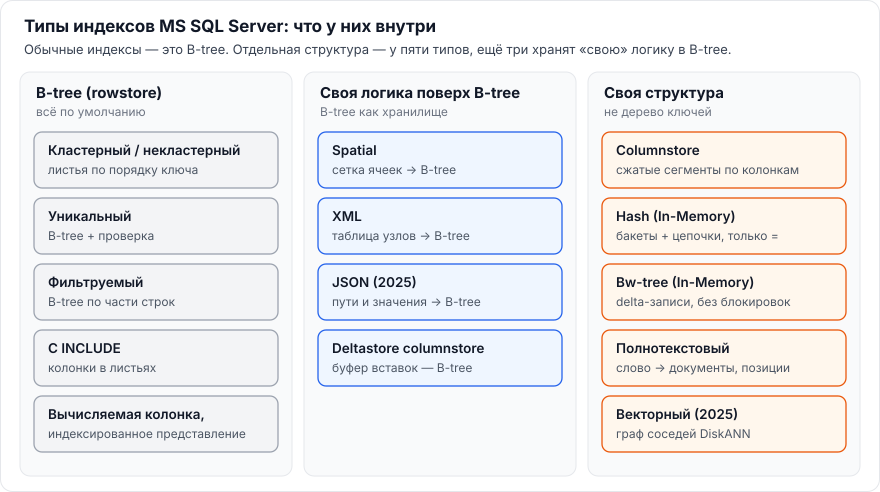

| Тип | Структура | Для чего | Где | С версии |
|---|---|---|---|---|
| **B-tree** (rowstore) | Сбалансированное дерево, листья по порядку ключа | Всё по умолчанию: `=`, диапазоны, сортировка, уникальность | Любые таблицы | всегда — см. [основу главы](#основа-главы-кластерный-индекс-некластерный-индекс-и-куча) |
| **Columnstore** | Группы строк → сжатые сегменты по колонкам | Аналитика, агрегаты, сканы | Дисковые и memory-optimized таблицы | 2012 / 2014 |
| **Hash** | Массив бакетов + цепочки строк | Только `=` по полному ключу | Только memory-optimized | 2014 |
| **Bw-tree** | Дерево без блокировок, delta-записи, таблица маппинга | `=`, диапазоны, сортировка в памяти | Только memory-optimized | 2014 |
| **Полнотекстовый** | Инвертированный индекс | Поиск слов, словоформ, фраз | Дисковые таблицы | 7.0 (встроен в движок с 2008) |
| **Spatial** | Сетка (тесселяция) → B-tree | Геоданные: пересечение, расстояние, ближайшие | Дисковые таблицы | 2008 |
| **XML** | Таблица узлов → B-tree | XQuery по колонке `xml` | Дисковые таблицы | 2005; selective — 2012 SP1 |
| **JSON** | Пути и значения → B-tree | `JSON_VALUE`, `JSON_PATH_EXISTS`, `JSON_CONTAINS` | Дисковые таблицы, тип `json` | 2025 |
| **Векторный** | Граф соседей DiskANN | Приближённый поиск похожих векторов | Дисковые таблицы, тип `vector` | 2025 (preview) |

> 📖 **Как читать разборы.** Как в [3.1](03-postgresql.md#31-какие-типы-индексов-есть-в-postgresql-и-для-чего-каждый): **«Простыми словами»** — аналогия и главные мысли; **«Как устроено»** — схема и техника; **«Когда даёт пользу ✅»** и **«Когда не поможет ❌»**; **«Практика»** — скрипт, который можно запустить в тестовой базе; **«Аналоги»** — что решает ту же задачу в PostgreSQL и других СУБД и когда чем можно заменить.

> 🖱️ **Интерактивные схемы.** «Открыть в браузере» запускает схему сразу; можно скачать файл (*Download raw file*) и открыть локально — интернет не нужен.
>
> | Тип | Что можно попробовать | Схема |
> |---|---|---|
> | Columnstore | агрегат по одной колонке, segment elimination на упорядоченных и перемешанных данных, `INSERT` в deltastore, `DELETE` в delete bitmap, `REORGANIZE` | [открыть в браузере](https://raw.githack.com/shultzMAN87/indexes-1c-attestation/main/interactive/columnstore.html) · [файл columnstore.html](../interactive/columnstore.html) |
> | Hash и Bw-tree | `=` по hash и по Bw-tree, диапазон и `ORDER BY`, мало бакетов и длинные цепочки, вставка delta-записью, консолидация страницы | [открыть в браузере](https://raw.githack.com/shultzMAN87/indexes-1c-attestation/main/interactive/mssql-inmemory.html) · [файл mssql-inmemory.html](../interactive/mssql-inmemory.html) |
> | Spatial | тесселяция объекта по уровням сетки, правило `CELLS_PER_OBJECT`, запрос «пересекается с областью»: первичный и вторичный фильтр | [открыть в браузере](https://raw.githack.com/shultzMAN87/indexes-1c-attestation/main/interactive/spatial.html) · [файл spatial.html](../interactive/spatial.html) |
> | Эмбеддинги | карта смыслов: ближайшие соседи слова и запроса, `euclidean` и `cosine` | [открыть в браузере](https://raw.githack.com/shultzMAN87/indexes-1c-attestation/main/interactive/embeddings.html) · [файл embeddings.html](../interactive/embeddings.html) |
> | Векторный (DiskANN) | жадный обход графа к ближайшим соседям, ширина поиска и точность (recall), сравнение с полным перебором | [открыть в браузере](https://raw.githack.com/shultzMAN87/indexes-1c-attestation/main/interactive/vector-diskann.html) · [файл vector-diskann.html](../interactive/vector-diskann.html) |

---

### Columnstore — колоночное хранение

#### Простыми словами

**Аналогия — бухгалтерская ведомость, разрезанная по столбцам.** Чтобы сложить колонку «Сумма» в обычной ведомости, приходится листать все страницы со всеми колонками. Если каждую колонку подшить в отдельную папку, для суммы берётся одна тонкая папка. А так как в одной колонке значения однотипные и часто повторяются, папку можно сильно ужать: «Склад 1 — 40 000 раз подряд».

**Где аналогия ломается.** Таблица режется не только по колонкам, но и по строкам: группами примерно по миллиону. У каждого куска колонки (сегмента) записаны min и max — по ним целые группы пропускаются, не читаясь. Поиск одной строки по ключу здесь неудобен: «собрать» строку значит заглянуть во все папки.

**Три мысли, которые надо унести:**

1. Читаются **только нужные колонки**, сжатые в разы, и обрабатываются пакетами (**batch mode**) — отсюда выигрыш на агрегатах.
2. Группы пропускаются по min/max сегмента (**segment elimination**) — только если данные лежат упорядоченно по колонке отбора.
3. Мелкие вставки идут в **deltastore** (обычное B-дерево), удаление — пометка в **delete bitmap**. Частые мелкие изменения columnstore не любит.

#### Как устроено

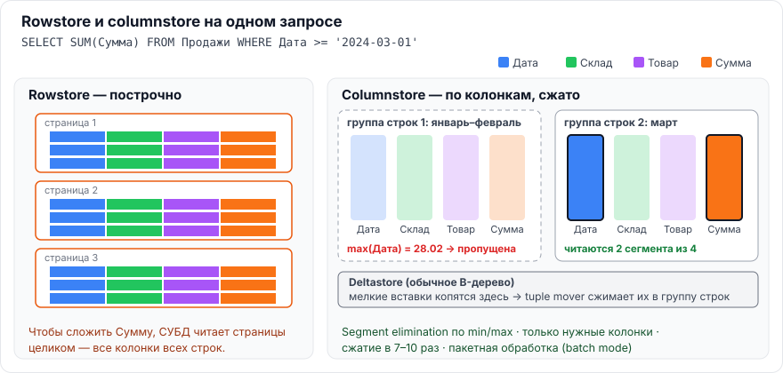

| Термин | Что это |
|---|---|
| **Rowgroup** (группа строк) | До 1 048 576 строк, которые сжимаются вместе |
| **Column segment** (сегмент) | Значения одной колонки в одной группе строк, сжатые; в метаданных — min/max |
| **Deltastore** | Обычная B-tree-таблица для мелких вставок; заполненную группу фоновый **tuple mover** сжимает в колонки |
| **Delete bitmap** | Пометки удалённых строк в сжатых группах. «Фрагментация» columnstore — это доля удалённых строк |
| **Batch mode** | Обработка пакетами примерно по 900 строк — меньше нагрузка на CPU |

**Кластерный (CCI) и некластерный (NCCI).**
- **CCI** — сама таблица хранится по колонкам. Чтобы получить его из существующей таблицы, её переписывают: `CREATE CLUSTERED COLUMNSTORE INDEX … WITH (DROP_EXISTING = ON)`. Рядом можно держать некластерные B-tree (2016+) для точечного поиска и уникальности.
- **NCCI** — колоночная копия выбранных колонок поверх обычной таблицы. Создаётся **без её пересоздания**, обновляемый с 2016, может быть фильтрованным. Оптимизатор сам выбирает: точечный запрос — в B-tree, агрегат — в NCCI. Это сценарий «аналитика поверх OLTP» (HTAP).
- На таблицу — **один** columnstore-индекс, уникальным он быть не может.

**Как данные попадают внутрь.** `INSERT` по одной строке → `OPEN`-группа deltastore → заполнилась (`CLOSED`) → tuple mover сжимает (`COMPRESSED`). Пачка от **102 400 строк** (`BULK INSERT`, `INSERT … SELECT WITH (TABLOCK)`) сжимается сразу. `UPDATE` = пометка удаления + вставка в deltastore. В NCCI удаление сначала пишется в **delete buffer** (внутреннее B-дерево). `COMPRESSION_DELAY = N` минут откладывает сжатие «горячих» строк.

**Segment elimination.** Условие `WHERE Дата >= '2024-06-01'` пропускает группы, у которых max(Дата) меньше. Если даты лежат вразнобой, min и max каждой группы покрывают почти весь диапазон — пропускать нечего. Поэтому: сначала отсортировать данные кластерным B-tree по колонке отбора, затем пересоздать columnstore с `DROP_EXISTING = ON, MAXDOP = 1`; в SQL Server 2022 — сразу `ORDER (колонка)`. Это тот же принцип, что у BRIN в PostgreSQL.

**Как увидеть.** В плане — `Columnstore Index Scan`, в свойствах оператора `Actual Execution Mode = Batch`. В `SET STATISTICS IO ON` — `segment reads N, segment skipped M`. Группы строк — `sys.dm_db_column_store_row_group_physical_stats` (состояние, `deleted_rows`, `trim_reason_desc`). Обслуживание: `REORGANIZE` сжимает `CLOSED`-группы и вычищает удалённые строки, `REBUILD` — полная перестройка.

**Версии и редакции.** NCCI — с 2012 (только чтение, вся таблица становится read-only), обновляемый и фильтрованный — с 2016. CCI — с 2014. Во всех редакциях — с 2016 SP1, но на **Standard** batch mode работает с DOP не больше 2, а кэш сегментов ограничен 32 ГБ. Упорядоченный CCI — 2022, упорядоченный NCCI — 2025. **Batch mode on rowstore** (пакетная обработка для обычных таблиц, без сжатия) — 2019+, Enterprise, уровень совместимости 150+.

#### Когда columnstore даёт ощутимую пользу ✅

| Сценарий | Почему работает |
|---|---|
| **Агрегаты по миллионам строк** (`SUM`, `COUNT`, `GROUP BY`) по нескольким колонкам | Читаются только нужные колонки, сжатые в разы, batch mode экономит CPU |
| **Таблица фактов хранилища, архив, журнал событий** | Массовая загрузка сразу в сжатые группы; размер обычно в 5–10 раз меньше rowstore |
| **Отчёты поверх OLTP-таблицы** | NCCI без пересоздания таблицы: OLTP-запросы идут в B-tree, отчёты — в колонки |
| **Отбор по дате на упорядоченных данных** | Segment elimination пропускает целые группы по min/max |

#### Когда columnstore не поможет или навредит ❌

| Сценарий | Что происходит | Что делать |
|---|---|---|
| **Точечный поиск по ключу**, чтение строки целиком | Строку надо собрать из всех сегментов, seek нет | B-tree (в CCI — дополнительный некластерный B-tree) |
| **Частые мелкие `UPDATE`/`DELETE`** | Растут delete bitmap и deltastore, сжатие портится | Rowstore; для NCCI — `COMPRESSION_DELAY`, фильтр по «остывшим» данным |
| **Загрузка по одной строке** | Всё копится в deltastore, группы мелкие | Пачки от 102 400 строк, `REORGANIZE` |
| **Данные вразнобой по колонке отбора** | `segment skipped = 0` | Упорядочить перед построением или `ORDER (…)` (2022) |
| **Standard Edition на тяжёлой аналитике** | Batch mode ограничен DOP 2 | Замерить против row mode с высоким DOP |

#### Практика

- [sql/mssql/01_columnstore_demo.sql](../sql/mssql/01_columnstore_demo.sql) — rowstore и columnstore на одних данных: размер, план, batch mode, группы строк и сегменты, segment elimination до и после упорядочивания, deltastore и `REORGANIZE`.
- [sql/mssql/08_nonclustered_columnstore.sql](../sql/mssql/08_nonclustered_columnstore.sql) — NCCI на обычной таблице без её пересоздания: выбор B-tree или NCCI, deltastore и delete buffer при DML, фильтрованный NCCI и `COMPRESSION_DELAY`, batch mode on rowstore.

#### Аналоги

| Где | Что | Чем отличается от columnstore MS SQL |
|---|---|---|
| **PostgreSQL** | Встроенного колоночного хранения нет. Ближе всего по идее — [BRIN](03-postgresql.md#brin--сводки-по-диапазонам-блоков): тот же пропуск блоков по min/max, но без хранения по колонкам и сжатия. Колонки — только расширениями: Citus columnar, TimescaleDB (сжатие чанков в колонки), pg_duckdb | Расширение ставится отдельно; в managed-облаках и сборках для 1С его может не быть |
| **ClickHouse** | Колоночная СУБД целиком. Таблица MergeTree состоит из кусков (parts), внутри куска строки отсортированы по `ORDER BY`; разреженный первичный индекс хранит одну метку на гранулу (по умолчанию 8192 строки); у колонок — skip-индексы `minmax`, `set`, bloom-фильтры | Колоночный формат — основа, а не индекс поверх таблицы. Вставка создаёт новый кусок, фон сливает куски — та же идея, что deltastore и tuple mover. `UPDATE`/`DELETE` — тяжёлые мутации или облегчённое удаление пометкой, OLTP-транзакций нет |
| **Vertica, Greenplum, Redshift, BigQuery, Snowflake** | Колоночные аналитические хранилища | Отдельные системы, данные туда выгружают из OLTP |
| **DuckDB + Parquet** | Колоночный файл: row group со статистикой min/max по колонкам ≈ rowgroup columnstore | Аналитика по файлам на одной машине, без сервера |

**Резюме.** NCCI/CCI — когда аналитика нужна **рядом с OLTP-данными**: те же таблицы, та же транзакционность, объёмы до сотен миллионов строк, отчёт может считаться секунды. ClickHouse — когда строк **миллиарды**, данные в основном дописываются (события, журналы, история продаж), ответ нужен за доли секунды, а задержка выгрузки из основной базы допустима. Обычный путь: начать с NCCI и уходить в ClickHouse, когда отчёты начинают мешать OLTP-нагрузке.

> **Запомнить:** колонки отдельно и сжаты, читаются только нужные; группы по ~1 млн строк, у сегмента min/max. CCI — вся таблица колоночная, NCCI — копия поверх обычной таблицы, один columnstore на таблицу. Мелкие вставки — в deltastore, пачки от 102 400 строк — сразу в сжатые группы. Segment elimination — только на упорядоченных данных. В плане: `Columnstore Index Scan`, `Batch`, `segment skipped`.

---

### Hash — бакеты по хеш-коду (только In-Memory OLTP)

#### Простыми словами

**Аналогия — гардероб с номерками.** Номерок сразу говорит, на каком крючке висит пальто: не надо перебирать вешалки по порядку. Если на одном крючке висят несколько пальто, их перебирают — это цепочка.

**Где аналогия ломается.** Номер крючка получается из ключа хеш-функцией, поэтому соседние значения (`41`, `42`, `43`) висят на совершенно разных крючках. Вопрос «дай все пальто с номерками от 40 до 50» гардероб решает только обходом всех крючков. Число крючков задаётся **заранее** при создании таблицы (`BUCKET_COUNT`) и само не растёт.

**Три мысли, которые надо унести:**

1. Только **`=`** по **всем** колонкам ключа: ни диапазонов, ни `ORDER BY`, ни поиска по первой колонке составного ключа.
2. Скорость зависит от `BUCKET_COUNT`: мало бакетов или много одинаковых значений — длинные цепочки, поиск деградирует.
3. Есть только у **memory-optimized** таблиц. На обычной дисковой таблице hash-индекса нет.

Пощёлкать самому (hash и Bw-tree рядом): [открыть в браузере](https://raw.githack.com/shultzMAN87/indexes-1c-attestation/main/interactive/mssql-inmemory.html) · [файл mssql-inmemory.html](../interactive/mssql-inmemory.html).

#### Как устроено

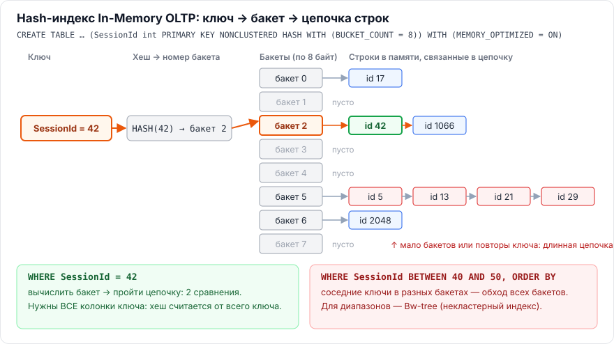

**Где живёт.** In-Memory OLTP (кодовое имя Hekaton, с SQL Server 2014; во всех редакциях — с 2016 SP1) хранит таблицу целиком в памяти, без страниц и без блокировок — через версии строк. Таблице нужна файловая группа `MEMORY_OPTIMIZED_DATA` и хотя бы один индекс. **Индексы memory-optimized таблиц не пишутся на диск и в журнал**: при старте базы строки читаются из checkpoint-файлов, а индексы строятся заново.

**Устройство.**
- Массив из `BUCKET_COUNT` указателей по 8 байт. Число округляется вверх до степени двойки: `BUCKET_COUNT = 1 000 000` даёт 1 048 576 бакетов (8 МБ).
- Сама строка в памяти хранит указатель на следующую строку того же бакета — индекс не хранит копий ключа, он «сшивает» строки в цепочки.
- Поиск `WHERE SessionId = 42`: хеш от 42 → номер бакета → пройти по цепочке, сравнивая ключ.

**Как выбрать `BUCKET_COUNT`.** Ориентир — в 1–2 раза больше числа **уникальных** значений ключа. Слишком мало — длинные цепочки. Слишком много — лишняя память и медленный полный обход. Изменить можно только `ALTER TABLE … ALTER INDEX … REBUILD WITH (BUCKET_COUNT = …)` (2016+).

**Как проверить.** `sys.dm_db_xtp_hash_index_stats`: `total_bucket_count`, `empty_bucket_count`, `avg_chain_length`, `max_chain_length`. Здоровое состояние — пустых бакетов около трети и больше, средняя цепочка короткая (единицы). Много пустых бакетов и при этом длинные цепочки — много одинаковых значений ключа: hash здесь не подходит, нужен Bw-tree.

#### Когда Hash даёт ощутимую пользу ✅

| Сценарий | Почему работает |
|---|---|
| **Очень частые точечные запросы и вставки** по ключу: сессии, корзины, очереди, кеш состояний | Бакет вычисляется, цепочка короткая — без обхода дерева и без блокировок |
| **Ключ почти уникален**, число значений известно заранее | `BUCKET_COUNT` легко подобрать, цепочки остаются короткими |
| **Промежуточные таблицы ETL** с `DURABILITY = SCHEMA_ONLY` | Нет записи в журнал вообще, поиск по `=` мгновенный |

#### Когда Hash не поможет или навредит ❌

| Сценарий | Что происходит | Что делать |
|---|---|---|
| **Диапазон, `ORDER BY`, `LIKE 'abc%'`** | Порядка нет — обход всех бакетов | Bw-tree (некластерный индекс той же таблицы) |
| **Условие только по части составного ключа** | Хеш считается от всего ключа — индекс неприменим | Bw-tree или отдельный hash по нужной колонке |
| **Много повторов ключа** (статус, код региона) | Все повторы в одной цепочке | Bw-tree |
| **Число строк выросло в разы** | Бакетов не хватает, цепочки длинные | `REBUILD WITH (BUCKET_COUNT = …)` |
| **Обычная дисковая таблица** | Hash-индексов нет | B-tree; для длинных ключей — вычисляемая колонка `HASHBYTES(...)` + B-tree и перепроверка значения |

#### Практика

[sql/mssql/10_inmemory_hash_bwtree.sql](../sql/mssql/10_inmemory_hash_bwtree.sql): файловая группа для In-Memory, таблица с hash и Bw-tree, планы для `=`, диапазона и `ORDER BY`, состояние бакетов при нормальном и заниженном `BUCKET_COUNT`, `REBUILD` с новым числом бакетов.

#### Аналоги

| Где | Что | Чем отличается от hash MS SQL |
|---|---|---|
| **PostgreSQL** | [Hash-индекс](03-postgresql.md#hash--корзины-по-хеш-коду) | Для любых таблиц, на диске, пишется в WAL (с PG 10). Корзины делятся по мере роста — `BUCKET_COUNT` задавать не нужно |
| **Redis, Memcached** | Вся СУБД — хеш-таблица «ключ → значение» в памяти | Рехеширование постепенное, число бакетов не фиксировано. Нет транзакций вместе с остальными данными базы |
| **Tarantool** | In-memory СУБД с индексами `HASH` и `TREE` | По замыслу ближе всего к In-Memory OLTP: hash для `=`, дерево для диапазонов |
| **MySQL** | `HASH` у движка MEMORY; **adaptive hash index** в InnoDB | Адаптивный индекс InnoDB строится сам поверх B-tree для «горячих» страниц, его не создают вручную |
| **Cassandra, DynamoDB** | Хеш от partition key | Хеш решает, **на каком узле** лежат данные, а не ищет строку внутри таблицы |

**Резюме.** Hash в MS SQL — узкий инструмент внутри транзакционной базы. Redis им не заменяется и его не заменяет: Redis — кэш, сессии, счётчики **вне** базы, без общей транзакции с таблицами. Если нужен очень быстрый доступ по ключу и транзакционность с остальными данными не важна — Redis или Tarantool; если важна — memory-optimized таблица с hash.

> **Запомнить:** hash в MS SQL — только у memory-optimized таблиц. Бакеты считаются от всего ключа: только `=` по всем колонкам ключа. `BUCKET_COUNT` — в 1–2 раза больше числа уникальных значений, задаётся заранее. Индекс не хранится на диске — строится при запуске.

---

### Bw-tree — некластерный индекс memory-optimized таблиц

> **В одном абзаце.** Bw-tree — это то же упорядоченное B-дерево, только страницы в нём **никогда не переписываются на месте**. Изменение приклеивается к странице сверху маленькой «наклейкой» (delta-записью), а новая версия публикуется одной атомарной командой процессора в **таблице маппинга**. Поэтому потокам не нужны latch'и и не нужно стоять в очереди к странице. В MS SQL так устроены все `NONCLUSTERED`-индексы (кроме `HASH`) у memory-optimized таблиц (In-Memory OLTP). У обычных дисковых таблиц — классическое B-дерево. Название — шутка авторов из Microsoft Research: «Bw» — от *buzz word*.

#### Зачем он понадобился

Вспомните [горячую последнюю страницу](#хороший-и-плохой-split) из 2.2. Ключ возрастает, все параллельные вставки идут в одну и ту же последнюю страницу. Чтобы два потока не испортили её одновременно, каждый берёт на странице **latch** (короткую защёлку) и работает по очереди: в ожиданиях видно `PAGELATCH_EX`. Страница при этом уже лежит в памяти, ждут не диска, а друг друга. Чем больше ядер, тем длиннее очередь.

In-Memory OLTP задуман так, чтобы этой очереди не было совсем: строки — без блокировок (через версии), индексы — без latch'ей. Hash-индекс решает это для `=`, а для упорядоченного индекса понадобилась новая структура — Bw-tree.

#### Простыми словами

Bw-tree держится на трёх идеях. У каждой своя бытовая аналогия.

**1. Наклейки вместо ластика (delta-записи).** Представьте страницу справочника, которую нельзя исправлять ручкой. Чтобы добавить строку, на страницу сверху клеят стикер «+25». Чтобы удалить — стикер «−40». Сама страница остаётся нетронутой. Читатель смотрит сначала стикеры (от свежего к старому), потом страницу под ними и складывает в уме итоговое содержимое.

**2. Телефонная книга страниц (таблица маппинга).** У каждой страницы есть постоянный номер — **PID**. Страницы ссылаются друг на друга только по PID, а где страница физически лежит в памяти, знает одна общая таблица маппинга «PID → адрес». Если у человека сменился номер телефона, не обзванивают всех знакомых — меняют одну строку в книге. Так и здесь: чтобы «заменить» страницу (повесить на неё новый стикер или подложить новую версию), меняют одну ячейку в таблице маппинга.

**3. «Поменяй, только если никто не успел раньше» (CAS).** Ячейку меняют одной командой процессора **compare-and-swap**: «если в ячейке PID 3 всё ещё адрес X — запиши туда Y, иначе ничего не делай и скажи, что не вышло». Эта команда атомарна: два потока не могут выполнить её «одновременно наполовину». Похоже на бронирование места в кинотеатре онлайн: кто первым нажал «Оплатить», тот и сел. Второй получает «место уже занято», смотрит на свежую схему зала и выбирает снова.

**Где аналогии ломаются.**
- Стикеры не копятся вечно: когда их становится много (в SQL Server — порядка 16), страницу **переписывают начисто** — это консолидация.
- Проигравший CAS поток не «ждёт в очереди»: он сразу повторяет попытку уже поверх чужого стикера. Ожидания нет, но повторная работа есть. Lock-free — это «никто не держит страницу», а не «никогда не бывает конфликтов».

**Три мысли, которые надо унести:**

1. Для запросов это **обычное упорядоченное дерево**: `=`, диапазоны, `ORDER BY`, левый префикс составного ключа.
2. Внутри **нет latch'ей**: изменение — delta-запись, публикация — одна CAS в таблице маппинга, длинные цепочки консолидируются.
3. Индекс **однонаправленный**: создан по возрастанию — `ORDER BY … DESC` из него не получить, в плане будет `Sort`.

#### Как устроено

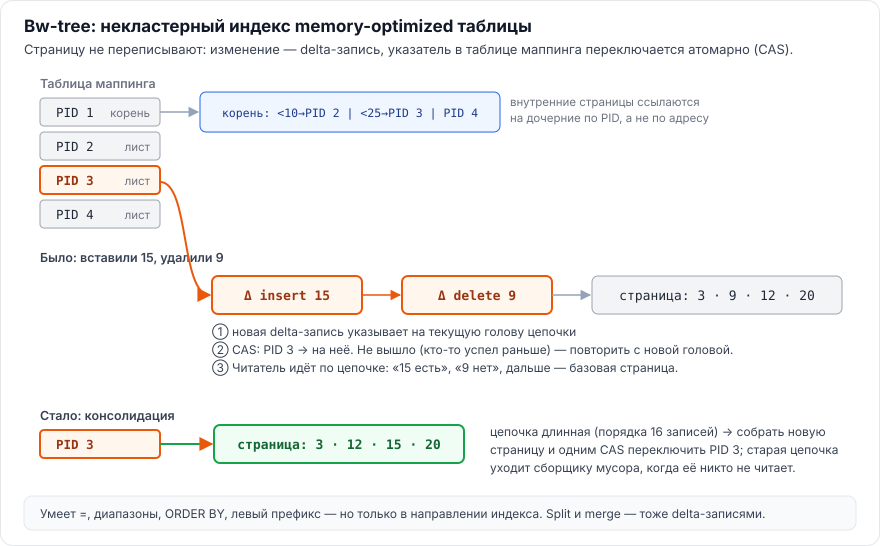

**Пример: вставка без блокировок.** Лист с PID 3 содержит ключи `3 · 9 · 12 · 20`. Таблица маппинга: `PID 3 → адрес A`.

1. Поток хочет вставить `15`. Он создаёт delta-запись «insert 15», внутри которой ссылка на текущую голову страницы — адрес A.
2. CAS: «если `PID 3` всё ещё указывает на A — переставь на мою delta-запись». Получилось — вставка видна всем.
3. Следующий поток удаляет `9`: delta-запись «delete 9» → ссылка на «insert 15» → CAS. Цепочка растёт сверху.
4. Читатель, пришедший по PID 3, идёт по цепочке: «15 есть», «9 нет», затем базовая страница. Итог: `3 · 12 · 15 · 20`.

**Что, если два потока пишут одновременно.** Оба прочитали `PID 3 → A` и каждый приготовил свою delta-запись. CAS первого проходит. CAS второго не проходит: в ячейке уже не A. Второй поток перечитывает голову, перецепляет свою delta-запись на запись первого и повторяет CAS. Изменения не теряются и не затирают друг друга.

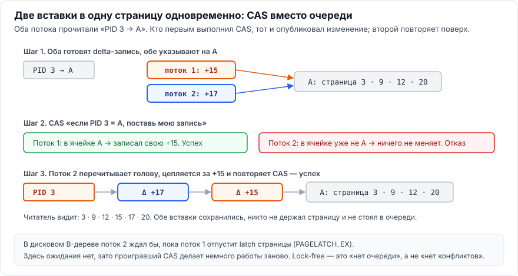

**Консолидация.** Длинная цепочка замедляет чтение: каждый раз её надо пройти целиком. Поэтому когда цепочка дорастает примерно до 16 записей, поток, который это заметил, собирает **новую** страницу со всеми изменениями и тем же CAS переключает на неё PID. Старые страницу и delta-записи сразу не удаляют: их может дочитывать другой поток. Память освобождает сборщик мусора, когда старую версию гарантированно никто не видит.

**Split и merge.** Переполненная страница делится на две, полупустые сливаются — как в обычном B-дереве. Только делается это несколькими атомарными шагами через специальные delta-записи, так что ни один читатель не увидит «полуразрезанную» страницу.

**Чем отличается от дискового B-дерева.**

| | B-дерево дисковой таблицы | Bw-tree memory-optimized таблицы |
|---|---|---|
| Как меняется страница | На месте, под latch'ем | Не меняется: delta-запись + CAS |
| Ссылки между страницами | Номера страниц файла | PID через таблицу маппинга |
| Размер страницы | Ровно 8 КБ | Переменный, только в памяти |
| Что в листе | Ключ + RID или ключ кластерного индекса | Ключ + указатель прямо на строку в памяти |
| Журнал и диск | Каждое изменение индекса — в журнал | Индекс **не пишется** ни в журнал, ни на диск: при старте базы строится заново по данным |
| Обслуживание | Split, merge, `REORGANIZE`/`REBUILD` | Split, merge, консолидация — сами; фрагментацию не обслуживают |
| Направление сканирования | В обе стороны | Только в направлении индекса |

**Как создать.** На memory-optimized таблице команды `CREATE INDEX` нет: индексы объявляют прямо в `CREATE TABLE` или добавляют через `ALTER TABLE … ADD INDEX` (2016+). Любой `NONCLUSTERED` без слова `HASH` — это Bw-tree.

```sql
CREATE TABLE dbo.Orders
(
    OrderId    int       NOT NULL PRIMARY KEY NONCLUSTERED HASH WITH (BUCKET_COUNT = 1048576), -- hash
    CustomerId int       NOT NULL,
    OrderDate  datetime2 NOT NULL,
    INDEX IX_Customer_Date NONCLUSTERED (CustomerId, OrderDate DESC)                             -- Bw-tree
)
WITH (MEMORY_OPTIMIZED = ON, DURABILITY = SCHEMA_AND_DATA);
```

**Как заглянуть внутрь.** `sys.dm_db_xtp_nonclustered_index_stats`: число листовых и внутренних страниц, delta-страниц, консолидаций, split'ов и merge'ей.

**Сравнение с hash.**

| | Hash | Bw-tree |
|---|---|---|
| `=` по полному ключу | Быстрее всего | Быстро |
| Диапазон, `ORDER BY`, левый префикс | Нет | Да (в направлении индекса) |
| Повторы ключа | Плохо: длинные цепочки | Нормально |
| Что задавать заранее | `BUCKET_COUNT` | Ничего |

Если сомневаетесь, что выбрать для memory-optimized таблицы, — Bw-tree: он не деградирует от неудачного `BUCKET_COUNT`.

#### Когда Bw-tree даёт ощутимую пользу ✅

| Сценарий | Почему работает |
|---|---|
| **Диапазоны и сортировка по memory-optimized таблице** | Hash этого не умеет, Bw-tree — да |
| **Высокая конкуренция за «горячий» конец индекса** (возрастающий ключ) | Нет latch'ей на странице — нет очереди `PAGELATCH_EX`, как у дискового B-дерева |
| **Ключ с повторами** (статус, дата, клиент) | Нет длинных цепочек, как у hash |
| **Число строк заранее неизвестно** | Нечего подбирать: дерево растёт само |

#### Когда Bw-tree не поможет ❌

| Сценарий | Что происходит | Что делать |
|---|---|---|
| **`ORDER BY` в обратном направлении** | `Sort` в плане | Создать индекс с нужным направлением (`DESC`) |
| **Только `=` по уникальному ключу на огромном потоке** | Работает, но чуть медленнее hash | Hash с правильным `BUCKET_COUNT` |
| **Таблица не помещается в память** | In-Memory OLTP держит таблицу целиком в RAM | Дисковая таблица, B-tree |
| **База 1С** | Платформа не создаёт memory-optimized таблиц | Знание для своих внешних баз и интеграционных таблиц |

#### Частые ошибки в ответах

Эти неточности регулярно встречаются в объяснениях Bw-tree, в том числе у нейросетей:

| Утверждение | Как на самом деле |
|---|---|
| «Bw-tree можно создать на обычной таблице» | Только на memory-optimized. У дисковых таблиц — B-tree |
| «Индекс хранится на диске, как обычный» | Индексы In-Memory OLTP не пишутся ни на диск, ни в журнал — строятся при старте базы |
| «Никакой поток никогда ничего не ждёт» | Latch'ей нет, но проигравший CAS повторяет работу. Конфликт есть, очереди нет |
| «Консолидацию делает фоновый процесс» | Её запускает рабочий поток, заметивший длинную цепочку. Фоновый — только сборщик мусора старых версий |
| «Латчи — проблема только диска, в памяти их нет» | `PAGELATCH_EX` — ожидание страницы, которая **уже в памяти**. Именно поэтому In-Memory OLTP от latch'ей отказался |
| «Раз дерево — можно читать в обе стороны» | Только в направлении индекса |

#### Проверь себя

<details>
<summary>1. Почему Bw-tree не правит страницу на месте?</summary>

Правка на месте требует, чтобы другие потоки на это время к странице не прикасались, — то есть latch. Delta-запись создаётся «в стороне» и публикуется одной атомарной CAS, поэтому страницу никто не держит.
</details>

<details>
<summary>2. Зачем нужна таблица маппинга, если можно хранить адреса прямо в страницах?</summary>

Тогда замена страницы потребовала бы поправить все ссылки на неё — несколько изменений, которые нельзя сделать одной атомарной операцией. С таблицей маппинга ссылки идут по PID, и замена — это одна ячейка и одна CAS.
</details>

<details>
<summary>3. Два потока одновременно вставляют ключ в одну страницу. Что произойдёт?</summary>

CAS одного пройдёт, второго — нет. Второй перечитает голову цепочки, перецепит свою delta-запись на запись первого и повторит CAS. Обе вставки сохранятся.
</details>

<details>
<summary>4. Что произойдёт, если delta-записей станет много?</summary>

Консолидация: собирается новая страница со всеми изменениями, CAS переключает на неё PID, старая цепочка уходит сборщику мусора, когда её никто не читает. В SQL Server порог — порядка 16 записей.
</details>

<details>
<summary>5. Индекс создан по <code>OrderDate</code> по возрастанию. Запрос <code>ORDER BY OrderDate DESC</code> — что в плане?</summary>

`Sort`: Bw-tree читается только в направлении индекса. Нужен индекс по `OrderDate DESC`.
</details>

<details>
<summary>6. Почему в базе 1С вы не встретите Bw-tree?</summary>

Bw-tree бывает только у memory-optimized таблиц, а платформа 1С создаёт обычные дисковые таблицы с B-tree-индексами.
</details>

#### Практика

- [sql/mssql/10_inmemory_hash_bwtree.sql](../sql/mssql/10_inmemory_hash_bwtree.sql) — тот же скрипт, что и для hash: планы для `=`, диапазона, `ORDER BY` и `DESC`.
- Интерактивная схема (hash и Bw-tree рядом, вставка delta-записью, консолидация): [открыть в браузере](https://raw.githack.com/shultzMAN87/indexes-1c-attestation/main/interactive/mssql-inmemory.html) · [файл mssql-inmemory.html](../interactive/mssql-inmemory.html).

#### Аналоги

| Где | Что | Чем отличается от Bw-tree |
|---|---|---|
| **PostgreSQL** | Аналога нет: нет in-memory движка. Но обычный [B-tree PG](03-postgresql.md#b-tree--то-же-b-дерево-что-в-ms-sql-с-отличиями) построен по алгоритму Лемана–Яо: у каждой страницы есть ссылка вправо, поэтому поиск не держит latch'и на всём пути спуска и не мешает расщеплениям | Та же цель — меньше ждать друг друга, — но классическими средствами: страницы правятся на месте под короткими latch'ами |
| **SingleStore (MemSQL)** | Строковые таблицы в памяти на **lock-free skip list** | Тот же подход «без latch'ей», другая структура |
| **Tarantool, Redis** | Данные обрабатывает **один поток** | Latch'и не нужны вовсе — конкуренции за страницу нет. Масштабируются шардированием |
| **RocksDB, Cassandra (LSM-деревья)** | Изменения не правят старые данные, а дописываются, потом сливаются | Та же идея «не переписывать на месте, а дописывать», только на уровне файлов на диске |

**Резюме.** Bw-tree — внутренняя деталь In-Memory OLTP: его не выбирают отдельно и не заменяют внешней системой. Полезно понимать саму идею — дописывать изменения вместо правки на месте, — она же лежит в основе LSM-деревьев и многих NoSQL-хранилищ.

> **Запомнить:** Bw-tree — «B-дерево без latch'ей» для memory-optimized таблиц. Три идеи: **delta-записи** вместо правки страницы, **таблица маппинга** PID → адрес, публикация одной **CAS**. Проиграл CAS — повтори поверх чужой записи. Длинная цепочка (≈16) → **консолидация**. Умеет `=`, диапазоны, сортировку и левый префикс — только в направлении индекса. На диск и в журнал не пишется.

---

### Полнотекстовый индекс (и семантический)

#### Простыми словами

**Аналогия — предметный указатель в конце книги.** Указатель не хранит текст книги: в нём слова по алфавиту и номера страниц, где они встречаются. Чтобы найти, где говорится про «индекс», не надо перелистывать книгу — открываете указатель на букву «И».

**Где аналогия ломается.** Полнотекстовый индекс знает язык: «индексы», «индексов», «индексом» сводятся к одной основе (стеммер), а «и», «на», «по» не индексируются вовсе (стоп-слова). Кроме номеров документов хранятся **позиции** слов — для поиска фраз и `NEAR`. И обновляется указатель **асинхронно**: только что вставленная строка находится не сразу.

**Три мысли, которые надо унести:**

1. Инвертированный индекс «слово → документы и позиции» — тот же принцип, что у GIN в PostgreSQL.
2. Запросы — только через `CONTAINS`/`FREETEXT` и `CONTAINSTABLE`/`FREETEXTTABLE` (с рангом). На `LIKE '%…%'` индекс не действует.
3. Это отдельная подсистема: свой каталог, разбивка на слова, асинхронное заполнение (population).

#### Как устроено

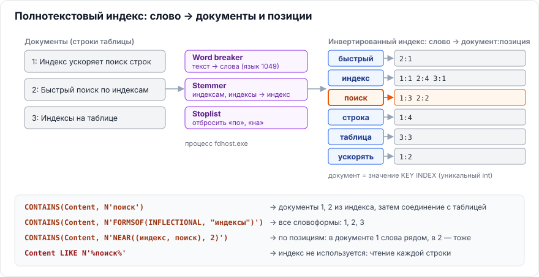

- **Разбор текста.** Word breaker делит текст на слова по правилам языка (`LANGUAGE 1049` — русский), stemmer приводит словоформы к основе, **stoplist** отбрасывает стоп-слова. Документы в `varbinary(max)` (docx, pdf) читаются через **iFilter** по колонке с расширением файла. Разбор выполняется в отдельном процессе `fdhost.exe`.
- **Хранение.** Индекс хранится во внутренних таблицах базы: для каждого слова — список документов (ключей строки) и позиций. Ключ документа — **уникальный одноколоночный не-NULL индекс** таблицы (`KEY INDEX`), лучше `int`. Полнотекстовый индекс на таблицу — **один**, но может включать несколько колонок.
- **Заполнение.** `CHANGE_TRACKING AUTO` — изменения подхватываются фоном; `MANUAL` — по команде; полное заполнение — при создании. Мелкие порции изменений образуют фрагменты индекса; `ALTER FULLTEXT CATALOG … REORGANIZE` сливает их (master merge).
- **Запрос** в плане — оператор `Table Valued Function [FulltextMatch]`: индекс отдаёт ключи документов, затем соединение с таблицей.

```sql
WHERE CONTAINS(Content, N'FORMSOF(INFLECTIONAL, "индекс")')    -- все словоформы
WHERE CONTAINS(Content, N'"индекс*"')                           -- префикс
WHERE CONTAINS(Content, N'NEAR((индекс, страница), 5)')         -- слова рядом
WHERE FREETEXT(Content, N'как ускорить поиск')                   -- «по смыслу»: словоформы + тезаурус
SELECT * FROM CONTAINSTABLE(dbo.Docs, Content, N'индекс') AS k  -- KEY и RANK
```

Посмотреть, на какие слова разбит текст: `sys.dm_fts_parser`; что лежит в индексе: `sys.dm_fts_index_keywords` и `sys.dm_fts_index_keywords_by_document`.

**Семантический индекс** строится поверх полнотекстового (`STATISTICAL_SEMANTICS` у колонки) и даёт ключевые фразы документа (`SEMANTICKEYPHRASETABLE`) и похожие документы (`SEMANTICSIMILARITYTABLE`). Требует отдельной установки базы Semantic Language Statistics. Встречается редко.

**Где есть.** Компонент **Full-Text Search** ставится отдельно при установке SQL Server (Developer, Standard, Enterprise; Express — в сборке with Advanced Services; на Linux — пакет `mssql-server-fts`). Проверка: `SELECT FULLTEXTSERVICEPROPERTY('IsFullTextInstalled')`.

#### Когда полнотекстовый индекс даёт ощутимую пользу ✅

| Сценарий | Почему работает |
|---|---|
| **Поиск по словам в больших текстах**: описания, комментарии, переписка, база знаний | Указатель вместо сканирования всех строк |
| **Нужны словоформы, префиксы, фразы, близость слов** | Стеммер, `FORMSOF`, `"слово*"`, `NEAR` |
| **Поиск внутри файлов в базе** (docx, pdf в `varbinary(max)`) | iFilter извлекает текст |
| **Нужна релевантность** | `CONTAINSTABLE` возвращает `RANK` |

#### Когда не поможет или навредит ❌

| Сценарий | Что происходит | Что делать |
|---|---|---|
| **Подстрока внутри слова** (`%декс%`) | Индекс знает слова и префиксы, но не середину слова | Отдельное решение: триграммы во внешней системе, n-граммы |
| **Нужна мгновенная видимость изменений** | Заполнение асинхронное | Учитывать задержку; `MANUAL` + запуск по расписанию |
| **Короткие поля, точное совпадение** (артикул, код) | Избыточно | B-tree |
| **Запрос написан через `LIKE`** | Индекс не используется | Переписать на `CONTAINS` |

#### Практика

[sql/mssql/11_fulltext.sql](../sql/mssql/11_fulltext.sql): проверка компонента, разбор русского текста (`sys.dm_fts_parser`), каталог и индекс, `CONTAINS` со словоформами, префиксом и `NEAR`, `FREETEXT`, ранг через `CONTAINSTABLE`, содержимое индекса, задержка при `CHANGE_TRACKING AUTO`, сравнение чтений с `LIKE '%…%'`.

#### Аналоги

| Где | Что | Чем отличается от полнотекстового MS SQL |
|---|---|---|
| **PostgreSQL** | [GIN](03-postgresql.md#gin--инвертированный-индекс) по `tsvector` — тот же инвертированный индекс; [GiST](03-postgresql.md#gist--дерево-охватывающих-ключей) по `tsvector` — компактнее, но с ложными срабатываниями. Как текст превращается в лексемы — [здесь](03-postgresql.md#полнотекстовый-поиск-как-текст-становится-лексемами) | Встроен в ядро, отдельной службы нет. Индекс **синхронный**: строка находится сразу после `COMMIT`. Ранг (`ts_rank`) считается по строкам таблицы, а не по индексу — на больших выборках это медленно (расширение RUM хранит позиции прямо в индексе) |
| **Elasticsearch / OpenSearch** (Lucene) | Инвертированный индекс — основа всей системы. Неизменяемые сегменты сливаются в фоне — как фрагменты и master merge в MS SQL | Изменения видны после refresh (по умолчанию около секунды) — асинхронно, как `CHANGE_TRACKING AUTO`. Ранжирование BM25, нечёткий поиск (опечатки), синонимы, подсветка, автодополнение, фасеты, горизонтальное масштабирование |
| **Manticore Search** (наследник Sphinx) | Поисковый движок с SQL-подобным языком | Легче Elasticsearch, хорошая морфология |
| **ClickHouse** | Текстовый индекс (инвертированный, GA с версии 26.2, март 2026) | Для поиска по токенам в журналах и событиях вместе с аналитикой; релевантность и фразовый поиск — не его задача |
| **MongoDB** | `text`-индекс | Один на коллекцию, возможности скромнее Elasticsearch |

**Резюме.** Встроенный полнотекстовый поиск MS SQL или PostgreSQL **заменяет Elasticsearch**, когда документов до десятков миллионов и они помещаются на одном сервере, искать нужно по словам, словоформам и фразам, достаточно простой релевантности, а важнее транзакционность и соединения с остальными таблицами (в PostgreSQL — ещё и мгновенная видимость). **Elasticsearch нужен**, когда качество поиска — часть продукта: опечатки, синонимы, тонкая настройка ранжирования, автодополнение, фасеты; когда объём требует нескольких узлов; когда это поиск по журналам. Цена — отдельный кластер и синхронизация данных из основной базы.

> **Запомнить:** полнотекстовый = инвертированный индекс «слово → документы и позиции», как GIN. Word breaker, стеммер, стоп-слова, язык. Один на таблицу, нужен уникальный `KEY INDEX`. Только `CONTAINS`/`FREETEXT`, на `LIKE` не действует. Заполнение асинхронное.

---

### Пространственный индекс (spatial) — сетка поверх B-tree

#### Простыми словами

**Аналогия — карта города в квадратах.** На туристической карте у каждого объекта указан квадрат: «музей — Б4». Чтобы найти всё в районе Б4–В5, смотрите список объектов этих квадратов, а не все объекты города. Потом проверяете по карте, действительно ли объект внутри района.

**Где аналогия ломается.** Сетка многоуровневая: квадрат делится на подквадраты, те — ещё раз. Большой объект может занимать много квадратов, поэтому их число на объект ограничено (`CELLS_PER_OBJECT`). Список «квадрат → объекты» хранится в **обычном B-дереве**.

**Три мысли, которые надо унести:**

1. Поиск в два шага: **первичный фильтр** по ячейкам сетки (быстро, с запасом) и **вторичный** — точная проверка геометрии кандидатов.
2. Индекс работает, только если условие записано в форме, которую он понимает: `col.STIntersects(@g) = 1`, `col.STDistance(@p) < @d` и т.п.
3. Нужен кластерный первичный ключ таблицы.

Пощёлкать самому: [открыть в браузере](https://raw.githack.com/shultzMAN87/indexes-1c-attestation/main/interactive/spatial.html) · [файл spatial.html](../interactive/spatial.html).

#### Как устроено

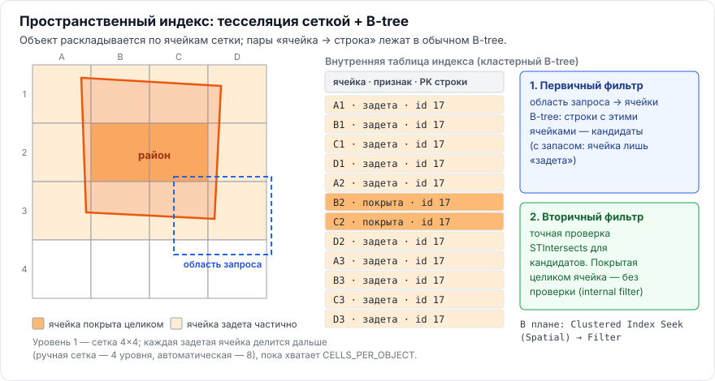

- **Типы.** `geometry` — плоские координаты (план склада, чертёж). `geography` — широта/долгота на эллипсоиде Земли.
- **Тесселяция.** Пространство делится сеткой, каждая ячейка — ещё раз, и так на несколько уровней. Ручная сетка (`GEOMETRY_GRID`, `GEOGRAPHY_GRID`) — **4 уровня**, плотность каждого `LOW` (4×4), `MEDIUM` (8×8), `HIGH` (16×16). Автоматическая (`GEOMETRY_AUTO_GRID`, `GEOGRAPHY_AUTO_GRID`, по умолчанию с уровня совместимости 110) — **8 уровней**. Для `geometry` задаётся рамка `BOUNDING_BOX`: объекты за её пределами индекс не различает.
- **Правила тесселяции.** Ячейка, целиком покрытая объектом, записывается и дальше не делится (covering rule). Объект занимает не больше `CELLS_PER_OBJECT` ячеек (по умолчанию 16 для ручной сетки, 8 и 12 — для автоматической): если дробить дальше — лимит будет превышен, дробление останавливается. Записываются только самые глубокие ячейки (deepest cell rule).
- **Хранение.** Пары «номер ячейки + признак (задета / покрыта целиком) + первичный ключ строки» — во внутренней таблице с кластерным B-tree.
- **Запрос.** Область запроса тоже раскладывается на ячейки → поиск по B-tree даёт кандидатов (первичный фильтр). Если ячейка объекта целиком покрыта областью, строка подходит без проверки (internal filter). Остальных кандидатов проверяет точный метод `STIntersects` и т.п. (вторичный фильтр). В плане — `Clustered Index Seek (Spatial)` и `Filter`.
- **Поддерживаемые условия:** `STIntersects`, `STContains`, `STWithin`, `STOverlaps`, `STTouches`, `STEquals`, `Filter` (= 1), `STDistance(...) < / <= @d`. Ближайшие соседи (2012+): `TOP (k) … WHERE col.STDistance(@p) IS NOT NULL ORDER BY col.STDistance(@p)`.
- **Насколько хорош индекс:** `sp_help_spatial_geometry_index` / `sp_help_spatial_geography_index` — доля кандидатов, отсеянных первичным фильтром, и доля строк, принятых без вторичной проверки.

#### Когда spatial даёт ощутимую пользу ✅

| Сценарий | Почему работает |
|---|---|
| **«Что в этой области»**: точки в полигоне района, пересечение участков | Первичный фильтр отсекает почти всё по ячейкам |
| **«В радиусе N метров»** | `STDistance < @d` превращается в поиск по ячейкам круга |
| **«N ближайших»** | Индекс проходит ячейки по удалённости |

#### Когда не поможет или навредит ❌

| Сценарий | Что происходит | Что делать |
|---|---|---|
| **Условие в «неудобной» форме**: `STIntersects(...) = 0`, функция поверх результата | Индекс не применяется | Записать как `метод(...) = 1` или `< @d` |
| **Объекты за пределами `BOUNDING_BOX`** (geometry) | Попадают в одну «внешнюю» ячейку — фильтр не работает | Задать рамку по реальным данным |
| **Огромные объекты и маленький `CELLS_PER_OBJECT`** | Грубые ячейки, много кандидатов на вторичную проверку | Подобрать сетку и `CELLS_PER_OBJECT` по `sp_help_spatial_*_index` |
| **Широта и долгота в двух `float`** | Это не spatial-тип | Хранить `geography`; или B-tree по (широта, долгота) для прямоугольника |

#### Практика

[sql/mssql/12_spatial.sql](../sql/mssql/12_spatial.sql): точки магазинов и полигоны районов (`geography`), индекс с автоматической и ручной сеткой, «в радиусе», «в районе», ближайшие N, план с первичным и вторичным фильтром, оценка индекса через `sp_help_spatial_geography_index`, условие, которое ломает использование индекса.

#### Аналоги

| Где | Что | Чем отличается от spatial MS SQL |
|---|---|---|
| **PostgreSQL** (PostGIS) | [GiST](03-postgresql.md#gist--дерево-охватывающих-ключей) — R-дерево по ограничивающим прямоугольникам; [SP-GiST](03-postgresql.md#sp-gist--разбиение-пространства-на-непересекающиеся-части) — дерево квадрантов и k-d-дерево | Дерево строится по самим объектам — не нужно задавать сетку, `BOUNDING_BOX`, `CELLS_PER_OBJECT`. Ближайшие соседи — `ORDER BY pos <-> точка` прямо по индексу |
| **MongoDB** | `2dsphere`: сфера режется на иерархические ячейки S2, номера ячеек — в обычном B-дереве | По устройству ближе всего к MS SQL: тоже «сетка → одномерный ключ → B-tree» |
| **Redis** | `GEO`: geohash точки как числовой ключ в sorted set | Та же идея сетки, только для точек; «рядом со мной» за миллисекунды, но без полигонов |
| **Elasticsearch** | `geo_point`, `geo_shape` на BKD-деревьях Lucene (разновидность k-d-дерева) | Ближе к SP-GiST; гео обычно сочетают с текстовым поиском |
| **MySQL, Oracle Spatial, SQLite (R\*Tree), Tarantool (RTREE)** | R-дерево | Ближе к GiST в PostgreSQL |

**Резюме.** Подходов два: **сетка + B-tree** (MS SQL, MongoDB, Redis, системы на сетках H3 и S2) и **дерево областей** (PostGIS, MySQL, Oracle). Для типичных задач — «магазины в радиусе», «точка в зоне доставки», «ближайший склад» — хватает встроенных средств MS SQL или PostGIS; PostGIS богаче функциями. Внешняя система нужна, когда гео — часть поиска в Elasticsearch или быстрый кэш «рядом со мной» в Redis.

> **Запомнить:** spatial = тесселяция (ручная сетка — 4 уровня, автоматическая — 8) + B-tree по номерам ячеек. Первичный фильтр по ячейкам, вторичный — точная геометрия. `CELLS_PER_OBJECT`, для geometry — `BOUNDING_BOX`. Нужен кластерный PK; условие — в форме `метод(...) = 1` или `STDistance < @d`.

---

### XML-индексы: primary, PATH / VALUE / PROPERTY, selective

#### Простыми словами

**Аналогия — разобрать договор на пункты и завести карточку на каждый.** Чтобы найти все договоры, где в пункте «Оплата» стоит «предоплата», не надо каждый раз читать договоры целиком: заранее заводим карточку на каждый пункт — путь, значение, номер договора.

**Три мысли, которые надо унести:**

1. **Primary XML index** — XML разбирается (shredding) на узлы, и они складываются в скрытую таблицу с кластерным B-tree. Без него XQuery разбирает документ при каждом запросе.
2. **Вторичные** — `PATH`, `VALUE`, `PROPERTY` — обычные B-tree поверх этой таблицы узлов, каждый под свой вид запроса.
3. **Selective XML index** индексирует только перечисленные пути — намного компактнее.

#### Как устроено

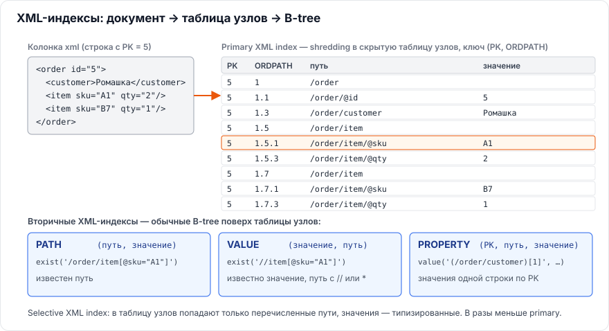

- **Primary.** Каждый узел документа (элемент, атрибут, текст) — строка скрытой таблицы: первичный ключ исходной строки, номер узла в формате ORDPATH (сохраняет порядок и вложенность), имя, тип, значение, идентификатор пути. Кластерный ключ — (PK, ORDPATH). Таблица часто в 2–5 раз больше самих XML. Требует кластерный первичный ключ исходной таблицы.
- **Вторичные:**

| Индекс | Ключ B-tree | Для какого запроса |
|---|---|---|
| `PATH` | путь, значение | Известен путь: `exist('/order/item[@sku="A1"]')` |
| `VALUE` | значение, путь | Известно значение, путь с `//` или `*`: `exist('//item[@sku="A1"]')` |
| `PROPERTY` | PK, путь, значение | Достать несколько значений из уже известной строки: `value()` по PK |

- **Selective XML index** (2012 SP1+). Перечисляются пути и их типы; индексируются только они, «продвинутые» значения хранятся типизированными. По ним можно строить вторичные selective-индексы.

```sql
CREATE PRIMARY XML INDEX PXML_Orders ON dbo.Orders (Doc);
CREATE XML INDEX IXML_Orders_Path ON dbo.Orders (Doc)
    USING XML INDEX PXML_Orders FOR PATH;

CREATE SELECTIVE XML INDEX SXI_Orders ON dbo.Orders (Doc)
FOR ( sku = '/order/item/@sku' AS SQL nvarchar(20),
      qty = '/order/item/@qty' AS SQL int );
```

#### Когда XML-индексы дают пользу ✅ и когда нет ❌

| Сценарий | Итог |
|---|---|
| Частые XQuery (`exist`, `value`, `nodes`) по большим документам | ✅ Primary + подходящий вторичный |
| Запросы всегда по нескольким известным путям | ✅ Selective — в разы меньше primary |
| XML только хранится и целиком отдаётся клиенту | ❌ Индекс — только лишнее место и медленная запись |
| Одно-два значения нужны в `WHERE` постоянно | ❌ Проще вычисляемая колонка (через функцию с `value()`) + B-tree ([2.8](#28-как-в-ms-sql-проиндексировать-выражение-вычисляемые-столбцы-и-индексированные-представления)) |
| Документы часто меняются | ❌ Каждое изменение переписывает все узлы документа в таблице узлов |

#### Практика

[sql/mssql/13_xml_indexes.sql](../sql/mssql/13_xml_indexes.sql): таблица заказов в XML, запрос без индекса и с primary, `PATH` и `VALUE` под разные запросы, размер таблицы узлов против исходных данных, selective XML index и его размер.

#### Аналоги

| Где | Что | Чем отличается от XML-индексов MS SQL |
|---|---|---|
| **PostgreSQL** | XML-индексов нет. [Индекс по выражению](03-postgresql.md#39-что-такое-индекс-по-выражению-в-postgresql-и-когда-он-нужен) с `xpath()` (B-tree) — аналог selective XML или вычисляемой колонки; GIN по массиву значений из `xpath()` | Индексируются только заранее выбранные пути, разбора документа на узлы нет |
| **Oracle** | `XMLIndex` | Тоже таблица путей и значений, по замыслу близко к primary XML |
| **BaseX, eXist-db** | Нативные XML-СУБД с индексами по путям, значениям и тексту | Нишевые системы |
| **MongoDB** | Индексы по путям документа | Та же идея, что у `PATH`-индекса, только для JSON-подобных документов |

**Резюме.** XML сегодня — чаще наследие интеграций и старых форматов; новые данные обычно хранят в JSON. Если по XML постоянно ищут по нескольким значениям, практичнее вынести их в обычные колонки с B-tree.

> **Запомнить:** primary XML = таблица узлов (shredding) с кластерным B-tree, нужен кластерный PK. Вторичные: `PATH` — известен путь, `VALUE` — известно значение, `PROPERTY` — значения одной строки. Selective — только нужные пути.

---

### JSON-индекс (SQL Server 2025)

#### Простыми словами

Та же идея, что у XML: документ разбирается на пары «путь → значение», и по ним строится индекс. До SQL Server 2025 у JSON не было ни своего типа, ни своего индекса — JSON хранили в `nvarchar(max)` и индексировали **вычисляемой колонкой** с `JSON_VALUE` и обычным B-tree. Этот приём работает с 2016 и его надо знать.

#### Как устроено

- Колонка нового типа **`json`** (хранится в бинарном формате). Индекс — `CREATE JSON INDEX … ON t(col) [FOR ('$.путь', …)]`; без `FOR` индексируется весь документ. Пути индексируются рекурсивно вниз и не должны перекрываться (`$.a` и `$.a.b` одновременно нельзя).
- Используется для `JSON_VALUE(col, '$.путь') = …` (а также `IN`, диапазон с `RETURNING` числового типа), `JSON_PATH_EXISTS(col, '$.путь') = 1`, `JSON_CONTAINS(...)`. `OPTIMIZE_FOR_ARRAY_SEARCH = ON` — для поиска по элементам массивов.
- Ограничения: нужен **кластерный первичный ключ** (меньше 128 байт); один JSON-индекс на колонку; создание только **офлайн** (блокировка Sch-M на всё время); нельзя на вычисляемую колонку и memory-optimized таблицу; нельзя указать в хинте.
- Статус: в Azure SQL — GA; в SQL Server 2025 по документации тоже доступен, но в ранних сборках шёл как preview. Если `CREATE JSON INDEX` выдаёт ошибку — включите `ALTER DATABASE SCOPED CONFIGURATION SET PREVIEW_FEATURES = ON`.

```sql
-- До 2025: вычисляемая колонка + B-tree (работает с SQL Server 2016)
ALTER TABLE dbo.Orders ADD CustomerId AS CAST(JSON_VALUE(Info, '$.customer.id') AS int);
CREATE INDEX IX_Orders_CustomerId ON dbo.Orders (CustomerId);
-- запрос с тем же выражением JSON_VALUE подхватит индекс без переписывания

-- SQL Server 2025: один индекс на много путей
CREATE JSON INDEX JX_Orders_Info ON dbo.Orders (Info) FOR ('$.customer', '$.items');
```

| Вычисляемая колонка + B-tree | JSON-индекс |
|---|---|
| Одна колонка — одно значение | Один индекс — много путей, массивы |
| `=`, диапазоны, сортировка, `INCLUDE` | `=`, `IN`, `JSON_PATH_EXISTS`, `JSON_CONTAINS` |
| `nvarchar`, с 2016 | Только тип `json`, с 2025 |

#### Практика

[sql/mssql/14_json_index.sql](../sql/mssql/14_json_index.sql): часть 1 — вычисляемая колонка + B-tree (любая версия с 2016); часть 2 — тип `json`, `CREATE JSON INDEX`, поиск по значению, по наличию пути и по элементу массива, сравнение планов (SQL Server 2025).

#### Аналоги

| Где | Что | Чем отличается от JSON-индекса MS SQL |
|---|---|---|
| **PostgreSQL** | [GIN](03-postgresql.md#gin--инвертированный-индекс) по `jsonb`: класс `jsonb_ops` (ключи и значения, операторы `?`, `@>`) или `jsonb_path_ops` (компактнее, только `@>`). [Индекс по выражению](03-postgresql.md#39-что-такое-индекс-по-выражению-в-postgresql-и-когда-он-нужен) `((doc->>'id'))` с B-tree — точный аналог вычисляемой колонки + B-tree | Тип `jsonb` и GIN по нему есть с PostgreSQL 9.4 (2014) — на десятилетие раньше. Создаётся `CONCURRENTLY`, без блокировки записи |
| **MongoDB** | Индекс по полю документа; **multikey** — по элементам массива; **wildcard** `$**` — по всем полям | Wildcard ≈ JSON-индекс без `FOR`, multikey ≈ `OPTIMIZE_FOR_ARRAY_SEARCH` |
| **Elasticsearch** | По умолчанию индексируется **каждое** поле документа (dynamic mapping) | Индексировать всё — норма, а не опция |
| **Couchbase** | Вторичные индексы (GSI) по путям документа, запросы на SQL++ | Документная СУБД с SQL-подобным языком |

**Резюме.** PostgreSQL с `jsonb` и GIN часто заменяет MongoDB, если документов не миллиарды, а нужны транзакции и соединения с обычными таблицами. MongoDB выбирают, когда вся модель данных документная и нужно шардирование из коробки. В MS SQL до 2025 тот же результат даёт вычисляемая колонка + B-tree.

> **Запомнить:** до 2025 JSON индексируют вычисляемой колонкой с `JSON_VALUE` + B-tree. С 2025 — тип `json` и `CREATE JSON INDEX`: много путей одним индексом, нужен кластерный PK, создаётся офлайн.

---

### Векторный индекс DiskANN (SQL Server 2025)

#### Простыми словами

**Задача.** Текст, картинку, товар модель превращает в **вектор** (эмбеддинг) из сотен чисел так, что похожие по смыслу объекты дают близкие векторы. «Найти похожие» = найти ближайшие векторы. Точный способ — посчитать расстояние до **каждого** вектора таблицы: это полный перебор.

**Аналогия — спросить дорогу у прохожих.** Индекс — граф: у каждого вектора есть список «знакомых» соседей. Поиск начинается с входной точки: смотрим её соседей, переходим к тому, кто ближе к цели, и так далее, пока ближе никого нет. Каждый знает немного соседей, но цепочка быстро приводит к нужному месту.

**Три мысли, которые надо унести:**

1. Ответ **приближённый**: можно пропустить одного из настоящих ближайших. Мера качества — **recall** (доля найденных настоящих соседей), обычно выше 0,9.
2. Точный поиск — `VECTOR_DISTANCE` + `ORDER BY` + `TOP` — индекс **не** использует. Приближённый — функция **`VECTOR_SEARCH`** по индексу.
3. В SQL Server 2025 это **preview**: нужно включать `PREVIEW_FEATURES`, и есть заметные ограничения.

Пощёлкать самому: [открыть в браузере](https://raw.githack.com/shultzMAN87/indexes-1c-attestation/main/interactive/vector-diskann.html) · [файл vector-diskann.html](../interactive/vector-diskann.html).

#### Что такое эмбеддинг

**Эмбеддинг — это координаты смысла.** У магазина на карте есть адрес из двух чисел — широта и долгота. По ним видно, что два магазина рядом, даже если названия ничем не похожи, и ближайший находится расчётом расстояния, без сравнения названий. Модель делает то же самое со смыслом: ставит текст, картинку или товар в точку пространства так, что похожее оказывается рядом. **Вектор** — это просто список координат этой точки.

**Почему чисел сотни, а не два.** У смысла много сторон: «кошка» — животное, домашнее, маленькое, пушистое, частый персонаж мемов. На двух осях это не уместить, поэтому у моделей от сотен до тысяч измерений (`vector(1536)`). Аналогия — **анкета**: 1536 вопросов, на каждый ответ числом; строка ответов и есть вектор, у похожих текстов ответы похожи. Но вопросы анкеты модель придумала сама, и **подписей у них нет**: нельзя сказать «12-я координата — пушистость». Смысл имеет только близость точек.

**Откуда модель знает, что похоже.** Её никто не учил вручную; она обучалась на огромном объёме текстов по принципу «скажи мне, кто твои соседи». «Яблоко» и «груша» встречаются среди одних и тех же слов (*спелое, сочное, компот*), поэтому получают близкие координаты — как кладовщик ставит рядом товары, которые забирают вместе, выводя это из тысяч накладных. Побочный эффект — «арифметика смыслов»: направления тоже значимы, `король − мужчина + женщина ≈ королева`.

**Текст, картинка, товар.**
- Текст модель читает целиком: «не проводится акт» и «документ реализации выдаёт ошибку при проведении» окажутся рядом почти без общих слов. В этом отличие от полнотекстового индекса: тот ищет **слова**, эмбеддинг — **смысл**.
- Мультимодальные модели (CLIP и подобные) кладут фото болта и текст «болт с шестигранной головкой» в одну область пространства — по тексту можно искать картинки.
- Товар — название + описание + характеристики: «Болт М8х20 оцинк.» и «болт оцинкованный 8*20» станут соседями, хотя `LIKE` их не сопоставит. Для 1С — поиск дублей в номенклатуре.

**Что значит «близко» — метрика (`METRIC` в индексе).**

| Метрика | Аналогия | Когда |
|---|---|---|
| `euclidean` | Линейка между точками | Если так рекомендует модель |
| `cosine` | Угол между стрелками из центра: двое указывают на одну гору с разного расстояния — направление одно | Чаще всего для текстов: длинный и короткий текст на одну тему смотрят в одну сторону |
| `dot` | Как `cosine`, но учитывает длину стрелки | Если модель обучена под скалярное произведение |

Метрику берут ту, что указана для модели.

**Подводные камни.**
1. **Разные модели — разные карты.** Векторы двух моделей несравнимы, как координаты из двух систем с разным нулём. Данные и запрос — одной моделью; сменили модель — пересчитать все векторы.
2. **Точные значения.** Артикулы, номера, ИНН эмбеддинги различают плохо: «А-1001» и «А-1002» почти одинаковы по смыслу. Для них — B-tree.
3. **Отрицание.** «Оплата прошла» и «оплата не прошла» часто рядом: тема одна.
4. **Похожесть задаёт модель.** Специфические термины («регистр накопления», «РАУЗ») общая модель раскладывает хуже общеупотребительных слов.

Карта смыслов, соседи и две метрики: [открыть в браузере](https://raw.githack.com/shultzMAN87/indexes-1c-attestation/main/interactive/embeddings.html) · [файл embeddings.html](../interactive/embeddings.html).

#### Как устроено


- **Тип `vector(n)`** — массив из n чисел `float32` (до 1998 измерений). Метрики: `cosine`, `euclidean`, `dot`.
- **DiskANN** — алгоритм Microsoft Research, рассчитанный на то, что граф лежит на диске, а не только в памяти. У каждой вершины ограниченное число соседей; при построении рёбра подбираются так, чтобы были и близкие соседи, и «дальние» рёбра для быстрых переходов.
- **Поиск:** от входной точки держится список лучших кандидатов; на каждом шаге раскрывается ближайший нераскрытый кандидат, его соседи добавляются в список; когда раскрывать нечего — список и есть ответ. Чем шире список, тем выше recall и тем больше чтений.

```sql
ALTER DATABASE SCOPED CONFIGURATION SET PREVIEW_FEATURES = ON;   -- SQL Server 2025
CREATE VECTOR INDEX VX_Docs ON dbo.Docs (Embedding) WITH (METRIC = 'cosine', TYPE = 'diskann');

-- Точно (полный перебор, индекс не нужен):
SELECT TOP (5) Id, VECTOR_DISTANCE('cosine', Embedding, @q) AS dist FROM dbo.Docs ORDER BY dist;

-- Приближённо по индексу (синтаксис SQL Server 2025 RTM):
SELECT t.Id, s.distance
FROM VECTOR_SEARCH(TABLE = dbo.Docs AS t, COLUMN = Embedding, SIMILAR_TO = @q,
                   METRIC = 'cosine', TOP_N = 5) AS s
ORDER BY s.distance;
```

**Версии индекса и ограничения.** В SQL Server 2025 (preview) таблица с векторным индексом становится **только для чтения**, `TOP_N` задаётся параметром, фильтр `WHERE` применяется **после** поиска (можно получить меньше строк, чем просили). В Azure SQL Database новая версия индекса снимает эти ограничения: DML разрешён, синтаксис `SELECT TOP (N) WITH APPROXIMATE … FROM VECTOR_SEARCH(…) ORDER BY distance`, фильтр применяется во время поиска, нужно не меньше 100 строк. Синтаксис ещё меняется — сверяйтесь с документацией под свою версию.

#### Кто строит эмбеддинг

**Сам движок SQL Server векторы не вычисляет: в нём нет модели.** Он хранит `vector`, считает `VECTOR_DISTANCE` и строит индекс. Вектор делает модель-эмбеддер. Обычная схема — приложение отправляет текст в модель, получает массив чисел и пишет его в колонку.

В SQL Server 2025 модель можно **вызвать из T-SQL**: один раз зарегистрировать через `CREATE EXTERNAL MODEL`, затем звать `AI_GENERATE_EMBEDDINGS`. Длинный текст предварительно режут на куски функцией `AI_GENERATE_CHUNKS` — документ целиком в один вектор обычно не превращают.

```sql
SELECT AI_GENERATE_EMBEDDINGS(N'не проводится акт' USE MODEL MyOllamaModel);

UPDATE dbo.Docs SET Embedding = AI_GENERATE_EMBEDDINGS(Content USE MODEL MyOllamaModel)
WHERE Embedding IS NULL;
```

| Где работает модель | Как подключается | Что учесть |
|---|---|---|
| **Облако** (OpenAI, Azure OpenAI) | HTTPS-эндпоинт + ключ в учётных данных базы | Данные уходят наружу, стоимость вызовов, исходящий трафик — на вашей стороне |
| **Свой сервер** (Ollama и т. п.) | HTTP-эндпоинт в своей сети | Данные не покидают контур; модель обслуживаете сами |
| **На сервере SQL** (ONNX Runtime) | Локальный рантайм, `LOCATION` — путь к файлам модели | Без сетевого трафика; preview: `PREVIEW_FEATURES = ON` и включение внешнего AI-рантайма |

Даже в варианте с ONNX вычисление делает отдельный рантайм, а не сам движок. В PostgreSQL так же: `pgvector` только хранит, считает расстояния и строит индекс; вызов модели из SQL — отдельными расширениями (например, pgai), но обычно эмбеддинги считает приложение.

**Применительно к 1С.** Колонок `vector` в базе 1С нет, и платформа `AI_GENERATE_EMBEDDINGS` не вызывает. Семантический поиск по данным 1С строят рядом: векторы и индекс — в отдельной базе или сервисе, эмбеддинги — моделью, данные — выгрузкой из 1С.

#### Когда векторный индекс даёт пользу ✅ и когда нет ❌

| Сценарий | Итог |
|---|---|
| Семантический поиск, RAG, «похожие товары» на сотнях тысяч и миллионах векторов | ✅ Обход графа вместо перебора |
| Несколько тысяч векторов | ❌ Точный перебор быстрый и даёт точный ответ |
| Нужен строго точный ответ | ❌ Только `VECTOR_DISTANCE` |
| Таблица постоянно меняется (SQL Server 2025 preview) | ❌ Таблица с индексом read-only |
| Поиск по словам, а не по смыслу | ❌ Полнотекстовый индекс |

#### Практика

[sql/mssql/15_vector_index.sql](../sql/mssql/15_vector_index.sql): синтетические векторы, точный kNN через `VECTOR_DISTANCE`, индекс DiskANN, приближённый поиск через `VECTOR_SEARCH` (оба варианта синтаксиса), подсчёт recall, проверка ограничения read-only.

#### Аналоги

| Где | Что | Чем отличается от DiskANN в MS SQL |
|---|---|---|
| **PostgreSQL** | Расширение **pgvector**: HNSW и IVFFlat (в методичке не разбирается — это не встроенный тип). Расширение **pgvectorscale**: StreamingDiskANN — тот же алгоритм, что в MS SQL | Таблица с индексом остаётся изменяемой; фильтр `WHERE` при итеративном сканировании (pgvector 0.8+) |
| **Qdrant** | Векторная СУБД, граф HNSW | Фильтр по полям (payload) применяется **во время** обхода графа, квантизация векторов для экономии памяти, шардирование |
| **Milvus** | Векторная СУБД: HNSW, IVF и **DiskANN** | Прямой аналог по алгоритму, рассчитан на миллиарды векторов |
| **Weaviate, Elasticsearch / OpenSearch, Redis** | HNSW | Векторный поиск в связке с текстовым (гибридный поиск) |
| **ClickHouse** | Индекс `vector_similarity` (HNSW, с версии 25.8) | Векторы рядом с аналитикой; индекс целиком загружается в память |

**Резюме.** Для RAG и «похожих товаров» на своих данных до нескольких миллионов векторов хватает pgvector или MS SQL — с поправкой на то, что в SQL Server 2025 (preview) таблица с индексом становится только для чтения. Отдельная векторная СУБД (Qdrant, Milvus) нужна, когда векторов десятки и сотни миллионов, жёсткие требования к задержке, сложные фильтры одновременно с поиском, нужна квантизация или частые изменения. Общее для всех: ответ приближённый, качество проверяют через recall.

> **Запомнить:** эмбеддинг — координаты смысла, похожее рядом; строит его модель, а не СУБД (в 2025 — можно вызвать из T-SQL через `CREATE EXTERNAL MODEL` + `AI_GENERATE_EMBEDDINGS`); данные и запрос — одной моделью. Векторный индекс — граф DiskANN, поиск жадным обходом к ближайшим, ответ приближённый (recall). Точно — `VECTOR_DISTANCE` + `TOP` (полный перебор), по индексу — `VECTOR_SEARCH`. В SQL Server 2025 — preview, `PREVIEW_FEATURES = ON`, таблица становится read-only.

---

### Что не является отдельным типом индекса

Эти названия часто путают с типами, но внутри — то же B-дерево:

| Название | Что это на самом деле | Где подробнее |
|---|---|---|
| Кластерный / некластерный | B-tree со строками в листьях / B-tree с ключом и ссылкой на строку | [Основа главы](#основа-главы-кластерный-индекс-некластерный-индекс-и-куча) |
| Уникальный | B-tree с проверкой уникальности | [1.7](01-teoriya.md#17-что-такое-уникальный-индекс-и-чем-он-отличается-от-ограничения-уникальности) |
| С `INCLUDE` (покрывающий) | B-tree с дополнительными колонками в листьях | [1.6](01-teoriya.md#16-что-такое-покрывающий-индекс-и-зачем-нужны-включённые-столбцы-include) |
| Фильтруемый | B-tree по части строк | [2.6](#26-что-такое-фильтруемые-индексы-и-сжатие-данных-и-когда-они-полезны) |
| Индекс по вычисляемой колонке, индексированное представление | B-tree по выражению или по результату запроса | [2.8](#28-как-в-ms-sql-проиндексировать-выражение-вычисляемые-столбцы-и-индексированные-представления) |
| Куча (heap) | Отсутствие кластерного индекса | [Основа главы](#основа-главы-кластерный-индекс-некластерный-индекс-и-куча) |

**Чего в MS SQL нет:** bitmap-индексов (как в Oracle; «Bitmap» в плане MS SQL — это фильтр при соединении, а не индекс), GIN/GiST/SP-GiST/BRIN (PostgreSQL), R-дерева, LSM-дерева, индексов по выражению без вычисляемой колонки.

### MS SQL и PostgreSQL: чему что соответствует

| Задача | MS SQL Server | PostgreSQL |
|---|---|---|
| Всё по умолчанию | B-tree (rowstore) | B-tree |
| Только `=` | Hash — только In-Memory | Hash — для любых таблиц |
| Слова в тексте | Полнотекстовый (отдельная подсистема) | GIN по `tsvector` (или GiST) |
| Геоданные, «рядом» | Spatial: сетка + B-tree | GiST, SP-GiST (PostGIS) |
| Пропуск блоков по min/max | Сегменты columnstore | BRIN |
| Аналитика по колонкам | Columnstore | Только расширения |
| JSON | Вычисляемая колонка + B-tree; JSON-индекс (2025) | GIN по `jsonb` |
| `LIKE '%подстрока%'` | Ничего — скан | GIN с `pg_trgm` |
| Векторы | DiskANN (2025, preview) | Расширение `pgvector`: HNSW, IVFFlat |

### Как выбрать тип индекса

| Задача | Тип |
|---|---|
| Точечный поиск, диапазоны, сортировка, уникальность | **B-tree** |
| Агрегаты и сканы миллионов строк, отчёты, хранилище | **Columnstore** (NCCI — поверх OLTP-таблицы) |
| Огромный поток `=` и вставок, таблица помещается в память | **Memory-optimized + Hash** (для диапазонов — Bw-tree) |
| Слова и словоформы в тексте | **Полнотекстовый**, а не `LIKE '%…%'` |
| Геоданные | **Spatial** |
| XQuery по колонке `xml` | **Primary + вторичный XML** или **selective XML** |
| Поиск по полям JSON | Вычисляемая колонка + B-tree; на 2025 — **JSON-индекс** |
| «Похожие по смыслу» по эмбеддингам | **Векторный** (или точный перебор на малых объёмах) |

### Применительно к 1С

- Платформа создаёт **только B-tree** индексы (кластерные и некластерные) и только rowstore-таблицы. Memory-optimized таблиц, columnstore, полнотекстовых, spatial, XML, JSON и векторных индексов в базе 1С нет.
- **Полнотекстовый поиск 1С** — собственный механизм платформы со своим индексом в файлах на сервере 1С; полнотекстовый индекс MS SQL он не использует. `ПОДОБНО "%текст%"` в запросе 1С превращается в `LIKE` — это сканирование.
- Создавать индексы других типов в таблицах базы 1С вручную — неподдерживаемое изменение структуры: реструктуризация их удалит или упадёт на них. Технически возможен NCCI на большой регистр для отчётов, но с рисками (запись при проведении дорожает, после обновления конфигурации индекс надо пересоздавать, при обращении в поддержку его придётся раскрывать). Безопаснее — batch mode on rowstore (2019+, Enterprise), реплика для отчётов или выгрузка в хранилище.
- Где эти типы встречаются рядом с 1С: **хранилища и BI-контур** (columnstore), **интеграционные и буферные базы** (In-Memory для очередей обмена, JSON/XML-индексы для сообщений), внешние сервисы поиска (полнотекстовый, векторный).

> **Запомнить:** кроме B-tree в MS SQL есть: **columnstore** (колонки, сжатие, аналитика), **hash** и **Bw-tree** (только In-Memory OLTP: `=` и «B-дерево без блокировок»), **полнотекстовый** (слово → документы, как GIN), **spatial** (сетка → B-tree, два фильтра), **XML** (таблица узлов → B-tree; selective), с 2025 — **JSON** и **векторный** (граф DiskANN, приближённый поиск). Filtered, `INCLUDE`, уникальный, индексированное представление — это всё B-tree. 1С создаёт только B-tree.

---

## 2.6. Что такое фильтруемые индексы и сжатие данных и когда они полезны

> **Коротко.** **Фильтруемый индекс** (в PostgreSQL — частичный) содержит только строки, подходящие под `WHERE` в определении индекса. Он меньше, дешевле в обслуживании, получает точную статистику по своему подмножеству. Полезен, когда колонка в основном `NULL`, при перекосе значений (ищем редкий статус) и для «горячих» подмножеств. **Сжатие данных** ROW/PAGE уменьшает размер таблиц и индексов на диске и в памяти ценой CPU — полезно для больших таблиц, где узкое место — ввод-вывод и память.

### Фильтруемые индексы

```sql
-- MS SQL: индексируем только заполненные значения
CREATE INDEX IX_Client_Email ON dbo.Client(Email) WHERE Email IS NOT NULL;

-- уникальность только среди активных записей
CREATE UNIQUE INDEX UX_Client_Login ON dbo.Client(Login) WHERE IsActive = 1;

-- PostgreSQL: частичный индекс
CREATE INDEX ix_orders_pending ON orders(created_at) WHERE status = 'Pending';
```

**Когда полезны:**
1. Колонка почти вся `NULL`, а ищут заполненные значения.
2. Перекос: «В обработке» — 0,5% заказов, «Выполнен» — 99,5%. Индекс только по редкому статусу.
3. Горячее подмножество: незакрытые документы, записи текущего периода.

**Ограничения в MS SQL (их спрашивают):**
- В фильтре только простые сравнения, `IN`, `IS [NOT] NULL`, `AND`. Нет `OR`, функций, вычисляемых колонок.
- **Параметризованные запросы:** если условие пришло параметром (`WHERE Status = @p`), оптимизатор не знает, совпадёт ли значение с фильтром, и **может не использовать** индекс (помогает `OPTION (RECOMPILE)` или литерал в запросе).
- Требуются определённые `SET`-параметры сессии (как для индексированных представлений).

В PostgreSQL частичные индексы гибче: в условии допустимо любое immutable-выражение.

### Сжатие данных (MS SQL Server)

| Вид | Что делает |
|---|---|
| **ROW** | Хранит значения фиксированной длины в переменном формате: `int` со значением 5 занимает 1 байт, а не 4; убирает лишние байты и NULL |
| **PAGE** | ROW + сжатие **префиксов** (общее начало значений колонки на странице) + **словарь** повторяющихся значений на странице |
| **Columnstore** | Своё колоночное сжатие (словари, RLE, битовая упаковка) — в разы сильнее |

```sql
ALTER INDEX IX_Orders_Date ON dbo.Orders REBUILD WITH (DATA_COMPRESSION = PAGE);
-- оценить выгоду заранее:
EXEC sp_estimate_data_compression_savings 'dbo', 'Orders', NULL, NULL, 'PAGE';
```

- Доступно во всех редакциях с SQL Server 2016 SP1.
- **Плюсы:** меньше диск, больше данных помещается в буферный кэш, меньше ввода-вывода.
- **Минусы:** CPU на сжатие и распаковку; при частых изменениях PAGE-сжатие дороже.

**В PostgreSQL** встроенного ROW/PAGE-сжатия нет. Есть:
- **TOAST** — длинные значения (больше ~2 КБ) сжимаются (`pglz`, с PG 14 — `lz4`) и выносятся в отдельную таблицу;
- **дедупликация B-tree** (PG 13+) — одинаковые ключи в листе хранятся один раз со списком ссылок, что сильно уменьшает индексы по малоселективным колонкам.

### Применительно к 1С

- Фильтруемые индексы платформа не создаёт.
- Сжатие таблиц базы 1С на MS SQL включают средствами СУБД — это частая практика для больших баз. После реструктуризации, когда платформа пересоздаёт таблицу, проверьте, что сжатие сохранилось.

> **Запомнить:** фильтруемый индекс = индекс по части строк (NULL, редкие значения, горячие данные); в MS SQL осторожно с параметрами. Сжатие = меньше IO и памяти за счёт CPU.

---

## 2.7. Как создать или перестроить индекс, не останавливая работу пользователей (`ONLINE`, `RESUMABLE`, `WAIT_AT_LOW_PRIORITY`)

> **Коротко.** Обычное (офлайн) создание **некластерного** индекса берёт на таблицу блокировку `S`: читать можно, **писать нельзя** до конца построения. Создание или перестроение **кластерного** индекса офлайн берёт `Sch-M` — таблица недоступна полностью. Режим `ONLINE = ON` (Enterprise, Developer, Azure SQL) строит новое дерево рядом со старым, а изменения, идущие во время построения, применяет к обоим. Сильные блокировки берутся только на короткие мгновения в начале и в конце. `RESUMABLE = ON` позволяет приостановить операцию и продолжить её позже: для `REBUILD` — с SQL Server 2017, для `CREATE INDEX` — с 2019. `WAIT_AT_LOW_PRIORITY` (для `REBUILD` — с SQL Server 2014) не даёт финальной блокировке выстроить за собой очередь из пользовательских запросов. Цена онлайн-режима: дольше, больше места (вторая копия индекса и версии строк в tempdb), больше журнала.

### Какие блокировки берёт построение индекса

| Операция | Офлайн | `ONLINE = ON` |
|---|---|---|
| `CREATE INDEX` некластерный | `S` на таблицу: чтение да, `INSERT/UPDATE/DELETE` — ждут | `IS` на время построения; короткие `S` в начале и в конце |
| `CREATE`/`REBUILD` кластерного индекса | `Sch-M`: таблица недоступна даже на чтение | `IS` на время построения; короткие `S` в начале и `Sch-M` в конце |
| `REBUILD` некластерного | `S`: чтение да, запись ждёт | `IS` на время построения; короткие `S` в начале и `Sch-M` в конце |
| `REORGANIZE` | Всегда онлайн, короткие блокировки страниц | — |

### Как работает онлайн-построение

1. **Подготовка.** Короткая блокировка `S`: дождаться, пока завершатся транзакции, которые уже меняют таблицу, и зафиксировать момент начала.
2. **Построение.** Новое дерево строится по снимку данных. Изменения, которые пользователи делают в это время, СУБД применяет и к старому, и к новому индексу.
3. **Завершение.** Короткая блокировка (`Sch-M`, а при создании нового некластерного индекса — `S`): подменить старый индекс новым в метаданных.

Подвох шага 3 при перестроении: `Sch-M` ждёт, пока завершатся все запросы к таблице, а все **новые** запросы встают в очередь уже за ней. Долгий отчёт → очередь из десятков пользовательских запросов. Против этого — `WAIT_AT_LOW_PRIORITY`:

```sql
ALTER INDEX IX_Orders_Customer ON dbo.Orders
REBUILD WITH (
    ONLINE = ON (WAIT_AT_LOW_PRIORITY (MAX_DURATION = 5 MINUTES, ABORT_AFTER_WAIT = SELF)),
    RESUMABLE = ON, MAX_DURATION = 60 MINUTES
);

-- приостановить и продолжить
ALTER INDEX IX_Orders_Customer ON dbo.Orders PAUSE;
ALTER INDEX IX_Orders_Customer ON dbo.Orders RESUME;

-- состояние возобновляемых операций
SELECT name, percent_complete, state_desc, last_pause_time FROM sys.index_resumable_operations;
```

`ABORT_AFTER_WAIT`: `NONE` — продолжать ждать с обычным приоритетом, `SELF` — отменить своё построение, `BLOCKERS` — завершить сеансы, которые мешают.

### Ограничения

- `ONLINE = ON` — только Enterprise (и Developer, Azure SQL). В **Standard** индексы создаются и перестраиваются **только офлайн**.
- Нужно место под вторую копию индекса, а при `SORT_IN_TEMPDB = ON` — ещё и в tempdb.
- `RESUMABLE` занимает место в файле данных до завершения или отмены операции; на приостановленном индексе дольше держатся служебные структуры.

### Применительно к 1С

- Индексы базы 1С создаёт **платформа** при реструктуризации. Создавать их вручную `CREATE INDEX ... ONLINE` в базе 1С нельзя — это неподдерживаемое изменение структуры (см. главу 5).
- Онлайн-режим нужен 1С-нику для **обслуживания**: `REBUILD WITH (ONLINE = ON)` в регламенте позволяет перестраивать индексы без технологического окна. На Standard его нет — отсюда либо окно, либо `REORGANIZE`.

> **Запомнить:** офлайн: некластерный — `S` (чтение можно, запись нет), кластерный — `Sch-M` (ничего нельзя). `ONLINE = ON` (Enterprise) — блокировки только в начале и в конце. `RESUMABLE` — пауза и продолжение. `WAIT_AT_LOW_PRIORITY` — не создавать очередь на финальной блокировке.

---

## 2.8. Как в MS SQL проиндексировать выражение: вычисляемые столбцы и индексированные представления

> **Коротко.** Индекса «по выражению» напрямую в MS SQL нет. Его делают через **вычисляемый столбец**: `ALTER TABLE ... ADD Год AS YEAR(Дата)` + обычный индекс по этому столбцу. Выражение должно быть **детерминированным**, сессия — с определёнными `SET`-параметрами. Оптимизатор умеет **сам** сопоставить выражение из запроса (`WHERE YEAR(Дата) = 2024`) с вычисляемым столбцом, даже если запрос о нём не знает. **Индексированное представление** — представление с уникальным кластерным индексом: результат соединения или агрегата хранится физически и поддерживается при каждой записи в базовые таблицы. Ускоряет тяжёлые агрегаты ценой записи. Автоматически подставляется в план только в Enterprise, в остальных редакциях — с хинтом `NOEXPAND`.

### Вычисляемый столбец + индекс

```sql
ALTER TABLE dbo.Orders ADD OrderYear AS YEAR(OrderDate);      -- не хранится, считается на лету
CREATE INDEX IX_Orders_Year ON dbo.Orders(OrderYear);          -- в индексе значения хранятся

-- запрос может даже не упоминать OrderYear — оптимизатор сопоставит выражение
SELECT OrderID FROM dbo.Orders WHERE YEAR(OrderDate) = 2024;
```

Условия:
- выражение **детерминированное** (одинаковый результат при одинаковых аргументах): `GETDATE()` нельзя, `YEAR(дата)` можно;
- для неточных типов (`float`) столбец должен быть `PERSISTED`;
- в сессии, которая создаёт индекс и **изменяет** таблицу, должны стоять `ANSI_NULLS`, `QUOTED_IDENTIFIER`, `ARITHABORT` и ещё несколько параметров в `ON` (иначе `INSERT` упадёт с ошибкой);
- сопоставление выражения с вычисляемым столбцом работает, только если выражение в запросе записано **так же**, как в определении столбца.

Типичные применения: поиск без учёта регистра или пробелов (`UPPER(...)`, `LTRIM(...)`), часть строки, извлечение поля из JSON (`JSON_VALUE`), «лишний» ключ для покрытия.

### Индексированное представление

```sql
CREATE VIEW dbo.vSalesByMonth WITH SCHEMABINDING AS
SELECT ProductID, YEAR(SaleDate) AS SaleYear, MONTH(SaleDate) AS SaleMonth,
       SUM(Amount) AS Amount, COUNT_BIG(*) AS Cnt          -- COUNT_BIG(*) обязателен при GROUP BY
FROM dbo.Sales
GROUP BY ProductID, YEAR(SaleDate), MONTH(SaleDate);

CREATE UNIQUE CLUSTERED INDEX UX_vSalesByMonth
ON dbo.vSalesByMonth (ProductID, SaleYear, SaleMonth);   -- с этого момента данные хранятся
```

| | Что важно |
|---|---|
| Требования | `WITH SCHEMABINDING`, имена с указанием схемы, детерминированные выражения; при `GROUP BY` — `COUNT_BIG(*)`; нет `OUTER JOIN`, `DISTINCT`, `TOP`, подзапросов, `AVG` (только `SUM` + `COUNT_BIG`) |
| Цена | Каждый `INSERT/UPDATE/DELETE` в `Sales` пересчитывает строку представления. Агрегат по малому числу групп — **горячая точка** блокировок при параллельной записи |
| Использование | Enterprise сам подставляет представление в план запроса к базовой таблице. В Standard — только `FROM dbo.vSalesByMonth WITH (NOEXPAND)` |

### Сравнение с PostgreSQL

В PostgreSQL индекс по выражению создаётся **напрямую** (см. [3.9](03-postgresql.md#39-что-такое-индекс-по-выражению-в-postgresql-и-когда-он-нужен)). Аналога индексированного представления, которое поддерживается автоматически, нет: `MATERIALIZED VIEW` обновляется только вручную командой `REFRESH`.

### Применительно к 1С

- Платформа не создаёт вычисляемых столбцов и индексированных представлений; добавлять их в базу 1С вручную — неподдерживаемое изменение структуры.
- Идея та же, что у **агрегатов** и **таблиц итогов** регистров: заранее посчитанный и поддерживаемый при записи результат. И та же цена — запись дороже, параллельная запись в одни и те же итоговые строки конфликтует (см. [5.10](05-1c.md#510-что-такое-разделение-итогов-и-как-оно-влияет-на-индексы-таблиц-итогов)).
- Функции над полем в условии запроса 1С (`ГОД(Дата) = 2024`) не используют индекс по полю — вычисляемого столбца платформа не создаст. Переписывать условие в диапазон: `Дата МЕЖДУ &Начало И &Конец`.

> **Запомнить:** индекс по выражению в MS SQL = вычисляемый столбец (детерминированный) + индекс; оптимизатор сам сопоставит выражение. Индексированное представление = сохранённый результат запроса с уникальным кластерным индексом; запись дороже; автоподстановка только в Enterprise.

---

## 2.9. Как MS SQL хранит строки на страницах: IN_ROW, ROW_OVERFLOW и LOB

> **Коротко.** Данные лежат на страницах по **8 КБ**: заголовок 96 байт, записи (строки таблицы) и в конце страницы — массив смещений записей. Под записи остаётся **8 060 байт**; одна запись не может быть больше и не делится между страницами. Поэтому значения, которые не помещаются, выносятся на страницы других видов — **единиц распределения** (allocation units). **IN_ROW_DATA** — сами записи. **ROW_OVERFLOW_DATA** — если запись не влезает в 8 060 байт из-за колонок `varchar(n)`/`nvarchar(n)`/`varbinary(n)` (каждая не больше 8 000 байт), самые длинные из них целиком переносятся на отдельные страницы, а в записи остаётся указатель 24 байта. **LOB_DATA** — значения `(max)` и `xml` больше 8 000 байт режутся на фрагменты по ~8 000 байт на отдельных страницах; в записи остаётся корень 24–72 байта или ссылка на дерево фрагментов. Устаревшие `text`/`ntext`/`image` по умолчанию хранятся вне записи **всегда**, даже 2 байта. Длинная колонка не мешает запросам, которые её не выбирают, но `SELECT *` и `LIKE '%…%'` по ней читают все её страницы.

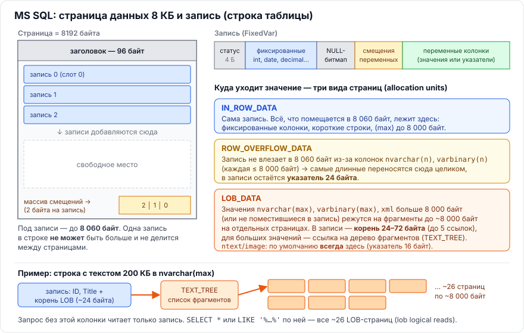

> ℹ️ **ROW, а не RAW.** Термины SQL Server — `IN_ROW_DATA` и `ROW_OVERFLOW_DATA` (от *row* — строка). `RAW` — это тип данных Oracle для двоичных значений, а не механизм хранения в MS SQL или PostgreSQL.

### Страница

| Часть | Размер | Что хранит |
|---|---|---|
| Заголовок | 96 байт | Номер страницы, тип, ссылки на предыдущую и следующую страницу (в индексе), число записей (`m_slotCnt`), свободное место (`m_freeCnt`) |
| Записи | до 8 060 байт | Строки таблицы (в листьях кластерного индекса или в куче) либо записи индекса. Добавляются от начала страницы |
| Массив смещений (slot array) | 2 байта на запись | В конце страницы, растёт навстречу записям. Задаёт **логический порядок** записей: сами записи на странице могут лежать в любом порядке, порядок ключа хранит массив |

**Как страница заполняется.** Новая запись пишется в свободное место, в массив смещений добавляется её слот. В кластерном индексе запись обязана попасть на «свою» страницу по ключу — если места нет, происходит **page split** ([2.2](#22--что-такое-fill-factor-и-зачем-может-потребоваться-его-менять-что-такое-page-split)). В куче запись идёт на любую страницу с местом: свободное место отслеживают служебные страницы **PFS** (Page Free Space). Удалённые записи оставляют «дыры», которые уплотняются при следующей записи на страницу или при перестроении.

### Адресация: как сервер находит страницу и строку

**В файле нет никаких «разделителей» между страницами.** Файл данных — массив одинаковых блоков по 8 192 байта, пронумерованных с нуля. Смещение страницы **нигде не хранится — оно вычисляется**: `смещение = номер страницы × 8192`. Страница 100 начинается с байта 819 200, страница 101 — с байта 827 392. Хранятся только **номера** страниц (в MS SQL — пара `файл:страница`, 6 байт), и записаны они в нескольких местах:

| Где | Что лежит | Зачем |
|---|---|---|
| Заголовок самой страницы | Собственный номер (`m_pageId`) | Проверить, что прочитана именно та страница |
| Заголовки соседей | `m_prevPage` / `m_nextPage` | Двусвязный список страниц одного уровня — по нему идёт сканирование диапазона |
| Записи родительской (нелистовой) страницы | Пара «минимальный ключ → номер дочерней страницы» | Спуск по B-дереву от корня к листу |
| Метаданные (`sys.system_internals_allocation_units`) | `root_page`, `first_page`, `first_iam_page` | Точка входа: откуда начинать спуск или обход |
| Карты размещения (GAM, SGAM, IAM, PFS) | Битовые карты по экстентам и страницам | Какие экстенты заняты (GAM), каким объектам принадлежат (IAM), сколько места на странице (PFS) |

**Экстент** — 8 подряд идущих страниц (64 КБ). Место объекту выделяется экстентами, чтобы соседние страницы по возможности лежали рядом.

**Адрес строки внутри страницы — слот.** Массив смещений лежит в самом конце страницы и растёт к началу: слот 0 — в байтах 8190–8191, слот 1 — в 8188–8189 и т. д. Значение слота — смещение записи от начала страницы. Пример: на странице лежат ключи 10, 30, 50, вставляем 20.

```
Физически (порядок записи):  10@96   30@136   50@176   20@216   ← новая запись дописана в свободное место
Массив слотов (порядок ключа):
  слот 0 = 96   (10)
  слот 1 = 216  (20)   ← вставлено в массив; сами записи 30 и 50 не двигались
  слот 2 = 136  (30)
  слот 3 = 176  (50)
```

Бинарный поиск внутри страницы идёт по слотам: «слот 2 → прочитать запись по смещению 136 → сравнить ключ». Полный адрес строки в куче — **RID** = `файл:страница:слот` (например, `1:102:3`), его выдаёт `sys.fn_PhysLocFormatter(%%physloc%%)`.

**Итого: порядок ключа держат три уровня указателей** — слоты внутри страницы, `prev/next` между соседними страницами, «ключ → страница» в родителях. Физически ни строки на странице, ни страницы в файле не обязаны лежать по порядку. В **кластерном** индексе листовой уровень и есть таблица — отдельного «массива строк» под индексом нет.

**Как посмотреть вживую:** `sys.dm_db_database_page_allocations` (SQL Server 2012+, замена устаревшего `DBCC IND`) — список страниц индекса с `previous_page_page_id` / `next_page_page_id`; `DBCC TRACEON(3604); DBCC PAGE(база, файл, страница, 3)` — заголовок, записи и **OFFSET TABLE** (массив слотов). Готовые запросы — в [sql/mssql/02_row_storage_lob.sql](../sql/mssql/02_row_storage_lob.sql).

Интерактивная пошаговая схема «вставка в страницу → слоты → page split → цепочка против файла»: [interactive/page-split.html](../interactive/page-split.html) — скачайте файл и откройте в браузере.

### Запись

Формат FixedVar: служебные байты (статус, смещение конца фиксированной части) → **фиксированные** колонки (`int`, `date`, `decimal`, `nchar(n)`, `binary(n)`) → NULL-битмап → число переменных колонок и массив их смещений (2 байта на колонку) → **переменные** колонки (`nvarchar(n)`, `varbinary(n)`, `(max)`) — их значения или указатели.

Отсюда:
- `nchar(n)` и `binary(n)` занимают место всегда, даже пустые; `nvarchar(n)` — только фактическую длину + 2 байта смещения.
- Строка `nvarchar` — **2 байта на символ**.
- Сумма **максимальных** длин колонок может превышать 8 060 байт — таблица создастся. Проблема появится, только когда **фактическая** строка не поместится, и тогда сработает ROW_OVERFLOW.

### ROW_OVERFLOW_DATA — переполнение строки

Когда строка с колонками `varchar(n)`, `nvarchar(n)`, `varbinary(n)` фактически не помещается в 8 060 байт, СУБД переносит **самую длинную** переменную колонку целиком на страницу ROW_OVERFLOW_DATA и оставляет в записи **указатель 24 байта**. Не помогло — переносит следующую.

- Переносится **колонка целиком**, а не часть. Каждая отдельная колонка такого типа не больше 8 000 байт, поэтому помещается на одну страницу переполнения.
- Если строку потом укоротить, значение может остаться на странице переполнения до перестроения.
- Каждое чтение такой колонки — **ещё одно случайное чтение страницы**. Сканирование таблицы, где у многих строк есть переполнение, заметно медленнее.

### LOB_DATA — большие значения

**Типы:** `varchar(max)`, `nvarchar(max)`, `varbinary(max)`, `xml`, а также устаревшие `text`, `ntext`, `image` (до 2 ГБ на значение).

**Где лежит значение `(max)`** (по умолчанию, `large value types out of row = 0`):

| Размер значения | Где хранится |
|---|---|
| До 8 000 байт и запись помещается в 8 060 байт | **В записи**, как обычный `varchar(n)` |
| До 8 000 байт, но запись не помещается | Переносится вне записи |
| Больше 8 000 байт | **Всегда** на страницах LOB_DATA |

**Как устроено значение на LOB-страницах:**
- Значение режется на **фрагменты** до ~8 000 байт. Фрагмент лежит на LOB-странице; мелкие фрагменты разных значений и строк могут делить одну страницу (`TEXT_MIX_PAGE`).
- В записи остаётся **корень** (inline root): 24 байта на одну ссылку, плюс 12 байт на каждую следующую, до **72 байт** (5 ссылок на фрагменты — около 40 КБ данных).
- Если фрагментов больше, в записи — одна ссылка на страницу **TEXT_TREE** со списком фрагментов; для очень больших значений дерево становится многоуровневым, как B-дерево.

**Устаревшие `text`, `ntext`, `image`** устроены так же, но по умолчанию (`text in row = OFF`) значение **всегда** выносится на LOB-страницы, даже если это 2 байта, а в записи лежит указатель **16 байт**. Чтение любого значения такой колонки — переход на LOB-страницу. Поменять можно опцией таблицы `sp_tableoption 'таблица', 'text in row', 'N'` — хранить в записи значения до N байт.

### Две большие колонки в одной строке

Каждая колонка `(max)` хранится **независимо**: у каждой свой корень в записи и свои фрагменты на LOB-страницах. Строка с текстом 200 КБ и двоичными данными 500 КБ — это запись в IN_ROW_DATA с двумя корнями (~50 байт) плюс ~26 + ~64 LOB-страницы. Запрос, который выбирает только одну из колонок, читает только её фрагменты.

### Что читается при запросе

| Запрос | Что читается |
|---|---|
| Длинная колонка **не упомянута** | Только IN_ROW_DATA. LOB-страницы не трогаются — таблица с большими колонками сканируется почти так же быстро, как без них |
| `SELECT *` / колонка в списке выборки | Все LOB-страницы значения. В `SET STATISTICS IO` — **`lob logical reads`** |
| `WHERE Колонка LIKE '%текст%'` | Значение **каждой** строки, которую приходится проверить, читается — для несовпавших строк целиком. Индекс не поможет: колонку `(max)` нельзя сделать ключом индекса |
| `SUBSTRING(Колонка, 1, 100)` | Дерево фрагментов позволяет перейти к нужному смещению и прочитать только нужные фрагменты |

Отдельные следствия:
- **Сжатие ROW/PAGE не сжимает LOB-страницы** ([2.6](#26-что-такое-фильтруемые-индексы-и-сжатие-данных-и-когда-они-полезны)) — только данные в записи. Для больших значений есть функция `COMPRESS()` (GZip) — сжимает значение на стороне запроса.
- **Обслуживание:** `REORGANIZE` по умолчанию уплотняет и LOB-страницы (`LOB_COMPACTION = ON`). Онлайн-перестроение индекса с колонками `(max)` поддерживается с SQL Server 2012 (с `text`/`ntext`/`image` — нет).
- **Ключ индекса:** колонки `(max)`, `text`, `ntext`, `image`, `xml` не могут быть ключом. `(max)` можно положить в `INCLUDE` ([1.6](01-teoriya.md#16-что-такое-покрывающий-индекс-и-зачем-нужны-включённые-столбцы-include)) — тогда она хранится и в индексе.

**Как искать в длинном тексте без чтения всех LOB-страниц.** Обычный индекс тут не поможет, нужен индекс **по содержимому** — **полнотекстовый индекс** SQL Server (Full-Text Search, условия `CONTAINS` / `FREETEXT`). Он хранит слова отдельно от таблицы, и при поиске таблица читается только для найденных строк. Но он ищет **слова и их формы**, а не произвольную подстроку: `CONTAINS(Note, 'договор')` найдёт «договора», а часть слова (`%говор%`) — нет. В базе 1С полнотекстовые индексы СУБД не создают — у платформы свой полнотекстовый поиск ([5.11](05-1c.md#511-как-хранятся-длинные-строки-и-хранилищезначения-1с-и-что-происходит-при-отборе-подобно)).

### Как увидеть

Скрипт [sql/mssql/02_row_storage_lob.sql](../sql/mssql/02_row_storage_lob.sql) создаёт таблицу со строками всех видов: короткая, с переполнением (`nvarchar(4000)` × 2), с текстом 200 КБ в `nvarchar(max)`, с двумя большими колонками (200 КБ + 500 КБ), и таблицу с `ntext`/`image`. Он показывает:
- число страниц каждой единицы распределения (`sys.allocation_units`) и типы страниц (`sys.dm_db_database_page_allocations`: `DATA_PAGE`, `TEXT_MIX_PAGE`, `TEXT_TREE_PAGE`);
- размеры записей (`sys.dm_db_index_physical_stats`);
- где лежит каждая строка — `sys.fn_PhysLocFormatter(%%physloc%%)` даёт «файл:страница:слот», и номер страницы сразу подставляется в `DBCC PAGE`;
- как заглянуть в страницу через `DBCC PAGE` и увидеть указатели;
- `lob logical reads` для запросов без длинной колонки, с ней, с `LIKE '%…%'` и с `SUBSTRING`;
- что короткое значение `ntext` всё равно лежит на LOB-странице.

> **Запомнить:** страница 8 КБ, под записи 8 060 байт, запись не делится. Не влезло из-за `nvarchar(n)` → ROW_OVERFLOW (колонка целиком, указатель 24 байта). `(max)` > 8 000 байт → LOB (фрагменты ~8 000 байт, корень 24–72 байта или дерево). `ntext`/`image` — всегда вне записи. Колонку не выбрали — её страницы не читаются; `LIKE '%…%'` по ней — читает значение целиком.

---

## 2.10. Как READ COMMITTED SNAPSHOT влияет на индексы: метка версии, version store, ghost-записи

> **Коротко.** База 1С на MS SQL в режиме управляемых блокировок работает с `READ_COMMITTED_SNAPSHOT = ON` (RCSI): читающий запрос не ждёт блокировок, а получает последнюю зафиксированную версию строки. Для индексов из этого следуют три вещи. **1)** Каждая изменённая запись — и в кластерном, и в некластерных индексах — получает **14-байтовую метку версии**: записи растут, плотно заполненные страницы (fill factor 100) расщепляются. **2)** Старые версии лежат в **version store** (в tempdb, а при включённом ADR — в самой базе), удалённые строки какое-то время остаются **ghost-записями**; долгие транзакции и долгие запросы не дают их очистить, сканирования читают лишнее. **3)** RCSI убирает блокировки только у чтения: `UPDATE`/`DELETE` без подходящего индекса по-прежнему сканируют и блокируют лишнее.

### Как это работает

При включённом RCSI (или `ALLOW_SNAPSHOT_ISOLATION`) каждое изменение строки делается так:

1. Старая версия записи копируется в **version store**.
2. Запись на странице меняется на месте, и к ней добавляется **метка версии** — 14 байт: номер транзакции, сделавшей изменение (XSN, 6 байт), и указатель на предыдущую версию в version store (8 байт). Метку получают и новые записи (`INSERT`).
3. Читающий оператор работает со снимком на момент своего начала (в RCSI — снимок на оператор, не на транзакцию). Если запись изменена позже, он идёт по указателю в version store за подходящей версией.

| | MS SQL с RCSI | PostgreSQL |
|---|---|---|
| Где старые версии | Отдельно: version store (tempdb или PVS при ADR) | В самой таблице, рядом с актуальной ([3.3](03-postgresql.md#33-как-mvcc-влияет-на-индексы-что-такое-hot-обновления-и-раздувание-bloat)) |
| Что остаётся в строке | 14-байтовая метка (XSN + указатель) | Заголовок версии строки (`xmin`/`xmax`), есть всегда |
| Кто чистит | Фоновая очистка version store и ghost cleanup | `VACUUM` / autovacuum |
| Что раздувается при долгих транзакциях | tempdb (или PVS в базе), ghost-записи в индексах | Таблица и индексы (bloat) |
| Ссылки индексов при `UPDATE` | Не меняются (запись на месте) | Новая версия по новому `ctid` (кроме HOT) |

### Метка версии и page split

Пока строку не меняли после включения версионирования, метки у неё нет. Первое же изменение увеличивает запись на 14 байт. Если на странице нет свободного места, происходит page split ([2.2](#22--что-такое-fill-factor-и-зачем-может-потребоваться-его-менять-что-такое-page-split)) — даже если меняли колонку фиксированной длины, которую без RCSI обновили бы на месте.

Пример из скрипта [sql/mssql/07_rcsi_version_tag.sql](../sql/mssql/07_rcsi_version_tag.sql): записи по ~215 байт, на странице 37 записей, свободно ~67 байт, fill factor 100. Массовый `UPDATE` одной колонки `int`:

| Режим | Размер записи | Что со страницами |
|---|---|---|
| RCSI выключен | Не меняется | Ничего: обновление на месте |
| RCSI включён | +14 байт (~229) | 37 × 14 ≈ 520 байт не помещаются → почти каждая страница расщепляется, страниц ~в 2 раза больше, заполнение ~50–60% |

Метка остаётся у записи и после того, как старая версия стала не нужна, поэтому волна расщеплений — разовая для каждой строки. Повторяется она, когда метки снимаются: как правило, это делает перестроение индекса. Проверьте на своей версии последним шагом скрипта. Отсюда практическое следствие: **ночной `REBUILD` с fill factor 100 у часто обновляемой таблицы + RCSI = утренняя волна page split**. Fill factor для таких индексов выбирают по замеру: счётчик `Page Splits/sec`, `leaf_allocation_count` в `sys.dm_db_index_operational_stats`.

### Version store, ghost-записи и долгие транзакции

**Удаление.** `DELETE` не стирает запись сразу: она помечается как **ghost** и физически удаляется позже фоновой задачей **ghost cleanup**. При версионировании ghost-запись нельзя убрать, пока её старая версия может понадобиться какому-то снимку (`version_ghost_record_count` в `sys.dm_db_index_physical_stats` в режиме `DETAILED`). Пока ghost-записи не убраны, сканирование индекса их читает.

**Очистка version store** удаляет только версии старше самой старой активной транзакции, которой они могут понадобиться. Поэтому одна долгая транзакция или один долгий запрос держит **все** версии, созданные после его начала, во всей базе (в версиях до SQL Server 2019 очистка в tempdb шла общей для экземпляра, и долгая транзакция в одной базе мешала очистке версий всех баз). Следствия:
- растёт tempdb (или файл базы при ADR);
- цепочки версий удлиняются, и чтение «горячих» строк становится дороже;
- ghost-записи копятся в индексах, сканирования читают больше страниц.

**ADR** (Accelerated Database Recovery, SQL Server 2019+) переносит version store в саму базу — **Persistent Version Store (PVS)**. По умолчанию ADR выключен; включается на уровне базы. Небольшие изменения ADR может хранить прямо в записи (in-row version), что тоже увеличивает записи.

Где смотреть:
```sql
-- Включён ли RCSI / snapshot / ADR
SELECT name, is_read_committed_snapshot_on, snapshot_isolation_state_desc,
       is_accelerated_database_recovery_on
FROM sys.databases;

-- Размер version store по базам (SQL Server 2016 SP2 / 2017+)
SELECT DB_NAME(database_id) AS db, reserved_space_kb
FROM sys.dm_tran_version_store_space_usage;

-- Кто держит версии: самые старые snapshot-транзакции
SELECT session_id, transaction_id, elapsed_time_seconds
FROM sys.dm_tran_active_snapshot_database_transactions
ORDER BY elapsed_time_seconds DESC;
```
Счётчики производительности: `Version Store Size (KB)`, `Version Generation rate (KB/s)`, `Version Cleanup rate (KB/s)` (объект `Transactions`).

### Чего RCSI не меняет

- **Запись по-прежнему блокирует.** `UPDATE`/`DELETE` ищет строки, ставя блокировки обновления (`U`), а изменённые держит под `X` до конца транзакции. Без индекса по условию поиска — сканирование, лишние блокировки, ожидания на чужих `X` и эскалация ([1.8](01-teoriya.md#18-как-индексы-влияют-на-блокировки-и-взаимоблокировки)). Индексы под условия записи нужны так же, как без RCSI.
- **Версионирование не бесплатно для чтения:** если нужная версия далеко в цепочке, чтение идёт в tempdb.
- **На заметку — SQL Server 2025:** *optimized locking* (требует ADR) блокирует запись по идентификатору транзакции (TID locking) и с RCSI проверяет условие `UPDATE`/`DELETE` по последней зафиксированной версии **до** взятия блокировки (lock after qualification). Блокировок и ожиданий становится меньше. Поддерживается ли эта версия СУБД для вашей платформы 1С — смотрите на ИТС.

### Применительно к 1С

- **Проверить режим:** `SELECT name, is_read_committed_snapshot_on FROM sys.databases`. У базы 1С в режиме управляемых блокировок должно быть `1`.
- **tempdb — общий ресурс:** в нём временные таблицы 1С (`#tt`), сортировки и хеш-соединения, которые не поместились в память, и version store. Его размещают на быстром диске, в нескольких файлах одинакового размера, с запасом места.
- **Таблицы, которые постоянно обновляются,** — итоги регистров накопления (`_AccumRgT…`), регистры сведений с частой перезаписью, служебные таблицы — главные кандидаты на page split от меток версии. Особенно сразу после включения управляемых блокировок и после каждого `REBUILD` с fill factor 100.
- **Перепроведение и запись движений:** платформа удаляет старые движения регистратора и вставляет новые. Массовое перепроведение или удаление движений оставляет ghost-записи в таблицах движений, и пока их не убрали, отчёты по этим таблицам сканируют больше страниц.
- **Долгие отчёты и долгие транзакции** (закрытие месяца, обмены, обработки, которые пишут в одной транзакции) держат version store и ghost-записи всей базы. Их видно в `sys.dm_tran_active_snapshot_database_transactions`, в ТЖ — по длительности.
- **Управляемые блокировки не отменяют индексы:** менеджер блокировок 1С блокирует логически, а на уровне СУБД `UPDATE` без подходящего индекса по-прежнему сканирует и блокирует лишние строки.

> **Запомнить:** RCSI = чтение без ожидания за счёт версий. Цена для индексов: +14 байт к каждой изменённой записи (page split при fill factor 100, волна после включения RCSI и после `REBUILD`), version store в tempdb (с ADR — в базе), ghost-записи. Всё это держат долгие транзакции и запросы. Блокировки записи RCSI не убирает: индексы под условия `UPDATE`/`DELETE` нужны по-прежнему.

---

[← Глава 1. Теория](01-teoriya.md) · [Оглавление](../README.md) · [Глава 3. PostgreSQL →](03-postgresql.md)
