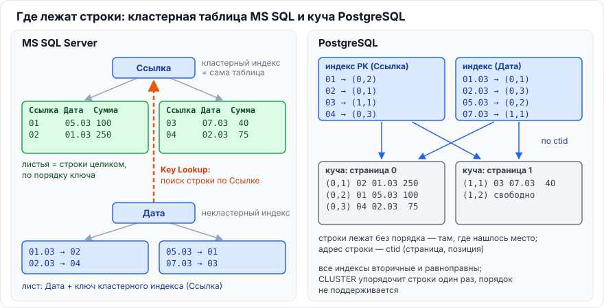
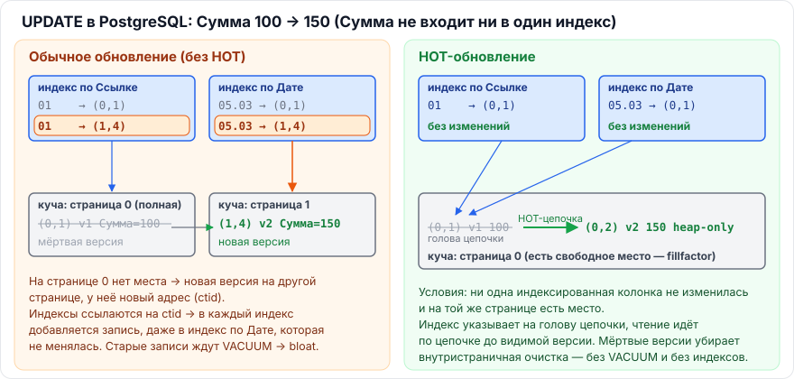
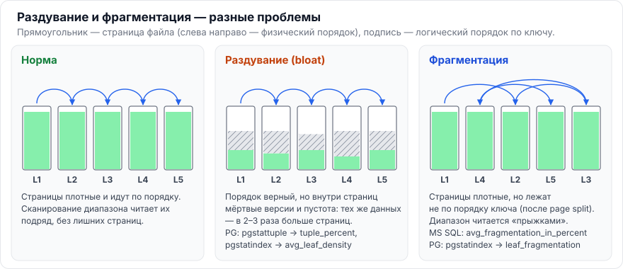

# Глава 3. PostgreSQL

[← Глава 2. MS SQL Server](02-mssql.md) · [Оглавление](../README.md) · [Глава 4. Секционирование →](04-sekcionirovanie.md)

Главное отличие PostgreSQL от MS SQL, из которого вытекает почти вся эта глава: **таблица — всегда куча, а `UPDATE` создаёт новую версию строки** (MVCC). Отсюда отсутствие кластерного индекса, HOT-обновления, раздувание и `VACUUM`.

---

## 3.1. Какие типы индексов есть в PostgreSQL и для чего каждый

> **Коротко.** Шесть встроенных типов: **B-tree** — универсальный, по умолчанию: равенство, диапазоны, сортировка, уникальность. **Hash** — только равенство, компактен для длинных значений. **GiST** — «обобщённое дерево»: геометрия, диапазоны, ближайшие соседи (KNN), ограничения исключения. **SP-GiST** — несбалансированные деревья с разбиением пространства: префиксы строк, IP-адреса, точки. **GIN** — инвертированный индекс по элементам: массивы, JSONB, полнотекстовый поиск, триграммы. **BRIN** — сверхкомпактные сводки min/max по диапазонам блоков: огромные таблицы, где значения коррелируют с физическим порядком (даты в логах). 1С использует только B-tree.

### B-tree

- **Для чего:** всё, что можно сравнить «больше/меньше»: числа, даты, строки.
- **Операторы:** `=`, `<`, `<=`, `>`, `>=`, `BETWEEN`, `IN`, `IS NULL`, `LIKE 'abc%'` (при подходящей коллации или классе операторов `text_pattern_ops`).
- **Умеет:** сортировку (`ORDER BY`) в обе стороны, **уникальность** (единственный тип, который поддерживает `UNIQUE`), `INCLUDE` (PG 11+), дедупликацию (PG 13+), skip scan (PG 18).

### Hash

- **Для чего:** только `=`.
- Хранит 32-битные хеш-коды, а не сами значения → компактен для очень длинных ключей.
- С **PostgreSQL 10** журналируется в WAL (до этого не переживал сбой и не реплицировался — старая документация 9.x предупреждает именно об этом).
- **Не умеет:** диапазоны, сортировку, уникальность, составные ключи.

### GiST (Generalized Search Tree)

- Каркас сбалансированного дерева для данных **без линейного порядка**.
- **Геометрия и PostGIS** (R-дерево): пересекается `&&`, содержит `@>`, слева/справа.
- **Ближайшие соседи (KNN):** `ORDER BY точка <-> 'цель' LIMIT 10`.
- **Диапазоны** (`daterange`, `tsrange`) и **ограничения исключения** `EXCLUDE` — например, запрет пересечения бронирований.
- Полнотекстовый поиск (сигнатурное дерево; обычно GIN лучше для чтения).

### SP-GiST (Space-Partitioned GiST)

- Каркас **несбалансированных** деревьев, рекурсивно делящих пространство на непересекающиеся части.
- **Префиксное дерево** (trie) для строк и IP-адресов (`inet`), **дерево квадрантов** и **k-d дерево** для точек.
- Поддерживает `Index Only Scan` (значение восстанавливается при спуске).

### GIN (Generalized Inverted Index)

- «Предметный указатель»: индексируются не значения целиком, а **элементы** внутри них, и для каждого элемента — список строк.
- **Полнотекстовый поиск** (`tsvector @@ tsquery`), **массивы** (`@>`, `&&`), **JSONB** (`?`, `@>`, классы `jsonb_ops` / `jsonb_path_ops`), **триграммы** `pg_trgm` — ускоряют `LIKE '%подстрока%'`, `ILIKE`, регулярные выражения.
- Быстро читает, медленно обновляется → режим отложенного обновления `fastupdate` (pending list).
- Всегда работает через битовую карту (`Bitmap Index Scan`).

### BRIN (Block Range Index)

- Делит таблицу на диапазоны блоков (по умолчанию 128 страниц) и хранит для каждого только **сводку**: min/max (или bloom-фильтр, PG 14+).
- Размер — в **сотни и тысячи раз меньше** B-tree (килобайты вместо гигабайт).
- Работает, только если значения **коррелируют с физическим порядком** строк: даты в логах и журналах, автоинкрементные ID при вставке в конец. Отбрасывает блоки, где нужного значения быть не может, остальные читает целиком.

### Сводная таблица

| Тип | Структура | Сценарии | Операторы |
|---|---|---|---|
| **B-tree** | Сбалансированное дерево | Сортируемые данные, уникальность, по умолчанию | `= < <= > >= BETWEEN IN` |
| **Hash** | Хеш-таблица | Только точное совпадение | `=` |
| **GiST** | Обобщённое сбалансированное дерево (R-дерево и др.) | Геоданные, диапазоны, KNN, `EXCLUDE` | `&& @> <@ <->` |
| **SP-GiST** | Несбалансированное дерево (trie, quadtree, k-d) | Префиксы строк, IP, точки | `^@ @> <@ ~=` |
| **GIN** | Инвертированный индекс | Массивы, JSONB, полнотекстовый поиск, триграммы | `@@ @> && ?` , `LIKE` через `pg_trgm` |
| **BRIN** | Сводки по диапазонам блоков | Огромные таблицы с физической корреляцией (логи, время) | `= < <= > >=` |

### Применительно к 1С

Платформа создаёт **только B-tree** индексы. Остальные типы важно знать для общего понимания PostgreSQL и для собственных (не 1С) баз.

> **Запомнить:** B-tree — по умолчанию и единственный для `UNIQUE`; GIN — «что внутри» (JSONB, массивы, текст); GiST — «где и рядом» (геометрия, диапазоны); BRIN — «очень большое и упорядоченное».

---

## 3.2. Почему в PostgreSQL нет кластерного индекса в понимании MS SQL и что делает `CLUSTER`

> **Коротко.** В PostgreSQL таблица **всегда куча**: строки пишутся туда, где есть место, а **все** индексы вторичные и ссылаются на строку по физическому адресу `ctid` (страница, позиция). Поддерживать постоянный порядок строк, как кластерный индекс MS SQL, при MVCC было бы слишком дорого: каждый `UPDATE` создаёт новую версию строки в новом месте. Команда `CLUSTER таблица USING индекс` **один раз** физически переписывает таблицу в порядке индекса. Порядок не поддерживается при последующих изменениях, на время работы таблица полностью заблокирована (`ACCESS EXCLUSIVE`) и нужно место под вторую копию.



### Почему так устроено

| | MS SQL Server | PostgreSQL |
|---|---|---|
| Таблица | B-дерево кластерного индекса (или куча) | Всегда куча |
| Листья индекса указывают на | Ключ кластерного индекса (или RID для кучи) | `ctid` — физический адрес версии строки |
| `UPDATE` | Изменяет строку на месте (если помещается) | Создаёт **новую версию** строки, старая остаётся до очистки |
| Порядок строк | Поддерживается автоматически при каждой записи | Не поддерживается |

Если бы PostgreSQL держал строки отсортированными, каждый `UPDATE` (= новая версия) требовал бы сдвига данных и правки ссылок во всех индексах. Поэтому куча и вторичные индексы — сознательный архитектурный выбор.

### Что делает `CLUSTER`

```sql
CLUSTER documents USING ix_documents_date;   -- один раз упорядочить
CLUSTER documents;                            -- повторить по тому же индексу
```

- Создаёт **новый файл** таблицы, переписывает в него строки в порядке индекса, удаляет старый и **перестраивает все индексы** (механизм тот же, что у `VACUUM FULL`).
- **Эффект однократный:** новые и обновлённые строки снова пишутся куда придётся.
- **Блокировка `ACCESS EXCLUSIVE`** — ни чтения, ни записи на всё время работы.
- Нужно свободное место примерно на размер таблицы со всеми индексами.

### Зачем это нужно

Повысить **корреляцию** между порядком значений в индексе и физическим порядком строк (`pg_stats.correlation` → близко к 1):

```sql
SELECT attname, correlation FROM pg_stats
WHERE tablename = 'documents' AND attname = 'doc_date';
```

При высокой корреляции диапазон по индексу читает страницы таблицы **подряд**, а не вразброс → планировщик охотнее выбирает индекс для широких диапазонов. Хорошая корреляция также нужна, чтобы работал **BRIN**.

**Без простоя:** утилита `pg_repack` (с ключом `--order-by`) переупорядочивает таблицу онлайн.

### Применительно к 1С

Для баз 1С `CLUSTER` практически не применяют: эффект временный, а блокировка полная. Важнее следить за раздуванием и статистикой ([3.3](#33-как-mvcc-влияет-на-индексы-что-такое-hot-обновления-и-раздувание-bloat), [3.5](#35-какова-роль-vacuum-и-autovacuum-в-обслуживании-индексов-чем-отличаются-reindex-и-reindex-concurrently)).

> **Запомнить:** в PG таблица = куча, индексы ссылаются на `ctid`. `CLUSTER` = одноразовая сортировка с полной блокировкой, порядок «расползается».

---

## 3.3. Как MVCC влияет на индексы? Что такое HOT-обновления и раздувание (bloat)

> **Коротко.** При `UPDATE` PostgreSQL создаёт новую версию строки с новым адресом `ctid`. В общем случае ссылку на неё приходится добавить в **каждый** индекс таблицы — даже если индексированные колонки не менялись. Старые версии и ссылки на них остаются, пока их не уберёт `VACUUM`. **HOT-обновление** (Heap-Only Tuple) избегает этого: если не меняется ни одна индексированная колонка **и** на той же странице есть место, новая версия кладётся на ту же страницу, связывается цепочкой со старой, а индексы не трогаются. **Раздувание** — накопление мёртвых версий и пустого места в таблицах и индексах: из-за долгих транзакций, отставания autovacuum, массовых изменений.



### MVCC и индексы

- `UPDATE` = «пометить старую версию удалённой (`xmax`) + записать новую версию (`xmin`)».
- Новая версия лежит по новому адресу → **без HOT в каждый индекс добавляется новая запись**. Чем больше индексов, тем дороже каждый `UPDATE`.
- Записи индексов, указывающие на мёртвые версии, остаются, пока их не удалит `VACUUM`.

> Сравните с MS SQL: там `UPDATE` неиндексированной колонки не трогает некластерные индексы вообще — они ссылаются на ключ, а не на физический адрес.

### HOT-обновление

**Условия (оба обязательны):**
1. Не изменилась ни одна колонка, входящая **в любой** индекс таблицы.
2. На **той же странице** таблицы хватает места для новой версии.

**Как работает:**
- Новая версия ложится на ту же страницу с флагом *heap-only tuple*, у старой появляется флаг *HOT updated* и ссылка на новую.
- В индексах **ничего не добавляется**: индекс по-прежнему указывает на «голову» цепочки, а при чтении СУБД проходит по цепочке до видимой версии.
- Мёртвые версии цепочки вычищаются **внутристраничной очисткой** (page pruning) прямо при обычном обращении к странице, без `VACUUM` и без индексов.
- Если места на странице нет — новая версия уходит на другую страницу, HOT не срабатывает, правятся все индексы.

Отсюда практический рецепт: для таблиц с частыми `UPDATE` неиндексированных колонок **снизить `fillfactor` таблицы** (например, до 80–90), чтобы на страницах оставалось место для HOT. Долю HOT-обновлений видно так:

```sql
SELECT relname, n_tup_upd, n_tup_hot_upd,
       round(100.0 * n_tup_hot_upd / NULLIF(n_tup_upd, 0), 1) AS hot_pct
FROM pg_stat_user_tables
ORDER BY n_tup_upd DESC LIMIT 20;
```

### Раздувание (bloat)

**Что это:** таблица или индекс занимает намного больше страниц, чем нужно для живых данных: внутри мёртвые версии и пустота.

**Причины:**
1. **Долгие транзакции** (в том числе «idle in transaction») держат **горизонт видимости**: `VACUUM` не имеет права удалить версии, которые эта транзакция теоретически может увидеть.
2. **Autovacuum не успевает** за интенсивными `UPDATE/DELETE` (пороги по умолчанию рассчитаны на «средние» таблицы).
3. **Нет места для HOT** → каждое обновление плодит записи во всех индексах.
4. **Массовые удаления** — место освобождается внутри файлов, но файлы не уменьшаются.

**Чем вредит:** больше страниц читать при сканированиях, засорённый буферный кэш, растут бэкапы и время обслуживания.

**Как бороться:**

| | Средство |
|---|---|
| Профилактика | Настроить autovacuum (снизить `autovacuum_vacuum_scale_factor` для больших таблиц); ограничивать долгие транзакции (`idle_in_transaction_session_timeout`, мониторинг `pg_stat_activity`); `fillfactor` таблицы под HOT; не создавать лишних индексов |
| Лечение индекса | `REINDEX INDEX CONCURRENTLY` |
| Лечение таблицы | `VACUUM FULL` или `CLUSTER` (полная блокировка) либо онлайн — `pg_repack`, `pgcompacttable` |

> **Запомнить:** MVCC → `UPDATE` = новая версия по новому адресу → записи во все индексы. HOT спасает, если индексированные колонки не менялись и на странице есть место. Bloat = мёртвые версии + пустота.

---

## 3.4. Что значит `fillfactor` в PostgreSQL для таблицы и для индекса и чем он отличается от MS SQL

> **Коротко.** В PostgreSQL `fillfactor` задаётся **и для таблиц, и для индексов**. Для таблицы (по умолчанию **100**) он оставляет место на страницах для **HOT-обновлений**. Для индекса (B-tree по умолчанию **90**) — уменьшает расщепления страниц. В MS SQL fill factor есть только у индексов (включая кластерный, который и есть таблица), по умолчанию 0 = 100%, и его единственная цель — page split. В обеих СУБД значение применяется при заполнении «с нуля» (создание, перестроение), а не поддерживается постоянно.

### Значения по умолчанию в PostgreSQL

| Объект | По умолчанию | Диапазон | Зачем снижать |
|---|---|---|---|
| Таблица (heap) | **100** | 10–100 | Место для HOT-обновлений → меньше записей в индексы и меньше bloat |
| B-tree | **90** | 10–100 | Меньше расщеплений при вставках в середину |
| Hash | 75 | 10–100 | Меньше переполнений корзин |
| GiST | 90 | 10–100 | Меньше расщеплений |
| SP-GiST | 80 | 10–100 | — |
| GIN, BRIN | параметра нет | — | У GIN — свои настройки (`fastupdate`), у BRIN — `pages_per_range` |

> ⚠️ **Поправка к ответу NotebookLM:** «для GiST — 10 или 80» — это перепутаны минимум диапазона и значение по умолчанию другого типа индекса.

```sql
ALTER TABLE documents SET (fillfactor = 85);       -- для новых страниц таблицы
CREATE INDEX ix_doc_number ON documents(number) WITH (fillfactor = 80);
ALTER INDEX ix_doc_number SET (fillfactor = 80);   -- применится при REINDEX
```

**Важно:** `ALTER TABLE ... SET (fillfactor)` действует только на **новые** страницы. Чтобы применить к существующим, таблицу нужно переписать (`VACUUM FULL`, `CLUSTER`, `pg_repack`); для индекса — `REINDEX`.

### Отличия от MS SQL

| | PostgreSQL | MS SQL Server |
|---|---|---|
| Где задаётся | Таблицы **и** индексы | Только индексы (у кучи MS SQL параметра нет) |
| Цель | Таблица — **HOT-обновления** (MVCC); индекс — page split | Page split |
| По умолчанию | Таблица 100, B-tree 90 | 0 (= 100) для всех индексов |
| Когда применяется | Таблица — при вставке в новые страницы; индекс — при создании/`REINDEX` | При создании/`REBUILD` |

> **Запомнить:** PG — fillfactor у таблицы ради HOT (по умолчанию 100) и у индекса ради split (B-tree — 90). MS SQL — только индексы, только ради split, по умолчанию 100.

---

## 3.5. Какова роль `VACUUM` и autovacuum в обслуживании индексов. Чем отличаются `REINDEX` и `REINDEX CONCURRENTLY`

> **Коротко.** `VACUUM` находит мёртвые версии строк, **удаляет ссылки на них из всех индексов**, освобождает место в таблице для повторного использования и обновляет **карту видимости** (без неё не работает `Index Only Scan`) и карту свободного места. Файлы при этом не уменьшаются. Autovacuum запускает `VACUUM` и `ANALYZE` автоматически по порогам. `REINDEX` строит индекс заново, сжимая его, но блокирует запись в таблицу, а сам индекс — полностью. `REINDEX CONCURRENTLY` (PG 12+) перестраивает без блокировки записи, но дольше, не работает в транзакции и при сбое оставляет «невалидный» индекс, который нужно удалить.

### Как `VACUUM` обрабатывает индексы


- Порядок важен: сначала из индексов, потом из таблицы. Иначе индекс указывал бы на переиспользованное место.
- Если список мёртвых TID не помещается в память (`maintenance_work_mem` / `autovacuum_work_mem`), индексы приходится сканировать **несколько раз** — на больших таблицах это медленно.
- **Карта видимости (visibility map)** — бит «на странице все версии видимы всем». `Index Only Scan` проверяет его и не ходит в таблицу. Нет свежего `VACUUM` → бит не установлен → `Heap Fetches` растёт, `Index Only Scan` по факту ходит в таблицу.
- Обычный `VACUUM` **не уменьшает** файлы (кроме пустого хвоста таблицы) и не перестраивает дерево индекса. Пустые страницы индекса переиспользуются.

### Autovacuum

Процесс `autovacuum launcher` запускает рабочих (`autovacuum_max_workers`), когда для таблицы выполняется условие:

```
мёртвых строк > autovacuum_vacuum_threshold + autovacuum_vacuum_scale_factor × число строк
                     (по умолчанию 50)                (по умолчанию 0,2)
```

Аналогично для `ANALYZE` (`autovacuum_analyze_scale_factor`, по умолчанию 0,1) и, с PG 13, для вставок (`autovacuum_vacuum_insert_*`).

Для таблицы в 100 млн строк порог по умолчанию — 20 млн мёртвых строк, это слишком поздно. Поэтому для больших таблиц `scale_factor` уменьшают (глобально или для таблицы через `ALTER TABLE ... SET (autovacuum_vacuum_scale_factor = 0.01)`).

### `REINDEX` и `REINDEX CONCURRENTLY`

| | `REINDEX` | `REINDEX CONCURRENTLY` |
|---|---|---|
| Версия | Всегда | PostgreSQL 12+ |
| Блокировка таблицы | `SHARE` — **запрещены `INSERT/UPDATE/DELETE`** | `SHARE UPDATE EXCLUSIVE` — чтение и запись **разрешены** |
| Блокировка самого индекса | `ACCESS EXCLUSIVE` — запросы, **которые хотят использовать этот индекс**, тоже ждут | Нет блокировки на чтение |
| Как строит | Один проход | Создаёт новый индекс рядом, несколько проходов, ждёт завершения текущих транзакций, затем подменяет |
| Скорость | Быстрее | Медленнее, больше нагрузка |
| В транзакции (`BEGIN ... COMMIT`) | Можно | **Нельзя** |
| При сбое | Откат, старый индекс на месте | Остаётся **INVALID**-индекс (с суффиксом `_ccnew`) — его нужно удалить и повторить |

> ⚠️ **Уточнение к ответу NotebookLM:** у обычного `REINDEX` «чтение доступно» не полностью: план, который хочет использовать перестраиваемый индекс, будет ждать, потому что на индекс берётся `ACCESS EXCLUSIVE`.

Найти невалидные индексы:

```sql
SELECT indexrelid::regclass AS index_name, indrelid::regclass AS table_name
FROM pg_index WHERE NOT indisvalid;
```

### Применительно к 1С

- В базе 1С много интенсивно изменяемых таблиц (таблицы итогов регистров, временные таблицы). Настройка autovacuum — обязательная часть администрирования 1С на PostgreSQL.
- Перестраивать индексы в рабочее время — только `REINDEX CONCURRENTLY` или `pg_repack`.

> **Запомнить:** `VACUUM` чистит индексы от ссылок на мёртвые строки и обновляет карту видимости, но не сжимает файлы. `REINDEX` сжимает, но блокирует запись (и сам индекс); `CONCURRENTLY` — без блокировки записи, медленнее, может оставить INVALID.

---

## 3.6. Как отличить фрагментацию индекса от раздувания в PostgreSQL

> **Коротко.** **Раздувание** — мало полезных данных **внутри** страниц: мёртвые версии и пустота после `UPDATE/DELETE`. Касается таблиц и индексов; лечится `VACUUM` (переиспользование), а уменьшение файла — `REINDEX` / `VACUUM FULL` / `pg_repack`. **Фрагментация** — листовые страницы B-tree идут на диске **не по порядку** ключей из-за расщеплений; касается только индексов, лечится `REINDEX`. Измеряются расширением `pgstattuple`: раздувание таблицы — `pgstattuple()` (`tuple_percent`, `dead_tuple_percent`, `free_percent`), индекса — `pgstatindex()` (`avg_leaf_density`), фрагментация — `pgstatindex()` (`leaf_fragmentation`).



| | Раздувание (bloat) | Фрагментация |
|---|---|---|
| Где | Таблицы и любые индексы | Листья B-tree |
| Причина | Мёртвые версии (MVCC), отставание autovacuum, долгие транзакции, массовые удаления | Вставки в середину (GUID, строки) → расщепления |
| Физический смысл | Страницы полупустые | Страницы не по порядку |
| Чем вредит | Читаем и кэшируем лишние страницы при любом сканировании | Больше случайного чтения при сканировании диапазонов |
| Показатель | `tuple_percent` (таблица), `avg_leaf_density` (индекс) | `leaf_fragmentation` |
| Лечение | Индекс — `REINDEX CONCURRENTLY`; таблица — `pg_repack` / `VACUUM FULL` | `REINDEX CONCURRENTLY` |

### Как измерить

```sql
CREATE EXTENSION IF NOT EXISTS pgstattuple;

-- раздувание таблицы (читает таблицу целиком!)
SELECT tuple_percent, dead_tuple_percent, free_percent
FROM pgstattuple('public.documents');

-- быстрая приблизительная оценка без полного чтения
SELECT * FROM pgstattuple_approx('public.documents');

-- индекс: плотность листьев и фрагментация
SELECT avg_leaf_density, leaf_fragmentation, leaf_pages, deleted_pages
FROM pgstatindex('public.ix_documents_date');
```

Ориентиры:
- `tuple_percent` таблицы ниже ~50–70% → таблица заметно раздута;
- `avg_leaf_density` индекса ниже ~50–60% (свежий B-tree — около 90%, это его fillfactor) → индекс раздут;
- `leaf_fragmentation` выше ~20–30% → индекс фрагментирован.

Без расширения число мёртвых строк видно в `pg_stat_user_tables.n_dead_tup`.

> **Запомнить:** bloat — «пусто внутри страниц» (таблицы и индексы); фрагментация — «страницы не по порядку» (B-tree). Инструмент — `pgstattuple` / `pgstatindex`.

---

## 3.7. Как найти неиспользуемые индексы и проблемные запросы (`pg_stat_user_indexes`, `EXPLAIN ANALYZE`, `pg_stat_statements`)

> **Коротко.** `pg_stat_user_indexes` хранит счётчики по каждому индексу: `idx_scan` (сколько раз использовался), `idx_tup_read`, `idx_tup_fetch`. Индекс с нулевым или крошечным `idx_scan` за полный бизнес-цикл при заметном размере — кандидат на удаление, кроме тех, что обеспечивают уникальность. Тяжёлые запросы ищут через `pg_stat_statements` (суммарное и среднее время, обращения к буферам) и лог медленных запросов (`log_min_duration_statement`), а разбирают через `EXPLAIN (ANALYZE, BUFFERS)`: сравнивают оценку строк с фактом, смотрят методы доступа и сброс на диск.

### Неиспользуемые индексы

| Колонка `pg_stat_user_indexes` | Что значит |
|---|---|
| `idx_scan` | Сколько раз индекс сканировался |
| `idx_tup_read` | Сколько записей индекса прочитано |
| `idx_tup_fetch` | Сколько строк таблицы получено через этот индекс (простое сканирование индекса) |
| `last_idx_scan` | (PG 16+) когда индекс использовался последний раз |

```sql
SELECT s.schemaname, s.relname AS table_name, s.indexrelname AS index_name,
       s.idx_scan,
       pg_size_pretty(pg_relation_size(s.indexrelid)) AS index_size
FROM pg_stat_user_indexes AS s
JOIN pg_index AS i ON i.indexrelid = s.indexrelid
WHERE s.idx_scan < 50
  AND NOT i.indisunique        -- уникальные обеспечивают целостность
ORDER BY pg_relation_size(s.indexrelid) DESC;
```

**Перед удалением проверить:**
- когда сбрасывалась статистика (`pg_stat_database.stats_reset`, `pg_stat_reset()`); на репликах счётчики свои;
- полный бизнес-цикл: индекс может работать раз в месяц на закрытии периода;
- индекс не обеспечивает уникальность и не нужен для внешнего ключа.

> 💡 **В базе 1С** этот запрос почти ничего не покажет: платформа создаёт большинство индексов **уникальными** (в конец ключа добавляется Ссылка или регистратор + номер строки), и фильтр `NOT indisunique` их отсечёт. Да и удалять индексы платформы средствами СУБД нельзя. Для 1С этот анализ полезен, чтобы найти **лишние галочки «Индексировать»** — тогда убирайте фильтр по уникальности и смотрите индексы с `idx_scan = 0`.

### Тяжёлые запросы — `pg_stat_statements`

Подключение:
```ini
# postgresql.conf (нужен перезапуск)
shared_preload_libraries = 'pg_stat_statements'
```
```sql
CREATE EXTENSION pg_stat_statements;
```

Топ по суммарному времени (PG 13+):
```sql
SELECT round(total_exec_time::numeric / 1000, 1) AS total_sec,
       calls,
       round(mean_exec_time::numeric, 1)          AS avg_ms,
       shared_blks_read, shared_blks_hit, temp_blks_written,
       left(query, 200)                           AS query
FROM pg_stat_statements
ORDER BY total_exec_time DESC
LIMIT 20;
```

> ⚠️ **Поправка к ответу NotebookLM:** колонки `total_time` / `mean_time` были **до PG 13**. С PG 13 — `total_exec_time` / `mean_exec_time` (отдельно появилось время планирования `total_plan_time`). Запрос из исходного ответа на современном PostgreSQL выдаст ошибку.

Дополнительно:
- `log_min_duration_statement = 1000` — в лог попадают запросы дольше 1 секунды;
- расширение `auto_explain` пишет в лог **планы** медленных запросов;
- `pg_stat_activity` — что выполняется прямо сейчас.

### Разбор плана — `EXPLAIN (ANALYZE, BUFFERS)`

```sql
EXPLAIN (ANALYZE, BUFFERS)
SELECT * FROM orders WHERE status = 'Processing' ORDER BY created_at DESC;
```

| Опция | Что даёт |
|---|---|
| без опций | Только **ожидаемый** план: `cost`, `rows` |
| `ANALYZE` | **Выполняет** запрос и показывает факт: `actual time`, `actual rows`, `loops`. ⚠️ `UPDATE/DELETE` реально изменят данные — оборачивайте в `BEGIN … ROLLBACK` |
| `BUFFERS` | Попадания в кэш (`shared hit`) и чтения с диска (`shared read`), временные файлы (`temp read/written`) |

**На что смотреть:**
1. **`rows` (оценка) против `actual rows` (факт).** Расхождение в десятки раз → плохая статистика → `ANALYZE`, увеличить `STATISTICS` для колонки, расширенная статистика (`CREATE STATISTICS`) для зависимых колонок.
2. **Методы доступа:** `Seq Scan` на большой таблице при селективном условии → нет подходящего индекса или условие «ломает» его (функция над полем, несовпадение типов); `Index Scan`; `Index Only Scan` + `Heap Fetches` (много — пора на `VACUUM`); `Bitmap Heap Scan` + `Rows Removed by Index Recheck`.
3. **`Rows Removed by Filter`** — много строк прочитано и выброшено → индекс подходит не полностью (не тот порядок колонок).
4. **`Sort Method: external merge Disk`** и `temp_blks` — не хватило `work_mem`.
5. **`loops`** у внутренней стороны `Nested Loop` — время умножается на число повторов.

> **Запомнить:** `pg_stat_user_indexes.idx_scan` — используется ли индекс; `pg_stat_statements` — какие запросы тяжелее всего; `EXPLAIN (ANALYZE, BUFFERS)` — почему.

---

[← Глава 2. MS SQL Server](02-mssql.md) · [Оглавление](../README.md) · [Глава 4. Секционирование →](04-sekcionirovanie.md)
