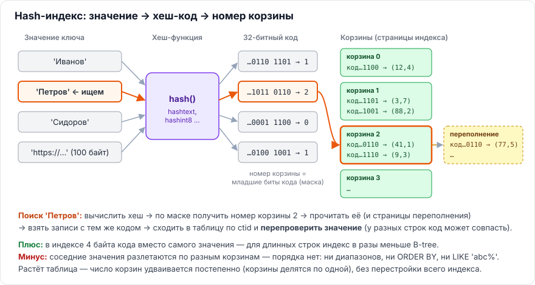
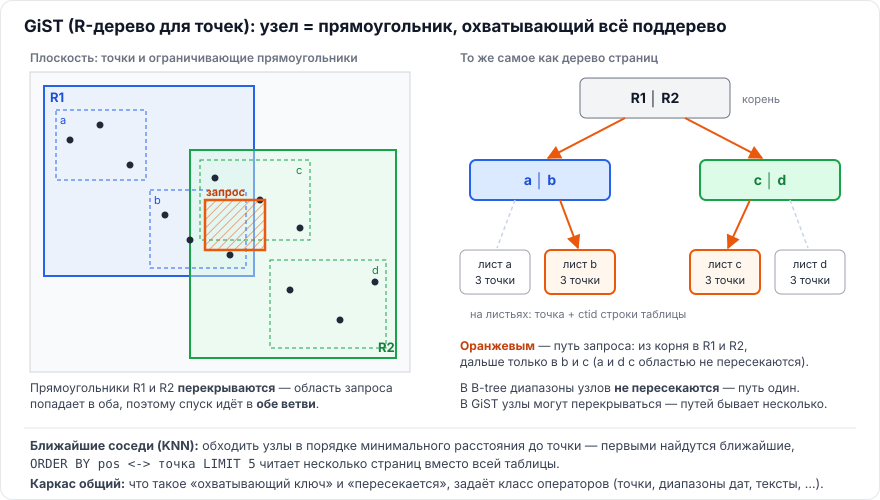
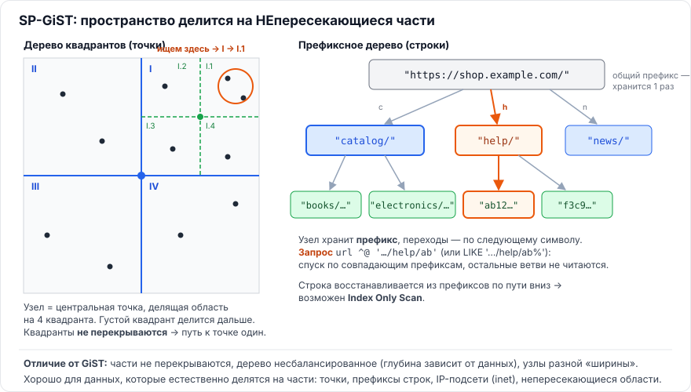
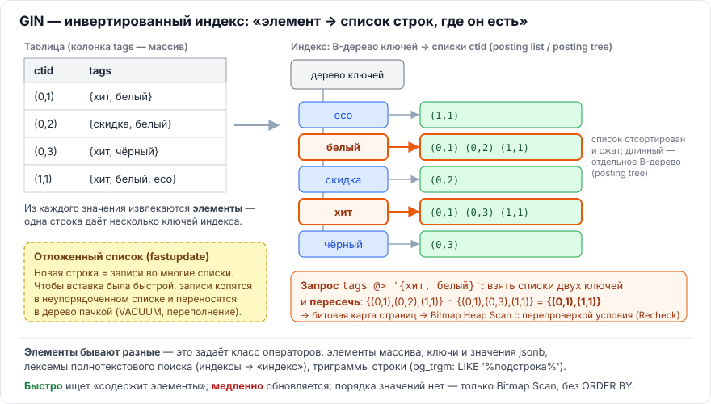
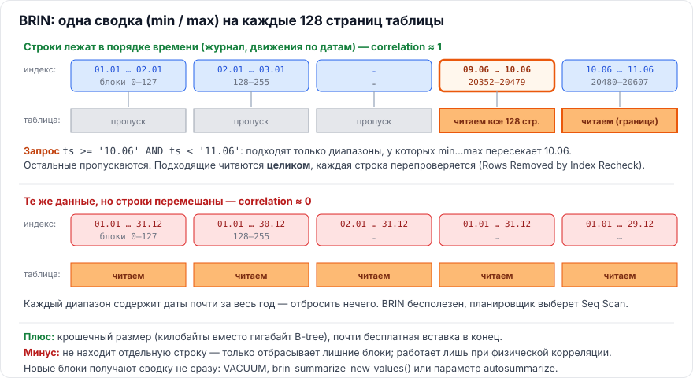

# Глава 3. PostgreSQL

[← Глава 2. MS SQL Server](02-mssql.md) · [Оглавление](../README.md) · [Глава 4. Секционирование →](04-sekcionirovanie.md)

Главное отличие PostgreSQL от MS SQL, из которого вытекает почти вся эта глава: **таблица — всегда куча, а `UPDATE` создаёт новую версию строки** (MVCC). Отсюда отсутствие кластерного индекса, HOT-обновления, раздувание и `VACUUM`.

---

## 3.1. Какие типы индексов есть в PostgreSQL и для чего каждый

> **Коротко.** Шесть встроенных типов: **B-tree** — универсальный, по умолчанию: равенство, диапазоны, сортировка, уникальность. **Hash** — только равенство; хранит 4-байтовый хеш-код вместо значения, поэтому компактен для длинных ключей. **GiST** — сбалансированное дерево, где ключ узла «охватывает» всё поддерево (для точек — ограничивающий прямоугольник), области узлов могут перекрываться: геометрия, диапазоны, ближайшие соседи (KNN), ограничения исключения. **SP-GiST** — несбалансированное дерево, рекурсивно делящее пространство на **непересекающиеся** части: дерево квадрантов для точек, префиксное дерево для строк, IP-подсети. **GIN** — инвертированный индекс: из значения извлекаются элементы, и для каждого элемента хранится список строк — массивы, JSONB, полнотекстовый поиск, триграммы (`LIKE '%подстрока%'`). **BRIN** — сверхкомпактные сводки min/max по диапазонам блоков таблицы; работает, только если значения коррелируют с физическим порядком строк (журналы, даты). 1С использует только B-tree.

### Как PostgreSQL поддерживает разные типы индексов

В MS SQL «обычный» индекс — всегда B-дерево. В PostgreSQL тип индекса — это **метод доступа** (access method, `pg_am`): алгоритм, который хранит и обходит структуру. Метод доступа ничего не знает о типах данных. Связь с типом даёт **класс операторов** (`pg_opclass`): набор функций, которые объясняют индексу, как работать с этим типом — что значит «равно», «пересекается», «содержит», как объединять ключи, как считать расстояние.

```sql
CREATE INDEX ON shops USING gist (pos);                       -- класс по умолчанию для point
CREATE INDEX ON shops USING spgist (pos kd_point_ops);        -- класс указан явно
CREATE INDEX ON goods USING gin (title gin_trgm_ops);         -- класс из расширения pg_trgm
```

Отсюда практическое правило: индекс используется, только если **оператор в `WHERE` входит в класс операторов индекса**. `tags @> ARRAY['хит']` использует GIN по массиву, а `'хит' = ANY(tags)` — нет: оператор `= ANY` в класс `array_ops` не входит.

Расширения добавляют и новые классы (`pg_trgm`, `btree_gist`, `btree_gin`), и новые методы доступа (`bloom`). Посмотреть, что установлено и что умеет каждый тип: [sql/postgresql/00_index_types_overview.sql](../sql/postgresql/00_index_types_overview.sql).

| Тип | Порядок (`ORDER BY`) | `UNIQUE` | Составной | `EXCLUDE` | `INCLUDE` | Index Only Scan |
|---|---|---|---|---|---|---|
| B-tree | да | да | да | да | да (11+) | да |
| Hash | нет | нет | нет | да (только `=`) | нет | нет |
| GiST | только KNN (`<->`) | нет | да | да | да (12+) | да (для части классов) |
| SP-GiST | только KNN (`<->`, 12+) | нет | нет | да | да (14+) | да |
| GIN | нет | нет | да | нет | нет | нет |
| BRIN | нет | нет | да | нет | нет | нет |

> ℹ️ **Есть ли аналоги в MS SQL?** Прямых — нет, но идеи встречаются. Hash-индексы в MS SQL есть только у таблиц In-Memory OLTP (с фиксированным числом корзин). Пространственные индексы MS SQL решают задачи GiST, но устроены иначе: плоскость режется на сетку, номера ячеек хранятся в обычном B-дереве. Полнотекстовый индекс MS SQL — инвертированный, как GIN, но только для слов и в отдельной подсистеме. Пропуск блоков по min/max, как в BRIN, есть у сегментов columnstore ([2.5](02-mssql.md#25-чем-columnstore-отличается-от-rowstore-и-для-каких-нагрузок-он-подходит)). Массивов, JSON-документов, триграмм и KNN по точкам «из коробки» в индексах MS SQL нет.

---

### B-tree — то же B+-дерево, что в MS SQL, с отличиями

Устройство и поиск — как в [1.2](01-teoriya.md#12-как-устроено-b-дерево-почему-поиск-логарифмический): корень → промежуточные страницы → листья, связанные в двусвязный список. Операторы: `=`, `<`, `<=`, `>`, `>=`, `BETWEEN`, `IN`, `IS NULL`, `LIKE 'abc%'`. Единственный тип с `UNIQUE` и с отдачей строк в порядке ключа.

Отличия от MS SQL:

| | PostgreSQL | MS SQL |
|---|---|---|
| Что лежит в листе рядом с ключом | `ctid` — адрес строки в куче (страница, позиция) | Ключ кластерного индекса (или RID кучи) |
| Одинаковые значения ключа | **Дедупликация** (PG 13+): ключ хранится один раз со списком `ctid` (posting list) | Каждое значение хранится отдельно |
| Условие только по второй колонке составного индекса | **Skip scan** (PG 18+), если у первой колонки мало значений | Нет |
| Чтение «только индекса» | `Index Only Scan` работает, только если страница кучи отмечена в карте видимости как «всё видимо» — её обновляет `VACUUM` | Покрывающий индекс работает всегда |
| Много строк по индексу | `Bitmap Index Scan` → `Bitmap Heap Scan`: сначала карта нужных страниц, потом чтение кучи по порядку, каждая страница один раз | `Key Lookup` на каждую строку |
| `LIKE 'abc%'` | Только при локали `C` или с классом `text_pattern_ops` | Работает с обычным индексом |
| Расщепление самой правой страницы | Не пополам: слева остаётся страница, заполненная до `fillfactor` (90%) | Пополам или «хороший» split в конец |
| `NULL` | Хранится в индексе, `IS NULL` использует индекс | То же |

Что видно в скрипте [sql/postgresql/01_btree.sql](../sql/postgresql/01_btree.sql) (1 млн строк): дерево из 3 уровней; в листьях — `ctid`; индекс по колонке с 4 значениями занимает **6,8 МБ с дедупликацией и 21 МБ без неё**; четыре метода доступа (`Index Scan`, `Index Only Scan` с `Heap Fetches: 0`, `Bitmap Heap Scan`, `Seq Scan`) в зависимости от доли строк.

---

### Hash — корзины по хеш-коду



**Идея.** Не хранить значения отсортированными, а вычислить от значения хеш-функцию и сразу «прыгнуть» в корзину, где лежат строки с этим кодом.

**Устройство.**
- **Метастраница** (страница 0): число корзин и маски, по которым из хеш-кода получается номер корзины.
- **Корзины** — страницы с парами «хеш-код (4 байта) → `ctid`». Самого значения в индексе **нет**.
- **Страницы переполнения** — если корзина не помещается в страницу, к ней цепляется ещё одна.
- **Страницы битовой карты** — учёт свободных страниц переполнения.
- Когда записей на корзину становится слишком много (порог зависит от `fillfactor`, по умолчанию 75), корзины **делятся по одной**, и их число постепенно удваивается. Весь индекс при этом не перестраивается.

**Поиск `WHERE url = '…'`:**
1. Вычислить хеш значения (`hashtext`, `hashint8` и т.д.).
2. По маске получить номер корзины, прочитать её страницу (и страницы переполнения).
3. Взять записи с тем же хеш-кодом, сходить в кучу по `ctid` и **перепроверить** значение: у разных значений код может совпасть.

Итого — метастраница, страница корзины, страница таблицы. В скрипте поиск одного URL среди 500 тыс. читает **3 страницы**.

**Чего не умеет и почему.** Соседние значения после хеширования разлетаются по разным корзинам — порядка нет. Значит, нет диапазонов, `ORDER BY`, `LIKE 'abc%'`. Нет `UNIQUE` и составных ключей. Зато есть `EXCLUDE ... WITH =` — так можно получить уникальность через hash-индекс.

**Когда полезен.** Равенство по **длинным** значениям: URL, хеши документов, длинные коды. В скрипте [sql/postgresql/02_hash.sql](../sql/postgresql/02_hash.sql) на 500 тыс. URL длиной ~100 символов: **B-tree — 68 МБ, Hash — 16 МБ**. Для коротких ключей (`int`, `uuid`) выигрыша обычно нет — B-tree универсальнее.

**История.** До PostgreSQL 10 hash-индексы не журналировались в WAL: не восстанавливались после сбоя и не реплицировались. Отсюда старый совет «не использовать hash» — для PG 10+ он устарел.

---

### GiST — дерево «охватывающих» ключей



**Идея.** GiST (Generalized Search Tree) — каркас сбалансированного дерева для данных, у которых **нет линейного порядка**: точки, прямоугольники, интервалы времени. Ключ во внутреннем узле — не «граница диапазона», как в B-tree, а **условие, которое выполняется для всего поддерева**. Для точек это ограничивающий прямоугольник: все точки поддерева лежат внутри него. Так GiST для геометрии становится **R-деревом**.

**Главное отличие от B-tree.** Прямоугольники соседних узлов **могут перекрываться**. Поэтому при поиске из одного узла бывает нужно спуститься в **несколько** ветвей, а не в одну. Чем меньше перекрытие, тем быстрее индекс.

**Поиск «точки в квадрате 1×1 км»:** в корне проверить, какие прямоугольники пересекают квадрат, → спуститься во все такие ветви → на листьях проверить сами точки → по `ctid` взять строки.

**Вставка:** на каждом уровне выбирается ветвь, прямоугольник которой **меньше всего придётся расширить** ради новой точки. Переполненная страница делится на две так, чтобы новые прямоугольники перекрывались как можно меньше.

**Что задаёт класс операторов.** Каркас один, а «что такое охватывающий ключ», «пересекается ли он с условием», «как выбрать ветвь», «как делить страницу» и «каково расстояние» определяют функции класса операторов. Поэтому GiST умеет очень разное:

| Класс / данные | Что ускоряет |
|---|---|
| `point`, `box`, `polygon`, `circle`; PostGIS | Попадание в область (`<@`, `&&`, `@>`), **ближайшие соседи** (`ORDER BY pos <-> точка LIMIT n`) |
| Диапазоны (`tstzrange`, `daterange`, `int4range`) | Пересечение интервалов `&&`, содержание `@>` |
| `EXCLUDE USING gist (room WITH =, during WITH &&)` | Запрет пересекающихся броней в одной комнате (равенство по `int` — через расширение `btree_gist`) |
| `tsvector` (полнотекстовый поиск) | Поиск по словам; хранит «сигнатуры» с потерями, поэтому строки перепроверяются. Для чтения GIN обычно лучше, GiST — компактнее и быстрее обновляется |
| `pg_trgm` (`gist_trgm_ops`) | `LIKE '%подстрока%'`, похожие строки (`%`, `<->` по сходству) |

**Ближайшие соседи (KNN).** Дерево обходится не «в глубину», а в порядке **минимального расстояния** от точки до прямоугольника узла. Первыми из индекса выходят ближайшие точки, и `LIMIT 5` останавливает обход. B-tree так не умеет: у точек нет порядка «больше/меньше».

Скрипт [sql/postgresql/03_gist.sql](../sql/postgresql/03_gist.sql): 200 тыс. магазинов на карте 100×100 км. Через `pageinspect` видно, что в корне 13 прямоугольников, на следующем уровне — тоже прямоугольники, а на листьях — точки. 5 ближайших магазинов: **11 страниц через индекс против ~1900 страниц и сортировки без него**. Во второй части — бронь переговорных с `EXCLUDE`.

---

### SP-GiST — разбиение пространства на непересекающиеся части



**Идея.** SP-GiST (Space-Partitioned GiST) — каркас для деревьев, которые **рекурсивно делят пространство на непересекающиеся части**. Классические структуры этого семейства: дерево квадрантов (quad-tree), k-d дерево, префиксное дерево (radix tree).

**Чем отличается от GiST.**

| | GiST | SP-GiST |
|---|---|---|
| Области узлов | Могут перекрываться → поиск идёт по нескольким ветвям | Не перекрываются → к значению ведёт один путь |
| Балансировка | Сбалансированное: все листья на одной глубине | **Несбалансированное**: в густых местах дерево глубже, в пустых — мельче |
| Узел | Список охватывающих ключей детей | «Префикс» (центральная точка, общее начало строки) + метки ветвей (номер квадранта, следующий символ) |
| Хорошо для | Объектов с размером (прямоугольники, интервалы), которые могут пересекаться | Точек и значений, естественно делящихся на части |

**Устройство на примерах.**
- **Дерево квадрантов** (`quad_point_ops`, по умолчанию для `point`): узел — центральная точка, которая делит область на 4 квадранта; густой квадрант делится дальше. **k-d дерево** (`kd_point_ops`) делит по очереди по x и по y на две части.
- **Префиксное дерево** (`text_ops`): узел хранит общее начало строк, ветви помечены следующим символом. У строк с длинными общими префиксами (URL, пути, коды с общим началом) префикс хранится **один раз** — индекс компактнее B-tree. Ускоряет `=`, `<`, `>`, `^@` («начинается с») и `LIKE 'префикс%'`.
- **IP-адреса** (`inet_ops`): подсети естественно делятся по битам адреса — «адрес входит в подсеть» (`<<`, `>>`).

Узлы маленького несбалансированного дерева «упаковываются» в страницы по несколько, поэтому число чтений страниц остаётся небольшим, хотя логическая глубина дерева больше, чем у B-tree.

**Плюсы:** поддерживает `Index Only Scan` (значение восстанавливается по префиксам на пути вниз), KNN для точек (PG 12+). **Минусы:** нет `UNIQUE` и составных ключей; на неравномерных данных дерево может стать глубоким.

Скрипт [sql/postgresql/04_spgist.sql](../sql/postgresql/04_spgist.sql): точки — **GiST 13 МБ, k-d 10 МБ, quad-tree 8,9 МБ**, поиск в квадрате через `Index Only Scan` с `Heap Fetches: 0`; URL с общими префиксами — **B-tree 27 МБ, SP-GiST 17 МБ**, и `LIKE 'префикс%'` планировщик сам превращает в условие `^@` для индекса; поиск адресов в подсети.

---

### GIN — инвертированный индекс



**Идея.** Как предметный указатель в конце книги: не «страница → какие слова на ней», а «слово → на каких страницах оно есть». GIN (Generalized Inverted Index) индексирует не значение целиком, а **элементы внутри** него. Одна строка таблицы даёт столько ключей индекса, сколько в её значении элементов.

**Устройство.**
- **Дерево ключей** (entry tree) — обычное B-дерево по элементам: меткам массива, ключам и значениям JSON, словам, триграммам. Каждый элемент хранится **один раз**.
- **Список строк** для каждого ключа — отсортированные и сжатые `ctid`. Короткий список (posting list) лежит прямо в листе дерева ключей. Длинный выносится в отдельное B-дерево (posting tree).
- **Отложенный список** (pending list, `fastupdate = on` по умолчанию) — неупорядоченная очередь новых записей. Вставка одной строки затрагивает много списков, поэтому новые записи сначала копятся здесь и переносятся в дерево пачкой: при `VACUUM`/autovacuum, при превышении `gin_pending_list_limit` (4 МБ) или вызовом `gin_clean_pending_list()`. Поиск просматривает и дерево, и отложенный список, — большой отложенный список замедляет чтение.

**Поиск `tags @> '{хит, белый}'`:** из условия извлекаются ключи (`хит`, `белый`) → для каждого берётся список строк → списки **пересекаются** (для `&&` — объединяются) → получается битовая карта страниц → `Bitmap Heap Scan` с перепроверкой условия. GIN **всегда** работает через битовую карту и не умеет отдавать строки в порядке.

**Что бывает «элементами»** (задаёт класс операторов):

| Класс | Элементы | Операторы |
|---|---|---|
| `array_ops` | Элементы массива | `@>` (содержит), `<@` (содержится), `&&` (пересекается), `=` |
| `jsonb_ops` (по умолчанию) | Каждый ключ и каждое значение документа | `@>`, `?` (есть ключ), `?\|`, `?&`, `@?`, `@@` (jsonpath) |
| `jsonb_path_ops` | Хеш «путь + значение» | Только `@>`, `@?`, `@@`; индекс меньше и точнее, но `?` не умеет |
| `tsvector_ops` | Лексемы — нормализованные слова («Индексы» → «индекс») | `@@` (полнотекстовый поиск) |
| `gin_trgm_ops` (`pg_trgm`) | Триграммы — тройки символов строки | `LIKE '%подстрока%'`, `ILIKE`, регулярные выражения, похожесть |
| `btree_gin` | Скалярные значения (`int`, `date`, …) | `=`, `<`, `>` — чтобы сделать составной GIN, например, «метки + организация» |

**Цена.** Чтение быстрое, запись медленная: одна строка — десятки записей в индексе (у триграмм — по одной на каждую тройку символов). Индекс по триграммам большой.

Скрипт [sql/postgresql/05_gin.sql](../sql/postgresql/05_gin.sql) (300 тыс. товаров): индекс по массивам меток содержит всего **8 ключей** и занимает 776 КБ; `jsonb_path_ops` вдвое меньше `jsonb_ops`; триграммный индекс — 53 МБ, но поиск `LIKE '%c4ca4238%'` — **0,5 мс** вместо полного просмотра; полнотекстовый поиск по-русски; отложенный список до и после `gin_clean_pending_list`.

---

### BRIN — сводки по диапазонам блоков



**Идея.** BRIN (Block Range Index) не ищет строки — он **отбрасывает блоки таблицы, где нужных строк быть не может**. Таблица делится на диапазоны по `pages_per_range` страниц (по умолчанию **128** страниц = 1 МБ), и для каждого диапазона хранится одна сводка — для дат и чисел это `min` и `max`.

**Устройство.** Метастраница → карта диапазонов (revmap: «диапазон № → где его сводка») → страницы сводок. На таблицу в 325 МБ — около 330 сводок, это **десятки килобайт**.

**Поиск `ts >= '10.06' AND ts < '11.06'`:** перебрать все сводки (их мало) → оставить диапазоны, у которых `min…max` пересекается с условием → построить **неточную** (lossy) битовую карту: «читать все страницы этих диапазонов» → прочитать их целиком и перепроверить каждую строку. В плане это `Bitmap Heap Scan` с `Heap Blocks: lossy=…` и `Rows Removed by Index Recheck`.

**Главное условие — корреляция.** BRIN полезен, только если значения колонки идут **в физическом порядке строк**: журналы событий, движения по датам, автоинкремент при вставке в конец. Проверить можно по `pg_stats.correlation` (близко к 1 или −1 — хорошо, около 0 — бесполезно). Если строки перемешаны, у каждого диапазона `min…max` покрывает почти всё и отбросить нечего. Массовые `UPDATE` и `DELETE` с повторным использованием места тоже портят корреляцию.

**Новые строки.** Диапазоны, появившиеся после создания индекса, получают сводку не сразу. До этого BRIN считает их «подходящими» и читает целиком. Сводки строит `VACUUM`/autovacuum, функция `brin_summarize_new_values()` или параметр индекса `autosummarize = on`.

**Варианты сводки** (класс операторов):
- `minmax` (по умолчанию) — один интервал на диапазон;
- `minmax_multi` (PG 14+) — несколько интервалов; терпит «выбросы», которые иначе раздули бы `min…max` на весь год;
- `bloom` (PG 14+) — bloom-фильтр для равенства по значениям без порядка (id сессии, код);
- `inclusion` — для `box`, `inet`, диапазонов: охватывающее значение.

Скрипт [sql/postgresql/06_brin.sql](../sql/postgresql/06_brin.sql) (5 млн событий, таблица 325 МБ): **B-tree — 107 МБ, BRIN — 32 КБ**; выборка за день — **12 мс через BRIN против 387 мс** полного просмотра; в перемешанной копии той же таблицы каждый диапазон содержит даты почти за весь год, и планировщик выбирает `Seq Scan`.

Сравните с columnstore в MS SQL: сегменты тоже хранят min/max, и пропуск групп строк тоже работает только при упорядоченной загрузке ([2.5](02-mssql.md#25-чем-columnstore-отличается-от-rowstore-и-для-каких-нагрузок-он-подходит)).

---

### Как выбрать тип индекса

| Задача | Тип |
|---|---|
| Равенство, диапазоны, сортировка, уникальность — обычные колонки | **B-tree** |
| Только равенство по длинным значениям (URL, хеши) | **Hash** (или B-tree по `md5(значение)`) |
| Точки, прямоугольники, геоданные; «ближайшие N» | **GiST** (или **SP-GiST** для точек) |
| Интервалы времени: пересечение, запрет пересечений | **GiST** + `EXCLUDE` |
| Строки с общими префиксами, поиск по префиксу; IP-подсети | **SP-GiST** (или B-tree с `text_pattern_ops`) |
| «Содержит элементы»: массивы, JSONB, полнотекстовый поиск | **GIN** |
| `LIKE '%подстрока%'`, `ILIKE`, регулярные выражения | **GIN** с `pg_trgm` (GiST с `pg_trgm` — если часто пишут) |
| Огромная таблица, значения растут вместе с порядком вставки (журналы, время) | **BRIN** |

### Сводная таблица

| Тип | Структура | Сценарии | Операторы | Что в плане |
|---|---|---|---|---|
| **B-tree** | Сбалансированное дерево, листья в порядке ключа | Сортируемые данные, уникальность, по умолчанию | `= < <= > >= BETWEEN IN`, `LIKE 'abc%'` | Index Scan, Index Only Scan, Bitmap |
| **Hash** | Корзины по хеш-коду | Только точное совпадение, длинные ключи | `=` | Index Scan, Bitmap |
| **GiST** | Сбалансированное дерево охватывающих ключей, области могут перекрываться | Геоданные, диапазоны, KNN, `EXCLUDE` | `&& @> <@ <->` | Index Scan (KNN: `Order By`), Bitmap |
| **SP-GiST** | Несбалансированное дерево непересекающихся частей (quad-tree, k-d, radix) | Точки, префиксы строк, IP | `<@ <-> ^@ << >>` | Index Only Scan, Bitmap |
| **GIN** | Дерево элементов + списки строк | Массивы, JSONB, полнотекстовый поиск, триграммы | `@> <@ && ? @@`, `LIKE` через `pg_trgm` | Только Bitmap |
| **BRIN** | Сводки по диапазонам блоков | Огромные таблицы с физической корреляцией | `= < <= > >=` | Только Bitmap (lossy) |

### Применительно к 1С

- Платформа создаёт **только B-tree** индексы, на обеих СУБД. Создавать в базе 1С индексы других типов вручную — неподдерживаемое изменение структуры: при реструктуризации они пропадут или помешают.
- Задачи, ради которых в «чистом» PostgreSQL берут GIN, в 1С решаются средствами платформы: поиск по словам и подстрокам — **полнотекстовый поиск 1С** (собственный индекс платформы, не индекс СУБД); `ПОДОБНО "%текст%"` по-прежнему ведёт к сканированию.
- Остальные типы важно знать для общего понимания PostgreSQL, для собственных (не 1С) баз и хранилищ, куда выгружаются данные из 1С.

> **Запомнить:** B-tree — по умолчанию и единственный для `UNIQUE`; Hash — «только `=`, но компактно»; GiST — «где и рядом»: охватывающие области, могут перекрываться, KNN, `EXCLUDE`; SP-GiST — «делим пространство без перекрытий»: точки, префиксы, IP; GIN — «что внутри»: элемент → список строк, всегда Bitmap, дорогая запись; BRIN — «очень большое и упорядоченное»: min/max на 128 страниц, нужна корреляция.

---

## 3.2. Почему в PostgreSQL нет кластерного индекса в понимании MS SQL и что делает `CLUSTER`

> **Коротко.** В PostgreSQL таблица **всегда куча**: строки пишутся туда, где есть место, а **все** индексы вторичные и ссылаются на строку по физическому адресу `ctid` (страница, позиция). Поддерживать постоянный порядок строк, как кластерный индекс MS SQL, при MVCC было бы слишком дорого: каждый `UPDATE` создаёт новую версию строки в новом месте. Команда `CLUSTER таблица USING индекс` **один раз** физически переписывает таблицу в порядке индекса. Порядок не поддерживается при последующих изменениях, на время работы таблица полностью заблокирована (`ACCESS EXCLUSIVE`) и нужно место под вторую копию.


### Почему так устроено

| | MS SQL Server | PostgreSQL |
|---|---|---|
| Таблица | B-дерево кластерного индекса (или куча) | Всегда куча |
| Листья индекса указывают на | Ключ кластерного индекса (или RID для кучи) | `ctid` — физический адрес версии строки |
| `UPDATE` | Изменяет строку на месте (если помещается) | Создаёт **новую версию** строки, старая остаётся до очистки |
| Порядок строк | Поддерживается автоматически при каждой записи | Не поддерживается |

Если бы PostgreSQL держал строки отсортированными, каждый `UPDATE` (= новая версия) требовал бы сдвига данных и правки ссылок во всех индексах. Поэтому куча и вторичные индексы — сознательный архитектурный выбор.

### Что это значит на практике

**Простыми словами.** Кластерный индекс в MS SQL — не отдельная структура рядом с таблицей, а **сама таблица**, уложенная в B-дерево: в его листьях лежат строки целиком, в порядке ключа. В PostgreSQL строки лежат в куче там, где нашлось место, а **ни один** индекс не определяет, как они расположены. «Нет кластерного индекса» означает именно это.

**Аналогия — библиотека.**
- **MS SQL:** книги стоят на полках строго по шифру. Полки и есть каталог по шифру — дошёл до места, книга перед тобой. Остальные каталоги (по автору, по году) пишут на карточке **шифр**, и по нему идёшь к полке.
- **PostgreSQL:** книгу ставят на любую свободную полку. Во **всех** каталогах, включая каталог по шифру, на карточке написано «стеллаж 812, место 3» (это `ctid`). Ни один каталог не главнее другого.

**Первичный ключ — тоже обычный вторичный индекс.** В MS SQL `PRIMARY KEY` по умолчанию создаётся кластерным и задаёт физический порядок строк. В PostgreSQL `PRIMARY KEY` — это уникальный B-tree рядом с кучей, такой же, как остальные индексы.

**У кучи есть и плюс — короче путь от индекса к строке.**

| | MS SQL (таблица с кластерным индексом) | PostgreSQL (куча) |
|---|---|---|
| Что лежит в листе некластерного индекса | Ключ кластерного индекса | `ctid` — адрес строки |
| Как получить строку | **Второй спуск** по кластерному дереву: 3–4 чтения страниц (`Key Lookup`) | **Сразу** нужная страница кучи: 1 чтение |
| Чтение диапазона по «главному» ключу | Строки лежат подряд — чтение подряд | Строки могут быть разбросаны по куче — «прыжки» по страницам |
| `UPDATE` неиндексированной колонки | Строка меняется на месте; некластерные индексы не трогаются | Новая версия в новом месте; в общем случае новые записи во **все** индексы (если не HOT) |

Итог: куча дешевле для поиска отдельных строк через вторичные индексы, кластерный индекс — для диапазонов по своему ключу и для `UPDATE`. За отсутствие порядка в PostgreSQL платят записью: индексы указывают на физическое место, а MVCC при каждом `UPDATE` кладёт строку в новое место ([3.3](#33-как-mvcc-влияет-на-индексы-что-такое-hot-обновления-и-раздувание-bloat)).

### Что делает `CLUSTER`

```sql
CLUSTER documents USING ix_documents_date;   -- один раз упорядочить
CLUSTER documents;                            -- повторить по тому же индексу
```

- Создаёт **новый файл** таблицы, переписывает в него строки в порядке индекса, удаляет старый и **перестраивает все индексы** (механизм тот же, что у `VACUUM FULL`).
- **Эффект однократный:** новые и обновлённые строки снова пишутся куда придётся.
- **Блокировка `ACCESS EXCLUSIVE`** — ни чтения, ни записи на всё время работы.
- Нужно свободное место примерно на размер таблицы со всеми индексами.

### Зачем это нужно

Повысить **корреляцию** между порядком значений в индексе и физическим порядком строк (`pg_stats.correlation` → близко к 1):

```sql
SELECT attname, correlation FROM pg_stats
WHERE tablename = 'documents' AND attname = 'doc_date';
```

При высокой корреляции диапазон по индексу читает страницы таблицы **подряд**, а не вразброс → планировщик охотнее выбирает индекс для широких диапазонов. Хорошая корреляция также нужна, чтобы работал **BRIN**.

**Без простоя:** утилита `pg_repack` (с ключом `--order-by`) переупорядочивает таблицу онлайн.

### Применительно к 1С

Платформа создаёт в обеих СУБД **одинаковый набор** индексов, но устроены они по-разному:
- **MS SQL:** таблица движений регистра накопления **физически** отсортирована по Периоду + Регистратору + НомеруСтроки (это её кластерный индекс). Отчёт за месяц читает страницы подряд.
- **PostgreSQL:** тот же индекс «Период + Регистратор + НомерСтроки» — обычный вторичный. Движения за месяц находятся по нему, но за строками приходится ходить в кучу. На практике разница невелика: движения пишутся в хронологическом порядке, поэтому в куче они тоже лежат примерно по времени (высокая `correlation`). Сильнее порядок «расползается» у таблиц с частыми `UPDATE` — например, у таблиц итогов регистров.
- То же для справочников и документов: «кластерный по Ссылке» в MS SQL превращается в PostgreSQL в обычный уникальный индекс по `_IDRRef`.

Для баз 1С `CLUSTER` практически не применяют: эффект временный, а блокировка полная. Важнее следить за раздуванием и статистикой ([3.3](#33-как-mvcc-влияет-на-индексы-что-такое-hot-обновления-и-раздувание-bloat), [3.5](#35-какова-роль-vacuum-и-autovacuum-в-обслуживании-индексов-чем-отличаются-reindex-и-reindex-concurrently)).

> **Запомнить:** в PG таблица = куча, все индексы (и первичный ключ) вторичные и ссылаются на `ctid`. Плюс кучи — от индекса к строке одно чтение вместо `Key Lookup`; минус — нет порядка строк, а каждый `UPDATE` даёт новый адрес. `CLUSTER` = одноразовая сортировка с полной блокировкой, порядок «расползается».

---

## 3.3. Как MVCC влияет на индексы? Что такое HOT-обновления и раздувание (bloat)

> **Коротко.** При `UPDATE` PostgreSQL создаёт новую версию строки с новым адресом `ctid`. В общем случае ссылку на неё приходится добавить в **каждый** индекс таблицы — даже если индексированные колонки не менялись. Старые версии и ссылки на них остаются, пока их не уберёт `VACUUM`. **HOT-обновление** (Heap-Only Tuple) избегает этого: если не меняется ни одна индексированная колонка **и** на той же странице есть место, новая версия кладётся на ту же страницу, связывается цепочкой со старой, а индексы не трогаются. **Раздувание** — накопление мёртвых версий и пустого места в таблицах и индексах: из-за долгих транзакций, отставания autovacuum, массовых изменений.


### MVCC и индексы

- `UPDATE` = «пометить старую версию удалённой (`xmax`) + записать новую версию (`xmin`)».
- Новая версия лежит по новому адресу → **без HOT в каждый индекс добавляется новая запись**. Чем больше индексов, тем дороже каждый `UPDATE`.
- Записи индексов, указывающие на мёртвые версии, остаются, пока их не удалит `VACUUM`.

> Сравните с MS SQL: там `UPDATE` неиндексированной колонки не трогает некластерные индексы вообще — они ссылаются на ключ, а не на физический адрес.

### HOT-обновление

**Условия (оба обязательны):**
1. Не изменилась ни одна колонка, входящая **в любой** индекс таблицы.
2. На **той же странице** таблицы хватает места для новой версии.

**Как работает:**
- Новая версия ложится на ту же страницу с флагом *heap-only tuple*, у старой появляется флаг *HOT updated* и ссылка на новую.
- В индексах **ничего не добавляется**: индекс по-прежнему указывает на «голову» цепочки, а при чтении СУБД проходит по цепочке до видимой версии.
- Мёртвые версии цепочки вычищаются **внутристраничной очисткой** (page pruning) прямо при обычном обращении к странице, без `VACUUM` и без индексов.
- Если места на странице нет — новая версия уходит на другую страницу, HOT не срабатывает, правятся все индексы.

Отсюда практический рецепт: для таблиц с частыми `UPDATE` неиндексированных колонок **снизить `fillfactor` таблицы** (например, до 80–90), чтобы на страницах оставалось место для HOT. Долю HOT-обновлений видно так:

```sql
SELECT relname, n_tup_upd, n_tup_hot_upd,
       round(100.0 * n_tup_hot_upd / NULLIF(n_tup_upd, 0), 1) AS hot_pct
FROM pg_stat_user_tables
ORDER BY n_tup_upd DESC LIMIT 20;
```

### Раздувание (bloat)

**Что это:** таблица или индекс занимает намного больше страниц, чем нужно для живых данных: внутри мёртвые версии и пустота.

**Причины:**
1. **Долгие транзакции** (в том числе «idle in transaction») держат **горизонт видимости**: `VACUUM` не имеет права удалить версии, которые эта транзакция теоретически может увидеть.
2. **Autovacuum не успевает** за интенсивными `UPDATE/DELETE` (пороги по умолчанию рассчитаны на «средние» таблицы).
3. **Нет места для HOT** → каждое обновление плодит записи во всех индексах.
4. **Массовые удаления** — место освобождается внутри файлов, но файлы не уменьшаются.

**Чем вредит:** больше страниц читать при сканированиях, засорённый буферный кэш, растут бэкапы и время обслуживания.

**Как бороться:**

| | Средство |
|---|---|
| Профилактика | Настроить autovacuum (снизить `autovacuum_vacuum_scale_factor` для больших таблиц); ограничивать долгие транзакции (`idle_in_transaction_session_timeout`, мониторинг `pg_stat_activity`); `fillfactor` таблицы под HOT; не создавать лишних индексов |
| Лечение индекса | `REINDEX INDEX CONCURRENTLY` |
| Лечение таблицы | `VACUUM FULL` или `CLUSTER` (полная блокировка) либо онлайн — `pg_repack`, `pgcompacttable` |

> **Запомнить:** MVCC → `UPDATE` = новая версия по новому адресу → записи во все индексы. HOT спасает, если индексированные колонки не менялись и на странице есть место. Bloat = мёртвые версии + пустота.

---

## 3.4. Что значит `fillfactor` в PostgreSQL для таблицы и для индекса и чем он отличается от MS SQL

> **Коротко.** В PostgreSQL `fillfactor` задаётся **и для таблиц, и для индексов**. Для таблицы (по умолчанию **100**) он оставляет место на страницах для **HOT-обновлений**. Для индекса (B-tree по умолчанию **90**) — уменьшает расщепления страниц. В MS SQL fill factor есть только у индексов (включая кластерный, который и есть таблица), по умолчанию 0 = 100%, и его единственная цель — page split. В обеих СУБД значение применяется при заполнении «с нуля» (создание, перестроение), а не поддерживается постоянно.

### Значения по умолчанию в PostgreSQL

| Объект | По умолчанию | Диапазон | Зачем снижать |
|---|---|---|---|
| Таблица (heap) | **100** | 10–100 | Место для HOT-обновлений → меньше записей в индексы и меньше bloat |
| B-tree | **90** | 10–100 | Меньше расщеплений при вставках в середину |
| Hash | 75 | 10–100 | Меньше переполнений корзин |
| GiST | 90 | 10–100 | Меньше расщеплений |
| SP-GiST | 80 | 10–100 | — |
| GIN, BRIN | параметра нет | — | У GIN — свои настройки (`fastupdate`), у BRIN — `pages_per_range` |

> ⚠️ **Поправка к ответу NotebookLM:** «для GiST — 10 или 80» — это перепутаны минимум диапазона и значение по умолчанию другого типа индекса.

```sql
ALTER TABLE documents SET (fillfactor = 85);       -- для новых страниц таблицы
CREATE INDEX ix_doc_number ON documents(number) WITH (fillfactor = 80);
ALTER INDEX ix_doc_number SET (fillfactor = 80);   -- применится при REINDEX
```

**Важно:** `ALTER TABLE ... SET (fillfactor)` действует только на **новые** страницы. Чтобы применить к существующим, таблицу нужно переписать (`VACUUM FULL`, `CLUSTER`, `pg_repack`); для индекса — `REINDEX`.

### Отличия от MS SQL

| | PostgreSQL | MS SQL Server |
|---|---|---|
| Где задаётся | Таблицы **и** индексы | Только индексы (у кучи MS SQL параметра нет) |
| Цель | Таблица — **HOT-обновления** (MVCC); индекс — page split | Page split |
| По умолчанию | Таблица 100, B-tree 90 | 0 (= 100) для всех индексов |
| Когда применяется | Таблица — при вставке в новые страницы; индекс — при создании/`REINDEX` | При создании/`REBUILD` |

> **Запомнить:** PG — fillfactor у таблицы ради HOT (по умолчанию 100) и у индекса ради split (B-tree — 90). MS SQL — только индексы, только ради split, по умолчанию 100.

---

## 3.5. Какова роль `VACUUM` и autovacuum в обслуживании индексов. Чем отличаются `REINDEX` и `REINDEX CONCURRENTLY`

> **Коротко.** `VACUUM` находит мёртвые версии строк, **удаляет ссылки на них из всех индексов**, освобождает место в таблице для повторного использования и обновляет **карту видимости** (без неё не работает `Index Only Scan`) и карту свободного места. Файлы при этом не уменьшаются. Autovacuum запускает `VACUUM` и `ANALYZE` автоматически по порогам. `REINDEX` строит индекс заново, сжимая его, но блокирует запись в таблицу, а сам индекс — полностью. `REINDEX CONCURRENTLY` (PG 12+) перестраивает без блокировки записи, но дольше, не работает в транзакции и при сбое оставляет «невалидный» индекс, который нужно удалить.

### Как `VACUUM` обрабатывает индексы


- Порядок важен: сначала из индексов, потом из таблицы. Иначе индекс указывал бы на переиспользованное место.
- Если список мёртвых TID не помещается в память (`maintenance_work_mem` / `autovacuum_work_mem`), индексы приходится сканировать **несколько раз** — на больших таблицах это медленно.
- **Карта видимости (visibility map)** — бит «на странице все версии видимы всем». `Index Only Scan` проверяет его и не ходит в таблицу. Нет свежего `VACUUM` → бит не установлен → `Heap Fetches` растёт, `Index Only Scan` по факту ходит в таблицу.
- Обычный `VACUUM` **не уменьшает** файлы (кроме пустого хвоста таблицы) и не перестраивает дерево индекса. Пустые страницы индекса переиспользуются.

### Autovacuum

Процесс `autovacuum launcher` запускает рабочих (`autovacuum_max_workers`), когда для таблицы выполняется условие:

```
мёртвых строк > autovacuum_vacuum_threshold + autovacuum_vacuum_scale_factor × число строк
                     (по умолчанию 50)                (по умолчанию 0,2)
```

Аналогично для `ANALYZE` (`autovacuum_analyze_scale_factor`, по умолчанию 0,1) и, с PG 13, для вставок (`autovacuum_vacuum_insert_*`).

Для таблицы в 100 млн строк порог по умолчанию — 20 млн мёртвых строк, это слишком поздно. Поэтому для больших таблиц `scale_factor` уменьшают (глобально или для таблицы через `ALTER TABLE ... SET (autovacuum_vacuum_scale_factor = 0.01)`).

### `REINDEX` и `REINDEX CONCURRENTLY`

| | `REINDEX` | `REINDEX CONCURRENTLY` |
|---|---|---|
| Версия | Всегда | PostgreSQL 12+ |
| Блокировка таблицы | `SHARE` — **запрещены `INSERT/UPDATE/DELETE`** | `SHARE UPDATE EXCLUSIVE` — чтение и запись **разрешены** |
| Блокировка самого индекса | `ACCESS EXCLUSIVE` — запросы, **которые хотят использовать этот индекс**, тоже ждут | Нет блокировки на чтение |
| Как строит | Один проход | Создаёт новый индекс рядом, несколько проходов, ждёт завершения текущих транзакций, затем подменяет |
| Скорость | Быстрее | Медленнее, больше нагрузка |
| В транзакции (`BEGIN ... COMMIT`) | Можно | **Нельзя** |
| При сбое | Откат, старый индекс на месте | Остаётся **INVALID**-индекс (с суффиксом `_ccnew`) — его нужно удалить и повторить |

> ⚠️ **Уточнение к ответу NotebookLM:** у обычного `REINDEX` «чтение доступно» не полностью: план, который хочет использовать перестраиваемый индекс, будет ждать, потому что на индекс берётся `ACCESS EXCLUSIVE`.

Найти невалидные индексы:

```sql
SELECT indexrelid::regclass AS index_name, indrelid::regclass AS table_name
FROM pg_index WHERE NOT indisvalid;
```

### Применительно к 1С

- В базе 1С много интенсивно изменяемых таблиц (таблицы итогов регистров, временные таблицы). Настройка autovacuum — обязательная часть администрирования 1С на PostgreSQL.
- Перестраивать индексы в рабочее время — только `REINDEX CONCURRENTLY` или `pg_repack`.

> **Запомнить:** `VACUUM` чистит индексы от ссылок на мёртвые строки и обновляет карту видимости, но не сжимает файлы. `REINDEX` сжимает, но блокирует запись (и сам индекс); `CONCURRENTLY` — без блокировки записи, медленнее, может оставить INVALID.

---

## 3.6. Как отличить фрагментацию индекса от раздувания в PostgreSQL

> **Коротко.** **Раздувание** — мало полезных данных **внутри** страниц: мёртвые версии и пустота после `UPDATE/DELETE`. Касается таблиц и индексов; лечится `VACUUM` (переиспользование), а уменьшение файла — `REINDEX` / `VACUUM FULL` / `pg_repack`. **Фрагментация** — листовые страницы B-tree идут на диске **не по порядку** ключей из-за расщеплений; касается только индексов, лечится `REINDEX`. Измеряются расширением `pgstattuple`: раздувание таблицы — `pgstattuple()` (`tuple_percent`, `dead_tuple_percent`, `free_percent`), индекса — `pgstatindex()` (`avg_leaf_density`), фрагментация — `pgstatindex()` (`leaf_fragmentation`).


| | Раздувание (bloat) | Фрагментация |
|---|---|---|
| Где | Таблицы и любые индексы | Листья B-tree |
| Причина | Мёртвые версии (MVCC), отставание autovacuum, долгие транзакции, массовые удаления | Вставки в середину (GUID, строки) → расщепления |
| Физический смысл | Страницы полупустые | Страницы не по порядку |
| Чем вредит | Читаем и кэшируем лишние страницы при любом сканировании | Больше случайного чтения при сканировании диапазонов |
| Показатель | `tuple_percent` (таблица), `avg_leaf_density` (индекс) | `leaf_fragmentation` |
| Лечение | Индекс — `REINDEX CONCURRENTLY`; таблица — `pg_repack` / `VACUUM FULL` | `REINDEX CONCURRENTLY` |

### Как измерить

```sql
CREATE EXTENSION IF NOT EXISTS pgstattuple;

-- раздувание таблицы (читает таблицу целиком!)
SELECT tuple_percent, dead_tuple_percent, free_percent
FROM pgstattuple('public.documents');

-- быстрая приблизительная оценка без полного чтения
SELECT * FROM pgstattuple_approx('public.documents');

-- индекс: плотность листьев и фрагментация
SELECT avg_leaf_density, leaf_fragmentation, leaf_pages, deleted_pages
FROM pgstatindex('public.ix_documents_date');
```

Ориентиры:
- `tuple_percent` таблицы ниже ~50–70% → таблица заметно раздута;
- `avg_leaf_density` индекса ниже ~50–60% (свежий B-tree — около 90%, это его fillfactor) → индекс раздут;
- `leaf_fragmentation` выше ~20–30% → индекс фрагментирован.

Без расширения число мёртвых строк видно в `pg_stat_user_tables.n_dead_tup`.

> **Запомнить:** bloat — «пусто внутри страниц» (таблицы и индексы); фрагментация — «страницы не по порядку» (B-tree). Инструмент — `pgstattuple` / `pgstatindex`.

---

## 3.7. Как найти неиспользуемые индексы и проблемные запросы (`pg_stat_user_indexes`, `EXPLAIN ANALYZE`, `pg_stat_statements`)

> **Коротко.** `pg_stat_user_indexes` хранит счётчики по каждому индексу: `idx_scan` (сколько раз использовался), `idx_tup_read`, `idx_tup_fetch`. Индекс с нулевым или крошечным `idx_scan` за полный бизнес-цикл при заметном размере — кандидат на удаление, кроме тех, что обеспечивают уникальность. Тяжёлые запросы ищут через `pg_stat_statements` (суммарное и среднее время, обращения к буферам) и лог медленных запросов (`log_min_duration_statement`), а разбирают через `EXPLAIN (ANALYZE, BUFFERS)`: сравнивают оценку строк с фактом, смотрят методы доступа и сброс на диск.

### Неиспользуемые индексы

| Колонка `pg_stat_user_indexes` | Что значит |
|---|---|
| `idx_scan` | Сколько раз индекс сканировался |
| `idx_tup_read` | Сколько записей индекса прочитано |
| `idx_tup_fetch` | Сколько строк таблицы получено через этот индекс (простое сканирование индекса) |
| `last_idx_scan` | (PG 16+) когда индекс использовался последний раз |

```sql
SELECT s.schemaname, s.relname AS table_name, s.indexrelname AS index_name,
       s.idx_scan,
       pg_size_pretty(pg_relation_size(s.indexrelid)) AS index_size
FROM pg_stat_user_indexes AS s
JOIN pg_index AS i ON i.indexrelid = s.indexrelid
WHERE s.idx_scan < 50
  AND NOT i.indisunique        -- уникальные обеспечивают целостность
ORDER BY pg_relation_size(s.indexrelid) DESC;
```

**Перед удалением проверить:**
- когда сбрасывалась статистика (`pg_stat_database.stats_reset`, `pg_stat_reset()`); на репликах счётчики свои;
- полный бизнес-цикл: индекс может работать раз в месяц на закрытии периода;
- индекс не обеспечивает уникальность и не нужен для внешнего ключа.

> 💡 **В базе 1С** этот запрос почти ничего не покажет: платформа создаёт большинство индексов **уникальными** (в конец ключа добавляется Ссылка или регистратор + номер строки), и фильтр `NOT indisunique` их отсечёт. Да и удалять индексы платформы средствами СУБД нельзя. Для 1С этот анализ полезен, чтобы найти **лишние галочки «Индексировать»** — тогда убирайте фильтр по уникальности и смотрите индексы с `idx_scan = 0`.

### Тяжёлые запросы — `pg_stat_statements`

Подключение:
```ini
# postgresql.conf (нужен перезапуск)
shared_preload_libraries = 'pg_stat_statements'
```
```sql
CREATE EXTENSION pg_stat_statements;
```

Топ по суммарному времени (PG 13+):
```sql
SELECT round(total_exec_time::numeric / 1000, 1) AS total_sec,
       calls,
       round(mean_exec_time::numeric, 1)          AS avg_ms,
       shared_blks_read, shared_blks_hit, temp_blks_written,
       left(query, 200)                           AS query
FROM pg_stat_statements
ORDER BY total_exec_time DESC
LIMIT 20;
```

> ⚠️ **Поправка к ответу NotebookLM:** колонки `total_time` / `mean_time` были **до PG 13**. С PG 13 — `total_exec_time` / `mean_exec_time` (отдельно появилось время планирования `total_plan_time`). Запрос из исходного ответа на современном PostgreSQL выдаст ошибку.

Дополнительно:
- `log_min_duration_statement = 1000` — в лог попадают запросы дольше 1 секунды;
- расширение `auto_explain` пишет в лог **планы** медленных запросов;
- `pg_stat_activity` — что выполняется прямо сейчас.

### Разбор плана — `EXPLAIN (ANALYZE, BUFFERS)`

```sql
EXPLAIN (ANALYZE, BUFFERS)
SELECT * FROM orders WHERE status = 'Processing' ORDER BY created_at DESC;
```

| Опция | Что даёт |
|---|---|
| без опций | Только **ожидаемый** план: `cost`, `rows` |
| `ANALYZE` | **Выполняет** запрос и показывает факт: `actual time`, `actual rows`, `loops`. ⚠️ `UPDATE/DELETE` реально изменят данные — оборачивайте в `BEGIN … ROLLBACK` |
| `BUFFERS` | Попадания в кэш (`shared hit`) и чтения с диска (`shared read`), временные файлы (`temp read/written`) |

**На что смотреть:**
1. **`rows` (оценка) против `actual rows` (факт).** Расхождение в десятки раз → плохая статистика → `ANALYZE`, увеличить `STATISTICS` для колонки, расширенная статистика (`CREATE STATISTICS`) для зависимых колонок.
2. **Методы доступа:** `Seq Scan` на большой таблице при селективном условии → нет подходящего индекса или условие «ломает» его (функция над полем, несовпадение типов); `Index Scan`; `Index Only Scan` + `Heap Fetches` (много — пора на `VACUUM`); `Bitmap Heap Scan` + `Rows Removed by Index Recheck`.
3. **`Rows Removed by Filter`** — много строк прочитано и выброшено → индекс подходит не полностью (не тот порядок колонок).
4. **`Sort Method: external merge Disk`** и `temp_blks` — не хватило `work_mem`.
5. **`loops`** у внутренней стороны `Nested Loop` — время умножается на число повторов.

> **Запомнить:** `pg_stat_user_indexes.idx_scan` — используется ли индекс; `pg_stat_statements` — какие запросы тяжелее всего; `EXPLAIN (ANALYZE, BUFFERS)` — почему.

---

## 3.8. Как создать индекс без блокировки записи: `CREATE INDEX CONCURRENTLY`

> **Коротко.** Обычный `CREATE INDEX` берёт на таблицу блокировку `SHARE`: чтение идёт, а `INSERT/UPDATE/DELETE` ждут до конца построения. `CREATE INDEX CONCURRENTLY` берёт `SHARE UPDATE EXCLUSIVE` — запись не блокируется. Платим временем и надёжностью: таблица сканируется **дважды**, команда ждёт завершения всех транзакций, которые могли видеть старое состояние, не работает внутри транзакционного блока, а при ошибке (например, нашёлся дубликат для `UNIQUE`) оставляет **INVALID**-индекс, который нужно удалить вручную. На секционированной таблице `CONCURRENTLY` по родителю не работает — индекс строят на каждой секции и присоединяют.

### Сравнение

| | `CREATE INDEX` | `CREATE INDEX CONCURRENTLY` |
|---|---|---|
| Блокировка таблицы | `SHARE` — запись **ждёт** | `SHARE UPDATE EXCLUSIVE` — запись **идёт** |
| Проходов по таблице | Один | Два + ожидание завершения старых транзакций |
| Скорость | Быстрее | В 2–3 раза дольше, больше нагрузка на ввод-вывод |
| В `BEGIN ... COMMIT` | Можно | **Нельзя** |
| При ошибке | Откат, индекса нет | Остаётся `INVALID`-индекс: не используется для чтения, но **поддерживается при записи** (лишняя цена) |
| Секционированная таблица | Работает на родителе | Только по секциям (см. ниже) |

### Как работает

1. В каталоге создаётся описание индекса с пометкой «не готов» (`indisready = false`, `indisvalid = false`). Ждём, пока завершатся транзакции, начатые раньше: после этого все новые изменения таблицы начинают учитывать новый индекс.
2. **Первый проход:** индекс строится по снимку данных. Индекс помечается готовым к записи.
3. **Второй проход:** добавляются строки, вставленные или изменённые во время первого прохода.
4. Ждём завершения транзакций, которые могли бы не увидеть индекс. Индекс помечается валидным — теперь его использует планировщик.

Из шагов 1 и 4 следует практический подвох: **одна долгая транзакция** (в том числе «idle in transaction») заставляет `CONCURRENTLY` висеть сколько угодно долго.

### Если что-то пошло не так

```sql
-- невалидные индексы
SELECT indexrelid::regclass AS index_name, indrelid::regclass AS table_name
FROM pg_index WHERE NOT indisvalid;

DROP INDEX CONCURRENTLY ix_orders_customer;   -- удалить без блокировки записи
CREATE INDEX CONCURRENTLY ix_orders_customer ON orders (customer_id);  -- повторить
```

### Секционированная таблица

```sql
CREATE INDEX ix_sales_amount ON ONLY sales (amount);         -- на родителе, пока INVALID
CREATE INDEX CONCURRENTLY ix_sales_2024_01_amount ON sales_2024_01 (amount);
ALTER INDEX ix_sales_amount ATTACH PARTITION ix_sales_2024_01_amount;
-- ... так для каждой секции; когда присоединены все — индекс на родителе становится валидным
```

### Сравнение с MS SQL

| | PostgreSQL | MS SQL Server |
|---|---|---|
| Создание без блокировки записи | `CREATE INDEX CONCURRENTLY` — во всех редакциях | `ONLINE = ON` — только Enterprise |
| Перестроение без блокировки записи | `REINDEX CONCURRENTLY` (12+) | `REBUILD WITH (ONLINE = ON)` |
| Пауза и продолжение | Нет | `RESUMABLE = ON` |
| Удаление без блокировки | `DROP INDEX CONCURRENTLY` | Удаление — короткая `Sch-M` |
| След неудачи | `INVALID`-индекс, удалять вручную | Откат (для `RESUMABLE` — приостановленная операция) |

### Применительно к 1С

Как и в MS SQL, индексы базы 1С создаёт платформа, вручную их не добавляют. `CONCURRENTLY` 1С-нику нужен в обслуживании: `REINDEX CONCURRENTLY` раздутых индексов в рабочее время и проверка, не осталось ли `INVALID`-индексов после прерванных операций.

> **Запомнить:** `CREATE INDEX` — `SHARE`, запись ждёт. `CONCURRENTLY` — запись идёт, но два прохода, ожидание старых транзакций, не в транзакции, при сбое — `INVALID`. На секционированной таблице — по секциям + `ATTACH PARTITION`.

---

## 3.9. Что такое индекс по выражению в PostgreSQL и когда он нужен

> **Коротко.** В PostgreSQL индекс можно построить не по колонке, а по **выражению**: `CREATE INDEX ON clients (lower(email))`. Индекс используется, только если в условии запроса записано **то же самое выражение**: `WHERE lower(email) = '...'`. Функции в выражении должны быть `IMMUTABLE` (результат зависит только от аргументов). Бонус: `ANALYZE` собирает статистику по значениям выражения, и планировщик точнее оценивает такие условия. Цена — выражение вычисляется при каждой записи. Частные случаи: класс операторов `text_pattern_ops` для `LIKE 'abc%'` при нестандартной локали и индекс по полю JSONB (`(data->>'inn')`).

### Примеры

```sql
-- поиск без учёта регистра в стандартном PostgreSQL
CREATE INDEX ix_clients_email_lower ON clients (lower(email));
SELECT * FROM clients WHERE lower(email) = 'ivanov@example.com';   -- индекс используется
SELECT * FROM clients WHERE email ILIKE 'ivanov@example.com';      -- НЕ используется: другое выражение

-- поле из JSONB
CREATE INDEX ix_docs_inn ON docs ((data->>'inn'));   -- выражение в двойных скобках

-- LIKE по префиксу при локали не C
CREATE INDEX ix_goods_name_prefix ON goods (name text_pattern_ops);
SELECT * FROM goods WHERE name LIKE 'Болт%';

-- частичный индекс по выражению; created_at — timestamptz
CREATE INDEX ix_orders_open_day ON orders (((created_at AT TIME ZONE 'UTC')::date))
WHERE status = 'open';
-- просто (created_at::date) не создастся: приведение timestamptz к date зависит
-- от часового пояса сессии → ERROR: functions in index expression must be marked IMMUTABLE
```

### Правила и подвохи

| | |
|---|---|
| Совпадение выражения | Планировщик сравнивает выражение из запроса с выражением индекса **буквально** (после нормализации). `lower(email)` ≠ `upper(email)` ≠ `email ILIKE` |
| `IMMUTABLE` | `now()`, `age(дата)`, функции, зависящие от часового пояса или настроек сессии (например, `timestamptz::date`), нельзя. Своя функция, помеченная `IMMUTABLE` «для обмана», при изменении поведения сделает индекс неверным |
| Статистика | Для выражения `ANALYZE` хранит отдельную статистику (видна в `pg_stats` под именем индекса) — полезно, даже если выигрыш от поиска небольшой |
| Цена | Выражение вычисляется при каждом `INSERT` и `UPDATE`; изменение колонки в выражении отключает HOT для этого обновления ([3.3](#33-как-mvcc-влияет-на-индексы-что-такое-hot-обновления-и-раздувание-bloat)) |
| Альтернатива | `CREATE STATISTICS` по выражению (PG 14+) — только статистика без индекса; тип `citext` — регистронезависимый текст |

### Сравнение с MS SQL

В MS SQL то же самое делают через вычисляемый столбец + индекс ([2.8](02-mssql.md#28-как-в-ms-sql-проиндексировать-выражение-вычисляемые-столбцы-и-индексированные-представления)). Отличие: MS SQL умеет сопоставить выражение запроса с вычисляемым столбцом, в PostgreSQL индекс работает только при совпадении выражения в условии.

### Применительно к 1С

- Платформа индексов по выражениям не создаёт. Главную причину, по которой они нужны в «чистом» PostgreSQL, — регистронезависимый поиск через `lower()` — в 1С снимают типы `mvarchar`/`mchar` ([5.3](05-1c.md#53-какие-особенности-есть-у-1с-на-postgresql-mvarcharmchar-регистронезависимость-online_analyze)).
- Функция над полем в запросе 1С (`ПОДСТРОКА`, `ГОД`, `ВРЕГ`) превращается в выражение в SQL, для которого индекса нет → сканирование. Решения — переписать условие или хранить вычисленное значение в отдельном реквизите с «Индексировать».

> **Запомнить:** индекс по выражению = `CREATE INDEX ON t (выражение)`; работает только при том же выражении в `WHERE`; функции `IMMUTABLE`; бонус — статистика по выражению. В MS SQL аналог — вычисляемый столбец.

---

[← Глава 2. MS SQL Server](02-mssql.md) · [Оглавление](../README.md) · [Глава 4. Секционирование →](04-sekcionirovanie.md)
