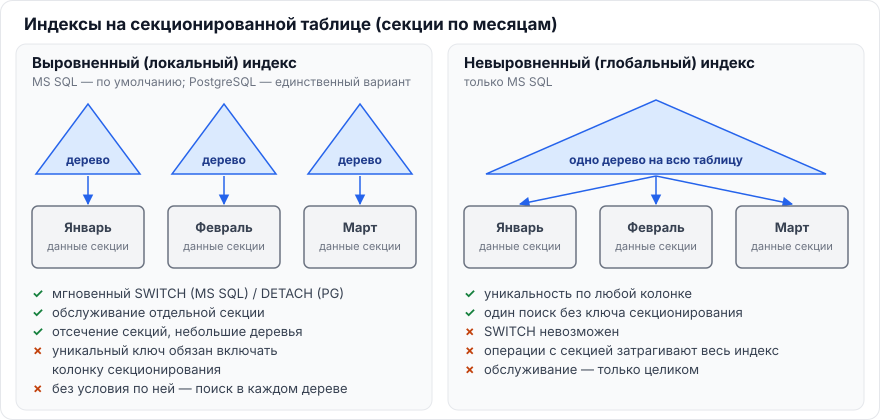
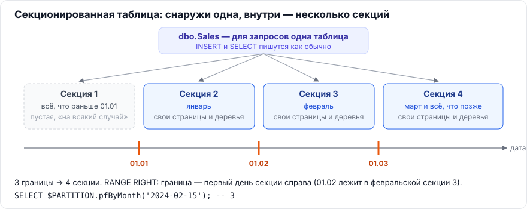
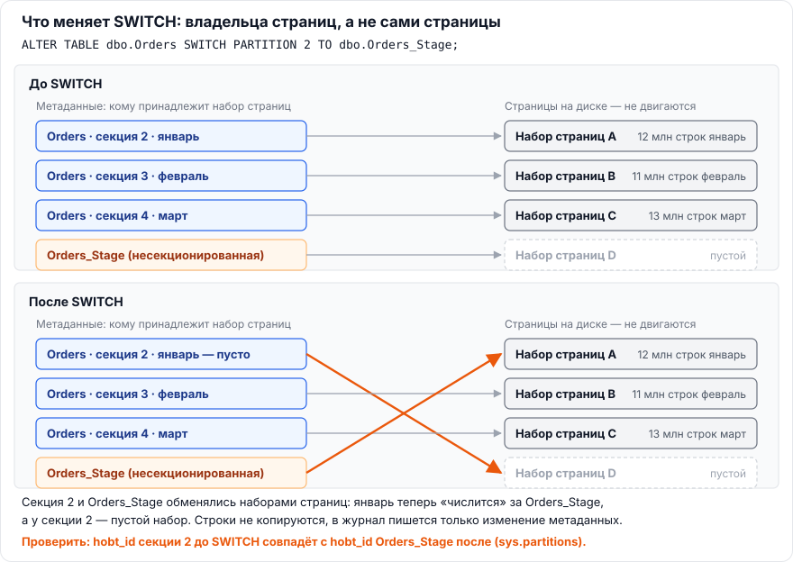
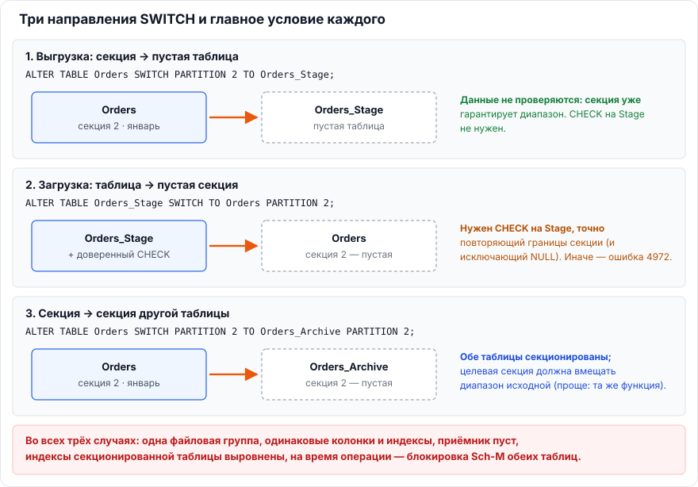
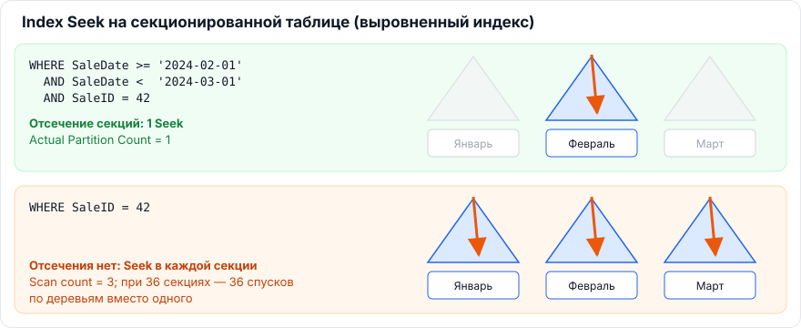
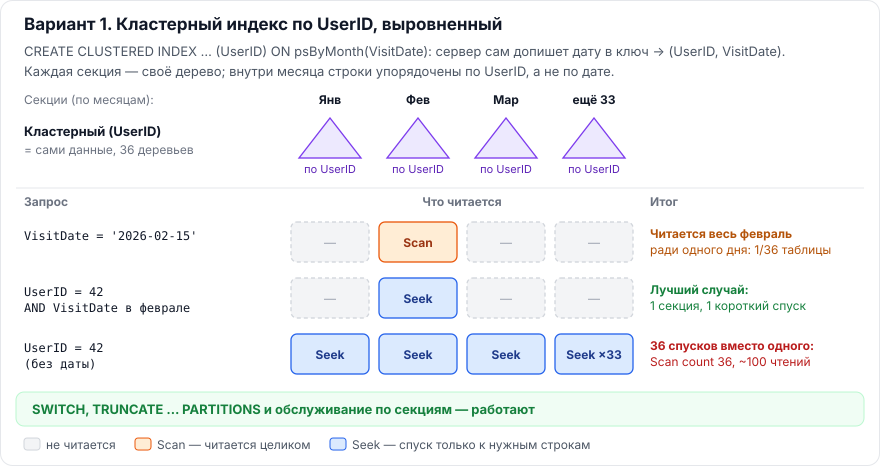
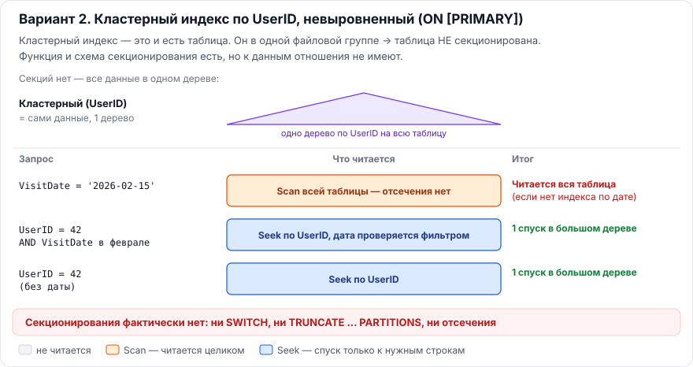
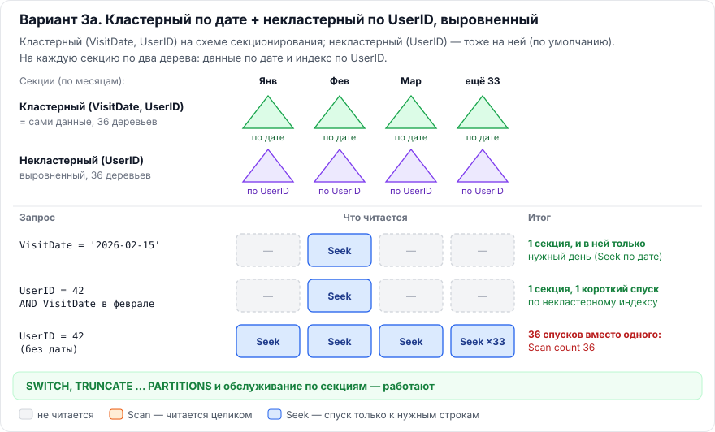
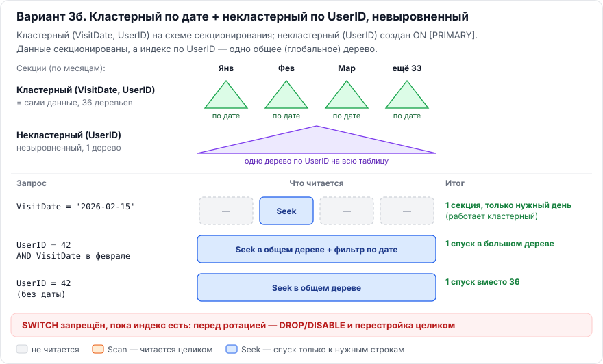
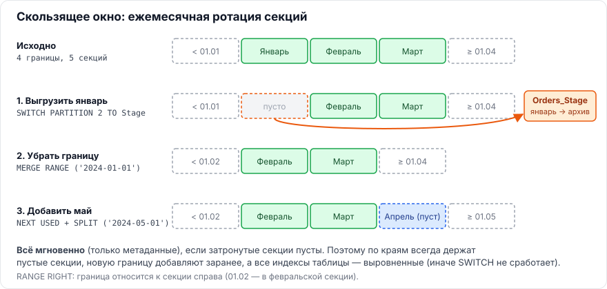

# Глава 4. Секционирование и индексы

[← Глава 3. PostgreSQL](03-postgresql.md) · [Оглавление](../README.md) · [Глава 5. Специфика 1С →](05-1c.md)

**Секционирование** (партиционирование) — горизонтальное деление большой таблицы на части (секции) по значению колонки, обычно даты. Для запросов это одна таблица, физически — несколько. Главные вопросы аттестации здесь: как индексы устроены на секционированной таблице, почему от этого зависит уникальность, когда работает отсечение секций и как быстро переключать секции.

Если тема новая — начните с [4.0](#40-секционирование-на-пальцах-зачем-оно-и-как-устроено): там то же самое без терминов, на одном примере. Разделы 4.1–4.5 — ответы на вопросы аттестации, [4.6](#46-когда-отсечение-секций-не-срабатывает-и-другие-грабли) — типичные ошибки.



---

## 4.0. Секционирование на пальцах: зачем оно и как устроено

> **Коротко.** Большую таблицу режут на куски по значению одной колонки (**ключ секционирования**, обычно дата). Для запросов таблица остаётся одной, а физически каждый кусок хранится отдельно — со своими страницами и своими деревьями индексов. Это даёт две вещи: запрос с условием по ключу читает только нужные куски (**отсечение секций**), а целый кусок можно мгновенно убрать или подключить (**операция над метаданными** вместо `DELETE` или `INSERT` миллионов строк). Секционирование — инструмент управления большими объёмами, а не универсальный ускоритель: точечный запрос по `id` без условия по ключу оно не ускорит, а может и замедлить.

### Аналогия

Шкаф с документами за 10 лет.

- **Без секционирования** — все бумаги в одном огромном ящике. Индекс (опись) помогает найти нужный лист, но ящик один: чтобы выбросить 2016 год, придётся вытаскивать миллион листов по одному.
- **С секционированием** — 120 подписанных ящиков, по одному на месяц. Нужен март 2026 — открываете один ящик, остальные 119 не трогаете. Не нужен 2016 год — выдвигаете 12 ящиков и выносите целиком.

Ящик — это **секция**. Надпись на ящике — **границы** секции. По какому признаку раскладывать — **ключ секционирования**. Правило «какой лист в какой ящик» — **функция секционирования**.

### Как это выглядит



- Приложение пишет `INSERT INTO dbo.Sales …` и `SELECT … FROM dbo.Sales` как в обычную таблицу. В какую секцию положить строку, СУБД решает сама по значению ключа.
- У каждой секции свои страницы данных и (для выровненных, то есть локальных, индексов) своё B-дерево. Поэтому их можно обслуживать, переключать и удалять по отдельности.

### Что даёт и чего не даёт

| Даёт | Не даёт |
|---|---|
| Запрос с условием по ключу (`WHERE SaleDate >= '2024-02-01' AND SaleDate < '2024-03-01'`) читает одну секцию из многих | Ускорения запроса без условия по ключу (`WHERE SaleID = 42`): поиск идёт в **каждой** секции |
| Мгновенное удаление или архивирование целого периода (`SWITCH`, `TRUNCATE … PARTITIONS` в MS SQL; `DETACH` + `DROP` в PG) вместо долгого `DELETE` | Замены индексам: внутри секции поиск всё равно идёт по индексу |
| Быструю загрузку: данные готовят в отдельной таблице и «подключают» как секцию | Пользы на маленьких таблицах: накладные расходы не окупаются |
| Обслуживание по частям: перестроить индекс или собрать статистику только по текущему месяцу | |

### Способы нарезки

| Способ | Правило | Пример | MS SQL | PostgreSQL |
|---|---|---|---|---|
| `RANGE` | Диапазоны значений | По месяцам, по годам | Да (единственный встроенный) | Да |
| `LIST` | Перечень значений | Регион: `'RU'`, `'KZ'`, `'BY'` | Нет (эмулируют через `RANGE` по вычисляемой колонке) | Да |
| `HASH` | Остаток от хеша ключа | Равномерно на 8 частей по `user_id` | Нет (эмулируют так же) | Да |

На практике почти всегда это `RANGE` по дате: у данных есть жизненный цикл («храним 3 года»), а отчёты фильтруют по периоду.

### Границы и номера секций (MS SQL)

- **N границ → N + 1 секция.** Три даты в `CREATE PARTITION FUNCTION … FOR VALUES ('2024-01-01', '2024-02-01', '2024-03-01')` дают 4 секции: крайние открыты влево и вправо.
- Секции нумеруются с 1 слева направо. Номера нужны в `SWITCH PARTITION 2`, `REBUILD PARTITION = 3`, `TRUNCATE … WITH (PARTITIONS (2))`.
- Узнать номер секции для значения — функция `$PARTITION`:

```sql
SELECT $PARTITION.pfByMonth('2024-02-15');   -- 3 (февраль)

-- сколько строк в каждой секции
SELECT $PARTITION.pfByMonth(SaleDate) AS partition_no, COUNT(*) AS rows_cnt
FROM dbo.Sales
GROUP BY $PARTITION.pfByMonth(SaleDate);
```

- **`RANGE RIGHT`** — граница принадлежит секции **справа**: границы задают первым днём периода (`'2024-02-01'` — начало февральской секции). **`RANGE LEFT`** — граница принадлежит секции **слева**: границами пришлось бы делать последний момент периода (`'2024-01-31'`, а для `datetime` ещё и `23:59:59.997`). Поэтому для дат почти всегда выбирают `RANGE RIGHT`.
- В PostgreSQL номеров нет: каждая секция — таблица с именем, а границы записываются как `FROM ('2024-02-01') TO ('2024-03-01')` — левая включается, правая нет.

### Когда секционировать, а когда нет

**Стоит**, если:
- таблица большая (десятки и сотни миллионов строк, десятки гигабайт) и продолжает расти;
- у данных есть жизненный цикл: старые периоды регулярно удаляют или переносят в архив;
- большинство тяжёлых запросов фильтрует по ключу секционирования (обычно по периоду);
- данные загружаются крупными пачками, и загрузка не должна мешать работе.

**Не стоит**, если:
- таблица небольшая — хватит индексов;
- основная нагрузка — точечные запросы по `id` без условия по дате;
- нужна уникальность по колонке, которая не входит в ключ секционирования (в PostgreSQL это не решается встроенными средствами, см. [4.5](#45-как-устроено-секционирование-в-postgresql-почему-там-нет-глобальных-индексов-и-как-это-влияет-на-уникальность));
- это таблицы базы 1С (см. [Секционирование и 1С](#секционирование-и-1с)).

> **Запомнить:** секция — отдельный кусок таблицы со своими страницами и индексами. Выигрыш — отсечение секций при чтении и мгновенные операции с целой секцией. Условие по ключу в `WHERE` — обязательное условие выигрыша.

---

## 4.1. ★ В чём особенность совместной работы индексов и секционирования в MS SQL (выровненные индексы, SWITCH, partition elimination)

> **Коротко.** В MS SQL индекс на секционированной таблице может быть **выровненным** — секционирован той же функцией по той же колонке, то есть это отдельное B-дерево на каждую секцию (по умолчанию так и создаётся), — или **невыровненным** (одно общее дерево или другая схема). Выравнивание даёт три вещи: мгновенный `SWITCH` секций (только если **все** индексы выровнены), обслуживание индексов по секциям и отсечение секций. Цена: уникальный индекс обязан содержать колонку секционирования, а запрос **без** условия по этой колонке делает поиск в **каждой** секции — точечные OLTP-запросы могут стать медленнее, чем на несекционированной таблице.

### Из чего состоит секционирование в MS SQL

```sql
-- 1. Функция: границы секций
CREATE PARTITION FUNCTION pfByMonth (date)
AS RANGE RIGHT FOR VALUES ('2024-01-01', '2024-02-01', '2024-03-01');

-- 2. Схема: какая секция в какой файловой группе
CREATE PARTITION SCHEME psByMonth AS PARTITION pfByMonth ALL TO ([PRIMARY]);

-- 3. Таблица (и её кластерный индекс) на схеме по колонке секционирования
CREATE TABLE dbo.Sales (
    SaleID   bigint        NOT NULL,
    SaleDate date          NOT NULL,
    Amount   decimal(18,2) NOT NULL,
    CONSTRAINT PK_Sales PRIMARY KEY CLUSTERED (SaleID, SaleDate)
) ON psByMonth(SaleDate);
```

`RANGE RIGHT` — граничное значение относится к секции справа (1 января — в январскую секцию). Для дат это обычный выбор.

### 1. Выровненные индексы (aligned)

- Индекс построен **на той же функции секционирования по той же колонке**, что и таблица. Физически это N независимых B-деревьев — по одному на секцию.
- Некластерный индекс на секционированной таблице MS SQL **по умолчанию** создаёт выровненным. В **неуникальный** индекс колонку секционирования СУБД добавит сама (в некластерный — как включённую, в кластерный — в ключ).
- **Уникальный** индекс (кластерный или нет) может быть выровненным, только если колонка секционирования **входит в его ключ**. Иначе СУБД не может проверить уникальность внутри одной секции. Поэтому в примере выше первичный ключ — `(SaleID, SaleDate)`, а не `(SaleID)`.

### 2. Переключение секций — `SWITCH`

```sql
ALTER TABLE dbo.Sales SWITCH PARTITION 1 TO dbo.Sales_Archive;
```

- Операция **только над метаданными**: секция в 100 млн строк «переезжает» в другую таблицу за миллисекунды.
- Работает, только если **все** индексы секционированной таблицы выровнены, структура и индексы обеих таблиц совпадают, они лежат в одной файловой группе, а приёмник пуст. При загрузке **в** секцию у исходной таблицы нужен доверенный `CHECK` по границам секции.
- Как это устроено, три направления переключения, блокировки и типичные ошибки — в [4.1a](#41a-как-работает-switch-что-переключается-куда-попадают-данные-и-почему-это-мгновенно).

### 3. Отсечение секций (partition elimination)

- Если в `WHERE` есть условие по колонке секционирования, оптимизатор читает только подходящие секции (подробно — [4.2](#42-как-секционирование-влияет-на-операцию-seek-что-такое-partition-elimination)).
- Если условия нет — поиск по **каждой** секции.

### 4. Обслуживание по секциям

```sql
ALTER INDEX PK_Sales ON dbo.Sales REBUILD PARTITION = 3;           -- только одна секция
ALTER INDEX PK_Sales ON dbo.Sales REBUILD PARTITION = 3 WITH (ONLINE = ON);  -- SQL 2014+
```

Перестраивают только «живую» (текущую) секцию, архивные не трогают. Статистику можно сделать инкрементальной (`STATISTICS_INCREMENTAL = ON`).

> **Запомнить:** выровненный индекс = дерево на каждую секцию. Даёт `SWITCH`, обслуживание по секциям и отсечение. Требует колонку секционирования в уникальном ключе. Без условия по ней — поиск во всех секциях.

---

## 4.1a. Как работает SWITCH: что переключается, куда попадают данные и почему это мгновенно

> **Коротко.** `SWITCH` не копирует строки. Секция — это набор страниц (в терминах SQL Server — HoBT, строка в `sys.partitions`), и `SWITCH` меняет запись о том, какой таблице этот набор принадлежит. Источник и приёмник **обмениваются** наборами страниц: данные уходят приёмнику, а источнику достаётся пустой набор приёмника. Поэтому время не зависит от объёма, а журнал почти не растёт. Направлений три: секция → таблица (выгрузка), таблица → секция (загрузка), секция → секция другой таблицы. Условия: одна файловая группа, одинаковые колонки и индексы, приёмник пуст, все индексы секционированной таблицы выровнены. При загрузке в секцию у источника нужен **доверенный `CHECK`**, точно задающий её диапазон. На время операции обе таблицы блокируются `Sch-M`.

### Аналогия

Коробка с документами за январь стоит на складе с наклейкой «Orders». Перенести документы в архив можно двумя способами:

- **`INSERT … SELECT` + `DELETE`** — открыть коробку, переложить миллион листов в другую коробку, старую очистить. Это долго, и каждый лист записывается в журнал дважды.
- **`SWITCH`** — коробку не открывать, а переклеить наклейку «Orders» на «Orders_Archive». Коробка стоит на том же месте, меняется только запись в описи склада. Поэтому склад должен быть тот же (одна файловая группа), а коробки — одного формата (одинаковая структура).

### Что меняется на самом деле



- Каждой секции соответствует строка в `sys.partitions` со своим `hobt_id` — идентификатором набора страниц (дерева или кучи) и его единиц размещения.
- У несекционированной таблицы такой набор один, у секционированной — по одному на секцию (и на каждый выровненный индекс).
- `SWITCH` меняет принадлежность наборов: набор с январскими страницами переписывается на `Orders_Stage`, а пустой набор `Orders_Stage` — на секцию 2 таблицы `Orders`.
- Строки не читаются и не пишутся, в журнал попадает только изменение метаданных. Секция 2 после этого **существует, но пуста** — граница в функции секционирования остаётся. Убрать её можно отдельной командой `MERGE RANGE` (см. [4.3](#43-пример-скользящего-окна-sliding-window-на-t-sql-split-merge-switch)).
- Операция транзакционная: внутри `BEGIN TRAN … ROLLBACK` откатывается так же мгновенно.

Убедиться в этом можно, сравнив `hobt_id` до и после — это есть в скрипте [06_partitioning_sliding_window.sql](../sql/mssql/06_partitioning_sliding_window.sql):

```sql
SELECT OBJECT_NAME(object_id) AS table_name, partition_number, hobt_id, rows
FROM sys.partitions
WHERE object_id IN (OBJECT_ID('dbo.Orders'), OBJECT_ID('dbo.Orders_Stage')) AND index_id = 1;
```

### Три направления



| | Команда | Приёмник | Что проверяет SQL Server |
|---|---|---|---|
| Выгрузка (архивирование, удаление старого периода) | `ALTER TABLE Orders SWITCH PARTITION 2 TO Orders_Stage;` | Пустая несекционированная таблица | Только структуру. Данные не проверяются: секция и так гарантирует свой диапазон |
| Загрузка (массовая вставка нового периода) | `ALTER TABLE Orders_Stage SWITCH TO Orders PARTITION 2;` | Пустая секция | Структуру **и** доверенный `CHECK` на `Orders_Stage`, доказывающий, что все строки попадают в диапазон секции 2 |
| Секция → секция (перенос в секционированный архив) | `ALTER TABLE Orders SWITCH PARTITION 2 TO Orders_Archive PARTITION 2;` | Пустая секция другой секционированной таблицы | Структуру и совместимость границ: диапазон целевой секции должен вмещать диапазон исходной. Проще всего, если обе таблицы на одной функции секционирования |

### Загрузка через SWITCH по шагам

```sql
-- 1. Stage в той же файловой группе, что и секция-приёмник; структура и индексы — как у Orders
CREATE TABLE dbo.Orders_Load ( … те же колонки … ) ON [PRIMARY];
CREATE CLUSTERED INDEX … ;  CREATE INDEX … ;   -- те же, что у Orders

-- 2. Загрузить и проверить данные: здесь можно не спешить, Orders никто не блокирует
INSERT INTO dbo.Orders_Load WITH (TABLOCK) SELECT … ;

-- 3. CHECK точно по границам секции (RANGE RIGHT: левая граница включается, правая нет).
--    WITH CHECK — ограничение проверяется на данных и становится доверенным.
--    Если колонка допускает NULL, добавьте AND OrderDate IS NOT NULL:
--    NULL уходит в крайнюю левую секцию, и без этого условия SWITCH не пройдёт.
ALTER TABLE dbo.Orders_Load WITH CHECK
    ADD CONSTRAINT CK_Orders_Load_Range
    CHECK (OrderDate >= '2024-04-01' AND OrderDate < '2024-05-01');

-- 4. Подключить: секция-приёмник должна быть пустой
ALTER TABLE dbo.Orders_Load SWITCH TO dbo.Orders PARTITION 5;
```

Проверка доверенности: `SELECT name, is_not_trusted, is_disabled FROM sys.check_constraints WHERE parent_object_id = OBJECT_ID('dbo.Orders_Load');` — нужно `0` и `0`. Ограничение, созданное или включённое с `WITH NOCHECK`, не доверенное, и `SWITCH` его не учтёт.

### Полный список условий

| Условие | Что значит |
|---|---|
| Приёмник пуст | Целевая таблица или целевая секция без строк |
| Одна файловая группа | Секция-источник и приёмник лежат в одной файловой группе (страницы не переносятся между файлами) |
| Одинаковые колонки | Имена, типы, длины, `NULL`/`NOT NULL`, collation, вычисляемые колонки — совпадают |
| Одинаковые индексы | Тот же кластерный индекс (или обе кучи), те же некластерные с теми же ключами и включёнными колонками |
| Индексы выровнены | У секционированной таблицы **все** индексы на схеме секционирования. Хоть один невыровненный — ошибка 7733 (см. [4.2a](#42a-секционирование-по-дате-и-поиск-по-пользователю-выровненный-и-невыровненный-кластерный-индекс)) |
| `CHECK` при загрузке | Доверенный, по колонке секционирования, не шире диапазона секции-приёмника (и исключает `NULL`, если колонка их допускает). Иначе — ошибка 4972 |
| Нет мешающих связей | Внешние ключи, ссылающиеся на источник или приёмник, и индексированные представления поверх них мешают `SWITCH` |

### Блокировки: «мгновенно», но не всегда сразу

- `SWITCH` берёт **`Sch-M`** (блокировку изменения схемы) на обе таблицы. Она несовместима ни с чем, даже с чтением под `NOLOCK`.
- Если на таблице идёт долгий отчёт, `SWITCH` ждёт его завершения. А все новые запросы к таблице выстраиваются в очередь **за** `SWITCH`. Мгновенная операция может на минуты «положить» таблицу.
- С SQL Server 2014 можно ждать с низким приоритетом и сдаться, не собирая очередь:

```sql
ALTER TABLE dbo.Orders SWITCH PARTITION 2 TO dbo.Orders_Stage
WITH (WAIT_AT_LOW_PRIORITY (MAX_DURATION = 1 MINUTES, ABORT_AFTER_WAIT = SELF));
-- SELF — отменить SWITCH; BLOCKERS — снять мешающие сеансы (осторожно)
```

### SWITCH против DELETE и TRUNCATE

| | `INSERT … SELECT` + `DELETE` | `SWITCH` | `TRUNCATE … WITH (PARTITIONS (n))` (2016+) |
|---|---|---|---|
| Строки копируются / удаляются по одной | да | нет | нет (освобождаются страницы) |
| Время | растёт с объёмом | не зависит от объёма | не зависит от объёма |
| Журнал транзакций | весь объём, часто в разы больше данных | только метаданные | только освобождение страниц |
| Данные после операции | в архивной таблице | в stage-таблице | удалены |
| Требования | обычные | строгие (см. выше) | все индексы выровнены |

Если старые данные не нужны, проще `TRUNCATE … WITH (PARTITIONS (2))`. Если их надо сохранить или выгрузить в архивную базу — `SWITCH` в stage-таблицу.

### Типичные ошибки

| Симптом | Причина | Что сделать |
|---|---|---|
| Ошибка 7733: *table is partitioned while index … is not partitioned* | Есть невыровненный некластерный индекс | Пересоздать индекс на схеме секционирования или удалить его на время `SWITCH` |
| Ошибка 4972: *check constraints or partition function of source table … allows values that are not allowed …* | Нет `CHECK` на stage, он не доверенный, шире диапазона секции или пропускает `NULL` | `WITH CHECK ADD CONSTRAINT …` точно по границам, `IS NOT NULL` для nullable-колонки |
| Ошибка о файловых группах | Stage создан не в той файловой группе, что секция | Создать stage `ON [та_же_FG]` — посмотреть FG секции через `sys.destination_data_spaces` |
| Ошибка о несовпадении индексов | Разные ключи, включённые колонки, фильтры или сжатие индексов | Создавать stage скриптом из той же таблицы, а не руками |
| `SWITCH` «висит» | Ждёт `Sch-M`, мешает долгий запрос | `WAIT_AT_LOW_PRIORITY`, запуск в окно обслуживания |

> **Запомнить:** `SWITCH` = обмен наборами страниц между источником и приёмником, строки не двигаются. Выгрузка — без проверки данных, загрузка — только с доверенным `CHECK` по границам секции. Одна файловая группа, одинаковая структура, приёмник пуст, все индексы выровнены, `Sch-M` на время операции.

---

## 4.2. Как секционирование влияет на операцию Seek. Что такое partition elimination

> **Коротко.** **Partition elimination** (отсечение секций) — оптимизатор по условию на колонку секционирования определяет, в каких секциях могут быть данные, и **не читает остальные**. Может срабатывать при построении плана (константы) и при выполнении (параметры, значения из соединения). Для `Index Seek` это означает: с условием по колонке секционирования — один поиск в небольшом дереве нужной секции; без него — **отдельный Seek в каждой секции** (в плане видно число секций и `Scan count`), что на точечных OLTP-запросах медленнее, чем один поиск в несекционированной таблице.



### Два сценария

| | Есть условие по колонке секционирования | Нет условия |
|---|---|---|
| Пример | `WHERE SaleDate >= '2024-02-01' AND SaleDate < '2024-03-01' AND SaleID = 42` | `WHERE SaleID = 42` |
| Что делает СУБД | Вычисляет номер секции → один Seek в её дереве | Seek в дереве **каждой** секции по очереди |
| В плане MS SQL (функция `pfByMonth` из 4.1: 4 секции) | `Actual Partition Count = 1`, `Actual Partitions Accessed = 3` — номер февральской секции | `Actual Partition Count = 4`; в `SET STATISTICS IO` — `Scan count 4` |
| Результат | Быстрее, чем на несекционированной таблице (дерево меньше) | Медленнее: 4 спуска вместо одного; при 36 месячных секциях — 36 |

### Где смотреть

- **MS SQL:** в свойствах оператора плана `Actual Partition Count` и `Actual Partitions Accessed`; `SET STATISTICS IO ON` → `Scan count`.
- **PostgreSQL:** в `EXPLAIN` перечислены только оставшиеся секции; при отсечении во время выполнения — строка `Subplans Removed: N`.

### Вывод для проектирования

Секционирование — инструмент в первую очередь для **управления данными** (быстрая загрузка и архивирование через `SWITCH`, обслуживание по частям), а не «ускоритель любых запросов». Оно ускоряет запросы, у которых есть условие по ключу секционирования, и может замедлить те, у которых его нет.

> **Запомнить:** нет условия по ключу секционирования → нет отсечения → Seek в каждой секции.

---

## 4.2a. Секционирование по дате и поиск по пользователю: выровненный и невыровненный кластерный индекс

> **Коротко.** Кластерный индекс — это и есть таблица, поэтому «выровненный или невыровненный кластерный» означает «таблица секционирована или нет». Выровненный кластерный по `UserID` даёт 36 деревьев, отсортированных по пользователю. Отбор по дате читает одну секцию целиком, «пользователь + дата» — один спуск, «пользователь без даты» — спуск в каждой секции. Невыровненный кластерный (`ON [PRIMARY]`) превращает таблицу в несекционированную: отбор по дате — скан всей таблицы, `SWITCH` невозможен. Обычная схема — кластерный по дате, а для поиска по пользователю — некластерный индекс. Выровненный некластерный сохраняет `SWITCH`, но без даты даёт N спусков. Невыровненный (глобальный) даёт один спуск, но запрещает `SWITCH`.

Пример для всех вариантов: таблица визитов `dbo.Visits (VisitID, UserID, VisitDate, Payload)`, секционирование по `VisitDate`, 36 месячных секций. Три запроса:

| | Запрос | Смысл |
|---|---|---|
| Q1 | `WHERE VisitDate = '2026-02-15'` | отчёт за день |
| Q2 | `WHERE UserID = 42 AND VisitDate >= '2026-02-01' AND VisitDate < '2026-03-01'` | история пользователя за месяц |
| Q3 | `WHERE UserID = 42` | вся история пользователя |

### Вариант 1. Кластерный по UserID, выровненный

```sql
CREATE CLUSTERED INDEX CX_Visits ON dbo.Visits (UserID) ON psByMonth (VisitDate);
```



- Индекс неуникальный, поэтому SQL Server сам допишет колонку секционирования в ключ. Фактический ключ — `(UserID, VisitDate)` и скрытый уникализатор. С `PRIMARY KEY CLUSTERED (UserID)` так не выйдет: будет ошибка 1908, ключ должен быть `(UserID, VisitDate)`.
- Каждая секция — своё дерево. Внутри месяца строки упорядочены по пользователю, а по дате разбросаны.
- **Q1:** отсечение оставляет февраль, но искать день внутри секции не по чему, поэтому секция читается целиком (`Clustered Index Scan`, `Actual Partition Count = 1`). Отсечение здесь работает как грубый индекс по дате с точностью до месяца.
- **Q2:** лучший случай — одна секция и один спуск по `(UserID, VisitDate)`.
- **Q3:** спуск в каждой из 36 секций. Это ~36 × 3 ≈ 100 логических чтений против 3–4 на обычной таблице.

### Вариант 2. Кластерный по UserID, невыровненный

```sql
CREATE CLUSTERED INDEX CX_Visits ON dbo.Visits (UserID) ON [PRIMARY];
```



- Кластерный индекс лежит в одной файловой группе, значит, и данные тоже. Таблица **не секционирована**, хотя функция и схема существуют.
- **Q1:** отсечения нет, без отдельного индекса по дате читается вся таблица.
- **Q2, Q3:** один спуск по `UserID` в большом дереве, дата проверяется фильтром.
- Ни `SWITCH`, ни `TRUNCATE … WITH (PARTITIONS …)`, ни обслуживания по секциям. По сути это обычная таблица.

### Вариант 3а. Кластерный по дате + некластерный по UserID, выровненный

```sql
CREATE CLUSTERED INDEX CX_Visits ON dbo.Visits (VisitDate, UserID) ON psByMonth (VisitDate);
CREATE INDEX IX_Visits_User ON dbo.Visits (UserID);   -- по умолчанию выровненный
```



- На каждую секцию приходится два дерева: данные по дате и индекс по пользователю.
- **Q1:** одна секция, и в ней `Seek` только по нужному дню. Это лучше, чем в варианте 1.
- **Q2:** одна секция, один спуск по некластерному индексу.
- **Q3:** как в варианте 1 — 36 спусков.
- `SWITCH` работает: все индексы выровнены.

### Вариант 3б. Кластерный по дате + некластерный по UserID, невыровненный

```sql
CREATE CLUSTERED INDEX CX_Visits ON dbo.Visits (VisitDate, UserID) ON psByMonth (VisitDate);
CREATE INDEX IX_Visits_User ON dbo.Visits (UserID) ON [PRIMARY];   -- одно общее дерево
```



- Данные секционированы, а индекс по пользователю — одно глобальное дерево.
- **Q1:** как в 3а: работает кластерный, одна секция, `Seek` по дню.
- **Q2:** один спуск в общем дереве. Дата есть в указателе на строку (это ключ кластерного индекса), поэтому фильтр по ней не требует обращения к данным.
- **Q3:** один спуск вместо 36 — ради этого глобальный индекс и делают.
- **`SWITCH` запрещён** (ошибка 7733), пока индекс существует. Перед ротацией его удаляют или отключают, а потом строят заново по всей таблице. На больших объёмах это часы, и выгода «мгновенного» `SWITCH` пропадает.

### Сводка

| | Q1: один день | Q2: пользователь + месяц | Q3: пользователь без даты | `SWITCH` |
|---|---|---|---|---|
| 1. CX(UserID) выровненный | 1 секция, читается целиком | **1 спуск** | 36 спусков | да |
| 2. CX(UserID) невыровненный | вся таблица | **1 спуск** | **1 спуск** | нет — таблица не секционирована |
| 3а. CX(дата) + NC(UserID) выровненный | **1 секция, нужный день** | **1 спуск** | 36 спусков | да |
| 3б. CX(дата) + NC(UserID) глобальный | **1 секция, нужный день** | **1 спуск** | **1 спуск** | нет, только через удаление и перестройку индекса |

### Как выбрать

- **Таблица растёт, старые месяцы регулярно удаляют, отчёты — по периодам:** вариант 3а. Запросы «пользователь без даты» платят N спусков. Если они есть в отчётах, добавьте в них ограничение по дате (например, «за последние 3 месяца»).
- **Почти все запросы — «пользователь + период», отчётов по голой дате мало:** вариант 1 тоже годится, в нём на одно дерево на секцию меньше.
- **Важен быстрый OLTP-поиск по пользователю без даты, а ротация редкая:** вариант 3б, если вы готовы перестраивать глобальный индекс при каждой ротации.
- **Вариант 2 как «секционированная таблица» не работает.** Если он получился, значит, кластерный индекс случайно создали вне схемы секционирования.

### А в PostgreSQL?

Кластерных индексов в смысле MS SQL там нет: таблица — это куча, а `CLUSTER` только разово пересортировывает данные. Глобальных индексов тоже нет. Поэтому поведение всегда как у выровненных вариантов: с условием по дате — одна секция, без него — поиск по индексу в каждой секции (как Q3 в вариантах 1 и 3а).

Скрипт для проверки всех четырёх вариантов — [sql/mssql/09_partitioning_clustered_choice.sql](../sql/mssql/09_partitioning_clustered_choice.sql). Он показывает расположение индексов, `Scan count` для трёх запросов и ошибку 7733 при `SWITCH`.

> **Запомнить:** кластерный индекс = таблица. Невыровненный кластерный = таблица без секций. Выбор «выровненный или глобальный» имеет смысл для некластерных индексов: выровненный сохраняет `SWITCH`, но без условия по ключу даёт N спусков; глобальный даёт один спуск, но мешает `SWITCH`.

---

## 4.3. Пример «скользящего окна» (sliding window) на T-SQL: SPLIT, MERGE, SWITCH

> **Коротко.** Скользящее окно — регулярная ротация: самую старую секцию мгновенно выгружают `SWITCH` в архивную таблицу, пустую границу убирают `MERGE RANGE`, для нового периода добавляют границу `SPLIT RANGE` (предварительно указав файловую группу `NEXT USED`). Всё выполняется над метаданными, если затрагиваемые секции **пусты**. Поэтому по краям всегда держат пустые секции, а все индексы — выровненными.



### Подготовка

```sql
CREATE PARTITION FUNCTION pfOrders (datetime2(0))
AS RANGE RIGHT FOR VALUES ('2024-01-01', '2024-02-01', '2024-03-01', '2024-04-01');
-- секции: 1: < 01.01 (пустая), 2: январь, 3: февраль, 4: март, 5: >= 01.04 (пустая)

CREATE PARTITION SCHEME psOrders AS PARTITION pfOrders ALL TO ([PRIMARY]);

CREATE TABLE dbo.Orders (
    OrderID   bigint        NOT NULL,
    OrderDate datetime2(0)  NOT NULL,
    Amount    decimal(18,2) NULL,
    CONSTRAINT PK_Orders PRIMARY KEY CLUSTERED (OrderID, OrderDate)
) ON psOrders(OrderDate);

-- архивная (stage) таблица: та же структура, та же файловая группа
CREATE TABLE dbo.Orders_Stage (
    OrderID   bigint        NOT NULL,
    OrderDate datetime2(0)  NOT NULL,
    Amount    decimal(18,2) NULL,
    CONSTRAINT PK_Orders_Stage PRIMARY KEY CLUSTERED (OrderID, OrderDate)
) ON [PRIMARY];
```

### Ежемесячная ротация

```sql
-- 1. Выгрузить самый старый месяц (январь = секция 2) в stage-таблицу: мгновенно
ALTER TABLE dbo.Orders SWITCH PARTITION 2 TO dbo.Orders_Stage;
--    дальше Orders_Stage можно выгрузить в архив и очистить (TRUNCATE)

-- 2. Убрать границу '2024-01-01': секции 1 и 2 пусты → слияние мгновенное
ALTER PARTITION FUNCTION pfOrders() MERGE RANGE ('2024-01-01');

-- 3. Добавить границу для мая: правая секция (>= 01.04) пока пуста → мгновенно
ALTER PARTITION SCHEME psOrders NEXT USED [PRIMARY];
ALTER PARTITION FUNCTION pfOrders() SPLIT RANGE ('2024-05-01');
```

### Правила

1. **`SPLIT` и `MERGE` мгновенны, только если затронутые секции пусты.** Если разрезать заполненную секцию, SQL Server физически перенесёт строки — долго, с блокировками и большим журналом.
2. **Пустые секции на обоих краях** — гарантия безопасных `SPLIT` и `MERGE`. Новую границу добавляют **заранее**, пока данные нового периода ещё не пришли.
3. **Все индексы выровнены** — иначе `SWITCH` не сработает.

---

## 4.4. Глобальные и локальные индексы при секционировании. Что есть в MS SQL и PostgreSQL

> **Коротко.** **Локальный** индекс секционирован так же, как таблица: отдельное дерево на каждую секцию (в MS SQL — «выровненный»). **Глобальный** — одно дерево на всю таблицу (в MS SQL — «невыровненный»). MS SQL поддерживает оба вида; PostgreSQL — **только локальные**. Локальные дают отсечение секций, обслуживание по частям и `SWITCH`/`DETACH`, но уникальный ключ обязан включать ключ секционирования, а запрос без него ищет во всех секциях. Глобальный обеспечивает уникальность по любой колонке и один поиск без ключа секционирования, но мешает операциям с отдельными секциями.

| | Локальный (aligned) | Глобальный (nonaligned) |
|---|---|---|
| Где есть | MS SQL и PostgreSQL | Только MS SQL |
| Структура | Дерево на каждую секцию | Одно дерево на всю таблицу |
| Уникальность | Ключ секционирования **обязан** входить в уникальный ключ | По любым колонкам (например, только `Email` или `UUID`) |
| Запрос с условием по ключу секционирования | Отсечение секций, поиск в маленьком дереве | Поиск в большом общем дереве |
| Запрос без такого условия | Поиск в **каждой** секции | **Один** поиск |
| Операции с секциями | `SWITCH` (MS SQL), `DETACH/ATTACH` (PG), обслуживание по секциям | `SWITCH` невозможен; изменения секций затрагивают весь индекс |

> **Запомнить:** локальный = по дереву на секцию (MS SQL и PG); глобальный = одно дерево (только MS SQL). В PostgreSQL глобальных нет.

---

## 4.5. Как устроено секционирование в PostgreSQL. Почему там нет глобальных индексов и как это влияет на уникальность

> **Коротко.** Декларативное секционирование (PG 10+) по `RANGE`, `LIST` или `HASH`: родительская таблица — логическая, данных не хранит; каждая секция — **самостоятельная таблица** со своей кучей. Индекс в PostgreSQL ссылается на физический адрес строки (`ctid`) в **конкретной** куче, поэтому индекс, созданный на родителе, — это набор локальных индексов на каждой секции; глобальных нет. Следствие: `PRIMARY KEY` и `UNIQUE` на секционированной таблице **обязаны включать все колонки ключа секционирования**: локальный индекс проверяет уникальность в своей секции, а схема секционирования гарантирует, что одинаковые значения ключа не окажутся в разных секциях.

### Устройство

```sql
CREATE TABLE sales (
    sale_id   bigint        NOT NULL,
    sale_date date          NOT NULL,
    amount    numeric(18,2),
    PRIMARY KEY (sale_id, sale_date)            -- ключ секционирования обязателен
) PARTITION BY RANGE (sale_date);

CREATE TABLE sales_2024_01 PARTITION OF sales
    FOR VALUES FROM ('2024-01-01') TO ('2024-02-01');
CREATE TABLE sales_2024_02 PARTITION OF sales
    FOR VALUES FROM ('2024-02-01') TO ('2024-03-01');

-- индекс на родителе → автоматически на каждой секции (и на будущих)
CREATE INDEX ON sales (amount);
```

- `INSERT` в родителя автоматически направляется в нужную секцию. Если подходящей секции нет — ошибка *no partition of relation "sales" found for row*.
- Секция по умолчанию `CREATE TABLE sales_default PARTITION OF sales DEFAULT;` принимает всё, что не попало в другие секции. Она страхует от ошибки вставки, но у неё есть цена — см. [4.6](#46-когда-отсечение-секций-не-срабатывает-и-другие-грабли).
- Индекс, созданный на родительской таблице, создаётся на всех секциях и на всех **будущих** секциях.
- Попытка `PRIMARY KEY (sale_id)` без `sale_date` → ошибка: *unique constraint on partitioned table must include all partitioning columns*.

### Отсечение секций (partition pruning)

- **При планировании** — условие с константами (`WHERE sale_date = '2024-02-10'`).
- **При выполнении** (PG 11+) — параметры подготовленных запросов, значения из соединения. В `EXPLAIN ANALYZE` видно `Subplans Removed: N`.
- Управляется параметром `enable_partition_pruning` (по умолчанию `on`).

### Операции с секциями — аналог `SWITCH`

```sql
ALTER TABLE sales DETACH PARTITION sales_2024_01 CONCURRENTLY;  -- PG 14+, без долгой блокировки
ALTER TABLE sales ATTACH PARTITION sales_2024_03
    FOR VALUES FROM ('2024-03-01') TO ('2024-04-01');
```

Перед `ATTACH` полезно создать на секции `CHECK`-ограничение, совпадающее с границами: тогда PostgreSQL не будет сканировать секцию для проверки.

`DETACH … CONCURRENTLY` нельзя выполнять внутри транзакции и нельзя, если у таблицы есть секция `DEFAULT`.

Соответствие операций:

| Задача | MS SQL | PostgreSQL |
|---|---|---|
| Убрать старый период из таблицы | `SWITCH PARTITION n TO stage` | `DETACH PARTITION` |
| Удалить старый период | `TRUNCATE … WITH (PARTITIONS (n))` (2016+) | `DETACH` + `DROP TABLE`, или сразу `DROP TABLE` секции |
| Подключить загруженные данные | `SWITCH stage TO … PARTITION n` (+ `CHECK` на stage) | `ATTACH PARTITION` (+ `CHECK` заранее) |
| Добавить секцию на будущее | `NEXT USED` + `SPLIT RANGE` | `CREATE TABLE … PARTITION OF … FOR VALUES …` |
| Убрать пустую границу | `MERGE RANGE` | не нужно: секции независимы |

### Если нужна уникальность без ключа секционирования

Встроенных средств нет. Варианты: включить ключ секционирования в бизнес-ключ; генерировать идентификаторы так, чтобы они были уникальны по построению (последовательность, UUID); отдельная несекционированная таблица-реестр с уникальным индексом; проверка в приложении или триггером (медленно и требует аккуратных блокировок).

> **Запомнить:** в PG секция = отдельная таблица, индекс ссылается на `ctid` своей кучи → только локальные индексы → ключ секционирования обязан входить в `PRIMARY KEY` / `UNIQUE`.

---

## 4.6. Когда отсечение секций не срабатывает и другие грабли

> **Коротко.** Отсечение работает, только если оптимизатор может по условию вычислить, в какие секции попадают значения **самой колонки** ключа. Функция над колонкой, неявное преобразование её типа или отсутствие условия по ключу — и запрос идёт во все секции. Остальные частые ошибки: слишком много мелких секций, забытая секция на следующий период, `SPLIT`/`MERGE` непустых секций, изменение ключа секционирования через `UPDATE`.

### Условия, которые ломают отсечение

```sql
-- ✗ функция над колонкой: границы секций вычислить нельзя
WHERE YEAR(SaleDate) = 2024                          -- MS SQL
WHERE date_trunc('month', sale_date) = '2024-02-01'  -- PostgreSQL

-- ✓ то же условие диапазоном по самой колонке
WHERE SaleDate >= '2024-01-01' AND SaleDate < '2025-01-01'
```

- **Нет условия по ключу** (`WHERE SaleID = 42`, `WHERE region = 'RU'`) — обход всех секций. Это не ошибка СУБД, а свойство схемы: ключ выбирают под главные запросы.
- **Неявное преобразование типа колонки.** Если параметр другого типа и СУБД вынуждена преобразовывать колонку (а не константу), отсечение может не сработать. Тип параметра должен совпадать с типом ключа — проверяйте по плану.
- **Параметры и значения «из соединения».** Отсечение происходит при выполнении, а не при построении плана. Проверять надо фактический план: в MS SQL — `Actual Partition Count`, а не оценочный; в PG — строка `Subplans Removed: N` в `EXPLAIN ANALYZE`.
- **`HASH`-секционирование** отсекает только по равенству (`WHERE user_id = 5`); по диапазону (`user_id BETWEEN 1 AND 100`) читаются все секции.

### Другие грабли

| Ошибка | Что происходит | Как правильно |
|---|---|---|
| Слишком мелкие секции (10 лет по дням = 3 650 секций) | Растут время планирования и расход памяти; в MS SQL предел — 15 000 секций | Секция — это гигабайты и миллионы строк; обычно месяц |
| Не создали секцию на следующий период — MS SQL | Новые строки копятся в последней открытой секции; потом `SPLIT` физически переносит их — долго, с блокировками и большим журналом | Добавлять границу заранее, пока правая секция пуста (см. [4.3](#43-пример-скользящего-окна-sliding-window-на-t-sql-split-merge-switch)) |
| Не создали секцию на следующий период — PostgreSQL | Без `DEFAULT` — ошибка вставки; с `DEFAULT` — строки уходят туда, а `ATTACH` новой секции сканирует `DEFAULT` и падает, если там уже есть строки её диапазона | Создавать секции заранее джобом или расширением `pg_partman` |
| `SPLIT` / `MERGE` непустых секций (MS SQL) | Физический перенос строк вместо операции над метаданными | Порядок: `SWITCH` в пустую таблицу → `MERGE` пустых → `SPLIT` пустого края |
| `UPDATE` ключа секционирования | Строка физически переезжает в другую секцию (удаление + вставка); в PG до 11-й версии — ошибка | Ключ — неизменяемая колонка: дата документа, дата события |
| Невыровненный индекс «для скорости» (MS SQL) | Перестаёт работать `SWITCH` | Создавать некластерные индексы на той же схеме секционирования (по умолчанию так и есть) |

### Версии и редакции

- **MS SQL:** секционирование есть во всех редакциях начиная с SQL Server 2016 SP1 (раньше — только Enterprise). `TRUNCATE … WITH (PARTITIONS …)` — с 2016, `REBUILD PARTITION … ONLINE` — с 2014.
- **PostgreSQL:** декларативное секционирование — с 10; индексы на родителе, `DEFAULT`, `UPDATE` ключа, `HASH` и отсечение при выполнении — с 11; `DETACH … CONCURRENTLY` — с 14. Автосоздания секций нет — используют `pg_partman` или свой джоб.

> **Запомнить:** условие должно быть по **самой колонке** ключа, без функций и без преобразования её типа. Секции на будущее создают заранее. `SPLIT`/`MERGE` — только по пустым секциям.

---

## Секционирование и 1С

- Платформа **не поддерживает** секционирование таблиц и не создаёт его. Ручное секционирование таблиц базы 1С средствами СУБД — неподдерживаемая модификация структуры: при реструктуризации платформа пересоздаёт таблицы по своим правилам, а кластерные и уникальные индексы платформы не содержат «вашего» ключа секционирования.
- На практике в 1С задачи, которые решает секционирование, закрывают другими средствами: **периодичность и итоги** регистров, **разделение итогов**, **агрегаты**, **свёртка** информационной базы, вынос истории в архивную базу.
- Знание секционирования нужно на аттестации для понимания возможностей СУБД и при работе с хранилищами данных, куда выгружается информация из 1С.

---

[← Глава 3. PostgreSQL](03-postgresql.md) · [Оглавление](../README.md) · [Глава 5. Специфика 1С →](05-1c.md)
