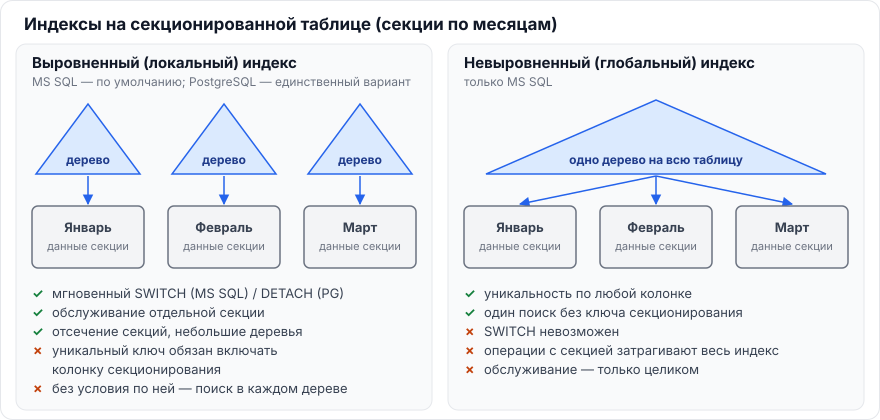
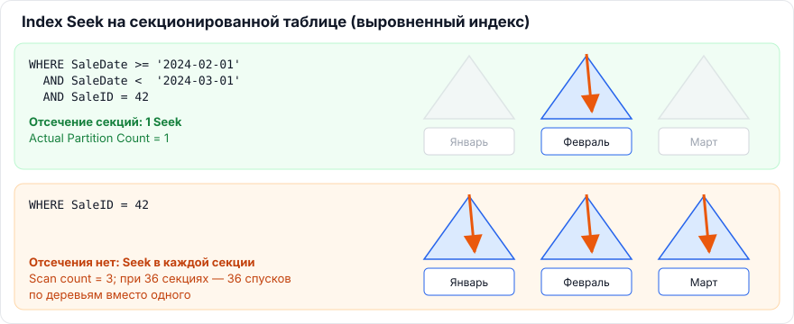
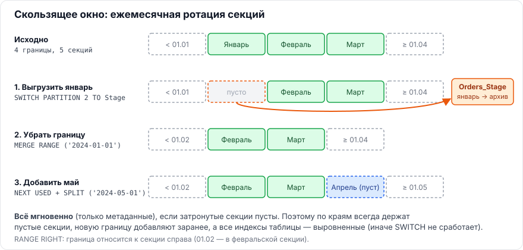

# Глава 4. Секционирование и индексы

[← Глава 3. PostgreSQL](03-postgresql.md) · [Оглавление](../README.md) · [Глава 5. Специфика 1С →](05-1c.md)

**Секционирование** (партиционирование) — горизонтальное деление большой таблицы на части (секции) по значению колонки, обычно даты. Для запросов это одна таблица, физически — несколько. Главные вопросы аттестации здесь: как индексы устроены на секционированной таблице, почему от этого зависит уникальность, когда работает отсечение секций и как быстро переключать секции.



---

## 4.1. ★ В чём особенность совместной работы индексов и секционирования в MS SQL (выровненные индексы, SWITCH, partition elimination)

> **Коротко.** В MS SQL индекс на секционированной таблице может быть **выровненным** — секционирован той же функцией по той же колонке, то есть это отдельное B-дерево на каждую секцию (по умолчанию так и создаётся), — или **невыровненным** (одно общее дерево или другая схема). Выравнивание даёт три вещи: мгновенный `SWITCH` секций (только если **все** индексы выровнены), обслуживание индексов по секциям и отсечение секций. Цена: уникальный индекс обязан содержать колонку секционирования, а запрос **без** условия по этой колонке делает поиск в **каждой** секции — точечные OLTP-запросы могут стать медленнее, чем на несекционированной таблице.

### Из чего состоит секционирование в MS SQL

```sql
-- 1. Функция: границы секций
CREATE PARTITION FUNCTION pfByMonth (date)
AS RANGE RIGHT FOR VALUES ('2024-01-01', '2024-02-01', '2024-03-01');

-- 2. Схема: какая секция в какой файловой группе
CREATE PARTITION SCHEME psByMonth AS PARTITION pfByMonth ALL TO ([PRIMARY]);

-- 3. Таблица (и её кластерный индекс) на схеме по колонке секционирования
CREATE TABLE dbo.Sales (
    SaleID   bigint        NOT NULL,
    SaleDate date          NOT NULL,
    Amount   decimal(18,2) NOT NULL,
    CONSTRAINT PK_Sales PRIMARY KEY CLUSTERED (SaleID, SaleDate)
) ON psByMonth(SaleDate);
```

`RANGE RIGHT` — граничное значение относится к секции справа (1 января — в январскую секцию). Для дат это обычный выбор.

### 1. Выровненные индексы (aligned)

- Индекс построен **на той же функции секционирования по той же колонке**, что и таблица. Физически это N независимых B-деревьев — по одному на секцию.
- Некластерный индекс на секционированной таблице MS SQL **по умолчанию** создаёт выровненным. В **неуникальный** индекс колонку секционирования СУБД добавит сама (в некластерный — как включённую, в кластерный — в ключ).
- **Уникальный** индекс (кластерный или нет) может быть выровненным, только если колонка секционирования **входит в его ключ**. Иначе СУБД не может проверить уникальность внутри одной секции. Поэтому в примере выше первичный ключ — `(SaleID, SaleDate)`, а не `(SaleID)`.

### 2. Переключение секций — `SWITCH`

```sql
ALTER TABLE dbo.Sales SWITCH PARTITION 1 TO dbo.Sales_Archive;
```

- Операция **только над метаданными**: секция в 100 млн строк «переезжает» в другую таблицу за миллисекунды.
- Условия:
  - **все** индексы обеих таблиц выровнены (хоть один невыровненный — ошибка);
  - одинаковая структура колонок и индексов;
  - одна файловая группа;
  - целевая секция или таблица пуста;
  - при загрузке **в** секционированную таблицу у исходной таблицы должно быть доверенное `CHECK`-ограничение, гарантирующее, что данные попадают в диапазон секции.

### 3. Отсечение секций (partition elimination)

- Если в `WHERE` есть условие по колонке секционирования, оптимизатор читает только подходящие секции (подробно — [4.2](#42-как-секционирование-влияет-на-операцию-seek-что-такое-partition-elimination)).
- Если условия нет — поиск по **каждой** секции.

### 4. Обслуживание по секциям

```sql
ALTER INDEX PK_Sales ON dbo.Sales REBUILD PARTITION = 3;           -- только одна секция
ALTER INDEX PK_Sales ON dbo.Sales REBUILD PARTITION = 3 WITH (ONLINE = ON);  -- SQL 2014+
```

Перестраивают только «живую» (текущую) секцию, архивные не трогают. Статистику можно сделать инкрементальной (`STATISTICS_INCREMENTAL = ON`).

> **Запомнить:** выровненный индекс = дерево на каждую секцию. Даёт `SWITCH`, обслуживание по секциям и отсечение. Требует колонку секционирования в уникальном ключе. Без условия по ней — поиск во всех секциях.

---

## 4.2. Как секционирование влияет на операцию Seek. Что такое partition elimination

> **Коротко.** **Partition elimination** (отсечение секций) — оптимизатор по условию на колонку секционирования определяет, в каких секциях могут быть данные, и **не читает остальные**. Может срабатывать при построении плана (константы) и при выполнении (параметры, значения из соединения). Для `Index Seek` это означает: с условием по колонке секционирования — один поиск в небольшом дереве нужной секции; без него — **отдельный Seek в каждой секции** (в плане видно число секций и `Scan count`), что на точечных OLTP-запросах медленнее, чем один поиск в несекционированной таблице.



### Два сценария

| | Есть условие по колонке секционирования | Нет условия |
|---|---|---|
| Пример | `WHERE SaleDate >= '2024-02-01' AND SaleDate < '2024-03-01' AND SaleID = 42` | `WHERE SaleID = 42` |
| Что делает СУБД | Вычисляет номер секции → один Seek в её дереве | Seek в дереве **каждой** секции по очереди |
| В плане MS SQL | `Actual Partition Count = 1`, `Actual Partitions Accessed = 2` | `Actual Partition Count = 36`; в `SET STATISTICS IO` — `Scan count 36` |
| Результат | Быстрее, чем на несекционированной таблице (дерево меньше) | Медленнее: 36 спусков вместо одного |

### Где смотреть

- **MS SQL:** в свойствах оператора плана `Actual Partition Count` и `Actual Partitions Accessed`; `SET STATISTICS IO ON` → `Scan count`.
- **PostgreSQL:** в `EXPLAIN` перечислены только оставшиеся секции; при отсечении во время выполнения — строка `Subplans Removed: N`.

### Вывод для проектирования

Секционирование — инструмент в первую очередь для **управления данными** (быстрая загрузка и архивирование через `SWITCH`, обслуживание по частям), а не «ускоритель любых запросов». Оно ускоряет запросы, у которых есть условие по ключу секционирования, и может замедлить те, у которых его нет.

> **Запомнить:** нет условия по ключу секционирования → нет отсечения → Seek в каждой секции.

---

## 4.3. Пример «скользящего окна» (sliding window) на T-SQL: SPLIT, MERGE, SWITCH

> **Коротко.** Скользящее окно — регулярная ротация: самую старую секцию мгновенно выгружают `SWITCH` в архивную таблицу, пустую границу убирают `MERGE RANGE`, для нового периода добавляют границу `SPLIT RANGE` (предварительно указав файловую группу `NEXT USED`). Всё выполняется над метаданными, если затрагиваемые секции **пусты**. Поэтому по краям всегда держат пустые секции, а все индексы — выровненными.



### Подготовка

```sql
CREATE PARTITION FUNCTION pfOrders (datetime2(0))
AS RANGE RIGHT FOR VALUES ('2024-01-01', '2024-02-01', '2024-03-01', '2024-04-01');
-- секции: 1: < 01.01 (пустая), 2: январь, 3: февраль, 4: март, 5: >= 01.04 (пустая)

CREATE PARTITION SCHEME psOrders AS PARTITION pfOrders ALL TO ([PRIMARY]);

CREATE TABLE dbo.Orders (
    OrderID   bigint        NOT NULL,
    OrderDate datetime2(0)  NOT NULL,
    Amount    decimal(18,2) NULL,
    CONSTRAINT PK_Orders PRIMARY KEY CLUSTERED (OrderID, OrderDate)
) ON psOrders(OrderDate);

-- архивная (stage) таблица: та же структура, та же файловая группа
CREATE TABLE dbo.Orders_Stage (
    OrderID   bigint        NOT NULL,
    OrderDate datetime2(0)  NOT NULL,
    Amount    decimal(18,2) NULL,
    CONSTRAINT PK_Orders_Stage PRIMARY KEY CLUSTERED (OrderID, OrderDate)
) ON [PRIMARY];
```

### Ежемесячная ротация

```sql
-- 1. Выгрузить самый старый месяц (январь = секция 2) в stage-таблицу: мгновенно
ALTER TABLE dbo.Orders SWITCH PARTITION 2 TO dbo.Orders_Stage;
--    дальше Orders_Stage можно выгрузить в архив и очистить (TRUNCATE)

-- 2. Убрать границу '2024-01-01': секции 1 и 2 пусты → слияние мгновенное
ALTER PARTITION FUNCTION pfOrders() MERGE RANGE ('2024-01-01');

-- 3. Добавить границу для мая: правая секция (>= 01.04) пока пуста → мгновенно
ALTER PARTITION SCHEME psOrders NEXT USED [PRIMARY];
ALTER PARTITION FUNCTION pfOrders() SPLIT RANGE ('2024-05-01');
```

### Правила

1. **`SPLIT` и `MERGE` мгновенны, только если затронутые секции пусты.** Если разрезать заполненную секцию, SQL Server физически перенесёт строки — долго, с блокировками и большим журналом.
2. **Пустые секции на обоих краях** — гарантия безопасных `SPLIT` и `MERGE`. Новую границу добавляют **заранее**, пока данные нового периода ещё не пришли.
3. **Все индексы выровнены** — иначе `SWITCH` не сработает.

---

## 4.4. Глобальные и локальные индексы при секционировании. Что есть в MS SQL и PostgreSQL

> **Коротко.** **Локальный** индекс секционирован так же, как таблица: отдельное дерево на каждую секцию (в MS SQL — «выровненный»). **Глобальный** — одно дерево на всю таблицу (в MS SQL — «невыровненный»). MS SQL поддерживает оба вида; PostgreSQL — **только локальные**. Локальные дают отсечение секций, обслуживание по частям и `SWITCH`/`DETACH`, но уникальный ключ обязан включать ключ секционирования, а запрос без него ищет во всех секциях. Глобальный обеспечивает уникальность по любой колонке и один поиск без ключа секционирования, но мешает операциям с отдельными секциями.

| | Локальный (aligned) | Глобальный (nonaligned) |
|---|---|---|
| Где есть | MS SQL и PostgreSQL | Только MS SQL |
| Структура | Дерево на каждую секцию | Одно дерево на всю таблицу |
| Уникальность | Ключ секционирования **обязан** входить в уникальный ключ | По любым колонкам (например, только `Email` или `UUID`) |
| Запрос с условием по ключу секционирования | Отсечение секций, поиск в маленьком дереве | Поиск в большом общем дереве |
| Запрос без такого условия | Поиск в **каждой** секции | **Один** поиск |
| Операции с секциями | `SWITCH` (MS SQL), `DETACH/ATTACH` (PG), обслуживание по секциям | `SWITCH` невозможен; изменения секций затрагивают весь индекс |

> **Запомнить:** локальный = по дереву на секцию (MS SQL и PG); глобальный = одно дерево (только MS SQL). В PostgreSQL глобальных нет.

---

## 4.5. Как устроено секционирование в PostgreSQL. Почему там нет глобальных индексов и как это влияет на уникальность

> **Коротко.** Декларативное секционирование (PG 10+) по `RANGE`, `LIST` или `HASH`: родительская таблица — логическая, данных не хранит; каждая секция — **самостоятельная таблица** со своей кучей. Индекс в PostgreSQL ссылается на физический адрес строки (`ctid`) в **конкретной** куче, поэтому индекс, созданный на родителе, — это набор локальных индексов на каждой секции; глобальных нет. Следствие: `PRIMARY KEY` и `UNIQUE` на секционированной таблице **обязаны включать все колонки ключа секционирования**: локальный индекс проверяет уникальность в своей секции, а схема секционирования гарантирует, что одинаковые значения ключа не окажутся в разных секциях.

### Устройство

```sql
CREATE TABLE sales (
    sale_id   bigint        NOT NULL,
    sale_date date          NOT NULL,
    amount    numeric(18,2),
    PRIMARY KEY (sale_id, sale_date)            -- ключ секционирования обязателен
) PARTITION BY RANGE (sale_date);

CREATE TABLE sales_2024_01 PARTITION OF sales
    FOR VALUES FROM ('2024-01-01') TO ('2024-02-01');
CREATE TABLE sales_2024_02 PARTITION OF sales
    FOR VALUES FROM ('2024-02-01') TO ('2024-03-01');

-- индекс на родителе → автоматически на каждой секции (и на будущих)
CREATE INDEX ON sales (amount);
```

- `INSERT` в родителя автоматически направляется в нужную секцию.
- Индекс, созданный на родительской таблице, создаётся на всех секциях и на всех **будущих** секциях.
- Попытка `PRIMARY KEY (sale_id)` без `sale_date` → ошибка: *unique constraint on partitioned table must include all partitioning columns*.

### Отсечение секций (partition pruning)

- **При планировании** — условие с константами (`WHERE sale_date = '2024-02-10'`).
- **При выполнении** (PG 11+) — параметры подготовленных запросов, значения из соединения. В `EXPLAIN ANALYZE` видно `Subplans Removed: N`.
- Управляется параметром `enable_partition_pruning` (по умолчанию `on`).

### Операции с секциями — аналог `SWITCH`

```sql
ALTER TABLE sales DETACH PARTITION sales_2024_01 CONCURRENTLY;  -- PG 14+, без долгой блокировки
ALTER TABLE sales ATTACH PARTITION sales_2024_03
    FOR VALUES FROM ('2024-03-01') TO ('2024-04-01');
```

Перед `ATTACH` полезно создать на секции `CHECK`-ограничение, совпадающее с границами: тогда PostgreSQL не будет сканировать секцию для проверки.

### Если нужна уникальность без ключа секционирования

Встроенных средств нет. Варианты: включить ключ секционирования в бизнес-ключ; генерировать идентификаторы так, чтобы они были уникальны по построению (последовательность, UUID); отдельная несекционированная таблица-реестр с уникальным индексом; проверка в приложении или триггером (медленно и требует аккуратных блокировок).

> **Запомнить:** в PG секция = отдельная таблица, индекс ссылается на `ctid` своей кучи → только локальные индексы → ключ секционирования обязан входить в `PRIMARY KEY` / `UNIQUE`.

---

## Секционирование и 1С

- Платформа **не поддерживает** секционирование таблиц и не создаёт его. Ручное секционирование таблиц базы 1С средствами СУБД — неподдерживаемая модификация структуры: при реструктуризации платформа пересоздаёт таблицы по своим правилам, а кластерные и уникальные индексы платформы не содержат «вашего» ключа секционирования.
- На практике в 1С задачи, которые решает секционирование, закрывают другими средствами: **периодичность и итоги** регистров, **разделение итогов**, **агрегаты**, **свёртка** информационной базы, вынос истории в архивную базу.
- Знание секционирования нужно на аттестации для понимания возможностей СУБД и при работе с хранилищами данных, куда выгружается информация из 1С.

---

[← Глава 3. PostgreSQL](03-postgresql.md) · [Оглавление](../README.md) · [Глава 5. Специфика 1С →](05-1c.md)
