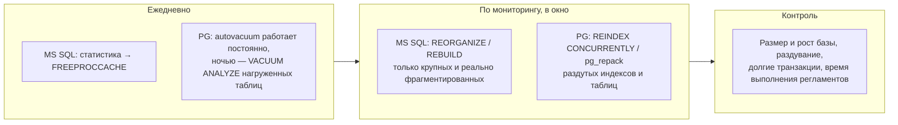
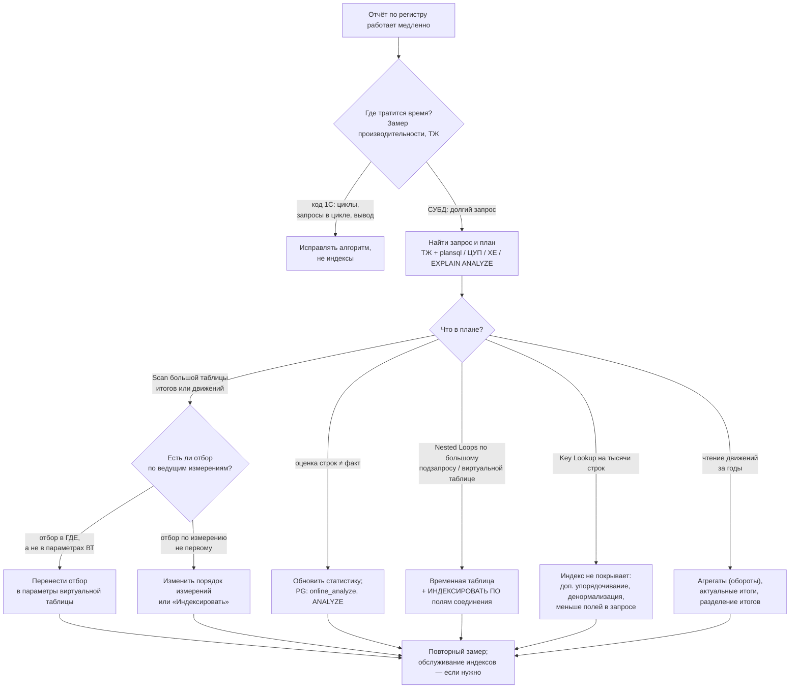

# Глава 6. Обслуживание и диагностика индексов в 1С

[← Глава 5. Специфика 1С](05-1c.md) · [Оглавление](../README.md) · [Шпаргалка →](07-shpargalka.md)

---

## 6.1. Каков регламент обслуживания индексов и статистики для баз 1С на MS SQL и на PostgreSQL

> **Коротко.** **MS SQL:** ежедневно — обновление статистики (`UPDATE STATISTICS`, после массовых загрузок — внепланово) и затем очистка процедурного кэша; обслуживание индексов (`REORGANIZE`/`REBUILD`) — в технологическое окно, **выборочно** по крупным индексам с измеренной фрагментацией или низкой плотностью; плюс проверка целостности и бэкапы. **PostgreSQL:** основную работу делает **autovacuum** (очистка мёртвых версий + `ANALYZE`) — его нужно настроить агрессивнее стандартного и следить за долгими транзакциями; статистика временных таблиц — `online_analyze`; при раздувании индексов — `REINDEX CONCURRENTLY` или `pg_repack` по расписанию (раз в неделю/месяц по факту). Реиндексация через «Тестирование и исправление» в конфигураторе требует монопольного режима — для регулярного обслуживания используют средства СУБД.

### MS SQL Server

| Операция | Зачем | Когда |
|---|---|---|
| **Обновление статистики** | Оптимизатор строит планы по актуальному распределению данных | **Ежедневно** + сразу после массовых загрузок, закрытия месяца, свёртки |
| **Очистка процедурного кэша** (`DBCC FREEPROCCACHE`) | Сбросить планы, построенные по старой статистике | Сразу после обновления статистики (рекомендация методики 1С) |
| **Дефрагментация индексов** | Уплотнить страницы, восстановить порядок | В технологическое окно; классически — ежедневно, современный подход — **выборочно** по измерению |
| Проверка целостности (`DBCC CHECKDB`) | Найти повреждения | Регулярно (например, еженедельно) |
| Резервное копирование | — | По политике |

**Обновление статистики:**
```sql
EXEC sp_updatestats;                          -- только там, где были изменения, с выборкой
-- или для конкретной большой таблицы:
UPDATE STATISTICS dbo._AccumRgT1234 WITH FULLSCAN;
-- затем
DBCC FREEPROCCACHE;
```
`sp_updatestats` проходит по всем таблицам, но обновляет только статистику, где были изменения. Полное `WITH FULLSCAN` по всей базе точнее, но на больших базах может не уложиться в окно.

> ⚠️ **Нюанс про `DBCC FREEPROCCACHE`.** Очистку кэша после обновления статистики рекомендует методика 1С — на аттестации её нужно называть. Но знайте, что обновлённая статистика **сама** помечает зависимые планы для перекомпиляции при следующем выполнении. Полная очистка кэша сбрасывает **все** планы экземпляра (всех баз на сервере), и следующие минуты сервер тратит CPU на компиляцию. Аккуратнее — очищать кэш только своей базы: `ALTER DATABASE SCOPED CONFIGURATION CLEAR PROCEDURE_CACHE;` (SQL Server 2016+, выполняется в контексте базы).

**Индексы — выборочно:**
```sql
-- REORGANIZE для умеренной фрагментации, REBUILD для сильной, маленькие пропускаем
ALTER INDEX [имя] ON [таблица] REORGANIZE;
ALTER INDEX [имя] ON [таблица] REBUILD WITH (ONLINE = ON, SORT_IN_TEMPDB = ON); -- ONLINE: Enterprise
```
Отраслевой стандарт для этого — процедура `IndexOptimize` из скриптов Ola Hallengren.

> ⚠️ **Поправка к ответу NotebookLM:** `sp_msforeachtable 'DBCC DBREINDEX(''?'')'` — устаревший способ: `DBCC DBREINDEX` объявлен устаревшим, а `sp_msforeachtable` — недокументированная процедура. Используйте `ALTER INDEX ... REBUILD/REORGANIZE` и выборочный подход.

**Настройки базы, связанные со статистикой:**
- `AUTO_CREATE_STATISTICS = ON`, `AUTO_UPDATE_STATISTICS = ON` — оставить включёнными;
- `AUTO_UPDATE_STATISTICS_ASYNC` — `ON` при ровной OLTP-нагрузке (запрос не ждёт пересчёта статистики), `OFF`, если бывают резкие изменения объёма данных (загрузки), — чтобы запрос сразу получил свежую статистику.

### PostgreSQL

| Операция | Зачем | Когда |
|---|---|---|
| **Autovacuum** (`VACUUM` + `ANALYZE`) | Удалить мёртвые версии из таблиц и индексов, обновить карту видимости и статистику | Постоянно, автоматически. Настроить пороги и число рабочих процессов |
| Ручной `VACUUM ANALYZE` | Помочь autovacuum на самых нагруженных таблицах | По расписанию в часы низкой нагрузки (ночью) |
| **`online_analyze`** | Статистика временных таблиц 1С | Постоянно включён |
| Контроль долгих транзакций | Не дать «горизонту» остановить очистку | Мониторинг `pg_stat_activity`, `idle_in_transaction_session_timeout` |
| **`REINDEX CONCURRENTLY`** / **`pg_repack`** | Убрать раздувание индексов и таблиц | Раз в неделю/месяц, по результатам мониторинга раздувания |
| `VACUUM FULL` | Сжать таблицу | Только в окно простоя (полная блокировка) |

Типичная настройка autovacuum для базы 1С (ориентир, подбирается под нагрузку):
```ini
autovacuum = on
autovacuum_max_workers = 4               # больше рабочих — больше таблиц обрабатывается параллельно
autovacuum_naptime = 20s
autovacuum_vacuum_scale_factor = 0.01    # вместо 0.2 — чистить раньше на больших таблицах
autovacuum_analyze_scale_factor = 0.005  # вместо 0.1
autovacuum_vacuum_cost_limit = 2000      # дать autovacuum работать быстрее
maintenance_work_mem = 1GB               # меньше повторных проходов по индексам
```

### Общие рекомендации



1. Тяжёлые операции — только в **технологическое окно**.
2. Обслуживание средствами СУБД **не требует монопольного режима** базы 1С, в отличие от «Тестирование и исправление → Реиндексация таблиц».
3. Результат проверять: стало ли быстрее после обслуживания (см. [2.3](02-mssql.md#23-что-такое-фрагментация-и-как-её-измерить-чем-reorganize-отличается-от-rebuild-и-как-изменился-подход-microsoft-к-порогам)).
4. Выполнение регламентов контролировать (журналы заданий SQL Agent / cron, мониторинг, ЦКК).

> **Запомнить:** MS SQL — статистика ежедневно (+ сброс кэша планов), индексы выборочно в окно. PG — autovacuum настроен и не заблокирован долгими транзакциями, `online_analyze`, `REINDEX CONCURRENTLY` по факту раздувания.

---

## 6.2. Как найти медленный запрос и связанный с ним индекс: технологический журнал, ЦУП, Profiler / Extended Events, `pg_stat_statements`

> **Коротко.** Задача из двух шагов: **поймать** медленный запрос (текст + длительность + место в коде 1С) и **прочитать его план**, где видно, какой индекс используется (`Index Seek`, `Index Scan`) или не нашёлся (`Table Scan`, `Seq Scan`). Инструменты: **технологический журнал 1С** — события `DBMSSQL`/`DBPOSTGRS` с отбором по длительности, `<plansql/>` для плана, контекст кода; **1С:ЦУП** — то же автоматически, с ранжированием и физическими именами → метаданные; **Profiler / Extended Events** (MS SQL) — события завершения запросов + `showplan`; **`pg_stat_statements` + лог медленных запросов + `EXPLAIN (ANALYZE, BUFFERS)`** (PG). Физические имена таблиц и индексов переводятся в метаданные через `ПолучитьСтруктуруХраненияБазыДанных()`.


### 1. Технологический журнал 1С

Работает с любой СУБД и сразу связывает SQL с кодом 1С. Пример `logcfg.xml`:

```xml
<config xmlns="http://v8.1c.ru/v8/tech-log">
  <log location="C:\v8logs\slow_sql" history="24">
    <event>
      <eq property="name" value="DBMSSQL"/>      <!-- MS SQL -->
      <ge property="duration" value="1000000"/> <!-- 8.3: микросекунды, т.е. > 1 с -->
    </event>
    <event>
      <eq property="name" value="DBPOSTGRS"/>    <!-- PostgreSQL -->
      <ge property="duration" value="1000000"/>
    </event>
    <property name="all"/>
  </log>
  <plansql/>                                   <!-- писать план запроса -->
</config>
```

- В событии: `duration` — длительность, `Sql` — текст запроса в терминах СУБД, `Context` — модуль и строка кода 1С, `planSQLText` — план (если включён `<plansql/>`).
- В плане ищем операторы и **имена индексов**: `Clustered Index Seek(OBJECT:([base].[dbo].[_AccumRgT1234].[_AccumRgT1234_ByPeriod...]))` или `Index Scan using _accumrgt1234_... on _accumrgt1234`.
- ⚠️ Сбор планов создаёт заметную нагрузку — включать на ограниченное время и с отбором по длительности.

### 2. 1С:ЦУП (Центр управления производительностью)

- Сам собирает данные ТЖ/СУБД, **ранжирует проблемы по суммарному времени** («вес»), группирует по контексту и по таблицам.
- По запросу показывает: **контекст** (строка кода), **текст** запроса, **план** с подсветкой проблемных операторов.
- Сопоставление физических имён с метаданными — автоматически.

### 3. MS SQL Server: Extended Events и Profiler

**Extended Events** — современный и лёгкий инструмент (Profiler объявлен устаревшим и сильно нагружает сервер):

```sql
CREATE EVENT SESSION slow_queries ON SERVER
ADD EVENT sqlserver.rpc_completed (
    ACTION (sqlserver.sql_text, sqlserver.database_name, sqlserver.plan_handle)
    WHERE duration > 1000000),                    -- микросекунды: > 1 c
ADD EVENT sqlserver.sql_batch_completed (
    ACTION (sqlserver.sql_text, sqlserver.database_name, sqlserver.plan_handle)
    WHERE duration > 1000000)
ADD TARGET package0.event_file (SET filename = N'slow_queries.xel');
ALTER EVENT SESSION slow_queries ON SERVER STATE = START;
```

- План — событие `query_post_execution_showplan` (дорогое) или по `plan_handle` из `sys.dm_exec_query_stats` + `sys.dm_exec_query_plan`.
- **Query Store** (SQL Server 2016+) хранит историю запросов, их статистику и планы — удобно видеть, когда план «испортился».
- **Profiler:** события `RPC:Completed`, `SQL:BatchCompleted` (колонки `Duration`, `CPU`, `Reads`) и `Showplan XML Statistics Profile`; сортируем по `Duration`, план — в событии рядом.
- Без трассировки — топ запросов из кэша планов: `sys.dm_exec_query_stats` + `sys.dm_exec_sql_text` + `sys.dm_exec_query_plan`.

### 4. PostgreSQL

- `pg_stat_statements` — топ по `total_exec_time`, `mean_exec_time`, `shared_blks_read` ([3.7](03-postgresql.md)).
- `log_min_duration_statement = 1000` — медленные запросы в лог; `auto_explain` — с планами.
- `EXPLAIN (ANALYZE, BUFFERS)` над найденным запросом:
  - `Seq Scan on _accumrgt1234` — индекс не используется;
  - `Index Scan using <индекс> on <таблица>` — поиск по индексу с обращением к таблице;
  - `Index Only Scan using <индекс>` — только индекс;
  - `Bitmap Index Scan on <индекс>` — битовая карта.

> ⚠️ Запросы 1С на PostgreSQL часто используют временные таблицы (`pg_temp.tt1`), которые исчезают после выполнения. Чтобы повторить такой запрос через `EXPLAIN`, нужно воспроизвести и шаги, создающие временные таблицы.

### 5. Физическое имя → объект 1С

`ПолучитьСтруктуруХраненияБазыДанных()` — см. [5.1](05-1c.md#как-узнать-физические-имена-таблиц-и-индексов). В ЦУП — автоматически.

> **Запомнить:** поймать (ТЖ / ЦУП / XE / pg_stat_statements) → посмотреть план (`<plansql/>` / showplan / `EXPLAIN ANALYZE`) → перевести имена в метаданные (`ПолучитьСтруктуруХраненияБазыДанных`).

---

## 6.3. Кейс: отчёт по регистру тормозит. Порядок диагностики и варианты решения через индексы

> **Коротко.** **Диагностика:** (1) понять, где время — в СУБД или в коде 1С (замер производительности, ТЖ); (2) найти тяжёлый запрос и его план (ТЖ с `<plansql/>`, ЦУП, XE, `EXPLAIN ANALYZE`); (3) в плане смотреть сканирования больших таблиц, `Key Lookup`, расхождение оценки и факта строк; (4) проверить текст запроса: отборы в параметрах виртуальной таблицы, соединения с подзапросами, обращения через точку. **Решения:** перенести отбор в параметры виртуальной таблицы; изменить порядок измерений или поставить «Индексировать» у отбираемого измерения (у регистра сведений индекс даёт и «Ведущее»); вынести данные во временную таблицу с `ИНДЕКСИРОВАТЬ ПО`; включить агрегаты / проверить актуальность итогов; обновить статистику (и `online_analyze` на PG); только затем — обслуживание индексов.



### Шаг 1. Где тратится время

- **Замер производительности** в отладчике: время на строках кода. Если медленно не запрос, а обработка результата, вывод в табличный документ, запросы в цикле — индексы не помогут.
- **ТЖ** (`DBMSSQL`/`DBPOSTGRS` + `Context`): длительность каждого SQL-запроса отчёта.

### Шаг 2. План запроса

| Что видим в плане | Что это значит |
|---|---|
| `Clustered Index Scan` / `Table Scan` / `Seq Scan` по `_AccumRgT…` или `_AccumRg…` | Таблица читается целиком: нет подходящего индекса или отбор не доходит до таблицы |
| `Index Seek` + тысячи `Key Lookup` | Индекс находит строки, но не содержит нужных полей |
| Оценка 1 строка — факт 300 000 | Статистика устарела или её нет (временная таблица в PG без `online_analyze`) |
| `Nested Loops` с большим числом повторов внутренней части | Ошибка оценки или соединение с подзапросом |
| `Sort` / `Hash` со сбросом в tempdb / на диск | Не хватило памяти; часто — следствие той же ошибки оценки |

### Шаг 3. Текст запроса

- Отбор в **параметрах виртуальной таблицы**: `РегистрНакопления.ТоварыНаСкладах.Остатки(&Дата, Склад = &Склад)`, а не `... .Остатки(&Дата) ГДЕ Склад = &Склад`. Так условие попадает в запрос к таблице итогов и использует её индекс.
- **Соединения** с виртуальными таблицами и подзапросами → выносить во временные таблицы. Особенно на PostgreSQL и особенно `СрезПоследних`.
- Обращения **через точку** к составным полям (`Регистратор.Дата`) → `ВЫРАЗИТЬ` или денормализация.

### Варианты решения

| № | Решение | Когда помогает |
|---|---|---|
| 1 | **Отбор — в параметры виртуальной таблицы** | Отбор в `ГДЕ` по измерениям регистра |
| 2 | **Порядок измерений**: отбираемое измерение — первым | Отбор по измерению, которое стоит не первым, а отборы по нему основные |
| 3 | **«Индексировать»** у измерения (у регистра сведений индекс создаётся и для «Ведущего»; у регистров накопления и бухгалтерии свойства «Ведущее» нет) | То же, но порядок менять нельзя или отборы бывают по разным измерениям |
| 4 | **Без «дыр»** в отборе: измерения, по которым отбирают вместе, — подряд | Отбор по 1-му и 3-му измерениям |
| 5 | **Временная таблица + `ИНДЕКСИРОВАТЬ ПО`** | Соединение с большим подзапросом / виртуальной таблицей |
| 6 | **Агрегаты** (регистр оборотов), **актуальные итоги**, разделение итогов | Обороты за длинные периоды; старый период рассчитанных итогов (остатки считаются от далёкой даты по движениям) |
| 7 | **Статистика**: `UPDATE STATISTICS` / `ANALYZE`, на PG — `online_analyze` | Оценка строк сильно не совпадает с фактом |
| 8 | **Обслуживание индексов** | Подтверждённое раздувание / фрагментация больших индексов |

> 💡 Проверьте период рассчитанных итогов (`ПолучитьПериодРассчитанныхИтогов()`): если итоги рассчитаны давно, остатки на текущую дату платформа досчитывает по таблице движений за весь промежуток — отчёт медленный при любом индексе.

> **Запомнить:** сначала измерить, где время; потом план; потом текст запроса. Индексные решения в 1С — через параметры виртуальных таблиц, порядок измерений, «Индексировать», временные таблицы с индексами, статистику.

---

## 6.4. Как найти дублирующиеся и пересекающиеся индексы

> **Коротко.** **Дубликат** — два индекса с одинаковыми ключевыми колонками в одном порядке. **Пересекающийся (избыточный)** — индекс, ключ которого является **левым префиксом** другого: `(A)` при наличии `(A, B)`. Почти любой запрос, которому подходит `(A)`, может использовать `(A, B)`, а запись платит за оба. Но удалять «короткий» индекс можно не всегда: он может обеспечивать **уникальность**, быть **фильтруемым/частичным**, иметь другие `INCLUDE`, другое направление сортировки, быть заметно **меньше** (для частых сканирований это важно), быть кластерным. Ищут через системные представления (`sys.index_columns` в MS SQL, `pg_index.indkey` в PostgreSQL), решение принимают вручную и по статистике использования. В 1С индексы создаёт платформа: пересечения её индексов убирают свойствами метаданных в конфигураторе, а «ручные» индексы в базе — удаляют.

### Виды

| Вид | Пример | Можно удалить? |
|---|---|---|
| Точный дубликат | `IX1 (A, B)` и `IX2 (A, B)` | Да, один из двух (если оба неуникальные и без фильтра) |
| Левый префикс | `IX1 (A)` и `IX2 (A, B)` | Обычно да — `IX1` |
| Перестановка | `(A, B)` и `(B, A)` | **Нет** — разные префиксы, разные запросы |
| Отличаются `INCLUDE` | `(A) INCLUDE (C)` и `(A, B)` | Объединить: `(A, B) INCLUDE (C)` |

### Когда «лишний» индекс не лишний

- **Уникальный:** `UNIQUE (A)` нельзя заменить индексом `(A, B)` — это другое правило.
- **Фильтруемый / частичный:** `(A) WHERE Status = 1` может быть в десятки раз меньше.
- **Размер:** `(A)` при широком `(A, B, C, D)` в разы компактнее — для сканирований по `A` выгоднее.
- **Кластерный** индекс и индекс под внешний ключ.
- **Разная сортировка:** `(A ASC, B DESC)` и `(A, B)` обслуживают разные `ORDER BY`.

### MS SQL: поиск по ключевым колонкам

```sql
WITH k AS (
    SELECT ic.object_id, ic.index_id,
           STRING_AGG(CAST(ic.column_id AS varchar(10)), ',')
               WITHIN GROUP (ORDER BY ic.key_ordinal) AS cols      -- SQL Server 2017+
    FROM sys.index_columns AS ic
    WHERE ic.is_included_column = 0
    GROUP BY ic.object_id, ic.index_id
)
SELECT OBJECT_NAME(a.object_id) AS table_name,
       ia.name AS redundant_index, a.cols AS redundant_cols,
       ib.name AS covered_by,      b.cols AS covering_cols
FROM k AS a
JOIN k AS b  ON b.object_id = a.object_id AND b.index_id <> a.index_id
            AND b.cols + ',' LIKE a.cols + ',%'                       -- a — левый префикс b (или дубль)
JOIN sys.indexes AS ia ON ia.object_id = a.object_id AND ia.index_id = a.index_id
JOIN sys.indexes AS ib ON ib.object_id = b.object_id AND ib.index_id = b.index_id
WHERE OBJECTPROPERTY(a.object_id, 'IsUserTable') = 1
  AND ia.is_unique = 0 AND ia.has_filter = 0 AND ia.type_desc = 'NONCLUSTERED'
ORDER BY table_name, redundant_index;
```

Запрос сравнивает только ключевые колонки и их порядок; направление сортировки и `INCLUDE` проверить глазами.

### PostgreSQL: поиск по `pg_index.indkey`

```sql
SELECT a.indrelid::regclass   AS table_name,
       a.indexrelid::regclass AS redundant_index,
       b.indexrelid::regclass AS covered_by,
       pg_size_pretty(pg_relation_size(a.indexrelid)) AS redundant_size
FROM pg_index AS a
JOIN pg_index AS b  ON b.indrelid = a.indrelid AND b.indexrelid <> a.indexrelid
JOIN pg_class AS ca ON ca.oid = a.indexrelid
JOIN pg_class AS cb ON cb.oid = b.indexrelid
WHERE ca.relam = cb.relam                                   -- одинаковый тип индекса (B-tree с B-tree)
  AND (b.indkey::text || ' ') LIKE (a.indkey::text || ' %') -- a — левый префикс b (или дубль)
  AND NOT a.indisunique
  AND a.indpred IS NULL AND a.indexprs IS NULL              -- не частичный, не по выражению
  AND b.indpred IS NULL AND b.indexprs IS NULL              -- «покрывающий» тоже полный
ORDER BY pg_relation_size(a.indexrelid) DESC;
```

`indkey` в PostgreSQL 11+ содержит и `INCLUDE`-колонки (первые `indnkeyatts` — ключевые) — результат тоже проверять вручную.

### Порядок действий

1. Найти кандидатов запросом.
2. Проверить по статистике использования за полный бизнес-цикл ([2.4](02-mssql.md#24-что-показывают-sysdm_db_index_usage_stats-и-sysdm_db_missing_index_-ограничения-рекомендаций-по-недостающим-индексам), [3.7](03-postgresql.md#37-как-найти-неиспользуемые-индексы-и-проблемные-запросы-pg_stat_user_indexes-explain-analyze-pg_stat_statements)), что «короткий» индекс не выигрывает у «длинного».
3. В MS SQL — сначала `ALTER INDEX ... DISABLE` (определение остаётся, вернуть — `REBUILD`), понаблюдать, затем удалить. В PostgreSQL — `DROP INDEX CONCURRENTLY`.

### Применительно к 1С

Удалять индексы платформы средствами СУБД нельзя: при следующей реструктуризации они вернутся, а до неё возможны ошибки. Поэтому в базе 1С поиск дублей нужен для двух вещей:

| Что находим | Пример | Что делать |
|---|---|---|
| Пересечение индексов **платформы** | Реквизит входит в критерий отбора (индекс «Реквизит») и проиндексирован (индекс «Реквизит + Ссылка») — первый является префиксом второго | Решать в конфигураторе: нужны ли оба признака |
| Индексы, созданные **вручную** администраторами (например, по рекомендациям missing index) | Ручной `IX_…(_Fld123RRef)` при платформенном «Реквизит + Ссылка» | Удалить ручной индекс, задачу решить свойствами метаданных |

Имена индексов платформы начинаются с имени таблицы (`_Document123_ByField456_RR`…) — так ручные индексы легко отличить.

> **Запомнить:** дубль — одинаковые ключи; избыточный — левый префикс другого. Не удалять уникальные, фильтруемые, заметно меньшие, с другой сортировкой. Искать по `sys.index_columns` / `pg_index.indkey`, решать по статистике использования. В 1С — решать свойствами метаданных, ручные индексы в базе удалять.

---

[← Глава 5. Специфика 1С](05-1c.md) · [Оглавление](../README.md) · [Шпаргалка →](07-shpargalka.md)
